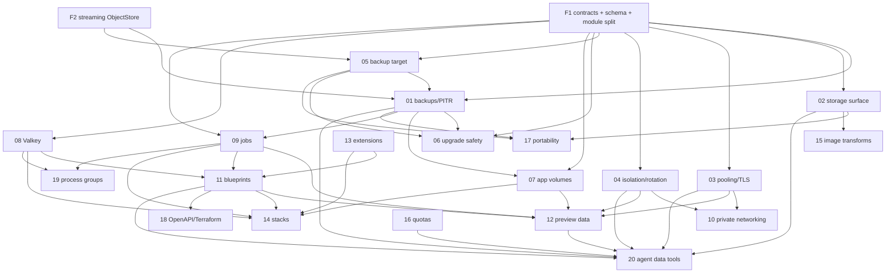

# Skiff data platform — parallel build plan

This directory turns the research report into executable work. The report is
[`reports/Skiff managed-data flagship features.md`](../../reports/Skiff%20managed-data%20flagship%20features.md).

Each numbered plan is a self-contained brief for one subagent. This document is the contract
between them: build order, dependencies, file ownership, integration gates, and the rules that
keep parallel work from turning into a merge war.

---

## 1. The strategy in one paragraph

Skiff already has the hard architecture: pull-based agents, immutable releases, one service layer,
scope ∩ role MCP, a ~250 MB baseline, and managed Postgres + RustFS. What it lacks is the data
product around them: provable restore, a real bucket surface, pooling and TLS, isolation, app
volumes, jobs, blueprints, preview data, and safe agent operations. Build the trust layer first
(0.5), then composition (0.6), then previews and depth (0.7), then agent data operations (0.8).
Do not start a new product category while restore is unproven.

---

## 2. Non-negotiable invariants

Every plan must preserve these. A PR that breaks one is rejected even if the feature works.

1. **Agents pull desired state.** No control-plane-to-agent command channel. Long-running work is a
   desired-state task plus a heartbeat result, or an agent-fetched activation.
2. **No shell.** The helper exposes fixed verbs and validated structured fields. No command string
   from the wire, ever.
3. **Immutable releases.** Promote/rollback move pointers; they do not mutate artifacts.
4. **One service layer.** REST, MCP, CLI, and dashboard call `packages/core`. No surface gets extra
   power.
5. **Secrets never enter desired state or its disk cache.** They arrive through the activation
   endpoint and live in agent memory or `0400` files.
6. **The control plane never reaches node loopback.** Backups, object listing, and restores execute
   on the node; the control plane schedules and records.
7. **≤250 MB edge baseline.** A new always-on daemon needs an explicit budget and an opt-in.
8. **No Kubernetes, no Docker daemon.** Rootless Podman/Quadlet and systemd only.
9. **One wildcard level** (`<slug>--<env>.<contentDomain>`) unless a plan explicitly changes it.
10. **Every destructive data action is audited and confirmed.** Restore, force bucket delete, purge,
    credential reveal, and preview teardown.
11. **Feature flags for destructive or risky work.** Default off until the acceptance tests pass on
    a real Debian 13 node.
12. **No new secret-returning MCP tool.** MCP may return resource IDs and status, never credentials.

---

## 3. Workstreams and lanes

| Lane | Theme | Plans | Primary owner |
|---|---|---|---|
| **A** | Data safety | 01 backups/PITR, 05 backup target, 06 upgrade safety | Data-safety agent |
| **B** | Storage product | 02 bucket surface, 15 image transforms | Storage agent |
| **C** | Runtime and network | 03 pooling/TLS, 04 isolation, 07 app volumes, 08 Valkey, 09 jobs, 10 private networking, 19 process groups | Runtime agent |
| **D** | Developer workflow | 11 blueprints, 12 preview data, 14 stacks, 17 portability, 18 IaC | Workflow agent |
| **E** | Platform and agent | 13 extensions, 16 quotas, 20 agent tools | Platform agent |

A plan may touch another lane's files only through the contract protocol in §7. The lane owner is
the reviewer for cross-lane changes.

---

## 4. Dependency graph



### Dependency table

| ID | Plan | Wave | Hard dependencies | Soft dependencies | Blocks |
|---|---|---|---|---|---|
| F1 | Contracts, schema, MCP/CLI module split | 0 | — | — | everything |
| F2 | Streaming `ObjectStore` | 0 | F1 | — | 01, 05, 17 |
| F3 | Debian 13/Podman e2e harness | 0 | — | — | 01, 02, 03, 04, 07 |
| F4 | Scheduler primitive | 0 | F1 | — | 01, 06, 12 |
| F5 | Feature flags + migration/rollback protocol | 0 | — | — | all destructive work |
| 01 | Backups, PITR, verified restore | 1 | F1, F2, F4 | 05 | 06, 07, 12, 17, 20 |
| 02 | Object-storage product surface | 1 | F1, F3 | 04 | 15, 17, 20 |
| 03 | Pooling, TLS, connection UX | 1 | F1, F3 | — | 10, 12, 20 |
| 04 | Isolation and credential lifecycle | 1 | F1, F3 | — | 10, 12, 20 |
| 05 | Self-hosted backup target | 1 | F1, F2 | — | 01, 06, 17 |
| 06 | Upgrade safety | 1 | F1, 01 | 05 | — |
| 07 | App volumes and snapshots | 2 | F1, F3, 01/05 for snapshots | — | 12, 14, 19 |
| 08 | Managed Valkey | 2 | F1 | 09 for queues | 11, 14, 19 |
| 09 | Jobs, cron, one-off | 2 | F1, F4 | 01 | 11, 12, 14, 19 |
| 10 | Cross-node private networking | 2 | 03, 04 | — | 12 |
| 11 | `skiff.yaml` blueprints | 2–3 | F1, 08, 09, 13 | 07 | 12, 14, 18 |
| 12 | Preview environments with data | 3 | 01, 04, 07, 09, 11 | 03, 10 | 20 |
| 13 | Postgres extensions and slow queries | 2 | F1 | — | 11, 14 |
| 14 | Curated stacks + compose import | 3 | 07, 08, 09, 11, 13 | 15 | — |
| 15 | Image transforms | 3 | 02 | 14 | — |
| 16 | Quotas and showback | 2 | F1 | — | 12, 20 |
| 17 | Data import/export/portability | 3 | 01, 02, 05 | — | — |
| 18 | OpenAPI, SDK, Terraform | 3 | 11 | — | — |
| 19 | Process groups | 2 | F1, 08, 09 | 07 | 14 |
| 20 | Agent data tools | 3 | 01, 02, 03, 04, 11, 12, 16 | — | — |

---

## 5. Wave plan

### Wave 0 — Foundations (serial, one integration owner, ~1–2 weeks)

All five land before parallel feature work starts. They are small, contract-only PRs. The detailed
brief is [`plans/00-foundations.md`](plans/00-foundations.md).

| Task | Deliverable | Exit |
|---|---|---|
| **F1** | Contracts and schema for `backup`, `backup-target`, `app-volume`, `job`, `blueprint`, `preview`, `bucket-config`, `pooler`, `extension`, `quota`; `WorkloadDesired` extensions; MCP/CLI tool modules extracted; migration numbering convention | `bun run check` green; contracts reviewed; no feature code |
| **F2** | `ObjectStore.putStream/getStream/list` and `S3ObjectStore` (any endpoint, path-style); local store streaming | Unit tests against a fake S3 and local fs |
| **F3** | Debian 13 + Podman ≥5 + netavark e2e fixture; a throwaway node harness; fake S3; Postgres fixture | One command runs the managed-data e2e lane |
| **F4** | `SchedulerService` primitive: due-task claim, idempotency key, lease, retry, result recording | Unit tests; used by 01 and 09 |
| **F5** | Feature flags (`SKIFF_FEATURE_*`), migration/rollback rules, pre-update snapshot hook | Documented; CI check; no flag on by default |

**Do not start Wave 1 until F1/F2 are merged.** A feature built against a moving contract will be
rewritten.

### Wave 0 integration checklist

When the five foundation branches are ready, merge in this order to minimise conflicts:

1. **F1 contracts** — new `packages/contracts/src/*` files, `index.ts` exports, additive
   `WorkloadDesired` fields. No schema, no services.
2. **F2 streaming ObjectStore** — `packages/core/src/object-store.ts` + tests; update call sites.
3. **F4 scheduler** — `scheduled_tasks` migration (next number), `scheduler.ts`, context/index,
   one line in `MaintenanceService`.
4. **F5 flags/migrations** — feature registry, config, `/api/setup/status`, CI migration check.
5. **F3 e2e** — harness, CI job, `docs/TESTING.md`.

For each merge:

```sh
bun install --frozen-lockfile
bun test
bun run check
bun scripts/check-migrations.ts   # after F5
```

Then verify the foundation invariants:

- A new contracts file imports without touching another domain's file.
- `WorkloadDesired` parses with and without the new optional fields.
- `putStream/getStream` round-trip a large object without a full buffer.
- The scheduler is idempotent, leases expire, and a retry is bounded.
- Every risky feature flag defaults off; `/api/setup/status` shows the resolved set.
- The e2e harness skips cleanly without Podman and runs the Postgres/RustFS lane with it.


| Lane | Plans | Notes |
|---|---|---|
| A | **05** backup target → **01** backups/PITR → **06** upgrade safety | 05 first; 01 can start with local target while 05 lands; 06 after 01's snapshot hook |
| B | **02** object-storage surface | Independent; start immediately after F1/F3 |
| C | **03** pooling/TLS and **04** isolation/rotation in parallel | Both touch helper network/unit code; assign one runtime reviewer |
| D | **09 scheduler primitive** (F4 already merged; this exposes the first consumer) and **16 quota schema** | 09's scheduler is used by 01; expose user jobs later in Wave 2 |

Exit: an operator can delete a production database, restore it to a verified new instance at a
chosen minute, undelete an object, survive 200 concurrent connections, and roll back a bad update.

### Wave 2 — Composition (parallel, ~4–5 weeks)

| Lane | Plans | Notes |
|---|---|---|
| A | **07** app volumes/snapshots | Snapshot path depends on 01/05; start with create/attach/disk admission |
| C | **08** Valkey, **09** full jobs/cron, **19** process groups | All three share `WorkloadDesired`; the F1 extension must be frozen |
| C | **10** private networking | Starts after 03 + 04 merge |
| E | **13** extensions, **16** quotas/showback | 13 is independent; 16 consumes telemetry |
| D | **11** blueprint contract + plan/apply skeleton | Start design early; full apply after 07/08/09/13 |

Exit: one repo runs web + worker + cron + Postgres + bucket from one file, on more than one node,
with backups and a tested restore.

### Wave 3 — Previews, packaging, agents (parallel, ~4–6 weeks)

| Lane | Plans | Notes |
|---|---|---|
| D | **11** complete, **12** preview data, **14** stacks, **17** portability | 11 first; 12 and 14 consume it |
| B | **15** image transforms | After 02 |
| D | **18** OpenAPI/SDK/Terraform | After 11 stabilizes |
| E | **20** agent data tools | Read-only tools can start after 01/02; destructive tools after 11/12/16 |

Exit: a PR gets an app, a database, and a bucket, and tears down cleanly; an agent stands up a full
stack and demonstrates a restore without reading a secret.

### Wave 4 — Hardening (1.0)

Docs, accessibility, upgrade rehearsal, performance re-measure on Debian 13, security review,
backup/restore drills on every supported engine, and removal of feature flags that are now default.

---

## 6. Critical path

```
F1 → F2 → 05 → 01 → 06
F1 → 11 → 12 → 20
F1 → 03 + 04 → 10
```

Anything that slips on this path slips the release. Protect it:

- F2 and 05 are small; do not let them become "storage rewrite".
- 01 should ship dump/restore first and PITR second. Do not block the release on PITR.
- 11 should ship plan/apply for one stack (site + Postgres + bucket) before it supports every
  resource.
- 12 should ship schema+seed previews before production-data forks.

---

## 7. Contract-first protocol

Parallel agents cannot see each other's uncommitted work. Every cross-lane dependency therefore
ships as a **contract PR** first.

A contract PR contains only:

1. Zod schemas and TypeScript types in a new `packages/contracts/src/<domain>.ts`.
2. The table definitions and one migration in `packages/db`.
3. The service method signatures with `throw new Error('not implemented')`, or a clearly marked
   `TODO` implementation.
4. A colocated contract test (parse/round-trip), not an integration test.
5. A one-paragraph note in the plan file: what changed and who consumes it.

Rules:

- **One domain, one contracts file.** Do not append to another domain's file.
- **One migration per feature.** Number after the latest (`0011_…`, `0012_…`). Never edit an
  existing migration.
- **`packages/contracts/src/index.ts` is integration-owned.** Add a one-line export in a separate
  integration commit; do not reformat the file.
- **Schema additions are append-only blocks** in `packages/db/src/schema.ts`, wrapped in a marker
  comment. The integration owner resolves ordering and exports.
- **No implementation may merge before its contract.** If a feature needs a field that does not
  exist, open a contract PR and wait.

### Shared `WorkloadDesired` extension

Plans 07, 09, 19, and 20 all need new fields on `WorkloadDesired`. F1 freezes this shape:

```ts
// Proposed; finalise in F1.
volumes?: Array<{ id: string; mountPath: string; readOnly: boolean }>;
processes?: Array<{ name: string; command: string[]; port?: number; healthPath?: string }>;
job?: { id: string; timeoutSeconds: number };
```

Keep it additive and optional so older agents ignore unknown fields. Do not overload `data`.

---

## 8. File ownership and conflict protocol

### Owned directories (safe to edit freely)

| Area | Owner |
|---|---|
| `packages/contracts/src/<domain>.ts` | the feature |
| `packages/core/src/<domain>.ts` and `<domain>.test.ts` | the feature |
| `apps/control-plane/src/routes/api/v1/<domain>/**` | the feature |
| `apps/control-plane/src/routes/(dashboard)/<domain>/**` | the feature |
| `apps/helper/src/<domain>.ts` (new module) | the feature, reviewed by runtime owner |
| `apps/agent/src/<domain>.ts` (new module) | the feature, reviewed by runtime owner |
| `apps/cli/src/commands/<domain>.ts` (new module) | the feature |
| `docs/<domain>.md` | the feature |

### Shared files (integration-owned; do not edit directly)

| File | Rule |
|---|---|
| `packages/contracts/src/index.ts` | one-line export, integration PR |
| `packages/db/src/schema.ts` | append-only marker block; integration owner merges |
| `packages/db/migrations/*` | one new file per feature; never edit old ones |
| `packages/core/src/context.ts`, `index.ts` | integration PR adds the service |
| `apps/control-plane/src/lib/server/mcp.ts` | add a tool module; integration PR registers it |
| `apps/control-plane/src/routes/api/v1/[...path]/+server.ts` | integration PR only |
| `apps/control-plane/src/routes/(dashboard)/+layout.svelte` | integration PR only (nav) |
| `apps/cli/src/main.ts` | add a module; integration PR wires the command |
| `apps/agent/src/main.ts` | runtime owner; feature adds a module and a hook |
| `apps/helper/src/server.ts`, `systemd.ts`, `units.ts` | runtime owner; feature adds a verb module and a test |
| `tests/rest.e2e.ts`, `tests/mcp-oauth.e2e.ts` | test owner; feature adds a case module |
| `README.md`, `docs/ROADMAP.md` | release owner; feature supplies a paragraph |

### Conflict rules

1. One plan, one branch, one worktree (`feat/NN-slug`). No shared branches.
2. Rebase on `main` at least daily; never merge `main` into a feature branch with unrelated
   changes.
3. If a PR touches a shared file, mark it `needs-integration` and keep the change to a single
   registration line.
4. If two features need the same field, the first contract wins; the second adapts or opens a
   follow-up. Do not duplicate types.
5. The integration owner merges contract PRs first, then feature PRs in dependency order. A
   feature PR that is green but blocked reports `blocked: <ID>` and stops; it does not edit the
   blocking feature.

---

## 9. Agent brief template

Copy this into every subagent prompt.

```text
You are implementing plan NN in the Skiff repository.

Read first:
- docs/build-plan/README.md
- docs/build-plan/plans/NN-<slug>.md
- the current code in the "Current state" section of that plan

Constraints:
- Preserve every invariant in docs/build-plan/README.md §2.
- Own only the files listed in the plan. Do not edit shared files without a contract PR.
- One migration file, numbered after the latest. Never edit an existing migration.
- No shell strings; helper verbs only.
- Secrets never enter desired state, logs, or MCP output.
- Add unit tests and one integration test. Run `bun test` and the package `check`.
- If blocked, stop and report the blocking plan ID; do not invent a workaround.

Deliverable:
- A PR with the plan's acceptance checklist ticked.
- A short handoff: files changed, tests run, deviations, follow-ups.
- If the change is user-visible, a docs update and a feature-flag note.
```

---

## 10. Per-PR checklist

- [ ] The plan's acceptance criteria are met, not just the happy path.
- [ ] `bun test` passes; the package `check` passes.
- [ ] New/changed behavior has a test that fails without the change.
- [ ] No secret is logged, stored in desired state, or returned by MCP.
- [ ] Destructive actions are audited and require confirmation.
- [ ] Migration is additive and reversible by restore/snapshot; no destructive `ALTER`.
- [ ] Feature flag exists and defaults off for risky work.
- [ ] Memory/CPU impact is measured against the 250 MB baseline.
- [ ] Docs updated (`docs/<domain>.md`, plan status, roadmap paragraph).
- [ ] The PR is rebased on `main`; no unrelated formatting.

---

## 11. Verification matrix

| Area | Unit | Integration | Real node | Security |
|---|---|---|---|---|
| Backups/PITR | `backup*.test.ts` | restore into a throwaway DB | Debian 13/Podman, 1 GB dump | encrypted artifact, no creds in logs |
| Object storage | `storage-admin.test.ts` | list/upload/download/delete | RustFS SigV4 + multipart | presigned scope, CORS, quota |
| Pooling/TLS | renderer tests | 200 concurrent connections | TLS handshake + `sslmode=require` | cert lifecycle, no plaintext |
| Isolation | network renderer | two orgs cannot resolve each other | netavark network | no public DB port |
| App volumes | mount renderer | attach/detach/snapshot | node volume + helper | fail-closed mount check |
| Jobs | cron parser, runner | one-off + scheduled | systemd transient unit | timeout, no overlap |
| Blueprints | schema/plan diff | apply then re-apply is a no-op | one full stack | no secret values |
| Previews | lifecycle | PR open/close, teardown | DB clone + bucket prefix | fork PR isolation |
| Agent tools | tool schema | OAuth scope matrix | — | server-side confirmation |

---

## 12. Feature flags and rollout

Use `SKIFF_FEATURE_<AREA>` environment flags, read once at startup and exposed in `/api/setup/status`.
Default off for:

- `BACKUPS_RESTORE` (until a restore drill passes)
- `PITR`
- `OBJECT_BROWSER`
- `POOLER`
- `APP_VOLUMES`
- `JOBS`
- `PREVIEW_DATA`
- `AGENT_DATA_WRITE`

Rollout order: dev → single-node test → Debian 13 node → installer default. Never enable a
destructive feature by default in the same release that introduces it.

---

## 13. Risk register

| Risk | Likelihood | Impact | Mitigation | Owner |
|---|---|---|---|---|
| Restore is wrong and users trust it | Medium | Critical | Restore-to-new default; verification query; monthly drill; feature flag | A |
| Backup scheduler silently stops | High (peer evidence) | Critical | Missed-run alert, last-success badge, external heartbeat check | A |
| RustFS CVE or S3 incompatibility | Medium | High | Pin digest, S3 conformance suite, Garage fallback, security review | B |
| Pooler breaks session semantics | Medium | High | Direct URL for migrations; document limits; per-attachment mode | C |
| Volumes fill the disk | High | High | Disk admission, quotas, 85% alert, reject create | C |
| Preview data leaks production | Medium | Critical | Schema+seed default; opt-in fork; fork PR isolation; TTL | D |
| Blueprints delete resources | Medium | High | Plan diff, `--prune` opt-in, typed confirmation | D |
| Agent tools become a confused deputy | Medium | Critical | Server-side confirmation, scope ∩ role ∩ env, read-only SQL | E |
| Helper verb becomes a shell | Low | Critical | Fixed verbs, structured fields, review by runtime owner | C |
| Parallel PRs conflict in shared files | High | Medium | Contract-first, append-only schema, integration owner | all |

---

## 14. Status board

Update this table as work lands. Use `not started` / `contract` / `in progress` / `blocked` /
`review` / `merged`.

### Reality check — 5 November 2026

The repository moved while the plans were being written. These are already shipped or partly
shipped; do not re-implement them. Verify the exact gaps before starting the plan.

| Area | Shipped | Still missing |
|---|---|---|
| Database backups | `database_backups`, `pg_dump -Fc`, manual/scheduled, retention, restore-to-new, `verified_at`, MCP/CLI/dashboard | PITR, S3-first artifact listing, backup targets, cross-node restore |
| Object storage | Object browser (list/upload/download/delete/presign), private gateway, CLI/MCP | Versioning, lifecycle, CORS, quotas, object lock, signed share links, image transforms |
| Pooling | Per-database PgBouncer sidecar, port allocation, unit rendering | TLS, pooled/direct UX, pool metrics, node-level pooler decision |
| Isolation | Credential rotation (`database_rotations`), sealed secrets | Per-org networks, TLS, named app/backup keys, encryption-at-rest proof |
| Extensions | `pgvector`/`pg_trgm`/etc. allowlist, `pg_stat_statements` slow queries | Verify on Debian 13; PostGIS image availability |
| Volumes | Node volumes for managed instances (D72–D80) | App volumes for workloads, snapshots, disk admission |
| Scheduling | Cron parser, backup `next_backup_at` sweep | Generic durable scheduler, user jobs, preview teardown |
| Agent/MCP | DB backups/restore/rotation tools | Read-only SQL, presigned URLs, plan/apply stack, fork, data health |

**Wave 1 is therefore narrower than originally planned.** The remaining P0 work is backup targets
(05), PITR (01b), TLS + connection UX (03b), bucket config (02b), per-org isolation (04b), and
upgrade safety (06). Do not rebuild the shipped halves.

| ID | Plan | Status | Branch | PR |
|---|---|---|---|---|
| F1 | Contracts/schema/modules | in progress | feat/wave0-f1-contracts | |
| F2 | Streaming ObjectStore | merged to integration — 36a5634, 14 tests | feat/wave0-f2-streaming-objectstore | |
| F3 | Debian 13 e2e | merged — 9642fef, 16 container checks | feat/wave0-f3-e2e | |
| F4 | Scheduler primitive | merged — 0e39d76, migration renumbered to 0017 | feat/wave0-f4-scheduler | |
| F5 | Flags/migrations | merged — f71c200, 22 tests | feat/wave0-f5-flags | |

Integration branch: `feat/wave0-foundations` at `472df3a` (four of five merged): 923 tests
pass, `bun run check` green, 17 migrations check clean. F1 still pending.
| 01 | Backups/PITR/restore | partial — logical backups shipped; PITR missing | | |
| 02 | Object-storage surface | partial — browser shipped; bucket config missing | | |
| 03 | Pooling/TLS | partial — pooler shipped; TLS/UX missing | | |
| 04 | Isolation/credentials | partial — rotation shipped; networks/TLS missing | | |
| 05 | Backup target | not started | | |
| 06 | Upgrade safety | not started | | |
| 07 | App volumes | partial — node volumes shipped; app volumes missing | | |
| 08 | Valkey | not started | | |
| 09 | Jobs/scheduler | partial — cron parser/backup sweep shipped; generic scheduler in F4 | | |
| 10 | Private networking | not started | | |
| 11 | Blueprints | not started | | |
| 12 | Preview data | not started | | |
| 13 | PG extensions | shipped — verify on Debian 13 | | |
| 14 | Stacks/compose | not started | | |
| 15 | Image transforms | not started | | |
| 16 | Quotas/showback | not started | | |
| 17 | Portability | not started | | |
| 18 | OpenAPI/Terraform | not started | | |
| 19 | Process groups | not started | | |
| 20 | Agent data tools | partial — backup/restore/rotation tools shipped | | |

---

## 15. What not to do while parallelising

- Do not let two agents implement the same service in two branches and "merge later".
- Do not add a field to `WorkloadDesired` in a feature PR; it is a contract PR.
- Do not edit `packages/db/src/schema.ts` outside your marker block.
- Do not write a migration that drops or rewrites a table with user data.
- Do not add an always-on daemon for a P1 feature; use the existing agent/helper.
- Do not ship a feature flag on by default in the release that adds it.
- Do not claim PITR, HA, or "verified restore" until the drill passes on a real node.
