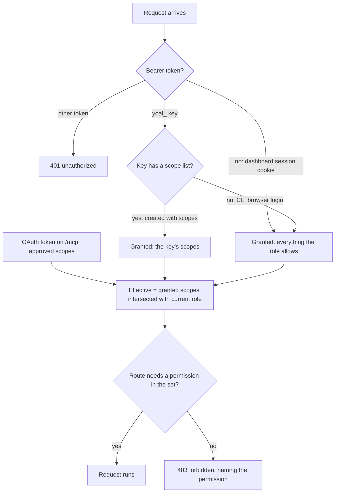

Yoal issues four kinds of credential: personal **API keys** for scripts and CI, the key that **`yoal login`** creates for you, **OAuth tokens** that MCP clients receive when you approve them, and the **service credentials** that give an app access to a database or bucket. This page covers how to create, scope, use and revoke each one. Your own sign-in, passkeys and two-factor settings are on [Sign-in and 2FA](/accounts/sign-in-and-2fa).

## The credentials at a glance

| Credential | Who it acts as | How you get it | Used for |
| --- | --- | --- | --- |
| API key (`yoal_…`) | You, limited to the scopes you choose | **Settings → API keys** | CI, scripts, the REST API |
| CLI login key | You, with your whole role | `yoal login` | Your own terminal |
| OAuth access token | You, limited to the scopes you approve | An MCP client's consent screen | MCP clients and agents |
| Service credentials | The database, bucket or mailbox | Attach it to a project, or run `yoal db credentials` and similar | Your app's own connections |

API keys and CLI keys are checked the same way, and OAuth tokens follow the same rule. Each request works out its **effective permissions**:

> Effective permissions = the scopes the credential was granted, intersected with your current role.

A key can never do more than you can, and a token keeps working only as far as your role still allows. If an owner or admin changes your role, every key and token you hold narrows at once. There is no need to revoke them first.

The diagram shows how a request's effective permissions are worked out, and where a denial comes from:



For MCP, a missing scope is not a plain 403. The server answers with an `insufficient_scope` challenge, so the client asks for that scope again and you approve it.

## Create an API key

Only owners and admins can create API keys. Other roles do not have the `apiKey:create` permission (see [Organisations and roles](/accounts/organizations-and-roles)).

1. Open **Settings → API keys** and select **Create API key**.
2. Give the key a name of up to 64 characters, such as `GitHub Actions deploy`. Names are how you recognise a key later, so name it after the place it is used.
3. Choose an expiry: **30 days**, **90 days**, **1 year** or **Never**. The server accepts any whole number of days from 1 to 365, or no expiry.
4. Choose the access. Start from a preset:
   - **Read-only** gives the read permissions of the viewer role: dashboards, monitoring and audits.
   - **Deploy** gives what a deployer has, which is what CI pipelines need to build, deploy and promote. It leaves out credentials and the database console.
   - **Everything I can do** mirrors your whole role, including destructive actions.

   You can then tick individual scopes. Scopes are grouped by resource, such as projects, deployments or databases, and named `resource:action`, for example `deployment:promote`. Scopes shown in red delete things or remove people. The counter in the dialog shows how many are selected.
5. Select **Create key**.

The full key starts with `yoal_` and is shown **once**, in a dialog that lists the scopes it was granted. Copy it straight into your secret store. If you lose it, create a new key and revoke the old one.

Once created, a key cannot be extended. If it is about to expire, create a replacement, update the places that use it, then revoke the old key. The page shows a warning for any key that expires within two weeks.

## Use a key

Send the key as a Bearer token. This lists your projects over the REST API:

```sh
curl -H "Authorization: Bearer $YOAL_TOKEN" https://control.example.com/api/v1/projects
```

The CLI reads the same key from `YOAL_TOKEN`. `YOAL_URL` sets the control plane it talks to:

```sh
export YOAL_URL=https://control.example.com
export YOAL_TOKEN=yoal_…
yoal status my-site
```

Environment variables take precedence over the saved configuration, so a CI job never depends on a file on the runner. For the full list of REST routes and response shapes, see [REST API](/clients/rest-api).

Each key has a rate limit of 100,000 requests per 24 hours.

## Keys created by `yoal login`

Running `yoal login` without a token opens an approval page in your dashboard. When you approve it, the CLI receives a new key. That key is named **Yoal CLI (browser login)**, and it is different from a key you create yourself in three ways:

- It has **no scope list**, so it acts with your whole role. It is not narrowed to a preset.
- It has **no expiry**.
- It is stored in `~/.config/yoal/config.json`, with mode `0600`, in the profile you logged in to.

Browser login needs the `apiKey:create` permission, and it needs a signed-in session that has passed your second factor if you are an owner.

`yoal logout` removes that key from the config file on your machine. It does **not** revoke the key on the server, so the key still works from anywhere it was copied to. To stop it, find it in **Settings → API keys** by its name and revoke it. Remember to do this when you leave a shared machine.

If you want a CLI on a server or in CI, create a scoped key yourself and use `yoal login --token <key>`, or set `YOAL_TOKEN`. Those keys are narrower than a browser login key.

## Use keys in CI

Store the key as a secret in your CI provider, and give the job only what it needs. A key from the **Deploy** preset with a 90-day expiry is a sensible default for a deploy pipeline.

This GitHub Actions workflow deploys a built folder whenever `main` changes. It needs one repository secret, `YOAL_TOKEN`:

```yaml
name: Deploy my-site
on:
  push:
    branches: [main]

jobs:
  deploy:
    runs-on: ubuntu-latest
    env:
      YOAL_URL: https://control.example.com
      YOAL_TOKEN: ${{ secrets.YOAL_TOKEN }}
    steps:
      - uses: actions/checkout@v4
      - run: npm ci && npm run build
      - run: npm install -g @yoal/cli
      - run: yoal deploy ./dist --project my-site --json
```

The `--json` flag prints the deploy result as JSON, which is easier to parse in later steps. When a command fails in `--json` mode, the error goes to stderr as `{ "error": { "code", "message", "suggestions" } }`, so the job log stays readable.

> [!WARNING]
> Never put a key in the workflow file, in a script, or on the command line. A key passed as `--token` can end up in shell history and process listings. Use a secret and the `YOAL_TOKEN` variable, as above.

## OAuth tokens for MCP clients

An MCP client, such as an AI agent, connects to Yoal with OAuth. The first time, Yoal shows a consent screen:

- The client's name and ID are shown at the top.
- Each requested permission is listed with a checkbox. The identity scopes (`openid`, `profile`, `email`, `offline_access`) and deployer-level permissions start ticked. Destructive permissions start unticked.
- Permissions your role does not include are listed but disabled.

When you connect a client, Yoal shows the consent screen. Select **Allow access** to grant the ticked scopes, or **Deny** to refuse. Tokens are limited to the granted scopes intersected with your role, as described above. If an agent later calls a tool that needs a scope it does not have, Yoal asks the client to request that scope again, and you approve it explicitly. Tokens work only on the MCP endpoint and are not accepted by the REST API. See [MCP](/clients/mcp) for the tools each scope unlocks.

## Connected apps

**Settings → Connected apps** lists every MCP client and agent you have approved on the consent screen. Each row shows:

- **App:** the name the client gave, its client ID, whether it identified itself with a metadata document or registered itself, and when you approved it.
- **Access:** how many permissions you granted, with a separate count of destructive ones. Open it to see every scope, including the sign-in scopes such as `offline_access`.
- **Last used:** when the client last called `/mcp` for you, or else when it last refreshed its token. **Not used yet** means neither has happened.

A client that you approved more than once, for example after granting it a new scope, appears once with all the scopes you granted.

### Disconnect an app

Select **Disconnect** on the app's row and confirm. Yoal deletes your approval and every refresh token the client holds. Access tokens are not stored on the server, so Yoal also checks your approval on every call to `/mcp`: the client's next call is refused with `401` and a fresh sign-in challenge, even if its last access token had not expired yet. To use the client again, connect it again and approve it on the consent screen. Disconnecting is recorded in the audit log as `connected_app.revoke`.

Owners and admins also see **Other members' connected apps**, with the member each approval belongs to, and can disconnect them. Only an owner can disconnect an owner's apps; an admin sees **Owner only** on those rows.

### Connected apps over the REST API

| Method | Path | Purpose |
| --- | --- | --- |
| GET | `/api/v1/connected-apps` | Your connected apps, most recently used first. Add `?scope=org` for every member's apps in the organisation, which needs `member:remove`. |
| DELETE | `/api/v1/connected-apps/{id}` | Disconnect the app with this approval ID. Your own needs no permission; another member's needs `member:remove`, and an owner's needs an owner. |

Each entry has an `id`, `clientId`, `name`, `uri`, `registration` (`metadata-document` or `registered`), `scopes`, `createdAt`, `updatedAt`, `lastUsedAt`, `activeRefreshTokens` and the `user` it belongs to. Times are milliseconds since the epoch. This disconnects the first app in your list:

```sh
id=$(curl -s -H "Authorization: Bearer $YOAL_TOKEN" https://control.example.com/api/v1/connected-apps | jq -r '.connectedApps[0].id')
curl -X DELETE -H "Authorization: Bearer $YOAL_TOKEN" "https://control.example.com/api/v1/connected-apps/$id"
```

The answer to a disconnect is `{ "revoked": true, "clientId", "userId", "refreshTokens" }`, where `refreshTokens` is how many refresh tokens were deleted.

## Permissions by role

Your role decides the ceiling for every credential you hold. These are the defaults for each role:

| Role | Creates API keys | Deploys and promotes | Reads credentials |
| --- | --- | --- | --- |
| Owner | Yes | Yes | Yes |
| Admin | Yes | Yes | Yes |
| Deployer | No | Yes | Database, storage, broker and email credentials (`*:credentials`) |
| Viewer | No | No | No |

A deployer can use the credentials permissions, but the **Deploy** preset leaves them out, so a deploy key cannot read a database password unless you tick that scope.

To change someone's role, see [Organisations and roles](/accounts/organizations-and-roles).

## Service and attachment credentials

Databases, object storage, message brokers and email each have their own credentials. These are not API keys. They let an app connect to its data service.

- **Attached projects** get connection settings as environment variables when they are activated. For databases this is `DATABASE_URL` and related variables, and for object storage it is an `S3_` set of endpoint, key and bucket variables. See [Databases](/data/databases) and [Object storage](/data/object-storage).
- **Reading the credentials** of a database, bucket or broker with `yoal db credentials`, `yoal storage credentials` or `yoal broker credentials` needs the `database:credentials`, `storage:credentials` or `broker:credentials` permission on the key, and each read is audited. MCP clients never receive them. Email credentials are gated by `email:credentials`. See [Email](/data/email).

Keep these out of the **Deploy** preset unless the pipeline really needs them.

## Node tokens

Nodes join a Yoal cluster with a join token, and their credentials can be rotated. These are platform operations, not organisation ones. Only a platform admin working in their own dashboard session can create a join token, drain a node or rotate a node's token. API keys and OAuth tokens never carry platform scope, so a narrow key cannot create node credentials. See [Nodes and fleet](/self-hosting/nodes-and-fleet).

## Keep your credentials safe

- **Use the narrowest preset that works.** Start from **Deploy** or **Read-only**, and add scopes only when a failure proves you need them.
- **Give every pipeline its own key.** When one is compromised, you revoke that key and nothing else breaks.
- **Use short expiries.** Thirty or ninety days is enough for most CI. Rotate before the warning appears.
- **Check last use.** The **Last used** column shows when a key last made a request. Revoke keys that are no longer used, and disconnect agents you no longer use in **Settings → Connected apps**.
- **Revoke, do not just delete the secret.** Revoking a key in **Settings → API keys** stops it on the server at once. Removing it from your CI secrets only stops your pipeline from using it.
- **Watch for destructive scopes.** Red scopes delete things or remove people. Leave them unticked unless the key's job is to do that.
- **Sign in carefully.** Creating keys, and approving CLI logins, needs a signed-in session. Owners must also have passed their second factor first. Keys themselves do not ask for a second factor. See [Sign-in and 2FA](/accounts/sign-in-and-2fa).
- **Read the audit log.** Actions taken with a key are recorded against that key, so you can see what a credential did. See [Security model](/accounts/security-model).
