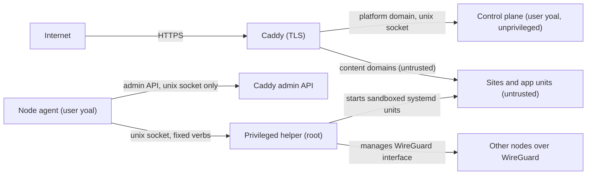

This page describes the protections Yoal builds in and where the trust boundaries sit. It is written for operators deciding whether to run Yoal, and for anyone who needs to know what a site or an agent can and cannot reach. Installation choices are in [Installation](/self-hosting/installation) and [Configuration](/self-hosting/configuration); sign-in and second factors are in [Sign-in and 2FA](/accounts/sign-in-and-2fa).

## One service layer

The dashboard, the REST API, the MCP server and the dashboard assistant all call the same service layer. The `yoal` CLI goes through the REST API. Every operation checks the caller's permissions before it runs and writes an audit entry, so no surface can do more than another.

Tokens never widen access. A token's effective permissions are the scopes it was granted, intersected with the user's current role in the organisation. API keys and OAuth tokens never carry platform-admin rights, so a narrowly scoped key cannot mint node credentials. See [Organisations and roles](/accounts/organizations-and-roles) and [API keys and tokens](/accounts/api-keys-and-tokens).

## Two domains

Yoal serves the dashboard on one origin, for example `control.example.net`, and every site on a subdomain of a content domain, for example `*.example.com`. Deployed content is code written by you or by an agent, so the dashboard must treat it as untrusted.

The recommended setup puts the two on **separate registrable domains**. A script running on a site is then cross-site to the dashboard, and platform session cookies are never sent to a site host.

### Shared-domain mode

If the dashboard sits under the content domain, for example `control.example.com` with sites at `example.com`, the installer accepts it and warns that both names share a registrable domain. Yoal cannot separate them in that case, so it relies on the following, which stay on in both modes:

- On HTTPS installs, session cookies use the `__Host-` prefix. A `__Host-` cookie must be `Secure`, must have no `Domain` attribute and must use `Path=/`, so a sibling host cannot overwrite it.
- Every state-changing request passes the Origin check described below.
- Reserved slugs stop a site taking a platform hostname.
- The dashboard shows a persistent warning while shared-domain mode is active.

Use a separate content domain if you can.

## Deployed content is untrusted

### Origin checks

Every request that changes state (any method other than `GET`, `HEAD` or `OPTIONS`) must send an `Origin` header equal to the platform origin. If a client sends no `Origin`, the request must carry `Sec-Fetch-Site: same-origin`. Anything else gets a `403`.

A short list of endpoints authenticate with a bearer token or a signature instead of a cookie, so a cross-site page gains nothing by calling them. These are exempt from the check. They include the OAuth token, register, revoke and introspect endpoints, the CLI token exchange, the MCP endpoint, the site-login bridge, and the node-agent, object and webhook paths.

Platform pages are never framed. Every response carries `X-Frame-Options: DENY` and `frame-ancestors 'none'`, which protects the consent and CLI approval pages from clickjacking.

### Cookies

- Platform session cookies use the `__Host-` prefix on HTTPS installs, as above.
- The site visitor cookie is host-only, so it is sent only to the site that set it. It is `HttpOnly`, `SameSite=Lax` and, on HTTPS, `Secure`. Its value is an HMAC signature, so it cannot be forged or altered.

### Slugs

A project slug becomes a hostname, so the rules are strict:

- 3 to 40 characters, lowercase letters, digits and single hyphens. It must start and end with a letter or digit. Underscores are not allowed.
- No double hyphen. `--` separates a slug from a preview ID, as in `my-site--abc123.example.com`.
- Reserved names cannot be used, including `api`, `auth`, `mcp`, `admin`, `www`, `control`, `mail`, `login`, `status`, `static`, `assets`, `preview`, `yoal`, `support`, `billing`, `internal` and `system`.
- A slug is unique across the platform. A taken slug is refused with suggestions.

### Protected sites

A site's access mode is `public`, `password` or `platform`, and each environment sets its own. See [Access and sharing](/deploying/access-and-sharing).

For a protected site, the proxy asks the node agent whether the visitor is allowed. The agent does this without calling the control plane for each request. When a visitor who is not signed in opens a protected site, they go to the platform to sign in or enter the password. The platform then redirects them back to the site with a one-time token that expires within about a minute. The agent checks the token's signature with a per-site key, refuses any token it has already accepted, and sets the site's host-only cookie. The platform's own session cookie is never sent to the site.

## Least privilege

The diagram shows the same boundaries from the internet inwards. Platform traffic and content traffic reach different places, and only the helper runs as root.

| Process | Runs as | What it can do |
| --- | --- | --- |
| Control plane | `yoal` | Writes only its data directory and runtime socket. Runs under a systemd sandbox with `ProtectSystem=strict` and `NoNewPrivileges`. |
| Node agent | `yoal`, with `caddy` as a supplementary group | Renders and applies Caddy's configuration. Has no root access. |
| Caddy | `caddy` | Serves sites and terminates TLS. |
| Privileged helper | `root` | The only process with root. It accepts a fixed set of verbs on a local socket. |
| App workloads | An unprivileged user per unit, or a per-container user namespace | Each runs inside its own systemd sandbox. See [App units](#app-units). |

### Caddy's admin API

Caddy's admin API listens on a unix socket only. Yoal never opens the default TCP admin port, so nothing on the network can reach it. The agent reaches the socket through group permissions.

### The privileged helper

The helper is the only component that runs as root, and it is deliberately small.

- It listens on a unix socket in a root-owned directory, with the socket readable by the `yoal` group. The helper refuses any configuration that grants permissions to other users.
- It has no passthrough and no shell. Each route is a fixed verb, such as applying or removing a workload, reading its logs, or starting and stopping a named unit. A request cannot name a command to run.
- It validates every request itself and does not trust the control plane or the agent. Identifiers and names must match fixed patterns. Container images must be valid OCI references with no `..` and no shell characters. Commands are argument arrays, with no newlines or control characters and at most 64 arguments. Paths must be absolute and normalised. Request bodies are capped at 8 MiB by default.
- Before the first app container starts, it adds a `containers` subuid/subgid range to `/etc/subuid` and `/etc/subgid` and refuses to continue if another account's range overlaps it. That range gives each container its own user namespace.
- Malformed input gets a `400` and nothing is attempted. Unknown routes get a `404`.
- It does not import the shared contracts package, so the privileged code checks the wire format on its own.

### App units

Each workload runs as its own systemd unit, and the sandbox depends on its kind:

- **Process apps and functions** get `DynamicUser=yes`, so each unit runs as its own unprivileged user. They also get `NoNewPrivileges`, `ProtectSystem=strict` with writable paths listed explicitly, `ProtectHome`, `PrivateTmp` and `PrivateDevices`, protected kernel tunables and control groups, an empty capability bounding set, restricted address families and namespaces, and memory and CPU limits.
- **Container apps** get a user namespace of their own (`UserNS=auto`), so uid 0 in the container maps to an unprivileged host uid from the node's `containers` subuid/subgid range. They drop all Linux capabilities, set `NoNewPrivileges`, and run with a read-only root filesystem. Writable volumes and secret files are owned by the mapped uid when the container starts.
- **Runners** are containers too, and get the same user namespace.
- **Databases, object storage and brokers** run as the image's fixed non-root user with `NoNewPrivileges` set. They do not get a user namespace, because their images and data directories are owned by that uid.

Functions also cannot reach private network addresses. Their units deny traffic to `10.0.0.0/8`, `172.16.0.0/12`, `192.168.0.0/16`, the link-local ranges and the IPv6 unique-local range.

## Secrets

- **Envelope encryption.** Each organisation has its own 256-bit data key. The key is stored wrapped by the master key. Secret values are encrypted with AES-256-GCM under the data key.
- **Master key.** The control plane needs a 32-byte base64 master key, read from `YOAL_MASTER_KEY` or from the file named by `YOAL_MASTER_KEY_FILE`. The installer seals it with `systemd-creds` into `/etc/yoal/master.key.cred`, bound to the server's TPM2 chip and host key, or the host key alone when there is no TPM2. systemd decrypts it only into the control plane's private credential directory through `LoadCredentialEncrypted`, so the plain key is never on disk and the sealed file cannot be opened on another machine. The TPM2 binding uses no PCR policy, so a firmware or Secure Boot update does not lock the control plane out. On systemd older than 250 the key is a root-only file with mode `0400`, passed through `LoadCredential`.
- **Rotation.** `yoal-rotate-master-key` replaces the master key and re-wraps every organisation's data key with it in one transaction, so no secret has to be re-encrypted. See [platform backups](/self-hosting/platform-backups#rotating-secrets).

> [!WARNING]
> The master key decrypts every secret. Keep a recovery kit somewhere safe, separately from the server: the sealed key file is not a backup, because it only opens on that server. Without the key, a restored database cannot read its secrets. See [platform backups](/self-hosting/platform-backups#recovery-kit).

- **Write-only.** The REST API and MCP server can create, list and delete secrets, but they never return a value. List calls return names, types, versions and scopes. The only read is internal: values are decrypted when a workload is activated and sent to the node that runs it.
- **Names and scope.** Names must be `UPPER_SNAKE_CASE`. A project's secret shadows an organisation secret with the same name. A project never resolves another project's secrets.
- **Delivery.** The helper writes each value to a root-only file with mode `0400`. Environment values go into an env file, and file-delivered secrets are loaded with `LoadCredential`. Neither puts a value on a command line.
- **Rotation.** Setting a secret creates a new version. Workloads that use the name are restarted with the new value.
- **Audit.** Setting a new name records `secret.create`, and setting a new version of an existing name records `secret.update`. Both record the name, scope, type and version. Deleting records `secret.delete`. None of them records the value.

Plain environment variables are a separate, readable type. Use a secret for anything sensitive.

## Auditing

Every change made through any surface is written to the audit log, with the actor type (user, API key, MCP client, assistant or system), the client identifier, the action, the resource and its ID, the result and the arguments. Client IP addresses are stored only as a hash. Argument keys that look like secrets, such as `secret`, `password`, `token`, `key` and `authorization`, are stored as `[redacted]`.

Reads are not audited, except for revealing a credential, which is. For the fields, filters and the API, see [Dashboards, logs and audit](/observe/dashboards-and-logs).

## Confirmations for agent actions

Agents read untrusted text, such as logs, page content and database rows, and that text can contain instructions. Yoal therefore does not let an agent make production-changing or destructive calls unseen:

- In the dashboard assistant, a set of tools always stops at a confirmation card. Those cover publishing or promoting sites, creating share links and presigned URLs, rolling back, changing workload configuration, rotating database credentials, restarting services, sending email, and invoking functions. The approval is bound to your user, your organisation, the tool and its exact arguments, and it expires after 10 minutes. The server checks it again before running the tool. See [Assistant](/clients/assistant).
- On the MCP server, destructive tools ask the person to confirm when the client can show the prompt. A client that cannot show it is refused for email sending rather than sending silently. See [MCP](/clients/mcp).

## Owner accounts

On production installs, an owner must verify a passkey or an authenticator app before their session can reach anything beyond the verification page. Sessions that have not passed the check are sent to it, and API calls get a `403` until they have. See [Sign-in and 2FA](/accounts/sign-in-and-2fa).

## Network

- Agents on other nodes authenticate to the control plane with node tokens, not cookies.
- Multi-node clusters can connect their nodes over a WireGuard overlay. The helper creates the WireGuard interface and manages its keys. For the cluster set-up, see [Clustering](/self-hosting/clustering).

## Reporting a vulnerability

Please report security issues privately through [GitHub security advisories](https://github.com/KieranHolroyd/yoal/security/advisories/new), not in a public issue.
