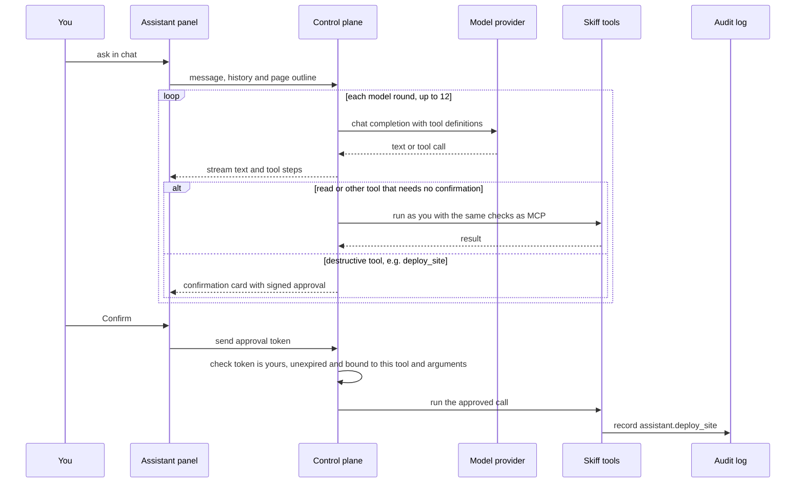

The dashboard assistant is an optional chat panel in the Skiff dashboard. You can ask it how something works, ask for the state of your projects, databases and fleet, and ask it to make changes. It uses the same tools as the [MCP server](/clients/mcp), so it can do no more than the signed-in user, and every call is audited. It stays off until an owner connects a model provider.

## Enable the assistant

Only an owner can configure the assistant. Open **Settings → Assistant** and fill in:

- **Provider**: the kind of endpoint, see the table below.
- **Base URL**: the `/v1` URL of an OpenAI-compatible server.
- **Model**: the model id that server serves.
- **API key**: only if the endpoint needs one.

Saving checks the endpoint first. Skiff calls `GET <base URL>/models`, and if the server does not implement that, it sends a one-token test completion. If the check fails, nothing is saved and the form shows the reason. A successful save writes the settings to the host and restarts the dashboard for a few seconds. **Test provider** runs the same check against the saved settings, and **Remove** clears the configuration so the launcher disappears after the restart.

The API key is write-only. The form shows only whether a key is saved, and a blank field keeps the saved key.

### Supported providers

| Provider | Base URL | Notes |
|---|---|---|
| OpenAI | `https://api.openai.com/v1` | API key required |
| OpenRouter | `https://openrouter.ai/api/v1` | API key required. The model field becomes a searchable picker |
| vLLM, LM Studio or another compatible gateway | Your `/v1` URL | Key only if the gateway needs one. Type the model id |
| Ollama | `http://127.0.0.1:11434/v1` | Usually no key. Use a model you have pulled |

Any server that speaks OpenAI-compatible chat completions can be used. Pick a model that supports tool calling. The assistant checks your account through tools, so a model without that support answers without looking anything up.

With **OpenRouter** selected, the model field lists the models in OpenRouter's public catalogue that can call tools, with their context length and prices. The list is only loaded on the Settings → Assistant page, for owners.

### Configure with environment variables

On a host where the dashboard does not manage settings, set the assistant in the environment:

```sh
SKIFF_ASSISTANT_PROVIDER=openai          # openai | openai-compatible | openrouter | ollama
SKIFF_ASSISTANT_BASE_URL=https://api.openai.com/v1
SKIFF_ASSISTANT_MODEL=gpt-4.1-mini
SKIFF_ASSISTANT_API_KEY=sk-...
SKIFF_ASSISTANT_DISABLED=1               # switches the assistant off
```

If `SKIFF_ASSISTANT_PROVIDER` is unset, the provider is `openai-compatible`. If `SKIFF_ASSISTANT_BASE_URL` is unset, the provider's address from the table above is used. The assistant is on when `SKIFF_ASSISTANT_MODEL` is set and `SKIFF_ASSISTANT_DISABLED` is not `1`. On a development server, the Settings page saves the same values to `platform-settings.json` in the data directory. See [configuration](/self-hosting/configuration) for how the other settings are managed.

### Instructions and tools

Below the provider settings, **Instructions and tools** (owner only) lets you change three things:

- The system prompt, up to 12,000 characters. The chat panel's formatting rules are added to it either way.
- A model override. Leave it empty to use the configured model.
- Which tools the assistant may call. **Every tool** is the default and includes tools added in later releases. Turning it off lets you pick an exact list, which must contain at least one tool.

**Reset** returns all three to the built-in defaults. Changes apply to the next turn, with no restart. Saves and resets are audited as `platform.assistantAgent` and `platform.assistantAgentReset`.

## Using the panel

Press **⌘I** (or Ctrl+I) to open the panel. It opens beside the page without covering the dashboard. From its menu you can make it wider, or dock it beside the page on screens 1024 px and wider.

- **Conversations** are saved in this browser's local storage, separately for each signed-in user. Up to 40 are kept, and pinned ones are kept first. Skiff does not store them on the server. Use `/history` to search, pin, rename and delete them.
- **Slash commands** are `/new`, `/history`, `/retry`, `/clear`, `/export`, `/status`, `/tour` and `/help`.
- **Mentions**: type `@` to pick a project, database or storage instance. It inserts the name, such as `@launch-page`, and the assistant looks it up with a tool.
- **Page context** is shared by default. A chip under the composer shows this, and clicking it stops sharing. While it is off, the assistant cannot see the page you are on.
- **Recovery**: **Stop** keeps the partial reply. **Regenerate** runs the last turn again. Editing your last message (**Edit**, or ↑ in an empty composer) replaces that turn and everything after it.
- **Tool steps** show under each reply: the tool, its status, how long it took, its arguments and an excerpt of the result.

## What it can do

The assistant can use every MCP tool the signed-in user is allowed to call. That covers projects, deployments, releases and environments, databases, storage, nodes, logs, metrics, the audit log, dashboards and alerts. It does not get tools for write actions the user lacks permission for. Those tools are not offered at all, so a viewer is not offered a delete it cannot run.

It can also search and read this documentation (`search_docs` and `read_docs`), for the platform version you are running. Ask it how something works and it answers from the docs, with a link to the page.

A chat turn runs like this. Read-only calls run as soon as the model makes them. A destructive call stops the turn for a click:



It can also use one tool of its own, `guide_user`, to show a guided tour. A tour has up to eight steps. Each step can navigate to a dashboard path first, then spotlight an element by its `data-skiff-target` id or a CSS selector, with a short title and body. Ask it "where do I…" and it will usually point at the element rather than describe where it is.

Each turn runs at most 12 model rounds and 24 tool calls by default. Both limits are set in **Settings → Assistant → Turn limits**.

## Confirmations

Actions that deploy, promote or roll back, change access or workloads, create share links or presigned URLs, rotate or restore database credentials, restart services, send email, or send, redrive or run queue and function work stop for a click. The list covers every tool marked as destructive plus a fixed set, and includes `deploy_site`, `promote_deployment`, `rollback`, `set_access`, `create_share_link`, `presign_object`, `send_email`, `restore_database`, `update_database` and `invoke_function`. Other tools run as soon as the model calls them, under the same permission checks as the MCP server.

When the assistant proposes one of these actions, the chat shows a card with the tool name and its arguments.

- **Confirm** runs the action. **Cancel** leaves everything unchanged.
- The approval is a signed token bound to your user, your organisation, the tool and the exact arguments. It expires after 10 minutes. The confirm endpoint checks the token and the permissions again before it runs the tool.
- A turn stops after the first confirmation card, so the assistant does not queue more destructive steps.
- After an action completes, **Ask Skiff to follow up** asks the assistant to check the result.

The assistant reads logs, page content and database rows, and any of them can contain text that tries to give instructions. The confirmation step means such text cannot publish a site, mint a link or rotate a credential on its own.

## Permissions

- Opening the chat needs project read access. Without it, the endpoint returns `403`.
- The assistant acts as you. It cannot do anything you cannot do in the dashboard or through the [MCP server](/clients/mcp).
- Settings → Assistant, including the instructions and tool list, is for owners only.

For roles and what each one may do, see [organisations and roles](/accounts/organizations-and-roles).

## Audit

Every tool call is recorded as `assistant.<tool>`, for example `assistant.deploy_site`, with resource `assistant`, the user and the result. Inline file contents are summarised rather than stored. Confirmed actions are recorded the same way when they run.

Each turn also records `assistant.chat`, with the length of your message and the page path. The text of your message is not stored in the audit log.

## Privacy

Every turn sends the following to the model provider you configured:

- The system prompt, either the built-in one or the owner's version, and the tool definitions (names, descriptions and argument schemas).
- Your message and the text of the current conversation, up to 30 messages.
- The current page, if you are sharing it: its path, title, project slug and up to 50 labelled elements with their ids and selectors.
- The result of every tool the model calls. This can include project names, URLs, deployment and runtime logs, site content, database rows and metrics.

No tool returns database or storage credentials, so the model never receives them. Apps attached to a database or bucket get those values as environment variables.

The provider sees all of this, so choose one you trust. A model that runs on the control-plane host, such as Ollama at its default address, keeps this traffic on that host.

## Limits

| Limit | Value |
|---|---|
| Message length | 8,000 characters |
| History sent per turn | Up to 30 messages, 12,000 characters each |
| Page elements sent to the model | 50 |
| Model rounds per turn | 12 by default (1 to 50, Settings → Assistant) |
| Tool calls per turn | 24 by default (1 to 200, Settings → Assistant) |
| Tool result given to the model | 40,000 characters |
| Result excerpt in a tool step | 4,000 characters |
| Chat turns per user per minute | 12 by default (1 to 120, Settings → Assistant) |
| Provider request timeout | 120 seconds |
| Confirmation lifetime | 10 minutes |
| Saved conversations per browser | 40 |

The turn limit is counted in memory by each control-plane process.

## Troubleshooting

| Symptom | Cause |
|---|---|
| No launcher. The API returns `503` with `assistant_not_configured` | No model is set, or `SKIFF_ASSISTANT_DISABLED=1` |
| "The model provider answered 401" or 404 | Wrong key, wrong base URL, or the model is not served there. The message points to Settings → Assistant |
| "The model provider timed out" | No answer within 120 seconds |
| `429` with `rate_limited` | More than the turn limit in one minute. Wait for the retry time shown |
| "This confirmation has expired" | Approvals last 10 minutes. Ask the assistant again |
