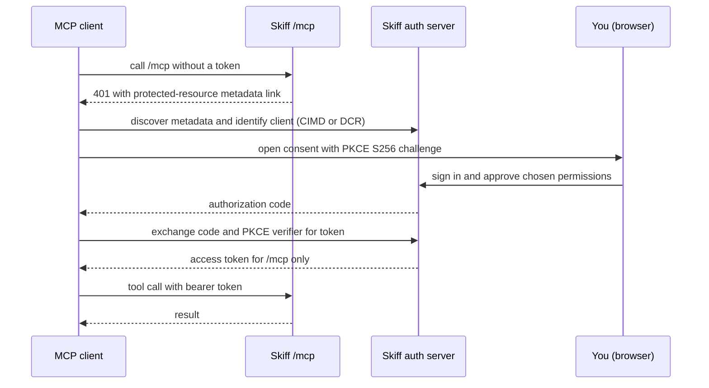
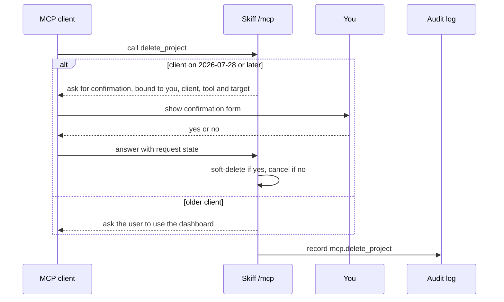

Skiff runs a remote [Model Context Protocol](https://modelcontextprotocol.io) server at `/mcp` on your control plane. An agent connected to it can deploy sites, manage projects, databases, queues, object storage, alerts and email, and read logs. Every tool calls the same service layer as the dashboard, the REST API and the `skif` CLI, so an agent can do no more than you could do yourself. This page covers connecting a client, what you approve on the consent screen, how permissions and confirmations work, and the full tool list.

## Connect a client

The endpoint is your control plane's origin with `/mcp` added, for example `https://control.example.com/mcp`. In Claude Code, add it as a remote server:

```sh
claude mcp add --transport http skiff https://control.example.com/mcp
```

Claude.ai and other clients that support remote MCP servers take the same URL in their own settings. The client finds the authorization server by itself, so you don't create client IDs or secrets by hand. If a client doesn't start sign-in on its own, run `/mcp` in Claude Code and choose `skiff`.

> [!NOTE]
> MCP accepts OAuth tokens only. An API key (`skif_…`) does not work at `/mcp`. Scripts and CI should call the [REST API](/clients/rest-api) or the [CLI](/clients/cli) with a key instead; see [API keys and tokens](/accounts/api-keys-and-tokens).

## How authorization works

Skiff is an OAuth 2.1 authorization server for MCP clients. The flow is:

1. **Discovery.** An unauthenticated request to `/mcp` gets an RFC 9728 challenge that points the client at Skiff's protected-resource metadata. The client then reads the authorization server metadata from the `/.well-known/` paths on your control plane.
2. **Client identity.** A client identifies itself with a Client ID Metadata Document (CIMD), the mechanism in the MCP 2026-07-28 revision. Older clients register dynamically (DCR). DCR is on by default. An operator can turn it off with `SKIFF_MCP_ALLOW_DCR=0`, which leaves only CIMD clients able to connect.
3. **PKCE.** The client proves possession of its code verifier with the `S256` method. Skiff requires PKCE for public clients.
4. **Consent.** You approve the client on the consent screen, described below.
5. **Tokens.** The access token is issued for the `/mcp` resource only, and the REST API does not accept it.

The first connection runs like this:



### The consent screen

The consent screen lists every permission the client asked for, with a count of how many are selected. You choose what to allow, then select **Allow access** or **Deny**.

- The sign-in scopes (`openid`, `profile`, `email`, `offline_access`) and the deployer-level permissions are ticked by default.
- Credential and console permissions (`database:credentials`, `storage:credentials`, `broker:credentials`, `email:credentials`, `database:console`) start unticked, because revealing passwords is a human decision.
- Destructive permissions carry a **destructive** badge and start unticked.
- Permissions your role does not include are shown greyed out with **not in your role**, and you cannot select them.

If you own the organisation and have not verified a second factor yet, Skiff sends you to the two-factor page before the consent screen appears. See [sign-in and two-factor](/accounts/sign-in-and-2fa).

### Asking for more later

Clients ask for the permissions they need as they need them. When a tool needs a permission the token does not have, Skiff answers with `403 insufficient_scope`, and the client starts authorization again with the complete set. You see the consent screen again and approve the extra permission. A new permission outside the default set starts unticked, so tick it deliberately.

### Disconnecting a client

Every client you approve is listed in **Settings → Connected apps**, with the permissions you granted and when it last called. Select **Disconnect** to revoke it. Skiff deletes the approval and the client's refresh tokens, and checks the approval on every call to `/mcp`, so the client's next call gets `401` with the same `WWW-Authenticate` challenge as an unauthenticated request, even if its access token has not expired. Most clients then start authorization again, and the client can only reconnect after you approve it on the consent screen once more. Owners and admins can also disconnect other members' clients. See [connected apps](/accounts/api-keys-and-tokens#connected-apps), which also covers the REST routes.

## Permissions

A token's effective permissions are its granted scopes **intersected with your current role** in the organisation. Scope names are the same `resource:action` strings used by the REST API and the CLI. Skiff reads your role on every call, so demoting someone narrows every token they hold straight away. Removing them from the organisation ends their access at the next call.

The roles are:

- **owner** and **admin** hold every permission.
- **deployer** can create, read, update and deploy, but cannot delete.
- **viewer** can read only.

See [organisations and roles](/accounts/organizations-and-roles) for how roles are assigned.

These are the permissions the MCP tools use. The tables in the catalogue below name the one each tool needs.

| Permission | Lets an agent |
|---|---|
| `project:read` | List and read projects, environments, volumes, usage, quotas, nodes, status and the audit log |
| `project:create` | Create projects (`deploy_site` also creates a missing project) |
| `project:update` | Rename or re-place projects, set access, create environments and volumes, and attach or detach resources |
| `project:delete` | Soft-delete projects |
| `deployment:read` | List deployments, and read workloads and functions |
| `deployment:create` | Deploy sites and files, run uploads, invoke functions and run their cron handlers |
| `deployment:promote` | Point production or an environment at an existing deployment |
| `deployment:rollback` | Move an environment back to its previous deployment |
| `database:read`, `database:create`, `database:update`, `database:delete` | Read, create, change and delete managed databases |
| `storage:read`, `storage:create`, `storage:update`, `storage:delete` | The same for object storage |
| `broker:read`, `broker:create`, `broker:update`, `broker:delete` | The same for queue brokers and event rules |
| `email:read`, `email:update`, `email:send` | Read sending domains and messages, change domains, suppressions and sandbox recipients, and send email |
| `shareLink:create`, `shareLink:read`, `shareLink:revoke` | Create, list and revoke share links |
| `container:inspect`, `container:files` | Inspect container projects; list and read their files (`container:files` is never pre-ticked) |
| `logs:read`, `metrics:read` | Read logs and log drains (owners and admins also manage drains); read metrics, dashboards and alerts |
| `database:credentials`, `storage:credentials`, `broker:credentials`, `database:console` | Rotate database credentials. No MCP tool reveals credentials. |

Some tools need a second permission depending on what the call does. For example, `create_database` with a `project` also needs `project:update`, because it attaches the database to that project in the same call.

Call `whoami` first to see the client, your role and the permissions that apply to this connection.

## Annotations and confirmations

Every tool carries the MCP hints `readOnlyHint`, `destructiveHint` and `idempotentHint`, so a client can approve reads automatically and ask before destructive calls. Twenty-one tools are marked destructive: the nine deletes, the four detaches, `revoke_share_link`, `revoke_site_session`, `sign_out_all_visitors`, `revoke_database_credential`, `revoke_storage_key`, `remove_email_suppression`, `remove_email_address` and `apply_stack`.

Seventeen tools ask a person to confirm before they act: the nine deletes (`delete_project`, `delete_projects`, `delete_database`, `delete_database_replica`, `delete_storage`, `delete_event_rule`, `delete_dashboard`, `delete_alert_rule`, `delete_log_drain`), plus `sign_out_all_visitors`, `revoke_database_credential`, `revoke_storage_key`, `remove_email_suppression`, `add_email_address`, `remove_email_address`, `send_email` and `apply_stack`. Each prompt names the exact target. The `apply_stack` prompt names the stack, counts what it creates and updates, and lists the first steps; the answer is bound to that exact plan. The `send_email` prompt shows the sender, recipients, subject and the start of the body, and warns that a sent message cannot be recalled.

How the prompt reaches you depends on the client:

- **Clients on the newer MCP protocol revision** (2026-07-28 or later) receive a confirmation form, such as *Delete project "old-site"? It stops serving immediately and can be restored for 7 days.* The tool runs only if you answer yes. If you decline, the call is cancelled and the audit log records it as declined.
- **Clients on the older protocol revision** cannot show a form. The tool does not run. It returns a message telling the agent to ask you to make the change in the dashboard, and the message names the page to use.

For a destructive tool such as `delete_project`, the exchange looks like this:



A confirmation is bound to you, the client, the tool and the target, and it expires after 10 minutes. An agent cannot skip the prompt by filling in the answer in advance.

Deletes are soft. A deleted project, database or storage instance stops serving at once, and it can be restored from the trash for 7 days by default. Permanent deletion, purging, pruning, promoting a database replica and reveals of credentials are not offered over MCP. Use the dashboard or the CLI for those.

## Resources

Clients that support MCP resources can read Skiff's guides before they start a task. The server exposes these, all as Markdown:

- `skiff://guides/deploying`: the deploy paths, when to use a single call or an upload, and how promotion works.
- `skiff://guides/limits`: artifact, file and inline-deploy sizes, and how many deployments are kept.
- `skiff://guides/site-config`: `_redirects`, `_headers` and `skiff.json`.
- `skiff://guides/databases`: the managed database engines, attachment, and the environment variables an attached app receives.
- `skiff://guides/storage`: object storage instances, buckets, grants and the variables an attached app receives.
- `skiff://guides/email`: setting up a sending domain and sending safely. This resource appears only while the Email feature is on, which it is by default.

## Auditing

Every tool call is written to the audit log as `mcp.<tool>`, for example `mcp.deploy_site` or `mcp.delete_project`. Each entry records the user, the MCP client, the tool, the arguments and the result. Secret values are redacted. Inline file contents are recorded as a file count, total size and paths, and queue message bodies as a byte count. Calls denied for missing scope and declined confirmations are recorded too.

Agents can read the log themselves with `get_audit_log`. Calls made from the dashboard's optional assistant are recorded as `assistant.<tool>`, so the log separates them from remote agents. See [the assistant](/clients/assistant).

## Example prompts

You don't need to name tools. Ask in plain language and the agent picks them. These are the kinds of requests that work well:

- "Which Skiff permissions does this connection have?"
- "Deploy `./dist` as `launch-page` and give me a share link that expires on Friday."
- "Roll `my-site` back to the deployment before this one."
- "Create a Valkey cache called `sessions` and attach it to `my-site`."
- "Back up the `orders` database now and tell me when it has finished."
- "Why are errors up on `api`? Check its last hour of logs and the alert history."
- "Set up `mail.example.com` for sending, tell me which DNS records to add, and check them once I have."
- "Delete the old `staging-2025` project." (You get a confirmation prompt before anything is deleted.)
- "How do I add a custom domain? Check the docs." (The agent uses `search_docs`, then `read_docs`.)

## Tool catalogue

There are 171 tools. The permission column lists every scope a call checks, and a note in parentheses says when a second one applies. Tools that ask you to confirm are marked as such. Some tools appear only while their feature is on: Email (on by default), and Jobs, point-in-time recovery, Blueprints and the container console (off by default; see [configuration](/self-hosting/configuration)).

### Documentation

These two tools search and read this documentation, as it shipped with the platform version you are connected to. The index is built from the docs inside the running build, so it is always current after an update, and results link to the matching page in your dashboard. They need no permission.

| Tool | What it does | Permission |
|---|---|---|
| `search_docs` | Full-text search over every docs section, ranked with headings first; optional `section` filter (for example `Self-hosting`) and `limit` (up to 20) | none |
| `read_docs` | Read a page as Markdown, or one section of it with `anchor`; without a `slug`, return the table of contents | none |

### Projects and operations

| Tool | What it does | Permission |
|---|---|---|
| `whoami` | Show the signed-in user, client, role and effective permissions | none |
| `list_projects` | List projects you can access, with production and preview URLs | `project:read` |
| `get_project` | Show one project with its access modes and its 10 latest deployments | `project:read` |
| `create_project` | Create a project. Slugs are globally unique, and a clash returns suggestions | `project:create` |
| `update_project` | Rename, re-place or change access modes | `project:update` |
| `delete_project` | Soft-delete a project. Asks to confirm | `project:delete` |
| `delete_projects` | Soft-delete up to 25 projects in one confirmed operation. Asks to confirm | `project:delete` |
| `restore_projects` | Restore up to 25 soft-deleted projects | `project:update` |
| `get_operation` | Show progress and per-item results of a bulk operation | `project:read` |
| `plan_stack` | Plan a blueprint (YAML or JSON text): every resource step with its field changes, and a plan hash. Changes nothing. No pruning. Offered while the `BLUEPRINTS` feature is on | `project:read`, plus the permissions of every step it plans |
| `apply_stack` | Apply a plan from `plan_stack` by its hash, waiting up to 20 seconds. Refuses a plan whose live state moved, and any plan that deletes resources. Offered while `BLUEPRINTS` is on. Asks to confirm | `project:update`, plus each step's own permission |
| `get_task` | Follow durable work by its task id: a blueprint run from `apply_stack` (with every step's result) or any other operation | `project:read` |

### Deploying

| Tool | What it does | Permission |
|---|---|---|
| `deploy_site` | Create the project if needed, deploy inline files (up to 5 MB) or a finished upload, and promote to production | `project:create`, `deployment:create` |
| `deploy_files` | Deploy inline files (up to 5 MB in total) to an existing project | `deployment:create` |
| `create_upload` | Start an upload session for a large site. PUT a zip to the URL it returns | `deployment:create` |
| `finalize_upload` | Validate the uploaded zip, create the deployment, and optionally promote it | `deployment:create` |
| `list_deployments` | List a project's deployments, newest first, with preview URLs | `deployment:read` |
| `get_deployment` | Get one deployment by id or short id | `deployment:read` |
| `promote_deployment` | Point production, or an environment, at an existing deployment. Instant, with no rebuild | `deployment:promote` |
| `rollback` | Point an environment back at its previous deployment, including its configuration | `deployment:rollback` |

### Pipelines

See [Pipelines](/deploying/pipelines). There are no tools for secrets, variables or environment approvals: those are a person's decision.

| Tool | What it does | Permission |
|---|---|---|
| `list_pipeline_runs` | List a repository's runs, newest first, with status and conclusion | `build:read` |
| `get_pipeline_run` | Show a run's jobs and steps, plus the last 200 log lines of the first failed job | `build:read` |
| `dispatch_workflow` | Start a workflow from `.skiff/workflows` (`workflow`) or inline YAML (`workflow_text`, always untrusted: no secrets, environments or deploys). The dashboard assistant asks to confirm | `build:create` |
| `rerun_pipeline_run` | Re-run a completed run, or only its failed jobs. The dashboard assistant asks to confirm | `build:create` |
| `cancel_pipeline_run` | Cancel a queued or running run | `build:cancel` |

### Environments and workloads

| Tool | What it does | Permission |
|---|---|---|
| `list_environments` | List named environments with their host, access mode and current deployment | `project:read` |
| `create_environment` | Create a named environment, served at `<project>--<env>` | `project:update` |
| `deploy_to_environment` | Deploy files or an upload into one environment, leaving production alone | `deployment:create`, `project:read` |
| `get_workload` | Show the runtime spec and status of a process or container project | `deployment:read` |
| `set_workload` | Set the runtime spec of a process or container project. Secrets are references only | `project:update` |
| `get_node_capacity` | Show each node's workload budget and reservations (platform admins) | `project:read` |
| `list_volumes` | List a project's persistent volumes, with size, usage and the current writer | `project:read` |
| `create_volume` | Create a persistent volume with a size quota | `project:update` |
| `attach_volume` | Mount a volume into a workload at an absolute path | `project:update` |
| `detach_volume` | Unmount a volume. Its data is kept | `project:update` |
| `list_volume_snapshots` | List a volume's snapshots, with status, size, method and target | `project:read` |
| `snapshot_volume` | Snapshot a volume to a backup target, pausing its writer while it copies | `project:update` |
| `restore_volume` | Restore a snapshot into a new volume in the same project | `project:update` |
| `inspect_container` | Live state of a container project: status, restarts, last exit, OOM kills, image, command, env var names (never values), ports, mounts, resource counters and processes | `container:inspect` |
| `list_container_files` | List a directory inside the running container. Secret files and `tmpfs` mounts are refused | `container:files` |
| `read_container_file` | Read a text file from the running container, up to 1 MiB. Audited | `container:files` |
| `restart_container` | Restart every replica from the same image and configuration | `project:update` |
| `list_images` | List the org's repositories in the platform registry, with the last tag, digest, size and deploy-on-push target | `image:pull` |
| `image_tags` | List one repository's tags with their digests. Deployment pins are hidden | `image:pull` |

There is no shell or command tool for containers. An agent reads untrusted text (logs, file contents), so running commands inside production stays with people: the dashboard's Shell section and `skif shell`.

### Functions

| Tool | What it does | Permission |
|---|---|---|
| `get_function` | Show a function's main module, compatibility settings, bindings (names only), assets and idle settings | `deployment:read` |
| `invoke_function` | Send one HTTP request to a function's live production host. It runs the real code, so writes and outgoing calls happen | `deployment:create` |
| `run_function_cron` | Run a function's `scheduled()` handler once, as if one of its cron triggers had fired | `deployment:create` |

### Jobs

Jobs run a command in a process or container app, on a cron schedule or by hand (see [app jobs](/compute/scheduled-jobs#app-jobs)). These tools are offered only while the platform has jobs turned on.

| Tool | What it does | Permission |
|---|---|---|
| `list_jobs` | List a project's jobs with their command, schedule, next run and last run | `project:read` |
| `create_job` | Define a job: an argument list, an optional five-field UTC cron, timeout, concurrency policy and retries | `project:update` |
| `update_job` | Change a job's command, schedule (`null` makes it manual only), timeout, concurrency, retries or `enabled` | `project:update` |
| `pause_job` | Pause a job's schedule, or resume it with `paused: false` | `project:update` |
| `run_job` | Run a job now and wait up to `waitSeconds` for the exit; returns the run and its last output lines | `deployment:create` |
| `run_command` | Run a one-off command against the current release, not saved as a job; returns the run and its last output lines | `deployment:create` |
| `get_job_runs` | Run history of one job, of one-off commands, or of the whole project | `project:read` |
| `get_job_run` | One run with its last output lines; `waitSeconds` waits for a run that is still going | `project:read` |
| `cancel_job_run` | Cancel a queued run or stop a running one | `deployment:create` |
| `delete_job` | Delete a job with its history and output. Asks for confirmation | `project:update` |

Creating, editing and deleting a job also needs `deployment:create`, and reading output needs `logs:read`. In the dashboard assistant, `run_job` and `run_command` wait for your click, like other tools that run production code.

### Managed databases

| Tool | What it does | Permission |
|---|---|---|
| `list_databases` | List managed databases with status, node, size and attachments | `database:read` |
| `get_database` | Show one database: limits, attachments, largest tables and last-hour health | `database:read` |
| `get_database_logs` | Show recent container log lines. Pass a cursor to poll for new ones | `database:read`, `logs:read` |
| `create_database` | Create a PostgreSQL, MySQL, MariaDB, MongoDB, Valkey, Redis or ClickHouse database, optionally attached to a project | `database:create` (and `project:update` with `project`) |
| `attach_database` | Attach a database to a project, optionally connecting as a named credential. The app restarts with its connection variables | `database:update`, `project:update` |
| `detach_database` | Detach a database from a project. The database and its data are untouched | `database:update`, `project:update` |
| `delete_database` | Soft-delete a database. Refused while projects are attached. Asks to confirm | `database:read`, `database:delete` |
| `update_database` | Resize a database, turn its pooler on or off, set its extensions, or move MySQL, MariaDB, Valkey, Redis or ClickHouse forward to a newer listed version | `database:update` |
| `restart_database` | Restart the database container, or only its pooler | `database:update` |
| `list_database_replicas` | List a PostgreSQL database's read replicas with status, replay position and lag, and its promotion history | `database:read` |
| `create_database_replica` | Add an async streaming read replica on a node. Attached apps restart once it streams, to receive `<PREFIX>_READ_URL` | `database:update` |
| `delete_database_replica` | Remove a read replica and delete its copy. The primary is untouched. Asks to confirm | `database:read`, `database:update` |
| `rotate_database_credentials` | Rotate the owner or monitor password. Attached apps receive the new value | `database:credentials`, `database:update` |
| `list_database_credentials` | List a database's owner, monitor and named credentials with status and expiry. Passwords are never returned | `database:read` |
| `create_database_credential` | Create an `app`, `readonly` or `backup` PostgreSQL credential, with an optional purpose and expiry | `database:credentials`, `database:update` |
| `rotate_database_credential` | Rotate a named credential's password. Apps attached with it restart with the new value | `database:credentials`, `database:update` |
| `revoke_database_credential` | Revoke a named credential. Refused while a project is attached with it. Asks to confirm | `database:credentials`, `database:update` |
| `backup_database` | Queue an on-demand logical backup | `database:update` |
| `backup_all_databases` | Queue a backup for every live database that is not already backing up | `database:update` |
| `list_database_backups` | List a database's backups with size, checksum, age and whether a restore was verified | `database:read` |
| `restore_database` | Restore a backup into a new database, never in place | `database:create` (and `project:update` with `project`) |
| `set_database_backup_policy` | Change the schedule (a UTC cron expression), retention or enabled flag | `database:update` |
| `get_database_pitr` | Point-in-time recovery status: WAL archive health, last base backup and the recoverable window. Only while the `PITR` feature is on | `database:read` |
| `set_database_pitr` | Turn point-in-time recovery on or off for a PostgreSQL 18 database. Turning it on restarts the database and takes a first full base backup. Only while the `PITR` feature is on | `database:update` |
| `backup_database_pitr` | Queue a full, differential or incremental PITR base backup. Only while the `PITR` feature is on | `database:update` |
| `restore_database_to_time` | Restore to a moment inside the recoverable window into a new database on the same node. Only while the `PITR` feature is on | `database:create` |
| `list_backup_targets` | List local and S3-compatible backup targets. Credentials are never returned | `database:read` |
| `create_backup_target` | Create a local or S3-compatible backup target. Credentials are sealed | `database:update` |
| `test_backup_target` | Probe a backup target and record its status | `database:update` |
| `restart_services` | Restart all databases, all storage instances, or both | `database:update`, `storage:update` |

### Queues and brokers

| Tool | What it does | Permission |
|---|---|---|
| `list_brokers` | List NATS brokers with status, node, limits and attachments | `broker:read` |
| `get_broker` | Show one broker with its internal hosts and attachments. Never includes credentials | `broker:read` |
| `get_broker_logs` | Show recent container log lines. Pass a cursor to poll for new ones | `broker:read`, `logs:read` |
| `get_broker_metrics` | Show a last-hour summary: connections, store use, messages held and consumer backlog | `broker:read` |
| `get_broker_queues` | Show the latest stream listing with message counts, refreshed about once a minute | `broker:read` |
| `create_broker` | Create a NATS broker with a message-store cap, optionally attached to a project | `broker:create` (and `project:update` with `project`) |
| `update_broker` | Resize a broker or move it to a newer listed version. Downgrades are refused | `broker:update` |
| `restart_broker` | Restart the broker container. Connected clients reconnect and JetStream data is kept | `broker:update` |
| `attach_broker` | Attach a broker to a project. The app restarts with its connection variables | `broker:update`, `project:update` |
| `detach_broker` | Detach a broker from a project. Its streams are untouched | `broker:update`, `project:update` |
| `create_queue` | Create the stream behind a function queue, so producers can send before a consumer is deployed | `broker:update` |
| `send_queue_message` | Publish a test message. Consumers handle it like production traffic | `broker:update` |
| `peek_queue_messages` | Read messages in a queue or stream without consuming or acknowledging them | `broker:update` |
| `redrive_queue` | Move dead-letter messages back to a queue, oldest first, up to a count | `broker:update` |
| `get_node_task` | Follow a queue or function task (`ntk_…`) that had not finished when its call returned | none |

### Event rules

| Tool | What it does | Permission |
|---|---|---|
| `list_event_rules` | List rules with their source, target, 24-hour delivery counts and last error | `broker:read` |
| `get_event_rule` | Show one rule with its 20 most recent deliveries | `broker:read` |
| `create_event_rule` | Publish a platform source's events (storage, alerts, deployments or database backups) to a queue | `broker:update`, plus read access to the source |
| `update_event_rule` | Change the events, key prefix or suffix, target queue, description or enabled flag | `broker:update` |
| `test_event_rule` | Queue one synthetic event through a rule | `broker:update` |
| `list_event_deliveries` | List recent deliveries with status, attempts, last error and body | `broker:read` |
| `delete_event_rule` | Delete a rule. Undelivered events are dropped. Asks to confirm | `broker:read`, `broker:update` |

### Object storage

| Tool | What it does | Permission |
|---|---|---|
| `list_storage` | List object storage instances with status, node, usage, buckets and attachments | `storage:read` |
| `get_storage` | Show one instance: endpoints, buckets, attachments and last-hour usage | `storage:read` |
| `get_storage_logs` | Show recent storage container log lines. Pass a cursor to poll | `storage:read`, `logs:read` |
| `list_objects` | List objects and folders in a bucket | `storage:read` |
| `presign_object` | Create a short-lived GET or PUT URL for one object | `storage:read` |
| `create_object_folder` | Create a folder marker in a bucket | `storage:update` |
| `create_storage` | Create an instance, optionally with private buckets and attached to a project | `storage:create` (and `project:update` with `project`) |
| `create_bucket` | Create a bucket, private or `public-read` | `storage:update` |
| `get_bucket_config` | Show a bucket's desired configuration and the node's last report | `storage:read` |
| `update_bucket_config` | Change a bucket's versioning, lifecycle, CORS or hard quota | `storage:update` |
| `attach_storage` | Attach an instance to a project, with read or read-write grants | `storage:update`, `project:update` |
| `detach_storage` | Detach an instance from a project. Its data is untouched | `storage:update`, `project:update` |
| `delete_storage` | Soft-delete an instance. Refused while projects are attached. Asks to confirm | `storage:read`, `storage:delete` |
| `restart_storage` | Restart the storage container. Buckets, objects and keys are kept | `storage:update` |
| `list_storage_keys` | List an instance's named access keys and attachment keys, without secrets | `storage:read` |
| `create_storage_key` | Create a named access key scoped to some buckets. The secret is not returned | `storage:update` |
| `revoke_storage_key` | Revoke a named access key. Asks to confirm | `storage:update` |

### Access and share links

| Tool | What it does | Permission |
|---|---|---|
| `set_access` | Set public, password or platform access for production or previews. Each scope has its own password | `project:update` |
| `create_share_link` | Create a time- and usage-limited link to a protected deployment | `shareLink:create` |
| `list_share_links` | List a project's share links, with redemption counts | `shareLink:read` |
| `revoke_share_link` | Revoke a link and every session it created. Takes effect within seconds | `shareLink:revoke` |
| `list_site_sessions` | List a project's live share-link visitor sessions | `shareLink:read` |
| `revoke_site_session` | End one share-link visitor session. The link keeps working | `shareLink:revoke` |
| `sign_out_all_visitors` | Sign out every visitor of a project on every scope. Asks to confirm | `project:update` |

### Observability

| Tool | What it does | Permission |
|---|---|---|
| `get_status` | Summarise the fleet: nodes, projects, deployments and storage | `project:read` |
| `get_metrics` | Show request metrics in 1-minute or 1-hour buckets, filtered by project or host | `metrics:read`, `project:read` |
| `get_logs` | Show recent runtime or build logs for a project. Pass a cursor to tail them | `logs:read` |
| `get_audit_log` | Show organisation audit entries, newest first. Narrow with `from`/`to` (a date, ISO time or epoch ms) and follow `nextCursor` with `cursor` for older pages | `project:read` |
| `list_log_drains` | List log drains with their status, lines sent and dropped, and last error. Header values and secrets are never shown | `logs:read` |
| `create_log_drain` | Forward logs from now on to a webhook or OTLP receiver. Returns a webhook drain's signing secret once. Owners and admins | `logs:read` |
| `test_log_drain` | Send one test line to a drain and report the receiver's answer | `logs:read` |
| `delete_log_drain` | Delete a log drain; forwarding stops at once. Asks to confirm | `logs:read` |
| `describe_telemetry` | Show what dashboards can chart: datasets, measures and dimensions | `metrics:read` |
| `query_telemetry` | Run one panel query and return its rows | `metrics:read` |
| `list_dashboards` | List saved dashboards, with links | `metrics:read` |
| `get_dashboard` | Show one dashboard with its panels, variables and time range | `metrics:read` |
| `create_dashboard` | Create a dashboard. Each query is checked before anything is saved | `metrics:read` |
| `add_dashboard_panels` | Append panels to a dashboard | `metrics:read` |
| `update_dashboard_panel` | Change one panel, found by id or exact title | `metrics:read` |
| `remove_dashboard_panels` | Remove panels, found by id or exact title | `metrics:read` |
| `update_dashboard` | Change a dashboard's title, description, tags, time range, refresh or variables | `metrics:read` |
| `delete_dashboard` | Delete a dashboard permanently. Its telemetry is untouched. Asks to confirm | `metrics:read` |
| `list_alerts` | Show what is alerting now, and every alert rule with its state | `metrics:read` |
| `get_alert_rule` | Show one rule with its series, current values and recent history | `metrics:read` |
| `create_alert_rule` | Create a metric alert rule. The result previews the series that would breach | `metrics:read` |
| `update_alert_rule` | Change a rule. Pause or resume it with `enabled` | `metrics:read` |
| `silence_alerts` | Mute notifications for a window, for one rule or by label | `metrics:read` |
| `acknowledge_alert` | Stop repeat notifications for a firing series until it resolves | `metrics:read` |
| `get_alert_history` | Show recent alert events, notifications, silences and acknowledgements | `metrics:read` |
| `delete_alert_rule` | Delete a rule with its series and silences. History is kept. Asks to confirm | `metrics:read` |

### Email

| Tool | What it does | Permission |
|---|---|---|
| `get_email_status` | Show whether mail is set up, the organisation's sending state (sandbox, active or paused), its limits, and how to request production access while in the sandbox | `email:read` |
| `list_email_domains` | List sending domains with their verification status and DNS records | `email:read` |
| `get_email_domain` | Show one domain's DNS records, what public DNS returned, and next steps | `email:read` |
| `create_email_domain` | Add a sending domain and generate its DKIM key | `email:update` |
| `check_email_domain` | Re-check a domain's DNS records now | `email:read` |
| `send_email` | Send one message from a verified domain, to at most 50 recipients. Asks to confirm every message | `email:send` |
| `list_email_messages` | List the message log, newest first, with each recipient's latest status | `email:read` |
| `get_email_message` | Show one message's delivery status for each recipient and the last SMTP response | `email:read` |
| `list_email_suppressions` | List addresses that are never sent to, or check one address | `email:read` |
| `remove_email_suppression` | Remove an address from the suppression list. Asks to confirm | `email:read`, `email:update` |
| `list_email_addresses` | List sandbox recipients: single addresses the sandbox lets you send to, pending or verified | `email:read` |
| `add_email_address` | Email an address a confirmation link so it becomes a sandbox recipient, or send a fresh link. Asks to confirm | `email:read`, `email:update` |
| `remove_email_address` | Remove a sandbox recipient. Asks to confirm | `email:read`, `email:update` |

### Usage and platform

| Tool | What it does | Permission |
|---|---|---|
| `list_nodes` | List fleet nodes. Requires a platform admin role | `project:read` |
| `get_ha_status` | Read the failover controller: whether automatic failover is on, the lease, how long each node has been silent, the ingress record set, databases whose primary is lost and the replica a promotion would use, and recent failover events. Requires a platform admin role; never changes anything | `project:read` |
| `get_usage` | Show usage for the organisation, or one project: counts, database and storage bytes, egress, builds and jobs, and percentage of each quota | `project:read` |
| `get_quotas` | Show the effective organisation quotas, or one project's overrides and limits | `project:read` |
