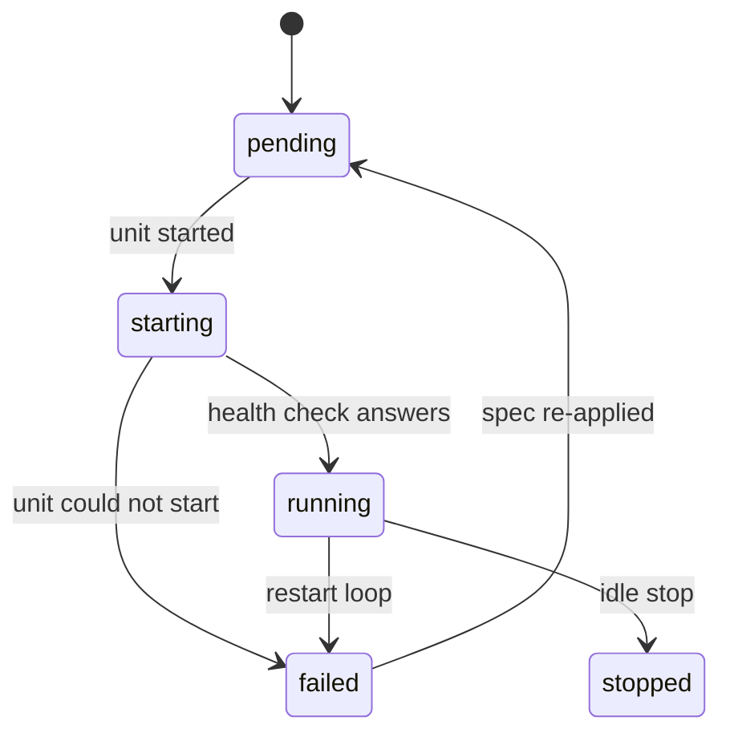
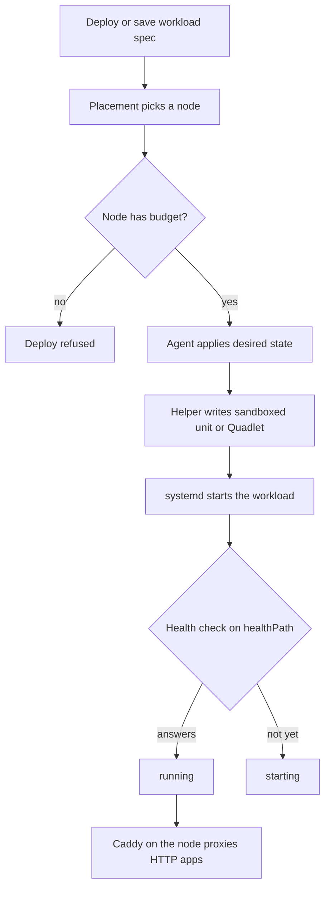

Use an app when you need something that stays running: a web server, an API, a queue consumer or a bot. Skiff runs it on one of your nodes, gives it a route when it listens for HTTP, and keeps it running. Two runtimes cover this. A **process app** runs a command from your release inside a sandboxed systemd unit. A **container** runs an OCI image under Podman Quadlet. Static sites and [functions](/compute/functions) use other runtimes.

> [!NOTE]
> Preview. Process apps and containers are implemented, but the end-to-end checks on a real Debian 13 node are still open. Test a new app on a non-critical node before you depend on it.

## Choose a runtime

| Runtime | What runs | Use it for |
| --- | --- | --- |
| `process` | A command from your release, in a sandboxed systemd unit | Bun, Node, Python, PHP (FrankenPHP) or any server that starts from the release |
| `container` | An OCI image you reference, under Podman Quadlet | Anything packaged as an image, or software with its own runtime |
| `function` | Code on the pinned workerd runtime | Workers-style code. See [functions](/compute/functions) |
| `static` | Files served from the edge | Sites with no server. See [static sites](/deploying/static-sites) |

The runtime is set when you create the project. Create it as a process or container project, then deploy to it.

## Create a process app

Create the project with `runtime` set to `process`, either from the dashboard, with `POST /api/v1/projects`, or with the `create_project` MCP tool. Then describe how it runs and deploy the release:

```sh
skif deploy ./my-api --project my-api
```

The release directory is what the unit runs from. The release is mounted read-only, so the app writes only to its state directory, described below.

Set the command with the workload spec. Skiff runs `command` as an argument list, not through a shell, from inside the release directory. If you leave `command` out, it defaults to `bun run start`.

```sh
curl -X PUT "https://control.example.com/api/v1/projects/my-api/workload" \
  -H "Authorization: Bearer $SKIFF_TOKEN" -H 'Content-Type: application/json' \
  --data @workload.json
```

A Bun server that listens on `PORT` looks like this:

```json
{
  "runtime": "process",
  "command": ["bun", "run", "start"],
  "port": 3000,
  "memoryMb": 256,
  "socketActivation": false
}
```

Socket activation is on by default, and it changes how your app must listen. With it on, Skiff holds the listening socket and passes it to the app as file descriptor 3. Your app must adopt that socket. Bun cannot do this yet, so a Bun app needs `"socketActivation": false`. Then Skiff sets `PORT` and `HOST=127.0.0.1` for the app, and the app listens there.

A PHP app that adopts the socket is in `examples/php-frankenphp` in the repository. It can scale to zero, as described under [scale to zero](#scale-to-zero).

> [!NOTE]
> Skiff does not install Node or Python. Process apps run whatever is on the node's `PATH` or inside the release. FrankenPHP is an opt-in install on the node, and the process unit cannot find it until it is installed.

## Create a container

A container needs an image. Pin it by digest so that a deploy always runs the same bytes:

```json
{
  "runtime": "container",
  "image": "registry.example.com/my-api@sha256:…",
  "port": 8080,
  "memoryMb": 512,
  "cpus": 1,
  "healthPath": "/healthz",
  "env": { "LOG_LEVEL": "info" },
  "secrets": [{ "name": "DATABASE_URL" }]
}
```

Containers cannot set a `command`. Use the entrypoint the image defines. Skiff publishes the container's `port` only on the node's loopback interface, and Caddy on the same node proxies to it.

## Workload settings

These fields make up the workload spec. Send them as the JSON body of `PUT /api/v1/projects/:slug/workload`, or as the `set_workload` MCP tool's input, which takes the same fields plus `project`.

| Field | Default | Limits and rules |
| --- | --- | --- |
| `runtime` | none, required | `process` or `container` for an app |
| `command` | `["bun", "run", "start"]` | Process only, 1 to 64 arguments of up to 1,024 characters. Refused for containers |
| `image` | none | Container only, required. Refused for processes |
| `port` | `3000` | 1 to 65535. The port the app listens on, used when socket activation is off |
| `memoryMb` | `256` | 32 to 8,192. Per replica. Enforced by the unit's memory limit |
| `cpus` | `1` | Above 0, up to 8. Per replica. Enforced as a CPU quota |
| `healthPath` | `/` | Must start with `/`. Up to 512 characters |
| `socketActivation` | `true` | Process only. Set to `false` for apps that cannot adopt fd 3 |
| `idleStopSeconds` | off | 0 to 86,400. See [scale to zero](#scale-to-zero) |
| `ingress` | `http` | `http` for a web app, or `none` for a [worker](#workers) |
| `replicas` | `1` | 1 to 20. Identical copies. Each one reserves `memoryMb` |
| `env` | `{}` | Plain variables. Names match `[A-Za-z_][A-Za-z0-9_]*`. Values up to 16,384 characters |
| `secrets` | `[]` | Up to 128 secret references. See [secrets](#environment-variables-and-secrets) |
| `volumes` | none | Mount [app volumes](/compute/volumes) into the workload |

### Scale to zero

Set `idleStopSeconds` to stop a process app after it has gone that many seconds without a request. The socket stays open, and the next request starts the app again. The first request after a stop pays the cold start.

Skiff accepts this only for a process app with HTTP ingress, socket activation on, and one replica. Any other combination is refused with an error that names the field. Containers are always on.

### Health checks

Skiff probes `healthPath` on the app. Until the path answers, the workload reports `starting`. When it answers, the workload reports `running`. A worker has no path to probe. It reports `running` while its unit is active.

Workloads report one of these statuses: `pending`, `starting`, `running`, `failed` or `stopped`. A running workload that reports five or more restarts is marked `failed` with the message "Restart loop". The diagram shows the transitions:



## Environment variables and secrets

Plain variables go in `env`. They are stored in the workload spec and shown when you read it back.

Secrets are references in the spec. The values live in encrypted secret storage, which holds each organisation's secrets under a separate data key. Nothing reads a secret value back. The API and the dashboard show only the name, version and creation time. To change a value, write a new one, and the workload restarts with it.

Create a secret with the REST API. Omit `projectId`, or set it to `null`, to share the secret across the organisation:

```sh
curl -X POST "https://control.example.com/api/v1/secrets" \
  -H "Authorization: Bearer $SKIFF_TOKEN" -H 'Content-Type: application/json' \
  --data '{"name":"DATABASE_URL","value":"postgres://…","projectId":"<project-id>"}'
```

Then reference it from the spec. The name is required and must be upper-snake-case. `delivery` defaults to `env`:

```json
"secrets": [
  { "name": "DATABASE_URL" },
  { "name": "SIGNING_KEY", "version": 2, "delivery": "file" }
]
```

With `env` delivery, the app reads the value from `NAME`. With `file` delivery, the app reads the path in `NAME_FILE`. A reference resolves to the project's own secret first, then to the organisation's. It can also pin a `version`. A reference that names no secret, or a pinned version that does not exist, is refused when you save the spec.

A name cannot be set both as a plain variable and by a secret. Skiff refuses the save, because one value would silently hide the other.

## Placement and capacity

Each project has a `placement` that Skiff resolves once, when you deploy:

- `edge` (the default for new projects) runs the app on the edge node. Skiff refuses the deploy if that node has no room.
- `auto` picks a node with enough free budget.
- A node id pins the app to that node.

For finer control, a project can also carry a `placementSpec`. It can pin a node, restrict to zones or roles or labels, prefer the node that runs a database (`near`), or spread replicas across nodes or zones. Set it with `PATCH /api/v1/projects/:slug`.

Placement is decided at deploy time, and a running app does not move between nodes by itself. Redeploy to move it.

Admission checks the node's workload slice before a deploy starts. Skiff reserves `memoryMb` multiplied by `replicas`, and it checks CPU and disk when the node reports them. Copies are spread across nodes, one per node, so a deploy with more replicas than eligible nodes is refused. Process apps are not spread while the `SERVICE_ENDPOINTS` flag is on. Your organisation's memory quota also applies. See [quotas and limits](/self-hosting/quotas-and-limits).

The diagram shows the path from a deploy to a running app:



## Workers

Set `ingress` to `none` for a process that does not serve HTTP, such as a queue consumer or a bot. A worker gets no route and no published port. Skiff does not probe it, and it counts as healthy while its unit is active. A worker can run several replicas.

For work on a schedule, or a one-off command such as a migration (`skif run my-api -- bun run migrate`), see [app jobs](/compute/scheduled-jobs#app-jobs).

## Logs and restarts

Read recent runtime logs from the CLI:

```sh
skif logs my-api --lines 500
```

The `--json` flag prints the raw response. Over REST, use `GET /api/v1/projects/:slug/logs?limit=500`. The `get_logs` MCP tool takes `level`, a search term `q` and an `after` cursor for tailing. See [dashboards and logs](/observe/dashboards-and-logs) for the dashboard view.

A failed process restarts after two seconds. A process that exits cleanly stays stopped. Systemd gives up after ten failures in 60 seconds. A container restarts on failure in the same way. Saved spec or variable changes make the node re-apply the workload, which restarts it with the new settings. A container project can also be restarted from its **Overview** console section; `skif container restart`, `POST /api/v1/projects/:slug/container/restart` and the `restart_container` MCP tool do the same for a container.

## Container console

A container project gets a **Container** group in its sidebar with **Overview**, **Logs**, **Shell** and **Files** (Logs moves there from Monitor). They read and work inside the running container rather than at a release. **Shell** and **Files** need the container to be running; **Overview** also shows why it is not. When a project runs several replicas, a picker at the top of each section chooses which replica to look at.

> [!NOTE]
> The console is on by default. An operator can turn it off with `SKIFF_FEATURE_CONTAINER_CONSOLE=0`; the sections and their routes then disappear and the nodes stop the console listener. See [feature flags](/self-hosting/configuration).

The console only works on nodes whose agent supports it. A node running an older agent reports that it needs an update the first time you open a section; updating the node fixes it.

### Overview

Overview shows what the container is doing now:

- Its state, image, node, systemd unit, restart count and last exit code, plus the image digest and the user and working directory it runs as.
- CPU rate, memory in use and peak against the limit, network and disk rates, and the process count.
- The processes inside the container, with PID, user, state, CPU time, resident memory and command.
- The configuration it was started with, including environment variable names. Values stay on the node, so they are not shown.
- Ports, networks, mounts and the sandbox settings (read-only root filesystem, dropped capabilities, no new privileges).
- **Logs** opens the runtime log tail, **Shell** and **Files** open their sections, and **Restart** stops the container and starts it again from the same image and configuration. Open shells close and requests fail for the few seconds it takes to come back. Restart needs `project:update`.

A browsable mount opens in **Files** at that path. Secret mounts and `tmpfs` mounts are listed but not browsable.

### Shell

**Shell** opens an interactive terminal in the container. Choose the replica, a shell and a user:

| Choice | Options |
| --- | --- |
| `shell` | `auto` (default) tries `bash`, then `sh`; or pin `/bin/bash`, `/bin/sh` or `/bin/ash` (Alpine) |
| `user` | `default` (the image's user) or `root` inside the container |

`root` inside the container is not root on the node: every capability stays dropped, privilege escalation stays blocked, and the root filesystem stays read-only. Writes go to the container's `/data` volume and its `tmpfs` `/tmp`.

The terminal survives switching to another section and back, and a page reload, until the session ends. Skiff closes a shell after 15 minutes with no attached viewer and no input, after 8 hours whatever happens, or when the container restarts. The **End** button ends it immediately, and **New** replaces it with a fresh shell using the current choices.

### Files

**Files** is a read-only browser of the container's filesystem: the image's root and the mounts marked browsable in Overview. Symbolic links are resolved inside the container, so a link to `/etc/passwd` shows the container's file, never the node's.

- Text files preview inline up to 1 MiB. A binary or larger file says why and offers a download instead.
- Any file can be downloaded; downloads have no size cap.
- A directory listing shows at most 2,000 entries and says when it was truncated.
- Secret mounts and `tmpfs` mounts are not browsable.

### Console permissions

| What you can do | Permission | Surfaces |
| --- | --- | --- |
| See Overview and the console sections | `container:inspect` | Dashboard, REST, CLI, MCP |
| Browse files and download | `container:files` | Dashboard, REST, CLI, MCP (list and read only) |
| Open a shell | `container:exec` | Dashboard, REST, CLI (`skif shell`); never MCP |
| Restart the container | `project:update` | Dashboard, REST, CLI, MCP |

The deployer role has all four. A viewer has only `container:inspect`. Default agent scopes leave out `container:files` and `container:exec`, so an API key or MCP client holds them only when you grant them explicitly. MCP clients never get a shell, even with `container:exec`: an agent reads untrusted text, so running commands in production stays with people. Opening or closing a shell and reading or downloading a file are audited; the keystrokes, file contents and secret values never are.

The same calls are on the REST API under `/api/v1/projects/:slug/container/` (see the CLI's [`container`](/clients/cli#container) command and the [REST API](/clients/rest-api)).

## Security properties

Skiff generates the units. You do not write them, and the settings below apply to every unit it creates.

For every process app:

- It runs as a dynamic, unprivileged user, with no Linux capabilities.
- The release directory is read-only. The app has a private, writable state directory that survives restarts, exposed as `$STATE_DIRECTORY`.
- It gets a private `/tmp`, no device access and no access to home directories.
- It cannot change the system clock, hostname, kernel settings or control groups, and it cannot gain privileges through setuid or setgid.
- Its memory and CPU are capped, and it runs in the shared `skiff-workloads.slice`.
- Its file mode mask is `0077`, so files it creates are private to it.

For containers:

- The container runs under rootful Podman, because only the root helper can drive it, but inside a
  **user namespace of its own**. Uid 0 in the container maps to an unprivileged host uid from the
  node's `containers` subuid/subgid range, which the node adds the first time it starts an app
  container. Container root is not host root.
- All Linux capabilities are dropped, and privilege escalation is blocked.
- The root filesystem is read-only. `/tmp` is a 64 MB tmpfs, and `/data` is a persistent volume.
- Writable volumes (`/data` and read-write app volumes) are owned by the container's mapped uid
  each time it starts. A restart can map a different id range, so Skiff re-owns them then.
  Read-only mounts are never re-owned, so a reader with a different id range may not be able to
  read files the writer made private to itself.
- Secret files are mounted read-only and owned by the container's user.
- Its port is published only on loopback.
- Its memory and CPU are capped in the same slice.

Managed databases, object storage and brokers are the exception: their images expect a fixed
non-root user, so they run as that user without a user namespace. Skiff owns their data directory
with that uid instead.

> [!WARNING]
> Process apps can reach the network, including private addresses on your nodes. Containers share one Podman network per node unless the `ORG_NETWORKS` feature flag is on, which gives each organisation its own. Keep this in mind for apps that handle data from other organisations.

## Blueprints

A blueprint declares a whole stack in one file: projects with their environments, domains and workload settings, plus the databases, storage buckets and brokers they use and how they attach. **Plan** compares the file with what exists and changes nothing. **Apply** runs that plan through the same services as the dashboard, so permissions, quotas and audit entries are exactly what the same clicks would produce. Applying the same file again changes nothing.

> [!NOTE]
> Blueprints are on by default. An operator can turn them off with `SKIFF_FEATURE_BLUEPRINTS=0` (see [configuration](/self-hosting/configuration#feature-flags)).

```yaml
apiVersion: skiff/v1
name: shop
projects:
  shop-web:
    access: { production: public, previews: platform }
    environments:
      staging: { access: platform }
    domains: [shop.example.com]
  shop-api:
    runtime: process
    placement: auto
    command: [bun, run, start]
    port: 3000
    healthPath: /health
    memoryMb: 256
    env: { LOG_LEVEL: info }
    secrets: [STRIPE_KEY]
databases:
  shop-db: { engine: postgres, version: "18", extensions: [pg_trgm] }
storage:
  shop-assets:
    buckets:
      uploads: { access: private }
brokers:
  shop-queue: {}
attachments:
  - { project: shop-api, database: shop-db }
  - { project: shop-api, storage: shop-assets, grants: [{ bucket: uploads, mode: read-write }] }
  - { project: shop-api, broker: shop-queue }
```

Map keys are the real names: `projects.shop-web` is the project with slug `shop-web`, and `databases.shop-db` is the database named `shop-db`. `name` is the stack's name in your organisation. Every object is strict, so an unknown field fails with its exact path, and references between sections (an attachment to an undeclared database, a grant on an undeclared bucket) fail before anything is read.

A field you leave out is not managed: it takes the platform default when the resource is created and keeps whatever the dashboard or CLI set afterwards. The fields are:

| Section | Fields |
| --- | --- |
| `projects.<slug>` | `name`, `runtime` (`static` by default, fixed for the project's life), `placement`, `access.production` and `access.previews` (`public` or `platform`), `environments.<name>.access`, `domains`. Process and container projects also take `command`, `image` (containers), `port`, `healthPath`, `memoryMb`, `cpus`, `replicas`, `env` and `secrets` |
| `databases.<name>` | `engine` (`postgres` by default), `version`, `variant`, `memoryMb`, `cpus`, `storageMb`, `extensions`, `pooler` |
| `storage.<name>` | `public`, `memoryMb`, `cpus`, `storageMb`, `buckets.<bucket>` with `access`, `versioning` and `quotaMb` |
| `brokers.<name>` | `engine` (`nats`), `version`, `memoryMb`, `cpus`, `storageMb` |
| `attachments[]` | `project` and exactly one of `database`, `storage` or `broker`; `prefix` (the engine's default otherwise); `grants` for storage, each a `bucket` and a `mode` of `read` or `read-write` |

Some rules follow from what the services allow:

- `env` and `secrets` replace the whole set when present. `secrets` lists secret **names**; create their values first (see [environment variables and secrets](#environment-variables-and-secrets)). A name that does not resolve for the project or the organisation fails the plan.
- `extensions` only adds. Removing one from the file never drops it from the database.
- A project's `runtime`, a database's `engine` and `variant`, and a broker's `engine` are fixed. Changing them fails the plan. So does a PostgreSQL major version change (use `skif db upgrade`) and any downgrade.
- A resource that already exists in your organisation is adopted: the plan shows `exists; this stack adopts it` and updates only the fields the file sets. A project slug held by another organisation fails the plan.
- A new database, private storage instance or broker is placed next to the first project the file attaches it to, so everything an app uses shares one node.
- Password access cannot be set from a file, because passwords never go in one.

### Plan and apply

From the CLI, with `skiff.blueprint.yaml`, `skiff.blueprint.yml` or `skiff.blueprint.json` in the current directory (or a path, or `-` for stdin):

```sh
skif blueprint validate
skif blueprint plan
skif blueprint apply
```

`plan` lists every resource as `create`, `update`, `delete` or up to date, with each changed field. `apply` plans, shows the plan, asks, then applies it and follows the progress; `--yes` skips the question. In the dashboard, open **Projects → From template → Apply a blueprint**, paste or open the file, choose **Plan**, review the diff and choose **Apply**.

The steps run in order: projects, environments, databases, storage, buckets, brokers, workload settings, domains, then attachments. Each step re-reads live state and changes only what still differs. The first step that fails stops the run, the later steps are skipped, and nothing is rolled back, so fix the cause and plan again: the new plan lists only what is left. `skif blueprint apply` exits 0 when everything applied, 3 when the run stopped partway, and 1 when it failed or you declined.

A plan lasts one hour and only the person who made it can apply it. Apply re-reads live state first, and if anything the plan covers has changed since, it refuses and asks you to plan again, so what runs is always what you reviewed.

Workload settings are saved, not deployed: deploy the app as usual, and a running app picks up the new settings on its next activation.

### Prune

Removing a resource from the file does not delete it. The plan warns that it is kept. To delete the resources this stack created or adopted that the file no longer lists, plan with prune:

```sh
skif blueprint apply --prune
```

A pruning plan asks you to type the stack name before it applies (`--yes` confirms it for you). Projects, databases, storage and brokers move to the trash and can be restored; buckets are deleted only when empty; attachments are detached. Prune never touches anything the stack does not manage, and AI agents cannot prune.

### Blueprints over REST and MCP

The REST routes are `POST /api/v1/blueprints/validate`, `POST /api/v1/blueprints/plan` and `POST /api/v1/blueprints/apply`, plus `GET /api/v1/blueprints` for the stacks your organisation has applied. See [REST API](/clients/rest-api). Agents use `plan_stack`, then `apply_stack` with the plan hash, which asks you to confirm, and `get_task` to follow a long run. See [MCP](/clients/mcp).

## MCP tools

| Tool | What it does | Permission |
| --- | --- | --- |
| `create_project` | Creates a project with `runtime`, `placement` and `placementSpec` | `project:create` |
| `get_workload` | Returns the workload's status, node, memory and CPU, and its saved spec | `deployment:read` |
| `set_workload` | Saves the runtime spec. Secrets are references only | `project:update` |
| `get_logs` | Returns recent runtime logs | `logs:read` |
| `get_node_capacity` | Returns each node's workload slice, reserved and free memory, and disk | Platform admin only |
| `inspect_container` | Live state, resources, mounts and processes of a container project | `container:inspect` |
| `list_container_files`, `read_container_file` | List a directory or read a text file in the running container | `container:files` |
| `restart_container` | Restarts every replica of a container project | `project:update` |

## Not available yet

> [!NOTE]
> Not available yet: more first-party app templates. The only one is the GitHub Actions runner pool, which runs as a container worker.
