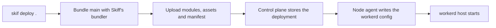
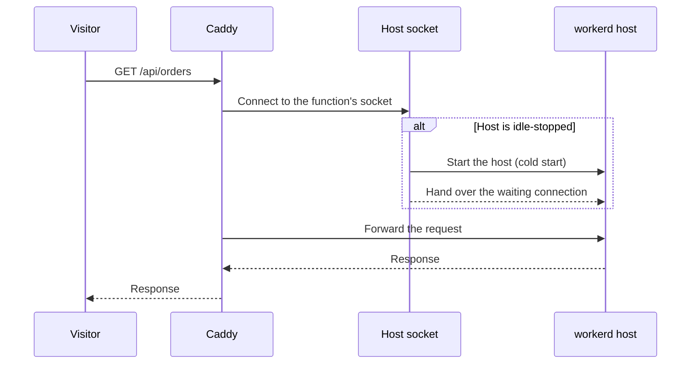

Functions run code written for Cloudflare Workers on workerd, the open-source runtime behind Workers. You write `export default { fetch }`, keep a `wrangler.jsonc` next to it, and run `skif deploy .`. Skiff bundles the Worker and runs it as its own process on a node. The process starts on the first request and stops after a period of idleness. Use a function for API routes, form handlers, webhooks and scheduled jobs that do not need an always-on process.

## Project layout

```text
my-api/
├── wrangler.jsonc
├── src/
│   └── index.ts
└── public/            optional static files
    └── logo.svg
```

A `wrangler.jsonc` (or `wrangler.json`) in the directory makes it a function project. A `wrangler.toml` is not read, so convert it to JSONC first. The `main` key names the entry module. Skiff bundles it with its own pinned bundler, so you do not need to install Wrangler to deploy. Imports from `node_modules` are bundled into the entry module.

A minimal Worker:

```ts
export default {
  async fetch(request, env, ctx) {
    return Response.json({ ok: true, path: new URL(request.url).pathname });
  },
};
```

## Configuration

Skiff reads these keys from `wrangler.jsonc` and uses the same names as Wrangler. Other Wrangler keys are ignored.

| Key | Purpose |
| --- | --- |
| `main` | Entry module: `.js`, `.mjs`, `.cjs`, `.ts` or `.py`. Required. |
| `compatibility_date` | Required, as `YYYY-MM-DD`. Must be from 2022-01-01 up to the newest workerd Skiff ships (currently 2026-11-06). |
| `compatibility_flags` | Passed to workerd. Node built-ins are enabled automatically for compatibility dates from 2026-08-04. |
| `name` | Used only to recognise a service binding that points back at this Worker. It does not set the project slug. |
| `vars` | Plain variables. A string becomes a text binding; any other JSON value becomes a JSON binding. Stored in the deployment, not as secrets. Each text value is limited to 16 KiB. |
| `triggers.crons` | Cron schedules. See [cron triggers](#cron-triggers). |
| `queues.producers`, `queues.consumers` | Queue bindings and consumers. See [queue consumers](#queue-consumers). |
| `kv_namespaces`, `d1_databases`, `r2_buckets`, `durable_objects.bindings`, `hyperdrive`, `analytics_engine_datasets`, `services`, `assets` | Bindings. See [bindings](#bindings). |
| `build.command`, `build.cwd` | A command to run before bundling, for example to install vendored packages. |
| `minify`, `keep_names`, `define`, `alias`, `tsconfig`, `jsx_factory`, `jsx_fragment`, `rules` | Bundler options, as in Wrangler. |
| `skiff` | Skiff-only settings, described below. |

The `skiff` section holds the Skiff-side names and sizing:

| Key | Purpose |
| --- | --- |
| `skiff.storage` | Maps an R2 binding name to the name of the RustFS instance that holds its bucket. |
| `skiff.brokers` | Maps a queue name to the managed broker that holds it. Needed when the project has more than one broker attached. |
| `skiff.hyperdrive` | Maps a Hyperdrive binding name to the name of the attached Postgres database. |
| `skiff.secrets` | Secret names to bind, including organisation-wide secrets. |
| `skiff.bindings` | Raw binding entries (`{ "name": "…", "type": "…" }`) for bindings that have no Wrangler key, such as `cache`. |
| `skiff.idleStopSeconds` | Seconds of inactivity before the host stops. `0` keeps it running. Default 300. |
| `skiff.memoryMb` | Memory reservation, from 32 to 2048. Default 128, or 384 for Python. |
| `skiff.cpus` | CPU share, up to 4. Default 1. |

These keys fail the deploy with an error, because Skiff cannot back them: `ai`, `browser`, `vectorize`, `images`, `send_email`, `containers`, `mtls_certificates`, `dispatch_namespaces` and `workflows`. Also refused are `no_bundle`, `find_additional_modules`, the retired `node_compat` option, and queue consumers that set `max_concurrency` or `visibility_timeout_ms`.

## Bindings

This example uses most of the supported bindings. The resources it names must exist and be attached to the project before you deploy.

```jsonc
{
  "name": "my-api",
  "main": "src/index.ts",
  "compatibility_date": "2026-10-01",
  "compatibility_flags": ["nodejs_compat"],
  "vars": { "APP_NAME": "My API" },
  "kv_namespaces": [{ "binding": "CACHE_KV" }],
  "d1_databases": [{ "binding": "DB", "database_name": "orders" }],
  "r2_buckets": [{ "binding": "UPLOADS", "bucket_name": "uploads" }],
  "hyperdrive": [{ "binding": "PG" }],
  "analytics_engine_datasets": [{ "binding": "EVENTS", "dataset": "api_events" }],
  "queues": {
    "producers": [{ "binding": "JOBS", "queue": "jobs" }],
    "consumers": [{ "queue": "jobs", "max_retries": 3, "dead_letter_queue": "jobs-dead" }]
  },
  "assets": { "directory": "public", "run_worker_first": ["/api/*"] },
  "triggers": { "crons": ["*/15 * * * *"] },
  "skiff": {
    "storage": { "UPLOADS": "files" },
    "brokers": { "jobs": "orders-broker" },
    "hyperdrive": { "PG": "orders-db" },
    "idleStopSeconds": 600,
    "memoryMb": 256
  }
}
```

| Binding | Configuration | In your code |
| --- | --- | --- |
| KV | `kv_namespaces: [{ "binding" }]` | `env.CACHE_KV.get`, `put`, `delete` and `list`. Each binding has its own namespace on the node. |
| D1 | `d1_databases: [{ "binding", "database_name" }]` | The D1 API (`prepare`, `bind`, `all`, `run`). The database lives on the node. The `d1_binding_jsrpc` flag is refused. |
| R2 | `r2_buckets: [{ "binding", "bucket_name", "prefix" }]` | The R2 API for single-part objects. Needs a RustFS storage instance attached to the project, with a grant on the bucket, named in `skiff.storage`. Without an entry there, Skiff looks for an instance with the bucket's name. |
| Durable Objects | `durable_objects.bindings: [{ "name", "class_name" }]` | The Durable Object API. Export the class from the entry module. SQL storage is enabled. Objects live on one node. |
| Hyperdrive | `hyperdrive: [{ "binding" }]` | Connects through a Postgres database attached to the project. Map a different database name in `skiff.hyperdrive`. |
| Queue producer | `queues.producers: [{ "binding", "queue" }]` | `env.JOBS.send(body)` and `sendBatch`. Needs a broker attached to the project. |
| Analytics Engine | `analytics_engine_datasets: [{ "binding", "dataset" }]` | `env.EVENTS.writeDataPoint({ blobs, doubles, indexes })`. A dataset defaults to the binding name. |
| Static assets | `assets: { "directory", "binding", "run_worker_first" }` | `env.ASSETS.fetch(request)`. The default binding name is `ASSETS`. |
| Services | `services: [{ "binding", "service", "entrypoint" }]` | Another function's entry point, or your own named export when `service` is this Worker's `name`. Calls to another project's slug are `fetch` only. |

The Cache API has no Wrangler key. To use `caches.default`, declare a cache binding in `skiff` instead:

```jsonc
"skiff": { "bindings": [{ "name": "EDGE_CACHE", "type": "cache" }] }
```

Only one cache binding is allowed per function. Each host caches responses up to 16 MiB each, with a total of 64 MiB and 10,000 entries.

Skiff's own invocation logs are always on, so there is no tail binding to declare.

Bindings that hold data (KV, D1, Cache and Durable Objects) keep a function on one host.

## Deploying

From the project directory, run:

```sh
skif deploy .
```

The command:

1. Finds `wrangler.jsonc` or `wrangler.json`. Use `--wrangler <path>` to choose a file, or `--no-wrangler` to deploy the directory as it is.
2. Runs `build.command` if you set one, then bundles `main` with Skiff's pinned bundler and generates the internal manifest.
3. Creates the project with the function runtime if it does not exist. The slug comes from `--project`, else `--name`, else the directory name. `--no-create` fails instead of creating it.
4. Promotes the deployment to production. Pass `--no-promote` to create a preview only.

The bundle then reaches a node in these steps:



You need the `deployment:create` permission. Deploying a Functions bundle to a project of another runtime is refused, and the error names the runtime the project uses.

Secrets are bound when you deploy. Add a project secret, then deploy again so the function can read it.

If you already built the Worker yourself, you can deploy the built directory with `skif deploy ./dist`. Once a function has been deployed, Skiff reuses its bindings, compatibility settings and assets directory and takes only the new modules and files. A first deploy of a prebuilt directory has no crons or bindings beyond the project's secrets, so use `wrangler.jsonc` for real configuration.

## Local development

```sh
skif wrangler dev
```

This runs Wrangler's local dev server in the project directory. If Wrangler is not installed there, the command installs it first. Wrangler uses workerd, the same runtime production uses. Deploys do not need Wrangler, and `skif wrangler` is the only command that uses it.

To test a deployed function, send one request from the CLI. This goes straight to the function's node, so it bypasses domains and access rules:

```sh
skif function invoke my-api /health
skif fn invoke my-api /users -X POST -H 'content-type: application/json' -d '{"name":"Ada"}'
skif function cron my-api '*/15 * * * *'
```

`invoke` prints the response body and a summary line with the status, time and cold start. It exits with status 1 for a non-2xx response. `cron` runs the `scheduled()` handler once for one of the crons in `triggers.crons`.

## Routing

Every request to the project's domain follows this order:

1. If `assets.directory` holds a file for the path, Skiff serves that file. A path ending in `/` also tries `index.html`.
2. If the path matches a `run_worker_first` glob, the function handles it, even when a file exists. Use `true` for every path, or a list of globs. A glob starting with `!` excludes paths.
3. Everything else goes to the function's `fetch`.

A function without a `fetch` handler returns 501. If the function's host cannot be reached, the visitor gets a 503 with `Retry-After: 30`.

Custom domains work as they do for other projects. See [domains and environments](/deploying/domains-and-environments).

## Variables and secrets

Use `vars` for configuration that can be read from the file. Use secrets for anything sensitive.

Create secrets in the **Variables & secrets** tab of the function. Values are write-only, and nobody can read them back from the dashboard. A secret named `STRIPE_KEY` appears in code as `env.STRIPE_KEY`.

A project's own secrets are bound automatically at deploy time. To bind an organisation-wide secret, list its name in `skiff.secrets`. A name that matches no secret fails the deploy.

## Cron triggers

```jsonc
"triggers": { "crons": ["*/15 * * * *", "0 3 * * *"] }
```

Each function can declare up to 8 crons. Each cron is five fields (minute, hour, day, month, weekday), in UTC. Names such as `MON`, seconds and macros such as `@daily` are not accepted. An invalid expression fails the deploy.

Each occurrence calls the default export's `scheduled` handler once:

```ts
export default {
  async scheduled(controller, env, ctx) {
    console.log(controller.cron, controller.scheduledTime);
  },
};
```

`scheduledTime` is in epoch milliseconds. The node stops waiting after 60 seconds. If the agent restarts, occurrences more than a minute old are skipped rather than replayed. A cron run also starts a host that is idle.

## Queue consumers

A queue lives on a managed broker. Create one and attach it to the project before you use queues:

```sh
skif broker create orders-broker
skif broker attach orders-broker -p my-api
```

Queue names use lowercase letters, digits and hyphens, up to 63 characters. A queue can have one consumer per broker.

```jsonc
"queues": {
  "consumers": [
    {
      "queue": "jobs",
      "max_batch_size": 10,
      "max_batch_timeout": 5,
      "max_retries": 3,
      "retry_delay": 30,
      "dead_letter_queue": "jobs-dead"
    }
  ]
}
```

Defaults are a batch of 10 messages, a 5-second wait for a full batch, and 3 retries. Without `retry_delay`, a retry waits 1 second, then 2, doubling up to 60 seconds. A message that still fails after its retries goes to `dead_letter_queue`, or is dropped with a warning if you did not set one.

The default export's `queue` handler receives each batch:

```ts
export default {
  async queue(batch, env, ctx) {
    for (const message of batch.messages) {
      console.log(message.id, message.attempts, message.body);
      message.ack();
    }
  },
};
```

If the handler returns, the whole batch is acknowledged. If it throws, the whole batch is retried. Call `message.ack()` or `message.retry({ delaySeconds })` to decide each message on its own. Delivery is at least once, so handle duplicates.

## Python functions

Set `main` to a `.py` file to make a Python Worker. It runs on Pyodide inside workerd, and Skiff adds the `python_workers` compatibility flag for you.

```python
from workers import Response, WorkerEntrypoint


class Default(WorkerEntrypoint):
    async def fetch(self, request):
        return Response.json({"greeting": self.env.GREETING, "url": request.url})

    async def scheduled(self, controller, env=None, ctx=None):
        print(f"cron {controller.cron} at {controller.scheduledTime}")
```

- Skiff ships every `.py` file in the entry module's directory. A file's module name is its path relative to that directory.
- Put dependencies in `python_modules/`. Use `build.command` to fill it, for example `"build": { "command": "uv run pywrangler sync" }`. Skiff does not resolve packages itself.
- A Python Worker can include at most 512 files, counting `python_modules/`. It cannot include JavaScript modules, but it can ship JavaScript files as data.
- The default memory is 384 MB, and the minimum is 256 MB. An idle Pyodide host uses about 230 MB.
- Python functions are placed only on nodes that have the Pyodide runtime cached.
- Cron and queue deliveries work as they do for JavaScript.

## Cold starts and idle stop

A function with no requests for `skiff.idleStopSeconds` (default 300) is stopped. The next request starts it again. The first request after a stop takes longer, because the host starts while the request waits. Cron occurrences and queue batches also start a stopped host.

Requests reach the host through a socket that stays open while the host is stopped, so the first request is the one that starts it:



Set `"idleStopSeconds": 0` to keep the host running all the time. Python functions take longer to start than JavaScript ones.

## Limits

| Item | Limit |
| --- | --- |
| Modules per function | 512 |
| Bindings per function | 64 |
| Compatibility flags | 32 |
| Cron expressions | 8 |
| Queue consumers | 8 |
| Memory | 32 to 2048 MB. Default 128 MB, or 384 MB for Python. The V8 heap is limited to 75% of this. |
| CPU | Up to 4. Default 1. |
| Idle stop | 0 to 86,400 seconds. Default 300. |
| Time to response headers | 5 minutes |
| Static asset files | 25 MiB each, 500 MiB in total, 20,000 files |
| `run_worker_first` globs | 64 |
| KV | Key up to 512 bytes, value up to 25 MiB, metadata up to 1 KiB, list pages of 1,000 keys, minimum expiration 60 seconds |
| R2 | A `put` body is held in memory, up to 25 MiB |
| Analytics Engine | Per data point: 20 blobs of up to 16 KiB, 20 indexes of up to 1 KiB, and 20 numbers |
| Queues | Batches of up to 100 messages. Up to 100 retries. Fixed retry delay up to 43,200 seconds. A batch not answered within 5 minutes is retried. |

## Logs and the Functions area

The **Functions** area of the dashboard lists your function projects. Create one with the placement you want (automatic, or a named edge node) and its production and preview access. Each function has these sections:

- **Overview**: request metrics and the active deployment.
- **Invocations**: recent invocations, with their outcome, errors and console output. Reading this needs the `logs:read` permission. If the telemetry store is unavailable, the list is marked unavailable rather than shown as empty.
- **Deployments**: each deployment, its logs and its source. Rolling back a deployment restores its code and bindings together.
- **Bindings & triggers**: the bindings, crons and queue consumers of the active deployment.
- **Data**, **Variables & secrets**, **Logs**, **Domains** and **Settings**.

For log retention and searching across projects, see [dashboards and logs](/observe/dashboards-and-logs).

> [!NOTE]
> Not available yet: R2 multipart uploads, Workflows, Browser Rendering, Workers AI, Vectorize, Images, Email Workers, Containers, dispatch namespaces and mTLS certificates. Calls from one project's function to another's are `fetch` only. Durable Objects run on one node.
