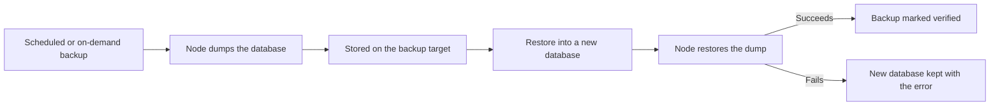

Every managed database can take backups on a schedule or on demand. Each backup is a complete dump that you can restore into a brand-new database. This page covers backups of managed databases only. The platform's own database is covered in [platform backups](/self-hosting/platform-backups).

PostgreSQL 18 databases can also use point-in-time recovery (PITR), which restores to any second in its window rather than to the last dump. PITR needs a backup repository that the platform admin configures. See [point-in-time recovery](#point-in-time-recovery) at the end.

## What is backed up

Every engine supports backups. Each backup uses the engine's own dump format:

| Engine | Format | What it contains |
|---|---|---|
| PostgreSQL | `pg_dump` custom format | The database's schema and data. |
| MySQL, MariaDB | `mysqldump` or `mariadb-dump` SQL | The database's tables, routines, triggers and events. |
| MongoDB | `mongodump` gzip archive | Every collection and index in the database. |
| Valkey, Redis | RDB snapshot | Every key in every numbered database (0 to 15). |
| ClickHouse | Native `BACKUP` zip archive | The database's tables, views and data parts, with checksums. |

A backup only contains the database itself. Users and roles you created inside the engine are not included. A restored database always gets new owner credentials.

A backup can only be restored into a database of the same engine. Skiff restores into the source database's version, so a backup from a database that was later upgraded in place still restores.

Valkey and Redis keep accepting writes while the snapshot is taken. Before a Valkey or Redis backup is marked `ok`, the node checks the whole snapshot with `valkey-check-rdb` or `redis-check-rdb`.

Backups go to the backup target that applies to the database's organisation. If you have not configured one, they go to the platform's built-in object store. See [backup targets](#backup-targets) to use your own bucket.

The path from a backup to a verified restore is shown below. A restore never writes to the source database:



## Scheduled backups

New databases get the platform default policy: a backup every day at 03:00 UTC, kept for 7 days. A platform admin can change these defaults under **Settings → Policies → New databases**, in the **Backup schedule** and **Backup retention** fields. Changing the defaults does not affect databases that already exist.

You can change the policy for one database from its **Backups** panel with **Schedule**, or from the CLI:

```sh
skif db backup-policy orders --schedule "0 */6 * * *" --retention 14
skif db backup-policy orders --disable
skif db backup-policy orders --enable
```

The schedule is a five-field cron expression in UTC. Retention is a whole number of days from 1 to 365. A change to retention applies to backups taken after the change. Existing backups keep the expiry they were given when they were created.

Scheduled backups are queued within a minute of their due time. The node that runs the database then takes the dump, and the backup changes from `pending` to `running` and then `ok` or `failed`. Only one backup can run for a database at a time, so a slow dump does not stack up behind the next one.

If the schedule never fires, for example because its cron fields are impossible, Skiff turns scheduled backups off for that database and records the reason as the last backup error.

### Retention

When a backup's expiry passes, Skiff deletes it from the target it was written to, even if a different target applies now. Four kinds of backup are never deleted by retention:

- A pinned backup.
- The newest successful backup of each database that Skiff can still reach.
- Any backup stored on a write-only backup target. Skiff does not delete objects on those targets.
- Any backup whose target was removed with `--force`. Skiff cannot reach those objects, and the backup record is the only note of where they are.

## On-demand backups

Take a backup now with the CLI:

```sh
skif db backup orders
skif db backup orders --pin
skif db backup --all
```

`--pin` keeps the backup past its retention period until you delete it. `--all` queues a backup of every database. The same action is available from the **Backups** panel and over REST with `POST /api/v1/databases/:name/backups`, where the body can include `"pinned": true`.

You can only have one backup in progress per database. A second request while one is running is refused.

To delete a backup you no longer need:

```sh
skif db backups orders
skif db backup-delete orders bkp_abc123
```

A backup that is still pending or running cannot be deleted, and neither can one that is being restored right now.

## Verify backups

A completed backup records its size and a SHA-256 checksum. Neither proves that the dump can be restored, because a backup is only marked as verified after a restore succeeds.

To check a backup, restore it into a new database, confirm the data, and then remove the test copy:

```sh
skif db restore-backup orders bkp_abc123 --as orders-check
skif db info orders-check
skif db delete orders-check
skif db purge orders-check
```

`delete` moves the database to the trash, and `purge` removes it for good. The source database is never changed by a restore.

## Restore to a new database

Restores always create a new database with new credentials. Skiff does not restore over an existing database. You can restore from the **Backups** panel with **Restore into new database…**, or from the CLI:

```sh
skif db restore-backup orders bkp_abc123 --as orders-restore
skif db restore-backup orders bkp_abc123 --as orders-restore --placement auto --project shop
```

`--as` is required and names the new database. `--placement` chooses where the new database runs, `--project` attaches it to a project straight away, and `--prefix` sets the environment variable prefix used when it is attached. Over REST, `POST /api/v1/databases/:name/backups/:backupId/restore` takes the same fields as a JSON body, including `name`, `placement`, `memoryMb`, `cpus`, `storageMb`, `volume`, `project` and `envPrefix`.

Only a backup with status `ok` can be restored. The new database starts in a restoring state until its node confirms the restore.

How the node restores depends on the engine. A Valkey or Redis restore checks the snapshot first. It then stops the new database briefly, installs the snapshot and starts the database again. The restore succeeds once the database has loaded every key and answers `PING`. A ClickHouse restore runs `RESTORE` into the new database while it keeps running, and ClickHouse checks every data part's checksum. When it succeeds, the backup is marked verified, the database's **Verified restore** time is updated, and scheduled backups resume on the new database. If the restore fails, the new database stays in place with the error message. Check it, then delete it.

Attach the restored database to an app only after you have confirmed the data, using `skif db attach`.

## Backup targets

A backup target is where backups are written. You can use a directory on the control-plane host or any S3-compatible bucket, such as Cloudflare R2, AWS S3, MinIO, RustFS or Garage.

Open **Settings → Backup targets** to add, test and remove targets. Organisation targets need permission to update databases. The platform default is set by a platform admin and applies to every organisation that has no target of its own.

Skiff chooses a target for each database in this order:

1. A target named explicitly for the request.
2. The organisation's oldest target.
3. The platform default target.
4. The built-in object store, if none of the above exists.

For an S3 target, fill in these fields:

| Field | Default | Notes |
|---|---|---|
| `endpoint` | AWS S3 for the region | Required for R2, MinIO, RustFS, Garage and other compatible endpoints. Use `https://` or `http://` with no username or password in the URL. |
| `bucket` | none | Required. |
| `region` | `us-east-1` | Use `auto` for R2. |
| `pathPrefix` | `skiff/backups` | Backups are written under this prefix in the bucket. |
| `forcePathStyle` | `true` | Needed by most self-hosted endpoints. |
| `accessKeyId` and `secretAccessKey` | none | Required. Stored sealed. |
| `writeOnly` | `false` | The key can write and list but not delete. Skiff then skips retention deletes on this target. |
| `objectLock` | `false` | Records that the bucket has object lock enabled. |

A local target needs an absolute `path`, such as `/var/lib/skiff/backups`. Use only letters, digits, `.`, `_`, `-` and `/`.

Credentials are sealed and never returned after you create the target. To rotate them, update the target with the new key pair. A target's name must be unique within its scope.

Add a target and test it from the CLI:

```sh
skif backup-target add garage --kind s3 --endpoint https://s3.internal:3900 --bucket skiff \
  --access-key "$KEY" --secret-key "$SECRET" --write-only
skif backup-target test bt_abc123
skif backup-target list
```

Add `--platform` to create the platform default. Only a platform admin can do that.

### Changing targets

The order above only decides where the next backup goes. Each backup records the target it was written to and its exact location, such as `s3://skiff/skiff/backups/database-backups/…/bkp_abc123.dump`. Restores, retention and `backup-delete` always use that record. Adding a target, or a change in which target applies, never moves an existing backup, and backups on the old target can still be restored. `skif db backups orders` shows the target of each backup in the `TARGET` column, and `--json` shows the full location.

To protect those backups, Skiff refuses two changes to a target that still stores backups that are kept, pending or running:

- Removing the target. Its sealed credentials are the only way Skiff can read or delete those backups. Delete the backups first with `skif db backup-delete`, or wait for retention to remove them.
- Changing its `path`, `endpoint`, `bucket` or `pathPrefix`. Add a new target for the new location instead. You can still rename the target, rotate its credentials and change its other settings.

If you must remove a target that still stores backups, use `--force`:

```sh
skif backup-target remove bt_abc123 --force
```

The command is refused while a backup on that target is in progress or a database is being restored from it. Removing a target never deletes its objects. Its backups stay in the list marked as unavailable, with their location. They cannot be restored, and retention leaves them alone. `skif db backup-delete` removes such a backup from the list but leaves its object in place. To reconnect them, add a target with the same location again: the same directory, or the same endpoint, bucket and prefix, in the same organisation or at the platform level.

Backup targets can be managed over REST at `/api/v1/backup-targets`, and each target can be tested at `/api/v1/backup-targets/:id/test`. Creating, changing and deleting targets requires the `BACKUPS_RESTORE` feature, which is on by default. Setting `SKIFF_FEATURE_BACKUPS_RESTORE=0` on the control plane blocks those changes.

## Monitor backup health

Start with the backup list, which shows each backup's status, size, when it was taken, when it was last verified, when it expires and which target stores it:

```sh
skif db backups orders
skif db backup-policy orders
```

The `backup-policy` output includes the next scheduled backup time and the last backup's status and error. The **Backups** panel on the database page shows the same information, along with the **Verified restore** time.

To be told when a backup fails, route the `database-backups` events to a function queue. The source publishes `completed` and `failed` events:

```sh
skif events create database-backups --broker events --queue backup-alerts -e failed --database orders
```

Check that a target is still reachable with `skif backup-target test <id>`, which prints the result and any error. `skif backup-target list` shows each target's status and when it was last checked.

## Point-in-time recovery

Point-in-time recovery restores a PostgreSQL database to a moment you choose, to the second, into a new database. Skiff uses [pgBackRest](https://pgbackrest.org): Postgres archives its write-ahead log (WAL) to an S3-compatible bucket continuously, at least once a minute, and the node takes base backups that the WAL is replayed on top of. PITR works alongside the scheduled dumps above and does not replace them.

> [!IMPORTANT]
> PITR is on by default, but the commands below are refused until a platform admin configures the PITR repository. See [turn PITR on for an install](#turn-pitr-on-for-an-install). A platform admin can turn it off with `SKIFF_FEATURE_PITR=0`, which hides the dashboard panel.

PITR needs:

- PostgreSQL 18 on the standard image. PostgreSQL 16 and 17, and the `postgis` and `pg_cron` variants, cannot use it yet. Upgrade first.
- The pgBackRest repository configured on the control plane. See [point-in-time recovery repository](/self-hosting/configuration#point-in-time-recovery-repository).

### Turn it on for a database

From the database's **Backups** tab, use **Turn on** in the **Point-in-time recovery** panel, or the CLI:

```sh
skif db pitr orders --enable
skif db pitr orders
```

Turning PITR on restarts the database on Skiff's PITR image, which is the same PostgreSQL build with pgBackRest added. The node then takes a first full base backup. After that, a full base backup runs every Sunday at 02:00 UTC and a differential one from Monday to Saturday at 02:00 UTC. Four full and seven differential backups are kept, which is about four weeks.

`skif db pitr orders` shows whether the WAL archive is healthy, the last base backup, and the recoverable window. The node checks the archive and the window every 15 minutes, and again right after each base backup. The window is empty until the first base backup has finished.

To take a base backup now, for example before a risky migration, run:

```sh
skif db pitr-backup orders
skif db pitr-backup orders --type diff
```

`--type` is `full` (the default), `diff` or `incr`. Only one base backup can be queued at a time.

To turn PITR off, run `skif db pitr orders --disable`, which asks first. WAL is no longer archived, so you can only restore up to that moment, and the database restarts on the standard image. Backups already in the bucket stay there until you remove them. A database cannot be moved to another node while PITR is on.

### Restore to a point in time

A restore creates a new database on the same node as the source, with its own credentials. The source keeps running and is never changed.

```sh
skif db restore-to orders --time 2026-11-05T09:30:00Z --as orders-before-migration
skif db info orders-before-migration
```

`--time` is an ISO 8601 timestamp with an offset or `Z`. It must be inside the recoverable window that `skif db pitr` shows:

- It cannot be earlier than the oldest base backup that is kept.
- It cannot be later than the last archived WAL. While the archive is healthy, WAL keeps arriving, so you can pick a time up to about two minutes ago.

In the dashboard, use **Restore to a point in time** in the same panel. Its time picker uses your browser's time zone, and the dialog shows the UTC time it sends.

The new database stays `pending` while the node restores the base backup and replays WAL up to your time. It becomes `running` once the node has logged in as the new owner. If the restore fails, the new database is marked `failed` with the node's error. Delete it and try again. How long a restore takes depends mostly on the database size and your bucket's bandwidth.

The restored database contains every role from the source. Only the owner is renamed and given new credentials. If the source had named credentials, revoke or rotate those roles on the copy before you give it to anyone. Scheduled dumps on the copy start once the restore has been verified. Compare the data, then attach the copy with `skif db attach`.

Over REST, `GET` and `PATCH /api/v1/databases/:name/pitr` read the status and turn PITR on or off with `{"enabled": true}`. `POST /api/v1/databases/:name/pitr/backups` queues a base backup with `{"type": "full"}`, and `POST /api/v1/databases/:name/pitr/restore` restores with `{"name": "orders-copy", "targetTime": "2026-11-05T09:30:00Z"}`. Over MCP, use `get_database_pitr`, `set_database_pitr`, `backup_database_pitr` and `restore_database_to_time`.

### Turn PITR on for an install

A platform admin does this once:

1. Configure the repository variables on the control plane (`SKIFF_PITR_REPO_BUCKET`, `SKIFF_PITR_ACCESS_KEY_ID`, `SKIFF_PITR_SECRET_ACCESS_KEY`, and the endpoint, region and prefix if you need them). Use a dedicated bucket or prefix. The endpoint must use `https://`.
2. Set `SKIFF_FEATURE_PITR=on` and restart the control plane.
3. Create a throwaway PostgreSQL 18 database, turn PITR on for it, and wait until `skif db pitr` shows a recoverable window.
4. Run the restore drill on that database's node. It needs `psql` and an API token with the `database:read`, `database:create`, `database:credentials` and `database:delete` permissions:

   ```sh
   SKIFF_CONTROL_URL=https://control.example.com SKIFF_API_TOKEN="$TOKEN" \
   SKIFF_PITR_DRILL_DATABASE=pitr-test ./scripts/pitr-drill.sh
   ```

   The drill writes one row, notes the time, writes a second row, restores to the noted time, and checks that the copy has the first row and not the second. It prints how long the restore took and ends with `PASS`.
5. Turn PITR on for the databases that need it.

If the drill fails, turn the flag off again and keep using scheduled dumps.
