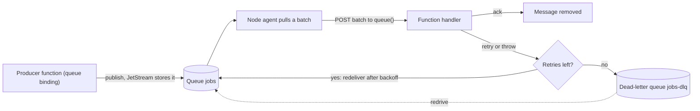
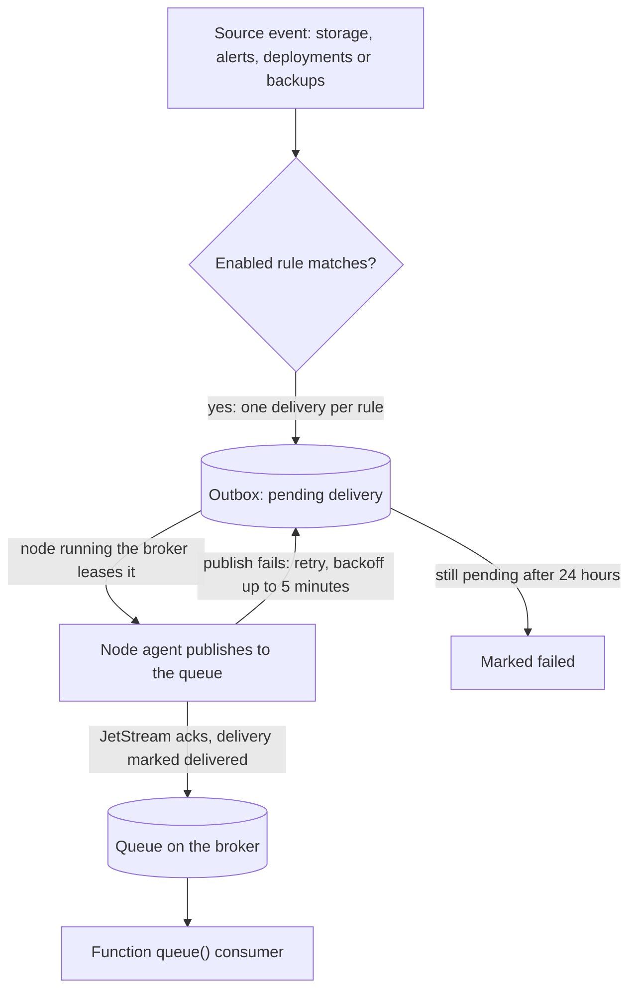

A **managed broker** is a message broker that Yoal runs for you on one of your nodes. Apps use it for background jobs, fan-out and events without running a broker container themselves. This page covers creating and attaching a broker, working with its queues and streams, reading its metrics, and routing platform events (uploads, deployments, alerts and backups) into a queue. Functions are the usual consumer of those queues; see [Functions](/compute/functions) for writing the handler.

## Create a broker

Yoal brokers run NATS with JetStream turned on. NATS is the only engine at the moment. In the dashboard, open **Queues → Create broker**, or use the CLI:

```sh
yoal broker create jobs --project api
```

This creates a broker called `jobs` and attaches it to the `api` project, which then receives `NATS_URL`. Yoal places the broker on the same node as the project. Broker names are 3 to 40 characters: lower-case letters, digits and single hyphens.

| Option | Default | Limits |
|---|---|---|
| `--version` | `2.12` | `2.12` or `2.11` |
| `--memory` | `256M` | 64 MB to 16 GB |
| `--cpus` | `0.5` | up to 8 |
| `--storage` | `2G` | 256 MB to 1 TB; the most message data the broker keeps on disk |
| `--placement` | `auto` | `auto`, `edge`, or a node id |
| `--prefix` | `NATS` | the environment variable prefix for the project |
| `--disk` | the **Queues** default in **Settings → Storage** | `system`, `fast`, `bulk`, or a [disk](/self-hosting/nodes-and-fleet#disks) by name, for the broker's data. `--volume` still works as an old name for it |

A broker listens only on its node's loopback address and its private container network, never on a public address. Connections are not encrypted, so reach a broker on another machine through an SSH tunnel rather than over the internet.

### Resize, upgrade and restart

`yoal broker update` changes memory, CPUs, storage or version. The broker restarts with the new settings and keeps its data:

```sh
yoal broker update jobs --memory 512M --storage 4G
yoal broker update jobs --version 2.12
```

Versions only move forward. Upgrading a `2.11` broker to `2.12` works in place; going back to an older version is refused. `yoal broker restart jobs` restarts the container, and its streams are kept.

### Delete and purge

`yoal broker delete jobs` moves a broker to the trash. Its container stops, its streams stay on disk, and you can bring it back with `yoal broker restore jobs` for 7 days. You cannot delete a broker that is still attached to a project; detach it first. A trashed broker is purged when its trash period ends, or immediately with `yoal broker purge jobs`, which deletes its data and streams for good.

## Attach a broker to an app

Attach a broker to a process, container or function project:

```sh
yoal broker attach jobs --project worker
yoal broker detach jobs --project worker
```

An attached app receives five environment variables, named after the attachment prefix. With the default prefix `NATS`, the app gets:

| Variable | Value |
|---|---|
| `NATS_URL` | the full connection URL, with the user and password |
| `NATS_HOST` | `127.0.0.1` for a process app, or the broker's network alias for a container |
| `NATS_PORT` | the broker's port for that host |
| `NATS_USER` | the broker's user |
| `NATS_PASSWORD` | the broker's password |

Most NATS clients read `NATS_URL` directly. The values are set when the app starts. Attaching or detaching a broker restarts a running app so it picks up the change.

A few rules apply:

- **Same node.** A project's brokers, databases and private storage must share a node. Attaching is refused if the project's other services already run on a different node. If the project's running workload is on another node, the attach succeeds, but the app gets no `NATS_URL` until you redeploy it next to the broker.
- **Static sites cannot attach.** Process, container and function projects can.
- **Attach needs `broker:update` and `project:update`.** Credentials need `broker:credentials` (see below).

### Connection details

The broker's page in the dashboard shows its connection details and client snippets. From the CLI, `yoal broker credentials jobs` prints the connection URL, and `--json` prints the user, password, host and port as well:

```bash
nats --server "$(yoal broker credentials jobs)" stream ls
```

The URL points at loopback on the broker's node, so run the client there or through `ssh -L`. Revealing the password needs the `broker:credentials` permission, from a dashboard session or an API key that holds it. The **Deploy** key preset leaves it out, so tick the scope on the key the CLI uses. The MCP server never returns broker credentials. Every reveal is recorded in the audit log.

## Queues and streams

JetStream keeps messages in **streams**. A function queue called `emails` is the stream `YOAL_Q_emails` on the broker, and Yoal creates it the first time something uses it. Streams that your own apps create with a NATS client also appear in the list, under their own names.

To create a queue before anything uses it, run `yoal broker queue-create jobs emails`, or choose **New queue** on the broker's **Queues** tab.

### Inspect the queues

```sh
yoal broker queues jobs
```

This lists each stream with its messages and bytes, and its consumers with the pending, awaiting-acknowledgement and redelivered counts. The listing refreshes about once a minute while the broker runs. It shows up to 200 streams, and up to 20 consumers per stream. The dashboard shows the same information on the **Queues** tab.

To read messages without consuming them, peek at a stream. Peeking returns up to 50 messages per call, and each body is cut at 16 KiB:

```sh
yoal broker peek jobs emails-dlq --limit 20
yoal broker peek jobs emails-dlq --from 120
```

Use `--stream <name>` instead of a queue name for a stream your app created itself, for example `yoal broker peek jobs --stream EVENTS`.

### Send a test message

```sh
yoal broker send jobs emails '{"to":"a@example.com"}'
yoal broker send jobs emails --file event.json --count 10 --delay 30s
```

Bodies are JSON unless you pass `--text`. A body is at most 128 KiB, `--count` publishes up to 100 copies, and `--delay` holds a message back for up to 12 hours before the consumer sees it.

### Redrive, purge and delete

Messages that ran out of retries land in the dead-letter queue. Move them back into a queue once the bug is fixed:

```sh
yoal broker redrive jobs emails-dlq --to emails --limit 100
```

Each call moves up to 1,000 messages. Run it again to move more.

To clear messages, use these commands:

| Command | Effect |
|---|---|
| `yoal broker queue-purge jobs emails` | Removes every message. The stream and its consumers stay. |
| `yoal broker message-rm jobs emails 42` | Deletes one message by its sequence number, as shown by `peek`. |
| `yoal broker queue-rm jobs emails` | Deletes the stream, its messages and its consumers. A function queue gets an empty stream again on its next use. |

Creating, sending, peeking and redriving need `broker:update`. Purging, deleting and removing messages need `broker:delete`.

These actions run on the broker's node, so the broker must be running. The REST API waits up to 20 seconds for the result. If the task is still running, it answers `202 Accepted` with a `Location` header pointing at `/api/v1/node-tasks/:id`. A task that fails returns `502` with the error `node_task_failed`.

## Consume queues from a function

Declare producers and consumers in your function's `wrangler.jsonc`, the same way as on Cloudflare. Use `yoal.brokers` to say which broker holds each queue. If the function has only one attached broker, you can leave it out.

```jsonc
{
  "queues": {
    "producers": [{ "binding": "JOBS", "queue": "jobs" }],
    "consumers": [
      { "queue": "jobs", "max_batch_size": 20, "max_retries": 5, "dead_letter_queue": "jobs-dlq" }
    ]
  },
  "yoal": { "brokers": { "jobs": "events", "jobs-dlq": "events" } }
}
```

The consumer handler receives each batch in `queue()`:

```js
export default {
  async queue(batch, env) {
    for (const message of batch.messages) {
      await handle(message.body);
      message.ack();
    }
  },
};
```

Each message gets one verdict. Call `message.ack()` or `message.retry()` for one message, or `batch.ackAll()` and `batch.retryAll()` for the whole batch. A handler that returns without a verdict acks the batch. A handler that throws retries it.

The diagram shows where a message goes after each verdict, including the dead-letter queue:



Consumer settings default to Cloudflare's values:

| Setting | Default | Range |
|---|---|---|
| `max_batch_size` | 10 | 1 to 100 |
| `max_batch_timeout` | 5 seconds | 0 to 60 seconds |
| `max_retries` | 3 | 0 to 100 |
| `retry_delay` | exponential backoff, 1 second doubling to 60 seconds | 0 to 43,200 seconds |

A function can have up to 8 consumers. `max_concurrency` and `visibility_timeout_ms` are not supported and fail the deploy.

Some rules to know:

- **Dead-lettering.** After `max_retries` retries, a message moves to `dead_letter_queue` on the same broker. Without one, it is dropped with a warning in the logs.
- **One consumer per queue.** A queue on a broker has one consumer. A second function that consumes the same queue on the same broker is refused at deploy time.
- **At least once.** A message can be delivered more than once, so make handlers idempotent.

## Broker metrics

```sh
yoal broker metrics jobs --since 1h
yoal broker metrics jobs --from 2026-11-07T09:00:00Z --to 2026-11-07T10:00:00Z --interval 1m --samples
```

`--interval` takes `1m` or `1h`, and `--samples` prints every row. The dashboard's **Metrics** tab charts the same data:

- store used against the `--storage` budget
- backlog: messages pending, awaiting acknowledgement and redelivered
- the age of the oldest message that no consumer has processed yet
- messages and bytes in and out, slow consumers and connections
- container memory

The node samples each running broker once a minute. Samples are kept as history only when the platform's telemetry store is installed. Without it, `yoal broker metrics` reports that there are no samples, but `yoal broker queues` still works.

You can alert on a broker that is down, on a store that is nearly full, and on a backlog that is not draining. See [Alerts](/observe/alerts).

> [!WARNING]
> When the store is full, the broker refuses new messages rather than dropping old ones, so publishes fail. Raise `--storage` with `yoal broker update`, or let consumers drain the queue.

## Platform events

An **event rule** watches a source inside Yoal and publishes each matching event into a queue on one of your brokers. A function consumes that queue like any other. Yoal never calls a function directly for an event, so you get the queue's batching, retries and dead-letter queue.

The diagram follows an event from its source to the consumer. Delivery is handled by the control plane's outbox and the node that runs the broker, as described under [Delivery and retries](#delivery-and-retries):



> [!NOTE]
> Not available yet: webhook subscriptions for platform events. Events go only to queues, and they are not signed. Alert notifications can also post to a webhook; see [Alerts](/observe/alerts).

### Sources and events

| Source | Events | Filter | Fires when |
|---|---|---|---|
| `storage` | `object-create`, `object-delete` | the storage instance and bucket (required), a key `--prefix` and `--suffix` | an object is uploaded, copied or deleted |
| `alerts` | `firing`, `resolved` | one alert rule, or every rule | Yoal sends an alert notification for the rule |
| `deployments` | `created`, `promoted`, `failed` | one project, or every project | a deployment is created, promoted or rolled back, or a git build fails |
| `database-backups` | `completed`, `failed` | one database, or every database | a scheduled or manual backup finishes |

A rule with no `--event` matches every event its source has.

### Create a rule

```sh
yoal events create storage --storage media --bucket uploads --prefix incoming/ --suffix .jpg \
  --event object-create --broker jobs --queue images

yoal events create deployments --project shop --broker jobs --queue deploys
```

A rule needs `--broker` and `--queue`. Creating a rule also needs read access to what it watches, such as `storage:read` for a storage rule. When the first rule watches a bucket, the storage instance restarts once to turn on bucket notifications.

Attach the broker to the function that consumes the queue, then add the consumer to its `wrangler.jsonc`:

```jsonc
{ "queues": { "consumers": [{ "queue": "images", "max_batch_size": 10, "dead_letter_queue": "images-dlq" }] } }
```

```js
export default {
  async queue(batch) {
    for (const message of batch.messages) {
      const { bucket, object } = message.body; // R2's notification shape
      await resize(bucket, object.key);
      message.ack();
    }
  },
};
```

In the dashboard, choose **Events → Create rule**. The form changes its fields to match the source, and it shows the consumer configuration to copy.

### Message bodies

A storage event uses the same body as Cloudflare's R2 event notifications, so a consumer written for R2 runs unchanged. Yoal adds a `yoal` field with what R2 has no place for:

```json
{
  "account": "org_…",
  "action": "PutObject",
  "bucket": "uploads",
  "object": { "key": "incoming/cat.jpg", "size": 48213, "eTag": "82d23a75…" },
  "eventTime": "2026-11-07T11:04:18.532Z",
  "yoal": { "type": "storage.object-create", "storage": "media", "eventName": "s3:ObjectCreated:Put" }
}
```

`action` is `PutObject`, `CopyObject`, `CompleteMultipartUpload` or `DeleteObject`. Tagging, retention and legal-hold changes are not events. Deletes carry no `size`.

Every other source uses one envelope, with `type` set to `<source>.<event>`:

```json
{ "type": "alerts.firing", "id": "evt_…", "time": "2026-11-07T11:20:00.000Z", "account": "org_…", "data": { } }
```

Use `id` to recognise a repeat. Messages carry the `json` content type, so `message.body` is already an object.

### Delivery and retries

1. When the event happens, Yoal queues one delivery per matching rule.
2. The node that runs the broker publishes queued deliveries to the queue. It checks for new work every 2 seconds while idle.
3. A failed publish, for example while the broker is down or its store is full, is retried. The wait starts at 1 second, doubles each time, and stops at 5 minutes.
4. A delivery still unpublished after 24 hours is marked `failed`.

Delivery is at least once. Each delivery carries a unique message ID, so JetStream drops an exact duplicate published inside its duplicate window, but a consumer should still tolerate repeats.

Limits per organisation: 200 event rules, and 50,000 undelivered events. When the undelivered backlog is full, new events are dropped and logged, so a stuck broker never fails a deploy, backup or alert. Delivered and failed deliveries are kept for 7 days.

### Events in the dashboard

**Events** sits beside **Queues** in the sidebar.

- The **Rules** tab lists each rule with what it watches, its events, its target queue, its counts for the last 24 hours and its last error. The row menu sends a test event, enables or disables the rule, or deletes it.
- The **Deliveries** tab shows the newest 100 deliveries with their message bodies. It refreshes every 5 seconds while open.

To change a rule's events, filters or queue, use the CLI or the REST API.

### The events CLI

| Command | Purpose |
|---|---|
| `yoal events list` | List rules |
| `yoal events create <source>` | Create a rule |
| `yoal events info <id>` | Show one rule, with its counts and last error |
| `yoal events update <id>` | Change events, filters, queue or description; `--enable` or `--disable` |
| `yoal events test <id>` | Queue one synthetic event to check the consumer end to end |
| `yoal events deliveries [<id>]` | Recent deliveries; `--status pending\|delivered\|failed` |
| `yoal events delete <id>` | Delete a rule and drop its undelivered events |

`yoal event` is an alias.

## Broker and event API

| Method and path | Purpose |
|---|---|
| `GET`, `POST /api/v1/brokers` | List brokers (`?includeDeleted=1` for the trash), or create one |
| `GET`, `PATCH`, `DELETE /api/v1/brokers/:name` | Read, resize or delete a broker; `DELETE ?purge=1` purges a trashed one |
| `POST /api/v1/projects/:slug/brokers` | Attach a broker to a project |
| `POST /api/v1/brokers/:name/restart`, `/restore` | Restart or restore a broker |
| `GET /api/v1/brokers/:name/metrics`, `/queues`, `/logs` | Metrics, the stream listing and logs |
| `POST /api/v1/brokers/:name/queues` | Create a queue's stream |
| `POST /api/v1/brokers/:name/queues/:queue/messages` | Send a test message |
| `POST /api/v1/brokers/:name/queues/:queue/redrive` | Move messages from a dead-letter queue |
| `GET /api/v1/brokers/:name/streams/:stream/messages` | Peek at messages |
| `POST /api/v1/brokers/:name/streams/:stream/purge` | Purge a stream |
| `DELETE /api/v1/brokers/:name/streams/:stream` | Delete a stream |
| `DELETE /api/v1/brokers/:name/streams/:stream/messages/:seq` | Delete one message |
| `GET`, `POST /api/v1/events` | List rules, or create one |
| `GET`, `PATCH`, `DELETE /api/v1/events/:id` | Read, change or delete a rule |
| `POST /api/v1/events/:id/test` | Queue a synthetic event |
| `GET /api/v1/events/deliveries` | Recent deliveries; `?rule=`, `?status=` and `?limit=` |

Send a test message with curl:

```sh
curl -X POST https://control.example.com/api/v1/brokers/jobs/queues/emails/messages \
  -H "Authorization: Bearer yoal_…" \
  -H "Content-Type: application/json" \
  -d '{"body": "{\"to\":\"a@example.com\"}", "contentType": "json", "count": 1}'
```

Brokers use the `broker:*` permissions: `broker:read` to list and inspect, `broker:create` to create, `broker:update` to change and to create or change event rules, `broker:delete` to delete, purge and remove messages, and `broker:credentials` to reveal the password. See [Organisations and roles](/accounts/organizations-and-roles) for how roles get these.
