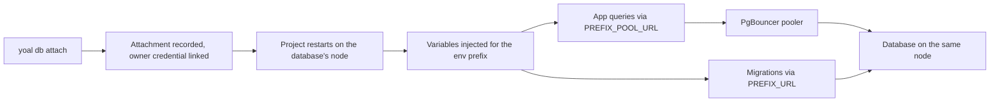
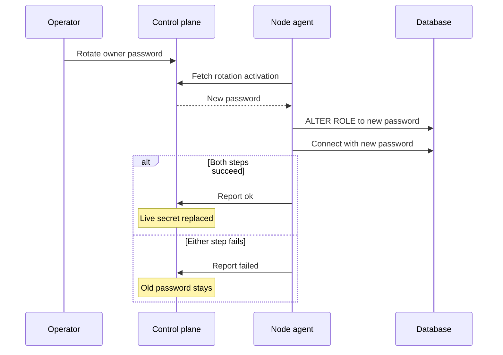

A managed database is an organisation-owned database that Yoal runs on one of your nodes. Yoal starts and restarts it, samples its size and activity, backs it up on a schedule, and injects connection details into the projects you attach it to. A database is not a project: it has no deployments or routes. This page covers creating and connecting databases, and managing their credentials, pooling and lifecycle. The [database studio](/data/database-studio) and [backups and point-in-time recovery](/data/backups-and-pitr) have their own pages.

## Engines and versions

| Engine | Versions (default) | Env prefix | Memory: minimum / default |
|---|---|---|---|
| PostgreSQL | 17 (default), 16 | `DATABASE` | 128 MB / 256 MB |
| MySQL | 8.4 (default), 9.7 | `DATABASE` | 384 MB / 512 MB |
| MariaDB | 11.8 (default), 11.4 | `DATABASE` | 192 MB / 256 MB |
| MongoDB | 8.0 (default), 9.0 | `MONGODB` | 256 MB / 512 MB |
| Valkey | 9.1 (default), 8.1 | `REDIS` | 128 MB / 256 MB |
| Redis | 8.10 (default), 8.8 | `REDIS` | 128 MB / 256 MB |
| ClickHouse | 26.8 (default), 26.3 | `CLICKHOUSE` | 1 GB / 2 GB |

Valkey is the BSD-licensed fork of Redis and the better default for caches and queues. Redis 8 is AGPLv3, so choose it only if you need a Redis-only module.

Not every feature applies to every engine. PostgreSQL has the full set. The others have the core lifecycle, backups, owner password rotation and, except for ClickHouse, the studio.

| Feature | PostgreSQL | MySQL, MariaDB | MongoDB | Valkey, Redis | ClickHouse |
|---|---|---|---|---|---|
| Connection pooler (PgBouncer) | yes | no | no | no | no |
| Extensions | yes | no | no | no | no |
| Optional TLS | yes | no | no | no | no |
| Metrics, tables and slow queries | yes | no | no | no | no |
| Backups and restore | yes | yes | yes | yes | yes |
| Point-in-time recovery (PostgreSQL 18, needs a PITR repository) | yes | no | no | no | no |
| Major-version upgrade planner | yes | no | no | no | no |
| Studio | yes | yes | yes | yes | no |
| Owner password rotation | yes | yes | yes | yes | yes |

Changing a version is only possible in place for some engines. A PostgreSQL major version goes through `yoal db upgrade` (see [changing the version](#changing-the-version-and-moving-nodes)). MySQL, MariaDB, Valkey, Redis and ClickHouse can move forward to a newer listed version in place with `yoal db update --version`. MongoDB must be backed up and restored into a new database to change version.

## Create a database

In the dashboard, open **Databases → New database**, choose an engine and fill in the form. From the terminal:

```sh
yoal db create main --project api
```

This creates a PostgreSQL 17 database called `main` and attaches it to the `api` project. The `yoal` command is an alias for `yoal`.

| Flag | Meaning |
|---|---|
| `-p, --project <slug>` | Attach to this project straight away. The project is placed on the database's node. |
| `--engine <engine>` | `postgres` (default), `mysql`, `mariadb`, `mongodb`, `valkey`, `redis` or `clickhouse`. |
| `--version <version>` | One of the versions in the table above. |
| `--variant <variant>` | PostgreSQL image: `standard` (default), `postgis` or `pg_cron`. The last two need `--version 18`. See [image variants](#image-variants). |
| `--prefix <PREFIX>` | Env prefix for the attachment. Defaults to the engine's prefix. |
| `--placement <where>` | `auto` (default), `edge`, or a node id. |
| `--memory <size>` | For example `512M` or `1G`. Defaults to the engine's default. |
| `--cpus <n>` | CPU limit, for example `1` or `0.5`. Default `1`. |
| `--storage <size>` | Storage budget for alerts and the dashboard gauge. Default `10G`. |
| `--disk <where>` | Where the data is stored: `system`, `fast`, `bulk`, or a [disk](/self-hosting/nodes-and-fleet#disks) by name. Defaults to the **Databases** default in **Settings → Storage**. |
| `--[no-]pooler` | PgBouncer sidecar. On by default; PostgreSQL only. |
| `--extension <name>` | Enable an allowlisted extension. Repeatable; PostgreSQL only. |
| `-y, --yes` | Skip confirmation. Required when stdin is not a terminal. |
| `--json` | Print the raw response. |

Names are 3 to 40 characters of lowercase letters, digits and single hyphens, starting and ending with a letter or digit. MySQL names can be at most 32 characters. A name is unique within your organisation, including databases in the trash. On PostgreSQL, names cannot start with `pg-`, and the reserved names `postgres`, `template0` and `template1` are refused. Each engine also reserves a few names of its own, which the dashboard and API reject.

With `--placement auto`, Yoal picks the node with the most free memory budget. If no node has room for the requested memory, creation fails rather than overcommitting. With `--disk fast` or `--disk bulk`, only nodes with a ready disk of that tier and room for the storage budget are considered, and Yoal never falls back to the other tier. A disk name places the database on that disk's node.

## Sizing

- **Memory** is a hard limit enforced when the node runs the container. It must be at least the engine's minimum and at most 16 GB. Memory is counted against the node's budget when you create or grow a database.
- **CPUs** can be fractional, up to 8.
- **Storage** is a budget between 256 MB and 1 TB, with a 10 GB default. Yoal uses it for the storage gauge and the storage alert. When the database's data directory sits on a disk, Yoal also checks that the disk has room for the budget and keeps 10% of it free.

To change any of these, open the database's **Settings** tab and use **Resources → Resize**, run `yoal db update main --memory 1G --cpus 2 --storage 20G`, or send a `PATCH` to the API. Limits take effect when the node next restarts the container, so run `yoal db restart main` to apply them now.

## Attach to a project

Attaching links a database to a project under an env prefix. The project receives the connection details as environment variables the next time it starts. Use the CLI, the dashboard (from the database's **Overview** or the project), or the API:

```sh
yoal db attach main --project api --prefix DATABASE
yoal db detach main --project api
```

```sh
curl -X POST https://control.example.com/api/v1/projects/api/databases \
  -H "Authorization: Bearer yoal_…" \
  -H "Content-Type: application/json" \
  -d '{"database": "main", "envPrefix": "DATABASE"}'
```

Attaching needs `database:update` and `project:update`. A few rules apply:

- A project can attach several databases, each under a different prefix. Attaching a second database with the same prefix is refused.
- Attached databases and the project must share a node. A project with attachments is placed on its database's node at deploy time. An explicit placement on another node is rejected.
- Static sites cannot attach databases.
- Attaching or detaching restarts the project, so it picks up the new variables. Detaching does not touch the data.
- A database that is attached to a project cannot be deleted. Detach it first.
- By default the app connects as the database owner. To give it fewer rights, attach it with a [named credential](#named-credentials): `--credential <id|role>` in the CLI, **Connect as** in the dashboard's attach dialog, or `"credential"` in the API body. PostgreSQL only. The pooler only knows the owner, so a project attached with a named credential connects directly and receives no `_POOL_*` variables.

The path from attaching to a running connection is shown below. The app receives its variables when it starts, and it can reach the database either through the pooler or directly:



### Environment variables

For a prefix of `DATABASE`, the project receives:

| Variable | Contents |
|---|---|
| `DATABASE_URL` | Direct connection string to PostgreSQL. |
| `DATABASE_HOST`, `DATABASE_PORT` | Where to connect. |
| `DATABASE_USER`, `DATABASE_PASSWORD`, `DATABASE_NAME` | Credentials and database name. |
| `DATABASE_SSL_MODE`, `DATABASE_CA_CERT` | Only when TLS is on (PostgreSQL). `CA_CERT` is set for process projects. |
| `DATABASE_POOL_URL`, `DATABASE_POOL_HOST`, `DATABASE_POOL_PORT` | Only when the pooler is on (PostgreSQL). |

MongoDB also receives `MONGODB_URI`, which most drivers read. Valkey and Redis set `REDIS_NAME` to `0`. Only PostgreSQL gets the SSL and pooler variables.

Process projects connect to `127.0.0.1` on the database's host port. Container projects connect to the database by its network alias, `db-<id>`, on the same node.

Pick the URL that suits each query path. A common pattern is to use `DATABASE_POOL_URL` for the application's queries and `DATABASE_URL` for migrations, because migrations need a direct session.

When you open a project's variables, Yoal scans the names your code and `.env` files use, and offers to link a matching database under the usual prefix. Only names are read, never values.

## Connections and TLS

Databases listen only on the loopback interface of their node. Each one is published on a host port from 15432 to 16431, so the connection string points at `127.0.0.1:<port>` on that node. To reach it from your own machine, open an SSH tunnel to the same port, then use the URL:

```sh
ssh -L 15432:127.0.0.1:15432 <node>
psql "$(yoal db credentials main)"
```

If you expose the database through your own TCP proxy or tunnel, store the public `postgres://…` URL in the database's **Overview → Connection → Public database URL**. Yoal keeps it encrypted and shows it only when you reveal it. The public URL never appears in desired state, logs or MCP output.

TLS is on by default. An operator can turn it off with `YOAL_FEATURE_DB_TLS=0` (see [configuration](/self-hosting/configuration)). With TLS on, PostgreSQL uses a per-database certificate, connection strings carry `sslmode=require`, and the public CA certificate is available from the credentials response. For full hostname verification, use `sslmode=verify-full` with the CA. If certificate generation fails, the database starts without TLS and the dashboard shows a warning.

## Connection pooling

PostgreSQL databases run a PgBouncer sidecar by default. It uses transaction pooling and accepts up to 200 client connections. Apps connect to it through `<PREFIX>_POOL_URL`. The sidecar runs in its own unit, so if it crashes, direct connections still work.

Transaction pooling does not suit everything. Use the direct URL for:

- migrations and schema tools
- `pg_dump` and `pg_restore`
- `LISTEN` and `NOTIFY`, and logical replication
- advisory locks
- `SET` settings and temporary tables used across statements
- prepared statements, and cursors held across transactions

To turn the pooler off, create the database with `--no-pooler`, or change **Settings → Connection pooler** (or send `"pooler": false` in a `PATCH`). Restart the pooler on its own with `yoal db restart main --pooler`. Postgres connections are not affected. An alert fires when pool saturation goes above 90%.

## Credentials

Yoal generates an owner password and a monitor password when you create a database. Both are encrypted with your organisation's key. The owner password is the one apps use.

To reveal the connection details, use one of these:

- **Overview → Connection → Reveal credentials** in the dashboard.
- `yoal db credentials main` prints the connection URL. Add `--json` for the full object, including the password.
- `GET /api/v1/databases/main/credentials` returns the URL, the password, the TLS mode, the CA certificate and copy-paste snippets. The response is never cached.

Revealing credentials needs `database:credentials`. The owner, admin and deployer roles have it, and viewers do not. It is not in the default scopes for agents, and the MCP server has no reveal tool. Every reveal is recorded in the audit log.

The dashboard snippets cover psql, node-postgres, Drizzle, Prisma, Kysely, Django, Rails and Go (pgx), among others.

### Rotating the owner password

Rotation replaces a password without losing the data. Rotate from the database's actions menu (**Rotate owner password**), with `yoal db rotate main`, or with `POST /api/v1/databases/main/rotate` and `{"role": "owner"}`. Rotating the monitor role uses `--monitor`, and is PostgreSQL only. Rotation needs both `database:credentials` and `database:update`, and only one rotation per role can run at a time.

Rotation happens in stages. The new password is prepared and stored separately. The node sets it on the database and checks a fresh connection. Only then does Yoal switch to the new password. If the node reports a failure, the old password stays in place and the error appears on the database. Once the new password is live, Yoal restarts the projects attached with it so they pick it up. Nothing else needs restarting.

The steps, and the point at which the live password changes, are shown below:



## Monitoring and slow queries

The overview shows storage, connections, cache hit ratio and the last backup. The **Metrics** tab charts the same figures over time, for the last 1 hour, 24 hours, 7 days or 30 days:

- size against the storage budget
- active and idle connections against `max_connections`
- commits and rollbacks per minute
- cache hit ratio
- rows written per minute

Yoal samples each running database once a minute. The API at `GET /api/v1/databases/:name/metrics` accepts `from`, `to` and `interval` (`1m` or `1h`). One-minute buckets cover up to 48 hours, and hourly buckets cover up to 92 days.

The **Insights** tab shows the 50 largest tables, with row estimates, scan counts and the last autovacuum and autoanalyze times. It also shows slow queries: the top 50 normalised statements from `pg_stat_statements`, refreshed every five minutes. Slow queries need the `pg_stat_statements` extension, which is not enabled by default. Enable it with `--extension pg_stat_statements` or in **Settings → Extensions**.

Yoal raises alerts when a database uses more than its storage budget threshold (85% by default), its connection limit threshold (90% by default) or its pool saturation threshold (90% by default). The operator sets the thresholds. See [alerts](/observe/alerts) for where alerts appear, and [dashboards and logs](/observe/dashboards-and-logs) for logs. `yoal db logs main --follow` tails a database's log.

## Extensions

Extensions are a PostgreSQL feature and come from an allowlist. Choose them when you create the database with `--extension`, or later in **Settings → Extensions**. An extension added later is installed the next time the database starts. Removing an extension from the list does not drop it from the database.

| Category | Extensions |
|---|---|
| Observability | `pg_stat_statements`, `pg_buffercache`, `pgstattuple`, `pgrowlocks`, `pg_freespacemap`, `pg_visibility`, `pg_walinspect`, `pageinspect`, `amcheck`, `pg_prewarm`, `sslinfo` |
| Text search | `pg_trgm`, `unaccent`, `fuzzystrmatch`, `dict_int`, `dict_xsyn` |
| Data types | `citext`, `hstore`, `ltree`, `isn`, `cube`, `seg`, `lo` |
| Indexing | `btree_gin`, `btree_gist`, `bloom` |
| Functions | `pgcrypto`, `uuid-ossp`, `tablefunc`, `intarray`, `earthdistance`, `tsm_system_rows`, `tsm_system_time` |
| Triggers | `moddatetime`, `autoinc`, `insert_username`, `refint`, `tcn` |
| Needs a specific image | `pgvector`, `postgis`, `pg_cron` |

`pgvector` is in every PostgreSQL 18 image. PostgreSQL 16 and 17 do not have it: enabling it there writes a warning to the node's log, and the database keeps running. `postgis` and `pg_cron` each need their own image variant.

### Image variants

A PostgreSQL 18 database can be created on one of three images:

| Variant | Adds | Use it for |
|---|---|---|
| `standard` (default) | `pgvector` | Everything else. |
| `postgis` | PostGIS 3, plus `pgvector` | Geospatial types, functions and indexes. |
| `pg_cron` | `pg_cron`, plus `pgvector` | Scheduled SQL jobs inside the database. |

```sh
yoal db create places --version 18 --variant postgis
yoal db create jobs --version 18 --variant pg_cron
```

In the dashboard, choose PostgreSQL 18 and then the **Image**. The variant's extension is enabled for you. You choose the variant when you create the database and cannot change it later. Variants do not combine: one database cannot have both PostGIS and pg_cron. A restore keeps the source's variant.

On a `pg_cron` database, jobs run in the database itself. Schedule them with `cron.schedule`:

```sql
SELECT cron.schedule('nightly-cleanup', '0 3 * * *', $$DELETE FROM events WHERE at < now() - interval '30 days'$$);
SELECT * FROM cron.job_run_details ORDER BY start_time DESC LIMIT 10;
```

Jobs restored from a backup still name the source database. Point them at the new one with `cron.alter_job(job_id, database => '<new name>')`, using the name with underscores.

Extensions that reach outside the database, run untrusted procedural code or can destroy data are not offered. These include `dblink`, `postgres_fdw`, `file_fdw`, `adminpack`, the Perl and Tcl languages, and `pg_surgery`.

## Restart, delete, restore and purge

Restarting restarts the database and its pooler together. From the terminal, use `yoal db restart main`, `yoal db restart main --pooler` to restart only the pooler, or `yoal db restart --all` to restart every database. The dashboard has a **Restart** button in the database header. Attached projects reconnect when the database is back.

Deleting moves a database to the trash. Its container stops, and its data stays on the node.

```sh
yoal db delete main
yoal db restore main
yoal db purge main
```

- **Delete** is refused while the database is attached. Detach it first. It also cancels any backups that are queued but have not run.
- **Restore** brings the database back on the same node with its data. Its memory is admitted again, so restoring can fail if the node is full. Attachments are not restored. Re-attach the projects that need the database.
- **Purge** permanently deletes a database that is in the trash, along with its data. The CLI asks you to type the name to confirm, and `-y` skips that prompt. Purge is available through `DELETE /api/v1/databases/main?purge=1`.

Trashed databases are kept for 7 days by default. The operator can change this from 1 to 90 days. After that, Yoal purges them automatically. Until then, the name stays taken.

## Changing the version and moving nodes

For PostgreSQL, a major version change always goes through the upgrade planner. `yoal db upgrade main --to 17` shows a plan, with any blockers and warnings. Add `--apply` to queue a pinned backup and get the manual runbook. Yoal never switches a PostgreSQL major version by itself.

Asking the planner for the major the database already runs is refused, because there is nothing to plan. Yoal runs one image per PostgreSQL major and has no separate minor-update step.

For MySQL, MariaDB, Valkey, Redis and ClickHouse, change the version with `yoal db update main --version <version>`, the `update_database` MCP tool, or `PATCH /api/v1/databases/main` with `{"version": "…"}`. The CLI asks you to confirm, and `-y` skips the prompt. The database restarts on the new image with its data. The dashboard does not change versions. Only forward moves within the listed versions are accepted, and downgrades are refused.

To move a database to another node, open **Settings** and choose **Move to another node**, or send `POST /api/v1/databases/main/move`. A move copies the data with a backup, so it works for every engine. Attached projects are stopped while Yoal takes a final backup and restores it on the new node. Downtime is roughly one backup plus one restore. The data lands on a disk of the same tier on the new node, or its system disk if the database is on one; add `storage` to the request body to choose another target. Projects that use app volumes or a persistent data directory block the move.

A database with read replicas cannot move, and its PostgreSQL major cannot be upgraded. Remove the replicas first, or add a replica on the target node and promote it.

### Named credentials

A named credential is a separate PostgreSQL role with its own generated password, so an app, a reporting tool or a backup job can connect with only the rights it needs. Three roles are available:

| Role | What it can do |
|---|---|
| `app` | Read and write tables in the `public` schema. It cannot manage roles or the database. |
| `readonly` | `SELECT` only. Use it for BI and reporting tools. |
| `backup` | Read everything a dump needs, and write nothing. |

The owner and monitor credentials always exist and appear in the same list. Manage named credentials from **Overview → Credentials** in the dashboard, or with the CLI:

```sh
yoal db credentials create main --role readonly --purpose "Metabase" --expires 2027-01-01
yoal db credentials list main
yoal db attach main --project reports --credential readonly
yoal db credentials reveal main dbc_…
yoal db credentials rotate main dbc_…
yoal db credentials revoke main dbc_…
```

A new credential is **pending** until the node creates the role, then **ready**. You can only attach or reveal a ready credential. `--credential` takes the credential's id, or its role when exactly one ready credential has that role.

- **Rotate** sets a new password the same way as an owner rotation. If the node fails to apply it, the old password keeps working. Projects attached with the credential restart once the new one is live.
- **Revoke** disables the role's login, so anything still using it is locked out. It is refused while a project is attached with the credential: detach it first. A revoked credential cannot be reused, so create a new one instead.
- **Expiry** is optional. An expired credential can no longer be revealed or attached.

Creating, rotating and revoking need `database:credentials` and `database:update`. Revealing a password needs `database:credentials` and works from the dashboard and the CLI only. The MCP server can list, create, rotate and revoke credentials, but it never returns a password. Every action is recorded in the audit log. The API routes are `GET` and `POST /api/v1/databases/:name/credentials/named`, `GET` (reveal) and `DELETE` (revoke) on `…/named/:id`, and `POST …/named/:id/rotate`.

## Read replicas

A PostgreSQL database can have asynchronous streaming read replicas. A replica on another node keeps a copy of the data there, so you can promote it if the primary's node is lost. A replica on the primary's own node only adds read capacity.

```sh
yoal db replica add main --node worker-2
yoal db replica list main
yoal db replica remove main dbr_…
```

The same actions are in the **Replicas** section of the database's **Overview**, the `list_database_replicas`, `create_database_replica` and `delete_database_replica` MCP tools, and `GET`, `POST /api/v1/databases/main/replicas` and `DELETE /api/v1/databases/main/replicas/{id}`.

- A replica reserves the database's memory on its node. Its data goes on a disk of the same tier as the primary's, or on the node's system disk if the primary is on one. Pass `--disk <where>` (`system`, `fast`, `bulk` or a disk on that node) to choose another. Each database can have up to 2 replicas by default (`database.maxReplicas` in **Settings → Clustering**).
- On first start the replica copies the primary with `pg_basebackup`, then streams changes. Its status is `pending` until it first connects, then `streaming`, or `lagging` when it is more than 30 seconds or 256 MB behind. `stopped` means it is not connected; `lost` means the primary removed WAL it still needed, so remove it and add a new one.
- A replica on another node needs both nodes on the managed overlay. The replication traffic goes through the same mTLS listener as a cross-node attachment, and no port is published.
- Removing a replica deletes its copy from its node. The primary and its data are untouched.
- Only `async` replicas are available, for PostgreSQL only. Replicas of a database with point-in-time recovery turned on are not supported.

While a replica the app can reach is streaming or lagging, attached apps get four more variables, with the same user and password as `<PREFIX>_URL`:

| Variable | Value |
|---|---|
| `<PREFIX>_READ_URL` | Connection URL of the first reachable replica |
| `<PREFIX>_READ_URLS` | Every reachable replica, comma-separated |
| `<PREFIX>_READ_HOST`, `<PREFIX>_READ_PORT` | Host and port of the first one |

An app reaches a replica on its own node directly. A process app reaches one on another node only when cross-node service endpoints are on (`YOAL_FEATURE_SERVICE_ENDPOINTS`). The variables appear and disappear as replicas start and stop streaming, and the app restarts each time. Reads can trail the primary by the replica's lag, so use `<PREFIX>_URL` when a read must see a write the app just made.

### Promote a replica

Promotion makes a replica the primary. It is a manual action from the dashboard (you type the database name), the CLI or REST. It is never available over MCP.

```sh
yoal db replica promote main dbr_…
yoal db replica promote main dbr_… --accept-data-loss
```

Yoal first stops the current primary. When its node is online, Yoal waits until the node confirms the primary has stopped, and gives up after 10 minutes. Then the replica's node runs `pg_ctl promote` and the database moves to that node with the replica's data. Attached apps restart with the new address, and their open connections drop once. The old primary's node deletes its copy when it next checks in. The other replicas are rebuilt from the new primary.

The promotion is refused unless the replica is streaming, within 64 MB and 60 seconds of the primary, and reported its lag in the last 2 minutes, and the primary's node is online. Otherwise `--accept-data-loss` (`acceptDataLoss: true`) promotes anyway, and commits the replica had not replayed are lost. A replica that never streamed, or is `failed` or `lost`, cannot be promoted, and neither can one on the primary's own node.

Over REST, send `POST /api/v1/databases/main/replicas/{id}/promote` with `{"confirm": true}` and the `If-Match` header set to the database's `primaryGeneration` from `GET …/replicas`. A different generation returns 412. The response describes the promotion, which goes from `fencing` to `promoting`, `repointing` and `completed`, or `failed`.

> [!WARNING]
> Promote with `--accept-data-loss` only once you are sure the old primary is down. Yoal cannot stop a primary on a node it cannot reach, and an app on that node keeps writing to it until the node checks in again.

## Command reference

| Command | What it does |
|---|---|
| `yoal db list` (`ls`) | List databases. `--all` includes the trash. |
| `yoal db create <name>` | Create a database. See the flags above. |
| `yoal db info <name>` (`show`) | Show status, node, size against budget, attached projects and top tables. |
| `yoal db update <name>` | Change `--memory`, `--cpus` or `--storage`, turn the pooler on or off with `--pooler` or `--no-pooler`, add extensions with `--extension`, or move forward in place with `--version`. |
| `yoal db attach <name> -p <project>` | Attach a database to a project. `--prefix` sets the env prefix, and `--credential` connects as a named credential. |
| `yoal db detach <name> -p <project>` | Detach a database from a project. |
| `yoal db delete <name>` (`rm`) | Move a database to the trash. |
| `yoal db restore <name>` | Bring a trashed database back. |
| `yoal db purge <name>` | Permanently delete a trashed database and its data. |
| `yoal db credentials <name>` (`creds`) | Print the connection URL. `--json` returns the full object. |
| `yoal db credentials list\|create\|rotate\|revoke\|reveal <name>` | Manage [named credentials](#named-credentials). `create` takes `--role`, `--purpose` and `--expires`; the others take a credential id. |
| `yoal db logs <name>` | Show the database's log. `--follow`, `--limit`, `--level`, `--q` and `--after` filter it. |
| `yoal db restart <name>` or `--all` | Restart a database and its pooler. `--pooler` restarts only the pooler. |
| `yoal db upgrade <name> --to <major>` | Plan a PostgreSQL major upgrade. `--apply` queues the backup and runbook. |
| `yoal db rotate <name>` | Rotate the owner password. `--monitor` rotates the monitor role. |
| `yoal db backups <name>` | List backups and the last verified restore. |
| `yoal db backup <name>` or `--all` | Take a backup now. `--pin` keeps it past retention. |
| `yoal db backup-delete <name> <id>` | Delete one backup. |
| `yoal db restore-backup <name> <id> --as <new>` | Restore a backup into a new database. |
| `yoal db backup-policy <name>` | Show or change the schedule and retention. |
| `yoal db replica list <name>` | List [read replicas](#read-replicas) with status and lag, and recent promotions. |
| `yoal db replica add <name> --node <node>` | Add a read replica on a node. `--disk` picks where its data goes on that node. |
| `yoal db replica remove <name> <id>` | Remove a replica and delete its copy. |
| `yoal db replica promote <name> <id>` | [Promote a replica](#promote-a-replica) to primary. `--accept-data-loss` promotes a replica that is behind. |

Every command accepts `--json` and `-h`. Delete, purge, `credentials revoke`, `update --version`, `upgrade --apply`, `replica remove` and `replica promote` ask for confirmation, and `-y` skips it. The backup commands are described in [backups and point-in-time recovery](/data/backups-and-pitr).

The REST API has the same operations under `/api/v1/databases`, and project attachments under `/api/v1/projects/:slug/databases`. See the [REST API](/clients/rest-api) page for authentication. The MCP server can create, update, attach, restart, rotate, manage named credentials and read replicas, and read logs for databases, but it cannot reveal credentials, promote a replica or purge.

Access is set by roles. The owner and admin roles have every database permission. Deployers can create, update and reveal credentials, but cannot delete unless granted `database:delete`. Viewers can read. See [organisations and roles](/accounts/organizations-and-roles) for details, and [quotas and limits](/self-hosting/quotas-and-limits) for the limits that apply to your organisation.
