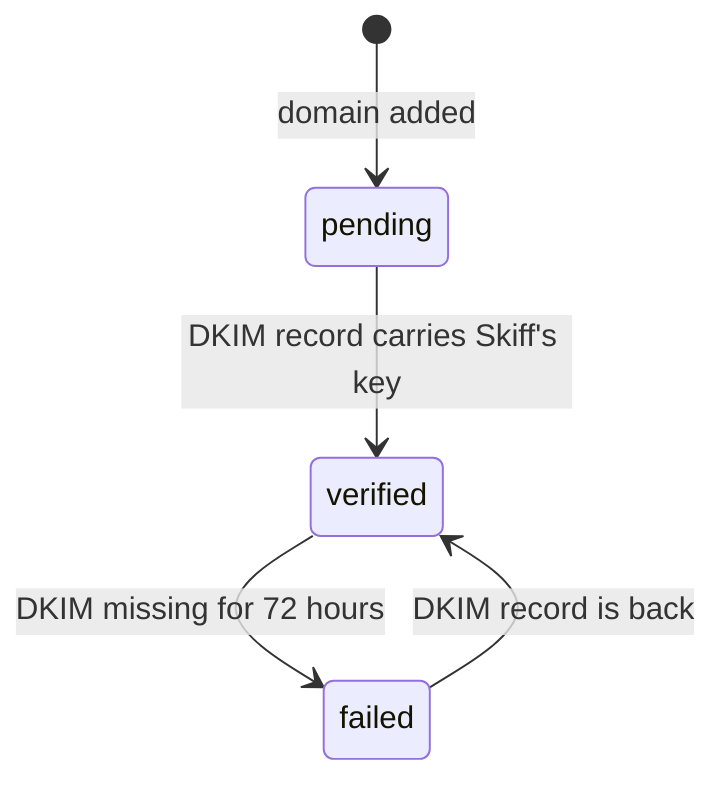
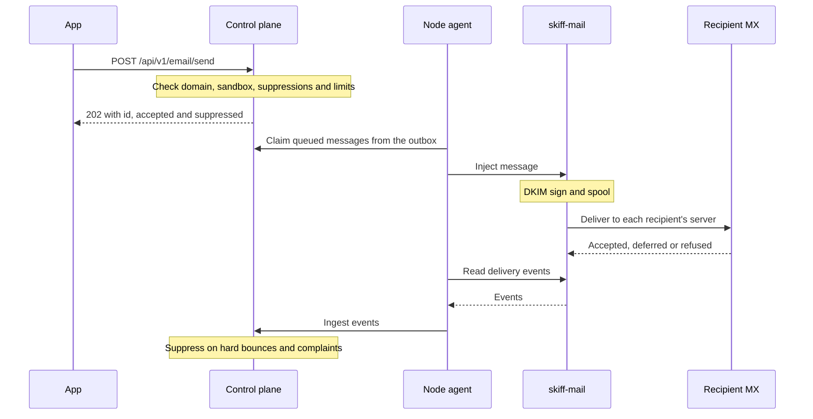

Skiff Email sends transactional mail, such as sign-up confirmations, receipts and alerts, from addresses on domains you own. The mail comes from Skiff's own server, skiff-mail, which delivers straight to each recipient's mail servers rather than handing it to a third-party relay. Apps send over an HTTP API or plain SMTP, and the dashboard and `skif email` show what happened to each message. This page covers the operator setup, adding a sending domain, sending, credentials, suppressions and delivery logs.

> [!IMPORTANT]
> Receiving mail is not available yet. You can add a domain for sending only: a receiving flag is refused, and nothing accepts mail on your apps' behalf. The mail server's inbound port 25 takes only bounce and complaint reports, never mail for your apps.

## Set up the mail server

Operators run this part once, from the checklist on the **Email** overview or from **Email → Mail server**. A platform admin chooses a **mail node** there. The node must run an agent with mail support and have a public address. If it is greyed out, update its agent from **Nodes** first. Until a node is chosen, every send is refused with `email_not_set_up`.

Email is on by default. Setting `SKIFF_FEATURE_EMAIL=0` hides the Email surfaces and refuses sends.

The mail node answers on hostnames under one **mail domain**. By default it is the **content domain**, the one your sites live under. To send from somewhere else, enter a custom domain (or a URL) under **Mail domain** in **Email → Mail server**; `SKIFF_MAIL_DOMAIN` sets one at install time, and the dashboard setting overrides it. The slugs `mx1`, `smtp` and `bounces` are reserved so no project takes a mail host name. **Email → Mail server** lists the records to publish. For a mail domain of `example.com`, they are:

| Name | Type | Value |
| --- | --- | --- |
| `mx1.example.com` | A | the node's IPv4 address |
| `mx.example.com` | A | the node's IPv4 address |
| `smtp.example.com` | A | the node's IPv4 address |
| `_spf.example.com` | TXT | `v=spf1 ip4:<node IPv4> -all` |
| `bounces.example.com` | MX | `mx.example.com`, priority 10 |
| `bounces.example.com` | TXT | `v=spf1 include:_spf.example.com -all` |

The A records appear only when the node has an IPv4 address.

> [!WARNING]
> Set the reverse DNS (PTR) of the node's IPv4 address to `mx1.example.com` in your server provider's console. Receivers reject mail from an IP whose PTR does not name the host it greets with. Skiff cannot set PTR records, and only the owner of the IP range can.

Skiff does not run preflight checks yet. Before you send real mail, check from the node that outbound port 25 is open, that inbound port 25 is reachable, and that the IP is not on a blocklist.

The node listens on these ports:

| Port | Use |
| --- | --- |
| 25 | Inbound. Bounce and complaint reports only; it is never a relay. |
| 587 | Submission with STARTTLS. |
| 465 | Submission with implicit TLS. |

**Email → Mail server** also has a **Delivery** switch. While it is on, sends are accepted and queued, but nothing is attempted. Use it while you fix a DNS mistake or a blocklisting.

## Add a sending domain

In the dashboard, go to **Email → Domains → Add domain**. From the CLI:

```sh
skif email domains add example.com
```

Pass `--no-auto-dns` to skip Cloudflare and print the records only, or `--no-sending` to add the domain without sending from it yet. When Skiff manages DNS for the domain, it creates the records itself. Otherwise it prints them for your DNS provider. For `example.com`, the records are:

| Purpose | Type and name | Value | Required |
| --- | --- | --- | --- |
| DKIM | TXT `skf202611._domainkey.example.com` | `v=DKIM1; k=rsa; p=<public key>` | Yes |
| SPF | TXT `example.com` | `v=spf1 include:_spf.example.com ~all` | Recommended |
| DMARC | TXT `_dmarc.example.com` | `v=DMARC1; p=none; rua=mailto:dmarc@example.com` | Recommended |

A few details matter:

- **DKIM** is the record that verifies the domain. Its selector is `skf` followed by the year and month the key was made. The public key is generated for this domain, and Skiff signs every message from it.
- **SPF** must exist once. If `example.com` already has an SPF record, add `include:_spf.example.com` to it rather than publishing a second one. Skiff never overwrites an existing SPF or DMARC record; `skif email domains info` shows the merged value to use.
- **Return path** needs nothing from you. Bounces come back to `bounces.example.com`, in a different envelope address for each recipient, so the platform records above handle them. Your From domain is signed with DKIM, which is what DMARC alignment checks.

Then check the records:

```sh
skif email domains check example.com
```

Public DNS can take a few minutes to show a new record. A domain is **verified** when its DKIM record carries Skiff's key. Until then it is **pending**, and nothing sends from it. If the DKIM record disappears after verification, Skiff keeps sending for 72 hours and then marks the domain **failed** and pauses it. Skiff re-checks every domain once a day, and `skif email domains info example.com` shows what each record currently returns. A domain moves between these states:



Removing a domain with `skif email domains rm example.com` refuses mail from it immediately, deletes its DKIM key, and deletes the records Skiff created. Records you added by hand stay until you remove them.

## Sandbox and limits

A new organisation starts in the **sandbox**. In the sandbox you can send only to addresses on your own verified domains and to sandbox recipients, at most 200 messages a day and 1 message a second. Once a platform admin moves the organisation out of the sandbox, the default limits are 10 messages a second and 10,000 a day. Platform admins can change either limit for an organisation.

### Sandbox recipients

A **sandbox recipient** is a single address, such as your personal Gmail inbox, that you may send test mail to while you are in the sandbox. Skiff emails the address a link, and mail to it is accepted only after its owner opens the link and clicks **Confirm**. Opening the link alone confirms nothing.

```sh
skif email addresses add me@gmail.com      # emails the link
skif email addresses list                  # pending or verified, and when the link expires
skif email addresses rm me@gmail.com
```

In the dashboard, open **Email → Sandbox** and choose **Add recipient**. You need `email:update`.

- A link works once and expires after 24 hours. Adding a pending address again sends a fresh link and cancels the old one. You can do this once a minute, and 5 times while a link is live.
- An organisation can have 50 sandbox recipients, at most 10 of them waiting for confirmation.
- The link comes from the platform's own mail settings, not your mail node. If the operator has not set up outgoing mail for Skiff, adding a recipient fails with `platform_mail_unavailable`.
- After you remove a recipient, the sandbox refuses mail to it again. Adding it back needs a new confirmation.

Sandbox recipients don't let you send *from* an address. That always needs a verified domain.

### Request production access

When test mail reaches the inbox with DKIM, SPF and DMARC passing, an organisation owner or admin asks to leave the sandbox. Describe what you send and to whom (at least 20 characters), give the number of messages you expect each day, and add your website if you have one.

```sh
skif email request-access --volume 500 \
  --use-case "Password resets and order receipts for customers of our shop" \
  --website https://example.com
skif email request-access                  # show the latest request and its answer
```

In the dashboard, use **Request production access** on **Email → Sandbox**. Platform admins are notified, and you get an email with the answer:

- **Approved**: the organisation becomes active with the limits the admin picked.
- **Denied**: the organisation stays in the sandbox. The page and the email show the reason. Fix the issue, then ask again.

An organisation can have one pending request at a time. You can't ask while sending is paused.

Platform admins review requests on **Email → Access requests**. **Approve** takes optional daily and per-second limits, which default to 10,000 a day and 10 a second, and an optional note. **Deny** needs a reason. Moving an organisation out of the sandbox in **Email → Mail server** also approves its pending request.

Every message is checked against these limits:

| Limit | Value |
| --- | --- |
| Recipients per message (`to`, `cc` and `bcc` together) | 50 |
| Message size | 10 MB |
| Attachments per message (API) | 50 |
| Tags per message | 10 |
| Messages per batch call | 100 |

Skiff paces delivery per recipient provider. Gmail gets 3 connections and 60 messages a minute. Outlook, Hotmail, Live, MSN, Yahoo, AOL, iCloud and Apple get 2 connections and 30 messages a minute. Every other recipient domain gets 2 connections and 120 messages a minute. When a provider throttles Skiff, it backs off that provider for 5 minutes, doubling up to an hour, and the back-off resets on the next success.

## Send over HTTP

Create an API key with the `email:send` permission (see [API keys and tokens](/accounts/api-keys-and-tokens)), then post the message:

```sh
curl -X POST https://control.example.com/api/v1/email/send \
  -H "Authorization: Bearer skif_..." \
  -H "Content-Type: application/json" \
  -d '{
    "from": "hello@example.com",
    "to": ["you@example.org"],
    "subject": "Welcome",
    "text": "Thanks for signing up.",
    "tags": { "kind": "welcome" }
  }'
```

The response is `202 Accepted`, with the message id and the recipients that will be sent to:

```json
{ "id": "em_…", "accepted": ["you@example.org"], "suppressed": [] }
```

`202` means the message is queued, not delivered. Follow it with `GET /api/v1/email/messages/em_…` or `skif email log em_…`.

An HTTP send passes through the control plane and the node agent before skiff-mail sends it. SMTP submission goes straight to skiff-mail, which runs the same checks, signs and queues the message itself:



The body takes these fields:

- `from` (required): an address on a verified sending domain.
- `to`, `cc`, `bcc`, `replyTo`: arrays of addresses, or objects with `name` and `address`.
- `subject`, `text`, `html`: give `text`, `html` or both.
- `attachments`: objects with `filename`, `contentType`, base64 `content`, and an optional `contentId` for inline `cid:` images.
- `headers`: extra headers. Skiff owns the headers that route, sign and identify the message, so setting `From`, `To`, `Subject`, `Message-ID`, `Date`, `Return-Path`, `Reply-To`, `List-Unsubscribe`, MIME headers, DKIM or ARC headers, or any `X-Skiff-*` header is refused.
- `tags`: up to 10 key and value pairs, echoed in the message log.
- `unsubscribe`: `{ "url": "https://…", "oneClick": true }` adds a `List-Unsubscribe` header, plus the one-click header when `oneClick` is true.
- `idempotencyKey`: a repeat send with the same key within 24 hours returns the first message.
- `raw`: a full RFC 5322 message instead of the fields above. Its `From:` must match `from`.

To send several messages in one call, post `{ "messages": [ … ] }` to `/api/v1/email/send-batch`. The response is `{ "results": [ … ] }`, one entry per message in order. Each entry is either the send result or `{ "error": { "code", "message" } }`, so one refused message does not stop the rest.

A refused send returns one of these codes:

| Status | Codes | What to do |
| --- | --- | --- |
| 403 | `email_paused` | Wait for a platform admin to resume the organisation. |
| 409 | `email_not_set_up` | A platform admin must choose a mail node. |
| 422 | `from_not_verified`, `from_not_allowed`, `sandbox_recipient`, `invalid_address`, `too_many_recipients`, `message_too_large`, `no_recipients`, `all_suppressed` | Fix the input. `all_suppressed` means every recipient is on the suppression list. For `sandbox_recipient`, add the address as a [sandbox recipient](#sandbox-recipients) or [request production access](#request-production-access). |
| 429 | `daily_quota`, `rate_limited` | Retry later. |

## Send over SMTP

Apps that speak SMTP use the submission server:

| Setting | Value |
| --- | --- |
| Host | `smtp.example.com` |
| Port | `587`, with STARTTLS |
| Username | `skf_…` |
| Password | shown once, when the credential is created |

The server requires TLS before it accepts a login (PLAIN or LOGIN). Each message needs exactly one `From:` address on a verified domain that the credential may send from.

### Credentials

Create a credential in **Email → SMTP credentials**, or from the CLI:

```sh
skif email credentials create transactional --project api --from example.com
```

The password is shown once, so copy it then. Only a signed-in person can create a credential: the server refuses API keys and agents. `--from` limits the credential to the domains you name. Without it, the credential may send from any of your sending domains.

Revoke a credential with `skif email credentials revoke <id>`. Apps using it stop sending straight away.

### Attach to a project

`skif email attach` creates a credential for a project and injects it as environment variables at the project's next activation:

```sh
skif email attach --project api
```

| Variable | Value |
| --- | --- |
| `SMTP_HOST` | `smtp.example.com` |
| `SMTP_PORT` | `587` |
| `SMTP_SECURE` | `starttls` |
| `SMTP_USER` | `skf_…` |
| `SMTP_PASSWORD` | the credential's password |
| `SMTP_URL` | `smtp://` URL with the username and password |

Pass `--prefix MAIL` to use a different prefix. `skif email detach --project api` revokes the credential and restarts the app without the variables.

## Suppressions, bounces and complaints

Each organisation has a suppression list. Mail to a suppressed address is dropped from the message and listed in the response as `suppressed`. It is not an error, unless every recipient is suppressed, which returns `all_suppressed`.

An address is suppressed when:

- it bounces with `invalid-recipient` or `bad-domain`, on the first failure;
- it hard-bounces for another organisation within 30 days, which suppresses it for every organisation;
- three messages in a row bounce, spanning at least 72 hours;
- a mailbox provider files a complaint about a message to it;
- a person adds it by hand.

Other temporary failures, such as a full mailbox or a throttled connection, are retried after 1, 5, 15, 30 and 60 minutes, then hourly. After three days the recipient is marked as bounced with the class `expired`.

To manage the list:

```sh
skif email suppressions list
skif email suppressions add someone@example.org --reason manual
skif email suppressions rm someone@example.org
```

Removing an address lets mail go to it again. If it bounces again, Skiff suppresses it again.

Skiff does not handle the unsubscribe link itself. When your app receives an unsubscribe, it should record it with `POST /api/v1/email/suppressions` and `"reason": "unsubscribe"`, or with `skif email suppressions add --reason unsubscribe`.

### Automatic pausing

Skiff watches each organisation's reputation over its last 10,000 messages, up to 14 days. Once there are at least 200 messages, the organisation is **paused** if the hard-bounce rate reaches 8% or the complaint rate reaches 0.3%. While paused, every send is refused with `email_paused`, and Skiff raises a critical alert. Overview warns at 4% bounces and 0.1% complaints. A platform admin resumes the organisation after the cause is fixed.

## Delivery logs

Each message has a status, and each recipient has its own. Statuses include `accepted` (queued), `deferred` (retrying), `delivered`, `bounced`, `complained` and `suppressed`. Skiff keeps the log for 30 days.

Find messages in **Email → Activity**, and open one to see each recipient's status and last response from the remote server. From the CLI:

```sh
skif email log                              # newest 50 messages
skif email log --status bounced --limit 100
skif email log --recipient you@example.org
skif email log em_…                         # one message, with its timeline
skif email log --follow                     # print new messages as they arrive
```

`--json` works with every form, and `--follow --json` prints one message per line.

## Dashboard

The **Email** section has these pages:

- **Overview**: until email is fully set up, a checklist from choosing the mail node to leaving the sandbox. Each step does its work on the page: pick the node, check reverse DNS, add a domain, publish its records, request production access. Once every step is done the checklist folds away, and the page shows the organisation's sending state, daily quota, reputation, domains and recent activity.
- **Domains**: add domains, see their records and check them again.
- **Activity**: the message log.
- **Send a test**: send one message from a verified domain.
- **Sandbox**: sandbox recipients and the production access request.
- **Suppressions**: add and remove addresses.
- **SMTP credentials**: create and revoke credentials.

Platform admins also get **Access requests**, to approve or deny production access, and **Mail server** for the mail node, the mail domain, the Delivery switch, a live reverse DNS check, the platform DNS records, sending limits and how Skiff's own mail (sign-in links, alerts) goes out. Mail server used to be **Settings → Email**; old links redirect.

## CLI reference

| Command | What it does |
| --- | --- |
| `skif email status` | Sending state, limits, sent today and rates. The default. |
| `skif email domains list` | Sending domains and how many of their records check out. |
| `skif email domains add <domain>` | Add a domain and print its records. |
| `skif email domains info <domain>` | A domain's records, with what public DNS returns. |
| `skif email domains check <domain>` | Re-check the records now. |
| `skif email domains rm <domain>` | Remove a domain. Asks first unless `--yes`. |
| `skif email send` | Send one message: `--from`, `--to`, `--cc`, `--bcc`, `--subject`, `--text` or `--text-file`, `--html-file`, `--tag`. |
| `skif email log [<messageId>]` | The message log, or one message. |
| `skif email suppressions list\|add\|rm` | Manage the suppression list. |
| `skif email addresses list\|add\|rm` | Manage sandbox recipients. `add` emails the confirmation link, or a fresh one. |
| `skif email request-access` | Ask to leave the sandbox: `--use-case`, `--volume` (messages a day; `10k` works), `--website`. Without flags, shows the latest request. |
| `skif email credentials list\|create\|revoke` | Manage SMTP credentials. |
| `skif email attach` / `detach` | Give a project SMTP credentials, or take them away. |

`skif email send` does not take attachments. Use the API or SMTP for those.

## Permissions

| Permission | Covers |
| --- | --- |
| `email:read` | Viewing domains, messages, suppressions and credentials. |
| `email:send` | Sending mail. |
| `email:update` | Adding and checking domains, managing suppressions and sandbox recipients, requesting production access (owners and admins only), and attaching credentials to projects. |
| `email:delete` | Removing a domain. |
| `email:credentials` | Creating and revoking SMTP credentials. |

Owners and admins have every permission. Deployers have all of them except `email:delete`. Viewers can only read.

## Using MCP

The MCP server exposes `get_email_status`, `list_email_domains`, `get_email_domain`, `create_email_domain`, `check_email_domain`, `list_email_messages`, `get_email_message`, `list_email_suppressions`, `remove_email_suppression`, `list_email_addresses`, `add_email_address`, `remove_email_address` and `send_email`. Each `send_email` needs the user's confirmation, and a sent message cannot be recalled. Adding or removing a sandbox recipient needs confirmation too, because adding one emails a real person. While you are in the sandbox, `get_email_status` tells the agent how to request production access. Requesting and approving access are done in the dashboard or the CLI. Attachments and raw messages are available through the API and SMTP only. The MCP server does not manage SMTP credentials, the mail server or an organisation's sending state. See [MCP](/clients/mcp) for connecting a client.

## Not available yet

These are not built in this release:

- receiving mail on your domains, and routing it to functions, webhooks or storage;
- webhooks for delivery events;
- a `send_email` binding for functions;
- open and click tracking.
