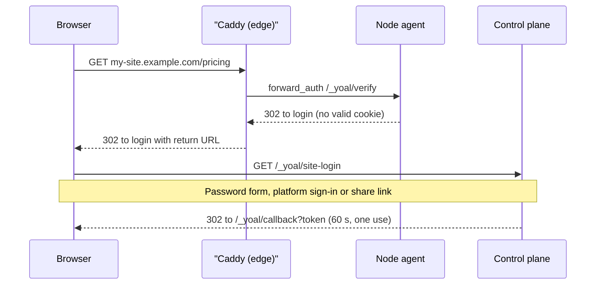
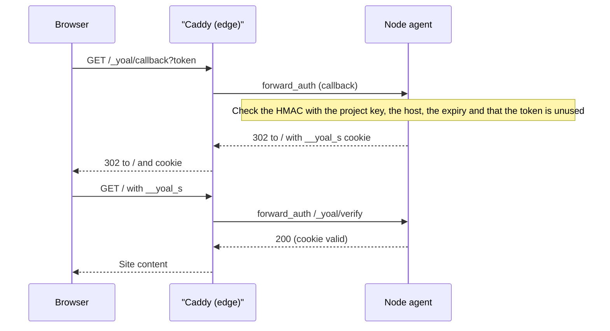

Every site has an access mode for production and another for previews. A **public** site opens for anyone with the URL. A **password** site asks for a password that you set for that site. A **platform login** site opens only to members of your organisation. When you need to let someone outside the organisation in, create a **share link** for a protected site. It works for a limited time, can be capped on usage, and you can revoke it at any moment. You can also end one visitor's session, or sign out every visitor at once.

## Access modes

| Mode | Who can open the site | What a visitor sees |
| --- | --- | --- |
| `public` | Anyone with the URL | The site, straight away. Default for production. |
| `password` | Anyone who knows the password for that scope | A password page. A correct password opens the site for 12 hours. |
| `platform` | Signed-in members of the organisation that owns the project | A sign-in redirect if they are signed out, or a 403 page if they belong to another organisation. A session lasts one hour. Default for previews. |

Production and previews are set separately. Production is the site on the project's own host and its custom domains, and previews are the immutable preview hosts described in [domains and environments](/deploying/domains-and-environments). Each named environment, such as `staging`, has its own access mode as well.

### One password per scope

Every scope in `password` mode has its own password: production, previews and each named environment. A password opens only the hosts of its own scope, so the preview password does not open production, and a host whose scope is not in `password` mode never accepts a password at all.

- Switching a scope to `password` needs a new password of at least 8 characters.
- Saving `password` mode again on a scope that already has a password may leave the password out. The current one is kept.
- Moving a scope to `public` or `platform` deletes that scope's password and nobody else's. Switching it back to `password` needs a new one.
- When you create a project or function with both scopes in `password` mode, the one password you enter is stored for each scope separately. Changing one later does not change the other.
- A new named environment with no access mode of its own uses the preview access. If previews are in `password` mode, the environment starts with a copy of the preview password.

Changing a password does not sign anyone out. Visitors who already entered the old one keep their session until it expires. To end those sessions straight away, [sign out everyone](#sign-out-every-visitor).

### Set the access mode

In the dashboard, open **Projects → my-site → Settings**, find the **Access** card, and select **Change** next to **Production** or **Previews**. The dropdown menu's **Change access** item opens the production dialog. For a function, the same card is on **Functions → my-function → Settings**. Named environments are set from **Projects → my-site → Environments**, when you create or edit one.

With the REST API, call `POST /api/v1/projects/{slug}/access`. The `scope` field is `production` (the default) or `previews`. Send `password` when you switch a scope to `password`, or to replace its password; leave it out to keep the current one:

```sh
curl -X POST https://control.example.com/api/v1/projects/my-site/access \
  -H "Authorization: Bearer yoal_…" \
  -H "Content-Type: application/json" \
  -d '{"scope":"previews","mode":"platform"}'
```

With an agent over MCP, call the `set_access` tool with `project`, `scope`, `mode` and, for password mode, `password`. The tool uses the same validation as the REST route. A named environment takes `access` and `password` on `POST /api/v1/projects/{slug}/environments` and `PATCH /api/v1/projects/{slug}/environments/{env}`.

Changing access needs the `project:update` permission.

## How protection works

A protected site is served through a Caddy `forward_auth` check on the node that hosts it. For each request, Caddy asks the local node agent whether the visitor is allowed. The agent does this without calling the control plane or the database.

A first visit with no session cookie is redirected to the control plane to log in:



The callback then sets the host-only session cookie, and later requests are checked against it:



- **Session cookie.** A visitor's session is a cookie called `__yoal_s` (the name is configurable). Its value is an expiry time and an HMAC over the host and that expiry. The HMAC key is derived per project from the platform's site cookie secret, so a cookie for one project does not verify for another. Signing out everyone replaces the project's key. The cookie is host-only, `HttpOnly`, `Secure` and `SameSite=Lax`, so it is never sent to any other host.
- **Login.** If the cookie is missing or expired, the visitor is redirected to the control plane. The control plane checks their platform session, the password, or the share link, then redirects back to the site with a one-time token. That token is valid for 60 seconds and can be used only once. The agent exchanges it for the host-only cookie.
- **Separation.** Platform session cookies stay on the control plane's domain. Content hosts never receive them.
- **Revocation.** Revoked links and sessions, and the project's current key, are part of the state each node agent pulls from the control plane. The agent refuses a revoked session cookie, or any cookie signed with a replaced key, from that point on. This usually takes a few seconds.

Responses from protected sites are sent with `X-Robots-Tag: noindex` and `Cache-Control: private`, so search engines do not index them and shared caches do not store them.

## Share links

A share link gives one person temporary access to a protected site without an account in your organisation. Links are created per project and point at either the production site or one specific deployment.

### Create a link

In the dashboard, open **Projects → my-site** and choose **Create share link**. You can also choose **Share this deployment** from a deployment's menu to pin the link to that deployment. The dialog offers these fields:

- **Deployment**: the production site (the default) or a specific deployment.
- **Expires**: an optional date and time. It must be in the future.
- **Max visits**: an optional cap on redemptions.
- **Note**: an optional internal note of up to 500 characters, shown only to your organisation.

The link is shown once, straight after creation. Copy it then, because Yoal keeps only a hash of the token and cannot show it again.

The REST API and MCP accept more options than the dashboard. These are the fields for `POST /api/v1/projects/{slug}/shares`:

| Field | Type | Default | Meaning |
| --- | --- | --- | --- |
| `deploymentId` | string | Production | Pins the link to one deployment of this project. Omit it to follow the production site at the time of each visit. |
| `expiresAt` | ISO 8601 datetime | None | After this time, no new visits are accepted. |
| `maxRedemptions` | positive integer | Unlimited | Total number of visits that start a session. Returning visitors use up this count too. |
| `maxVisitors` | positive integer | Unlimited | Number of distinct visitors. A visitor is identified by IP address and browser user agent. |
| `sessionTtlSeconds` | integer, 1 to 2,592,000 | 3600 | How long each session started by the link lasts. The maximum is 30 days. |
| `allowedEmails` | up to 100 addresses | Anyone | Visitors must be signed in to Yoal with one of these addresses. |
| `note` | string, up to 500 characters | None | An internal note. |

```sh
curl -X POST https://control.example.com/api/v1/projects/my-site/shares \
  -H "Authorization: Bearer yoal_…" \
  -H "Content-Type: application/json" \
  -d '{"expiresAt":"2026-12-01T09:00:00Z","maxRedemptions":20,"sessionTtlSeconds":7200,"allowedEmails":["alex@example.com"],"note":"Design review"}'
```

The response is `201 Created`, and its `url` field holds the link in the form `https://my-site.example.com/?_yoal_share=…`. The clear-text token appears only in this response.

> [!NOTE]
> Expiry stops new visits, but it does not shorten sessions that have already started. A session lasts for its full `sessionTtlSeconds`, even if the link expires part-way through. Revoking the link ends those sessions at once.

### Use a link

When a visitor opens the link, Yoal checks it and starts a session. The visitor then goes to the site and stays signed in for `sessionTtlSeconds`. A visit counts once against `maxRedemptions`, and a new distinct visitor counts once against `maxVisitors`. Visitors whose link is revoked, expired or used up see a **Link unavailable** page that says why. Links to public sites are not needed, because the site is open already.

### List and revoke links

Open **Projects → my-site** and select the **Share links** tab. Each link shows its host, its state and how often it has been redeemed. Select **Revoke**, then confirm, to end access. The link stops working, and every session it started is revoked with it. Revoked sessions end as the nodes receive the revocation, so anyone mid-visit loses access shortly afterwards. Revoking cannot be undone, so create a new link if you need access again.

Listings never include the token or the URL.

With the REST API, `GET /api/v1/projects/{slug}/shares` lists links, and `DELETE /api/v1/projects/{slug}/shares/{id}` revokes one.

## Visitor sessions

Every visitor who gets past a protected site holds a session. You can end one share-link session, or sign out every visitor of a project at once.

### List and end share-link sessions

Open **Projects → my-site → Settings**. Under **Visitor sessions**, the **Access** card shows how many share-link sessions are live and lists the 20 newest, each with the visitor's email address (for links restricted to `allowedEmails`) or the link's note, the host and the expiry time. Select **End**, then confirm, to end one. The visitor loses access within seconds. The share link keeps working, so revoke the link as well if that person should not come back. Functions have the same list on **Functions → my-function → Settings**.

Only share-link sessions are listed. Password and platform sign-ins are not stored anywhere, so they cannot be listed or ended one by one. Sessions that expired, were ended, or belong to a revoked link are left out.

### Sign out every visitor

Select **Sign out everyone** on the **Access** card, then confirm. Every password, platform and share-link session ends on production, previews and every named environment, usually within a few seconds, and one-time login tokens already issued stop working too. Visitors have to sign in again. Share links keep working and can start new sessions; revoke a link to stop that.

Use this after you change a password, or when a password or a share-link URL has leaked.

### Sessions over the REST API

| Method | Path | What it does | Permission |
| --- | --- | --- | --- |
| GET | `/api/v1/projects/{slug}/sessions` | List live share-link sessions, newest first, up to 500 | `shareLink:read` |
| DELETE | `/api/v1/projects/{slug}/sessions/{id}` | End one share-link session | `shareLink:revoke` |
| DELETE | `/api/v1/projects/{slug}/sessions` | Sign out every visitor of the project | `project:update` |

Each listed session has `id` (`red_…`), `kind` (always `share`), `shareLinkId`, `note`, `host`, `email`, `startedAt` and `expiresAt`. Signing out everyone returns the number of share-link sessions it ended in `shareSessions`, with `signedOutAt`:

```sh
curl -X DELETE https://control.example.com/api/v1/projects/my-site/sessions \
  -H "Authorization: Bearer yoal_…"
```

> [!NOTE]
> **Settings → Network shares** is a different feature. It defines network filesystem mounts for clustered nodes, and only platform administrators can see it. Share links are created from each project, as described on this page. For cluster storage, see [clustering](/self-hosting/clustering).

## MCP tools

Agents use these tools over [MCP](/clients/mcp):

| Tool | Purpose | Permission |
| --- | --- | --- |
| `set_access` | Set the access mode for production or previews. Takes `project`, `scope`, `mode` and `password`. | `project:update` |
| `create_share_link` | Create a link. Takes `project` and the fields in the table above. The result includes the one-time `url`. | `shareLink:create` |
| `list_share_links` | List a project's links, including redemption counts. Takes `project`. | `shareLink:read` |
| `revoke_share_link` | Revoke a link and every session it started. Takes `project` and `shareLinkId`. | `shareLink:revoke` |
| `list_site_sessions` | List live share-link sessions. Takes `project`. | `shareLink:read` |
| `revoke_site_session` | End one share-link session. Takes `project` and `sessionId`. The link keeps working. | `shareLink:revoke` |
| `sign_out_all_visitors` | Sign out every visitor of a project. Takes `project`. Asks a person to confirm first. | `project:update` |

Creating a link is not idempotent, so an agent that retries after a timeout may create a second link. List the links first to check.

## Permissions

The share link permissions come from your role. The standard roles grant them as follows:

- **Viewer** can read links and list sessions (`shareLink:read`) but cannot change access, create or revoke links, or end sessions.
- **Deployer**, **admin** and **owner** can create, read and revoke links, end sessions, sign everyone out and change access.

An API key or MCP token can never do more than its user's role allows, even if it was granted a broader scope. See [organisations and roles](/accounts/organizations-and-roles) and [API keys and tokens](/accounts/api-keys-and-tokens).

Visitor cookies are signed with a key derived from the platform's site cookie secret, `YOAL_SITE_COOKIE_SECRET`, which falls back to `BETTER_AUTH_SECRET` when it is not set. Set it explicitly on a self-hosted install. See [configuration](/self-hosting/configuration).
