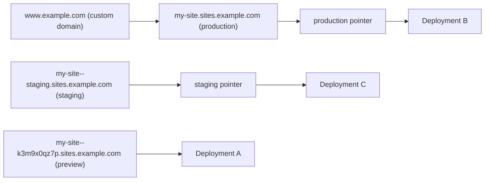
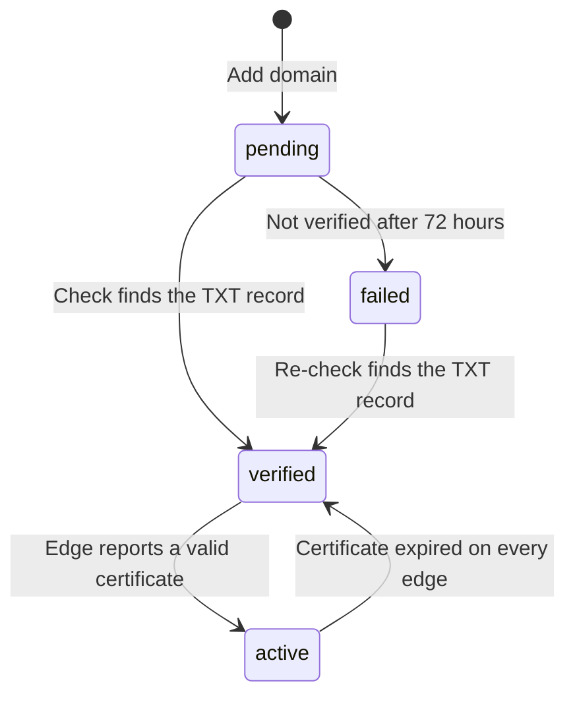

Every project is reachable on a hostname under your server's content domain as soon as it is deployed. This page covers those default hostnames, how to attach your own domain to a project, the server-wide domain settings, and named environments for running a staging copy alongside production.

## Default hostnames

Skiff serves every project under the content domain (for example `sites.example.com`). The name is built from the project slug and, for other environments, the environment slug:

| Host | Example | Serves |
| --- | --- | --- |
| `<project>.<content-domain>` | `my-site.sites.example.com` | The production environment |
| `<project>--<environment>.<content-domain>` | `my-site--staging.sites.example.com` | A named environment |
| `<project>--<id>.<content-domain>` | `my-site--k3m9x0qz7p.sites.example.com` | One immutable deployment (its preview URL) |

The `--` separator is reserved for these hosts, so an environment can never take the name of a preview. Environment slugs are 1 to 30 lowercase letters, digits and hyphens, cannot contain `--`, and `production` is reserved for the built-in environment.

The content domain needs a wildcard DNS record (`*.sites.example.com`) that points at your Skiff server. Your operator sets this up; see [configuration](/self-hosting/configuration) and the **Settings → Domains** section below.

The diagram shows where each kind of hostname ends up. Every environment and preview host points at one deployment, and a custom domain serves the production deployment.



## Custom domains

A custom domain is your own hostname, such as `www.example.com`, attached to one project. It serves the project's production deployment: the same release, site configuration and access mode as `my-site.sites.example.com`. Custom domains are not attached to environments.

Attaching and removing domains needs the `domain:create` and `domain:delete` permissions, which the owner and admin roles have. Deployers can see domains but not change them.

### Attach a domain

1. Open **Projects → my-site → Domains** and select **Add domain**.
2. Enter the hostname with no scheme, port or path, for example `www.example.com`.
3. Optionally tick **Also create the www sibling and redirect it to the apex**. This also serves `www.` on the same name and redirects it to the bare hostname. The choice is fixed after attaching; to change it, remove the domain and add it again.

The hostname must not be on the platform's dashboard or content domain, and it can be attached to only one project. Through the REST API, send `POST /api/v1/domains` with a JSON body such as `{"project": "my-site", "hostname": "www.example.com", "redirectWww": false}`. The response includes the TXT record; the traffic record is listed by the check (see below).

The CLI and the MCP server have no domain commands, so attaching and removing domains is done in the dashboard or over REST.

### Prove you control the name

Skiff does not serve a domain until a TXT record proves control. Create this record, using the exact name and value shown on the domain:

```text
Type:   TXT
Name:   _skiff.www.example.com
Value:  skiff-verify=<token>
```

The token is random for each domain, so copy it from Skiff rather than reusing one from another domain.

### Point traffic at Skiff

Once the TXT record is in place, point the hostname at the project's production host with a CNAME:

```text
Type:   CNAME
Name:   www.example.com
Value:  my-site.sites.example.com
```

If `redirectWww` is set, create the same CNAME for `www.example.com`. If your content domain is an IP address rather than a name, the record is an A record to that address instead.

For the bare domain (`example.com`), a CNAME is not allowed at the zone apex on many DNS providers. Use your provider's ALIAS or ANAME record, or CNAME flattening, instead. Skiff accepts the apex when it resolves to the same addresses as the target.

> [!NOTE]
> If your operator has connected a Cloudflare account to Skiff, the CNAME or A record is created for you when you attach the domain, as a DNS-only record. Skiff updates it on each check and deletes it when you remove the domain. It never overwrites a non-address record (such as an existing TXT or MX) on the same name; it reports the conflict instead.

### Check status

A new domain starts as **pending**. Select **Check DNS** on the domain, or send `POST /api/v1/domains/{id}/check`. A successful check changes the status to **verified**. The response includes a `detail` message and the list of `records` still expected, so a failed check tells you what to fix.

Skiff also re-checks DNS on its own: a pending domain about every 10 minutes. You can still run a check yourself straight after you change records.

| Status | Meaning | Serves traffic |
|---|---|---|
| **pending** | Added, TXT record not found yet. | No |
| **verified** | TXT record found. The proxy can obtain a certificate. | Yes |
| **active** | An edge node reports a valid certificate for the hostname, so HTTPS works. | Yes |
| **failed** | Still not verified 72 hours after it was added. | No |

A failed domain is re-checked every 6 hours, and a check that finds the TXT record moves it to verified. Fixing the record and selecting **Check DNS** recovers it straight away.

Once a domain is verified it stays served. A later failed check records the problem in the domain's last error, and traffic continues until you remove the domain. If the certificate for an active domain expires on every edge node, the domain goes back to verified with the reason in its last error until the proxy renews it.

The diagram shows each status change. Removing a domain is possible from any status.



### TLS certificates

You do not upload certificates. After a domain verifies, the first HTTPS request for it makes Skiff's proxy obtain a certificate from Let's Encrypt. This usually takes about a minute. Only verified and active hostnames are eligible, so a pending or failed name never triggers issuance. Each edge node checks a newly verified domain's certificate every 2 minutes for its first half hour, so the status shows **active** soon after the certificate is issued.

Skiff's records are DNS only. If you proxy the name through Cloudflare yourself, the certificate needs your operator's Cloudflare DNS token, which is set in **Settings → Domains**.

### Remove a domain

Select **Remove** on the domain, or send `DELETE /api/v1/domains/{id}`. The hostname stops serving straight away, and any records Skiff created are deleted. Existing certificates are left to expire.

## Platform domains

**Settings → Domains** controls the server's own addresses. Only owners can open it. It has three settings:

- **Dashboard address**: the hostname you use to reach the dashboard and API. It can be a domain (with an A record to the server) or the server's IP address.
- **Content domain**: the domain under which projects are served. Projects become `<project>.<content-domain>`.
- **HTTPS with Let's Encrypt**: needs a real domain for both the dashboard and the content domain, a contact email, and a Cloudflare DNS token with Zone → Zone → Read and Zone → DNS → Edit on the content domain (the **Create one in Cloudflare** link pre-fills both). The token is needed because the wildcard certificate for projects is issued with a DNS challenge.

If you have no domains, the dashboard is served at `http://<server-ip>` and projects at a temporary wildcard address, such as `my-site.1-2-3-4.sslip.io`. That address works over HTTP only.

Before saving, Skiff looks up the names in public DNS. A dashboard address that does not resolve is refused, because nobody could reach the dashboard afterwards. A content-domain wildcard that does not point at the server produces a warning, and you can confirm to continue. Saving applies the change to the server and reverts it if the new address does not answer.

> [!WARNING]
> Changing the content domain changes the default host of every project, every environment and every existing preview URL. Custom domains are not affected. Changing the dashboard address also moves the sign-in page, and passkeys only work on the address they were created on. Owners must set up an authenticator app before changing it.

## Named environments

Each project has a built-in **production** environment. Named environments, such as `staging`, give you extra deployment pointers with their own host and access mode. Each environment's pointer moves only when you deploy to it or promote a deployment into it. Production is never affected by a deploy to another environment.

### Create an environment

Open **Projects → my-site → Environments** and select **New environment**. The slug is derived from the name (`Staging` becomes `staging`). Over REST, send `POST /api/v1/projects/my-site/environments`:

```sh
curl -X POST https://control.example.com/api/v1/projects/my-site/environments \
  -H "Authorization: Bearer skif_..." \
  -H "Content-Type: application/json" \
  -d '{"name": "Staging", "slug": "staging", "access": "password", "password": "correct-horse-battery"}'
```

`access` is `public`, `password` or `platform` (see [access and sharing](/deploying/access-and-sharing)). Password mode needs a `password` of at least 8 characters; it opens only this environment's host. If you leave `access` out, the environment uses the project's preview access, and with password-protected previews it starts with a copy of the preview password. The MCP tool `create_environment` takes the same fields. Creating, renaming and deleting environments needs `project:update`, which the owner, admin and deployer roles have.

An environment can be deleted once none of its deployments remain. Production cannot be renamed or deleted.

### Deploy to an environment

Use the `environment` option, which defaults to `production`:

- **MCP**: call `deploy_to_environment` with `project`, `environment` and either inline `files` or a finalized `uploadId`. Only that environment's pointer moves.
- **REST**: send inline files to `POST /api/v1/projects/my-site/deploy` with `"environment": "staging"`. This route accepts inline files only; uploads are finalized without an environment.
- **CLI**: `skif deploy` has no environment option. It deploys to production, or to a preview with `--no-promote`.

Set `promote` to `false` to create the deployment without moving the environment's pointer. To move an existing deployment into an environment, send `POST /api/v1/projects/my-site/environments/staging/promote` with `{"deploymentId": "..."}`. To roll an environment back, use the **Rollback** action on the environment or the `rollback` MCP tool with an `environment` argument.

> [!IMPORTANT]
> A project with a process or container workload runs one app at a time. Deploying to any environment makes that release the running app, and every environment host and preview URL proxies to it. Environment pointers do not start separate copies, so promoting an older deployment to production moves the running app back to that release. Static sites do not have this limit. See [apps and containers](/compute/apps-and-containers).
