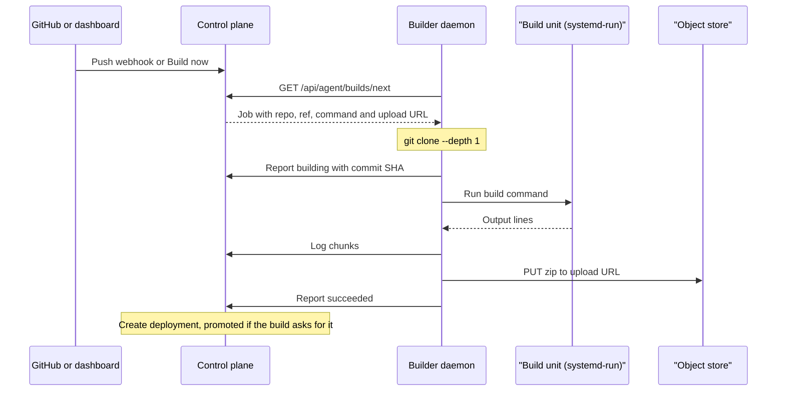

Instead of uploading a folder, you can point a project at a Git repository. Skiff clones the repository, runs your build command, and deploys the output folder as a normal deployment. This page covers connecting a repository, how the build runs and what it is allowed to do, reading build logs, and the GitHub Actions self-hosted runner template. Uploads from the CLI are covered in [static sites](/deploying/static-sites).

Skiff does not build on the control plane. A build runs on a **Builder** node, which is any enrolled node that a platform admin has marked as a Builder. See [nodes and fleet](/self-hosting/nodes-and-fleet) for how nodes are enrolled and given roles.

## Connect a repository

In the dashboard, open **Projects → my-site → Builds** and choose **Connect repository**. A project has one repository source. The form has these fields:

| Field | Default | Meaning |
| --- | --- | --- |
| Repository URL | none | An `https://`, `ssh://`, `git@` or `git://` URL. |
| Branch | `main` | The branch built by a push webhook or by **Build now** when you do not name a ref. |
| Root directory | `.` | The folder that holds the site, relative to the repository root. The build command runs here. |
| Build command | `bun install && bun run build` | A shell command, run with `bash -lc` inside the root directory. |
| Output directory | `dist` | The folder, relative to the root directory, whose contents become the deployment. |
| Webhook secret | none | At least 16 characters. Required before GitHub webhooks are accepted. |
| Enabled | on | When off, webhook builds are ignored and **Build now** is refused. |

The same settings are available over REST at `/api/v1/projects/:slug/git`. `PUT` (or `POST`) saves the source, `GET` reads it and `DELETE` removes it:

```sh
curl -X PUT https://control.example.com/api/v1/projects/my-site/git \
  -H "Authorization: Bearer skif_…" -H 'content-type: application/json' \
  -d '{"repoUrl":"https://github.com/acme/site.git","branch":"main","buildCommand":"bun install && bun run build","outputDir":"dist"}'
```

Root and output directories must stay inside the repository: a leading `/` or a `..` segment is rejected, and a symlink that points outside the checkout fails the build.

### Build on push

If Skiff's [GitHub App](/deploying/github) is installed on the repository's account, pushes arrive without any setup. Otherwise, add a GitHub webhook to the repository with these settings:

- **Payload URL:** `https://control.example.com/api/webhooks/github/my-site`
- **Content type:** `application/json`
- **Secret:** the same value you set as the project's webhook secret
- **Events:** push

Skiff checks the `X-Hub-Signature-256` header against the secret. Deliveries without a valid signature are rejected, and a project with no secret rejects every delivery. Pushes to any branch other than the configured one, and events other than `push`, are accepted and ignored.

> [!WARNING]
> A build started by a push webhook is always promoted to production when it succeeds. Manual builds let you turn promotion off.

### Private repositories

Repositories that Skiff's [GitHub App](/deploying/github) can see need no setup: each build clones with a one-hour, read-only token for that repository alone.

Any other private repository needs a credential on each Builder node, set in `/etc/skiff/agent.env`. Use a token for HTTPS URLs or a deploy key for SSH URLs. A Builder can hold both, and each clone uses the one that matches its URL.

To clone a private GitHub repository over HTTPS, set a token:

```dotenv
SKIFF_GIT_TOKEN=github_pat_…
SKIFF_GIT_TOKEN_HOSTS=github.com
```

`SKIFF_GIT_TOKEN` is sent only to the hosts listed in `SKIFF_GIT_TOKEN_HOSTS`, which defaults to `github.com`. It is passed to `git` as an HTTP header for that clone, so it is never written to the repository's `.git/config` or into the build's environment.

To clone over SSH (`git@github.com:acme/site.git` or `ssh://…`), create a deploy key, add its public half to the repository as a read-only deploy key, and point the Builder at the private half:

```sh
sudo ssh-keygen -t ed25519 -N '' -C skiff-builder -f /etc/skiff/git-deploy-key
sudo chmod 600 /etc/skiff/git-deploy-key
echo 'SKIFF_GIT_SSH_KEY=/etc/skiff/git-deploy-key' | sudo tee -a /etc/skiff/agent.env
sudo systemctl restart skiff-builder
```

The key is used only for SSH URLs, and only by the Builder's own `git` while it clones. The build command runs as the `skiff-build` user, which cannot read the key and does not inherit it. The first clone from a host records that host's key in `/var/lib/skiff-builder/known_hosts`, and a clone fails if the key later changes. To pin host keys in advance instead, set `SKIFF_GIT_SSH_KNOWN_HOSTS` to a `known_hosts` file, for example one made with `ssh-keyscan github.com`. Paths may use only letters, digits and `. _ / @ + -`.

## Builder nodes

Every enrolled node runs a Builder daemon, but it only claims work when its node has the Builder role. The role is set by a platform admin:

```sh
curl -X POST https://control.example.com/api/v1/nodes/NODE_ID/builder \
  -H "Authorization: Bearer skif_…" -H 'content-type: application/json' \
  -d '{"builder": true}'
```

A Builder runs one build at a time. Queued builds are claimed oldest first, so several Builder nodes share one queue. A node without the role is idle, not broken.

## How a build runs

1. **Queue.** A manual build (**Build now**, or `POST /api/v1/projects/:slug/builds`) or a webhook creates a queued build. The build records the ref, which is the branch, tag or commit you asked for (the configured branch by default).
2. **Claim.** A Builder claims the oldest queued build and gets a short-lived upload URL for the result.
3. **Clone.** The Builder makes a shallow clone of the ref. A commit SHA, which `git clone --branch` cannot take, is fetched directly. The commit SHA and message are recorded on the build as soon as the clone succeeds.
4. **Build.** The build command runs as a transient systemd unit. Output streams to the build log as it runs.
5. **Upload.** The output directory is zipped and uploaded.
6. **Deploy.** The control plane turns the zip into a deployment in the same way as a CLI upload. The build then shows the deployment and release it produced.

The sequence below shows the same steps between the GitHub webhook or dashboard, the control plane, the Builder daemon, the build unit and the artifact store.



### Limits and isolation

On a Linux Builder with systemd, each build runs in its own unit with these limits. Each value can be changed per node with an environment variable in `/etc/skiff/agent.env`.

- **Time:** 10 minutes by default (`SKIFF_BUILDER_TIMEOUT_SECONDS`). A build that runs longer is killed and fails.
- **Memory:** 2 GiB (`SKIFF_BUILDER_MEMORY_MAX`).
- **CPU:** 200%, meaning two cores (`SKIFF_BUILDER_CPU_QUOTA`).
- **Processes:** at most 1,024 (`TasksMax`).

Builds run as an unprivileged account, `skiff-build` by default (`SKIFF_BUILDER_USER`). Builders never run builds as root. The sandbox also:

- can write only to its own checkout, and cannot see Skiff's configuration, state or secrets directories;
- cannot gain privileges, and has no Linux capabilities;
- starts from an empty environment with `CI=1`, a scratch `HOME` inside the checkout, and a standard `PATH`.

The sandbox does not block network access, so install steps can download packages.

On a node without systemd, Skiff runs the build command directly with none of these limits. That mode is meant for development machines.

### When a build fails

A build ends as `failed` with a message in the build row when:

- the build command exits with a non-zero code, or runs past the time limit;
- the output directory does not exist, or resolves outside the repository;
- the zip cannot be turned into a release.

A build ends as `cancelled` when someone cancels it. A Builder that dies mid-build leaves its claim behind. After 15 minutes the control plane requeues the build, and a build held by a node that is removed is requeued at once.

## Build history and logs

Open **Projects → my-site → Builds** to see the most recent builds. Each row shows the build ID, status, ref, commit, start time and duration. Statuses are `queued`, `building`, `succeeded`, `failed` and `cancelled`. The log button opens the build's output: while the build runs, it streams live in the project's Logs tab.

Over REST, `GET /api/v1/projects/:slug/builds` lists builds, and `GET /api/v1/projects/:slug/builds/:id` returns a single build. The list returns only the last 8,000 characters of each log. Add `?log=full` to the list, or use the single-build request, for the full log, which Skiff keeps up to about 2 million characters. The MCP `get_logs` tool also reads build output with `source: "build"` and a `buildId`.

Cancel a queued or running build with `POST /api/v1/projects/:slug/builds/:id/cancel`. A queued build is removed. For a running build, Skiff marks it cancelled and discards its result. The Builder may keep working until its current command finishes or times out.

### Permissions and quotas

| Action | Role needed |
| --- | --- |
| See the source and build history | viewer, deployer, admin or owner |
| Connect, edit or remove the repository, and start builds | deployer, admin or owner |
| Cancel a build | deployer, admin or owner |

Every build counts against the daily build quota (`buildsPerDay`). A build that would exceed it is refused when it is queued. See [quotas and limits](/self-hosting/quotas-and-limits). Roles are described in [organisations and roles](/accounts/organizations-and-roles).

## GitHub Actions runners

Skiff can host a pool of GitHub Actions self-hosted runners. Choose **Projects → From template → GitHub Actions runner**, then enter:

- the GitHub owner, and either one repository or a whole organisation;
- a credential that can register runners: **Skiff's GitHub App** when it is [installed](/deploying/github) on the owner (nothing to paste), a fine-grained personal access token with *Administration: write* on the repository (or *Self-hosted runners: write* on the organisation), or another GitHub App with the same permission and its private key;
- the number of runners, the memory for each runner and any extra labels.

Skiff stores a pasted credential as a project secret (the GitHub App needs none) and deploys the pool. The runners appear under the repository's or organisation's runner settings on GitHub. Use them from a workflow with:

```yaml
jobs:
  build:
    runs-on: [self-hosted, linux]
```

Extra labels from the form are added to `runs-on`. Each runner takes one job and then exits, and Skiff starts a fresh runner in its place with a new single-use registration. The GitHub credential is read only by the control plane and is never given to the runner.

Things to know before you use a runner pool:

- **Placement.** The pool runs on one worker node with enough free memory. The memory for every runner is reserved up front. Build jobs are heavy, so pick a node with a large budget.
- **No Docker in jobs.** Runners are unprivileged. `docker build`, `container:` jobs, `services:` and `sudo` do not work. Use setup actions such as `setup-node` or `setup-bun`.
- **github.com only.** GitHub Enterprise Server is not supported yet.
- **Fixed size.** The pool does not scale to zero or grow on demand.
- **Private repositories.** GitHub advises against self-hosted runners on public repositories, because a pull request from a fork can run code on your node.
