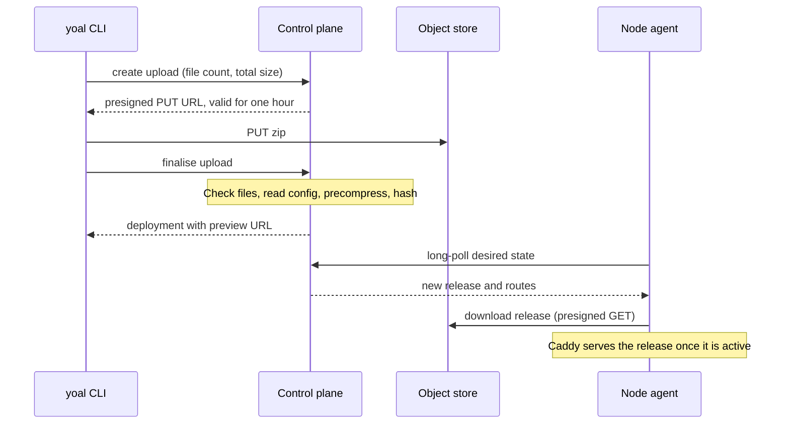
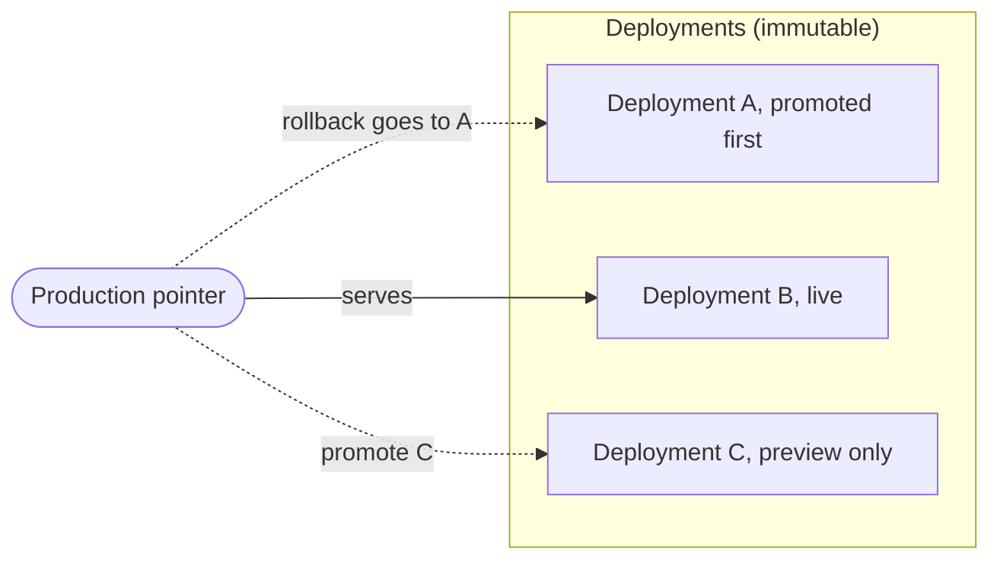

A static site is a folder of files (HTML, CSS, JavaScript, images and so on) that Yoal serves from the edge. You can deploy one from the command line, from the dashboard or through an AI agent. Every deploy creates an immutable deployment with its own preview URL. Promoting a deployment moves your production address to it without rebuilding anything, and rolling back moves it again.

Each deployment stores the files (a release) and the site configuration in those files (`yoal.json`, `_redirects` and `_headers`). For what those files do, see [site configuration](/deploying/site-config).

## Deploy from the CLI

Sign in once with `yoal login --url https://control.example.com`, then deploy a build directory:

```sh
yoal deploy ./dist --project my-site
```

`yoal deploy` zips the directory, uploads it and finalises the deployment. It also promotes the deployment to production unless you pass `--no-promote`. The zip goes straight to object storage, and the node agent then fetches the new release from its desired state:



| Flag | What it does |
| --- | --- |
| `-p, --project <slug>` | Target project. Defaults to a slug made from `--name` or the directory name. |
| `-n, --name <name>` | Project name, used when the project is created. |
| `--no-create` | Fail instead of creating a project that does not exist. |
| `--no-promote` | Create a preview only. Production stays where it is. |
| `-m, --message <text>` | A note stored with the deployment (500 characters at most). |
| `--spa` | Add `"spa": true` to `yoal.json` in the upload. See [single-page apps](#single-page-apps). |
| `--json` | Print the finalise response as JSON. |

A few things to know:

- The directory's own files are zipped. `.git`, `node_modules` and `.DS_Store` are always skipped, and rules in `.gitignore` files in the directory and its subdirectories are honoured. Symlinks are skipped with a warning.
- A project created by the CLI gets production access `public` and preview access `platform`.
- The CLI deploys to production or to a preview only. Named environments are available through the REST API, MCP and the dashboard.
- Without `--project`, the slug comes from the directory name, so `yoal deploy ./dist` creates a project called `dist`. Pass `--project` in scripts.
- A folder that contains a `wrangler.jsonc` deploys as a function instead. See [functions](/compute/functions).

On CI or any headless machine, skip `yoal login` and set `YOAL_URL` and `YOAL_TOKEN` to an API key from the dashboard. See [CLI](/clients/cli) and [API keys and tokens](/accounts/api-keys-and-tokens).

## Deploy from the dashboard

1. Go to the **New** page and choose **Static site** under *Or start from a blank runtime*. The new project dialog opens with the runtime set to Static site.
2. Enter a name and a slug (see [project slugs](#project-slugs)). Production access defaults to `public` and preview access to `platform`.
3. Open the project and choose **Deploy a zip**. Pick a `.zip` of the built output, choose an environment and, optionally, add a message. Leave the promote option ticked to move the live site.

Zip the contents of the build directory, not the directory itself, for example `cd dist && zip -r ../site.zip .`. The dashboard applies the same limits as the other paths.

For a repository rather than a build output, use a [git build](/deploying/git-builds).

## Deploy from an agent

Agents deploy through MCP tools. Connect the server first (see [MCP](/clients/mcp)). The tools are:

- **`deploy_site`** does everything in one call. Pass a project `name` and either `files` (inline) or an `uploadId`. It creates the project if it is missing and promotes by default. The response includes the production and preview URLs, and a `hint` when SPA mode might help.
- **`deploy_files`** sends inline `files` to an existing `project`. It takes `promote`, `message` and `environment`.
- **`create_upload`**, then a `PUT` of the zip to the returned URL, then **`finalize_upload`** for sites too large to send inline.
- **`list_deployments`**, **`get_deployment`**, **`promote_deployment`** and **`rollback`** to inspect and move deployments.

An inline deploy looks like this. Text files use `utf8` (the default) and binary files use `base64`:

```json
{
  "name": "my-site",
  "files": [
    { "path": "index.html", "content": "<h1>Hello</h1>" },
    { "path": "logo.png", "content": "<base64-encoded bytes>", "encoding": "base64" }
  ]
}
```

## Upload paths and limits

There are two ways to send files:

- **Inline.** The files travel inside the JSON request. This is used by `deploy_site` and `deploy_files` in MCP, and by `POST /api/v1/projects/:slug/deploy` in the REST API. The total size of the decoded files must be 5 MiB or less.
- **Presigned upload.** The CLI, and an agent using `create_upload`, first get a session with a URL that accepts a `PUT` for one hour. The zip goes straight to storage, so large sites do not pass through the control plane. Call finalise once the upload is complete. Finalising before the `PUT` returns an error and leaves the session open to retry. A session that is not finalised within an hour expires.

| Limit | Value |
| --- | --- |
| Inline deploy, total decoded size | 5 MiB |
| Zip archive size | 500 MiB |
| Total size of all files once unzipped | 500 MiB |
| One file | 25 MiB |
| Files in one deploy | 20,000 |
| Presigned upload session | 1 hour |

Organisation quotas, such as the maximum upload size and total storage, can also refuse a deploy. See [quotas and limits](/self-hosting/quotas-and-limits).

## What a deploy does

When a deploy is finalised, Yoal:

1. **Checks the files.** Paths must be relative and cannot contain `..`. `.DS_Store` files are dropped. The limits above are enforced here.
2. **Reads the site configuration.** `yoal.json`, `_redirects` and `_headers` are parsed and validated. An invalid file fails the whole deploy, and the error names the file.
3. **Precompresses text.** For HTML, CSS, JavaScript, JSON, SVG, plain text and similar files up to 5 MiB each, Yoal stores Brotli (`.br`) and gzip (`.gz`) copies beside the original. It stops once the source text reaches 100 MiB in a release. Images, fonts, video and other formats that are already compressed are stored unchanged.
4. **Hashes the release.** Every file gets a SHA-256 hash, and the release is identified by a hash of that file list. Deploying the same files again reuses the stored release instead of storing a second copy.
5. **Snapshots the configuration.** Each deployment records the configuration it was built with, so changing `_redirects` affects only later deployments.
6. **Creates the deployment.** It gets a short ID and a preview URL, and is promoted if you asked for that.

## Preview and production URLs

- **Production** is `https://<slug>.<contentDomain>`, for example `https://my-site.example.com`. It serves whichever deployment is promoted.
- **Preview** is `https://<slug>--<shortId>.<contentDomain>`, for example `https://my-site--k3j9x2a7mq.example.com`. The short ID is ten lowercase letters and digits. Every deployment has a preview, and it always serves that deployment and never changes.
- **Environments** serve at `https://<slug>--<environment>.<contentDomain>`. See [domains and environments](/deploying/domains-and-environments).

Production access defaults to `public`. Previews default to `platform`, which means only signed-in members of the project's organisation can open them, and their access lasts an hour. See [access and sharing](/deploying/access-and-sharing).

## Single-page apps

A single-page app serves one `index.html` and handles every other path in JavaScript. To send unknown paths to `index.html`, turn on SPA mode in `yoal.json`:

```json
{ "spa": true }
```

Yoal never turns this on by itself. When a deploy contains `index.html` and no other HTML file, `deploy_site` returns a hint suggesting SPA mode. Pass `"spa": false` to suppress the hint. `yoal deploy --spa` adds `"spa": true` to the copy of `yoal.json` in the upload, merging with any existing file, and leaves your folder untouched.

## Promote and roll back

A deployment serves production only after it is promoted. Promoting moves a pointer, so it is instant and nothing is rebuilt. The configuration snapshot moves with the deployment, so code and configuration always change together. Deployments themselves never change, so the production pointer is the only thing that moves:



To promote an older deployment, list the project's deployments and pass the ID or short ID:

```sh
yoal deployments my-site
yoal promote my-site k3j9x2a7mq
```

In the dashboard, open the project, go to **Deployments** and choose **Promote** on the row. You can only promote an active deployment.

To undo a promotion, roll back:

```sh
yoal rollback my-site
```

Rollback moves production to the deployment that was live before the current one. It follows promotion history, not upload order, so deployments that were never promoted are skipped. Each further rollback steps back again. If there is no earlier production deployment, rollback fails and you promote a specific deployment instead.

> [!NOTE]
> Rolling back deletes nothing. The newer deployment remains, and you can promote it again at any time.

Environments can be promoted and rolled back too, but the CLI and REST rollback act on production only. The MCP `promote_deployment` and `rollback` tools take an `environment`, and so does the environments promote route in the REST API.

## Retention and clean-up

Yoal keeps each project's ten most recent unpinned deployments by default. The platform sets this default (between 1 and 500), and organisation or project quotas can override it. After each deploy, promote or rollback, older deployments beyond the limit are removed.

Yoal never removes:

- a **pinned** deployment, which you pin from its row in the dashboard or with `POST /api/v1/projects/:slug/deployments/:id/pin` and a body of `{ "pinned": true }`;
- the **production** deployment; or
- any deployment an environment is pointing at.

You can also delete a deployment yourself with **Delete deployment** in the dashboard, or with `DELETE /api/v1/projects/:slug/deployments/:id`. If that deployment is in production, production falls back to the one promoted before it. Once no remaining deployment uses a release, Yoal deletes the stored files in the background.

## Project slugs

A slug is a project's name on the platform and the first label of its hostname. A valid slug:

- is 3 to 40 characters long;
- uses lowercase letters, digits and single hyphens, and starts and ends with a letter or digit;
- contains no double hyphen, because `--` separates the parts of preview and environment hosts;
- is not reserved. Reserved names include `api`, `www`, `admin`, `mail`, `static`, `status` and `yoal`; and
- is unique across the whole platform, not just your organisation.

A slug stays taken while its project is in the trash, and for 30 days after the project is renamed. If the slug you want is taken, Yoal suggests free alternatives built from it. When you do not give a slug, the dashboard suggests one. The CLI makes one from the name by lowercasing it, turning runs of other characters into hyphens, truncating it to 40 characters and prefixing `site-` if it is shorter than three.

## Rename a project

Change the **Slug** field in the project's **Settings**, or send `PATCH /api/v1/projects/:slug` with `{ "slug": "new-slug" }`. The old production address (`<old>.<contentDomain>`) redirects to the new one for 30 days, keeping the path and query string. Preview URLs built from the old slug are not redirected. Update any CI scripts to the new slug, because the old one stays reserved for 30 days.

## Delete and restore projects

Deleting a project moves it to the trash. Its site stops serving straight away, but Yoal keeps the project, its deployments and its production pointer, so a restore brings the site back as it was.

```sh
yoal projects delete my-site       # asks for confirmation; add --yes outside a terminal
yoal projects trash                # lists what is in the trash and when it is purged
yoal projects restore my-site
yoal projects purge my-site        # permanent, and only for projects already in the trash
```

The dashboard has the same actions on the trash view of **Projects**. Projects in the trash are purged automatically after 7 days by default; the platform can set this between 1 and 90 days. Purging removes the project and its deployments and frees the slug. Restoring counts the project against your project quota again, so it can fail if you are at the limit.

Bulk deletes (for example `yoal projects delete --match 'test-*' --not-deployed`) show a plan first and handle up to 100 projects per run.

> [!WARNING]
> `yoal projects purge` cannot be undone. Use `yoal projects delete` first if you might want the site back.
