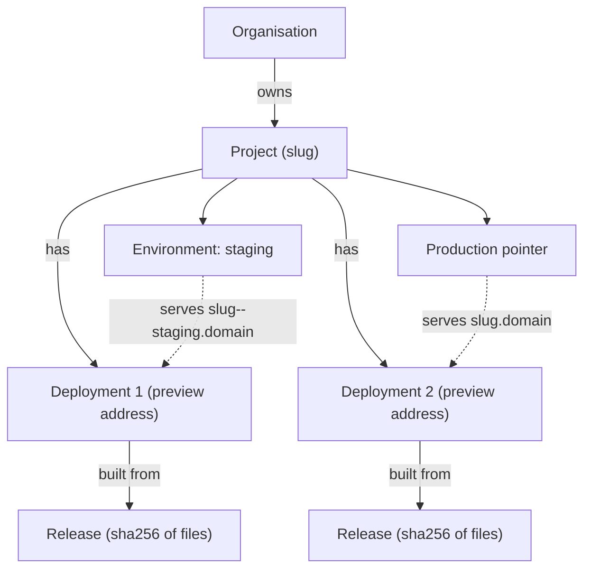
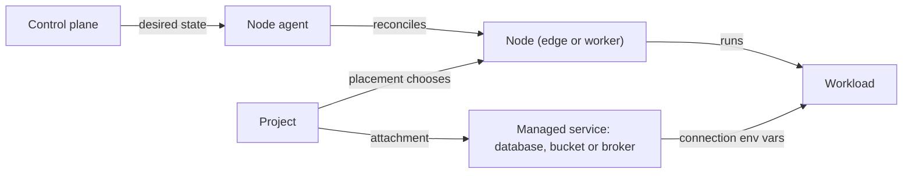

Skiff uses a small set of words consistently across the dashboard, the `skif` CLI, the REST API and the MCP tools. This page explains each one in a sentence or two and links to the page that covers it in depth.

## How the pieces fit

You belong to an **organisation**, which owns **projects**. Each project is a site or app with its own address. Every time you deploy, Skiff packages your files into an immutable **release** and records a **deployment** that combines that release with its configuration. One deployment at a time is the **production** version of the project; the others remain reachable at their own preview addresses. The deployments run on **nodes**, which a **control plane** tells what to do, and a project can use **managed services** such as databases and storage. Everything you do is checked against your **role** and written to the **audit log**.

The diagram shows what refers to what. Ownership and containment are solid arrows, and the two pointers, which decide what visitors see, are dotted.

## People and access

**Organisation.** The tenant boundary. Every project, managed service, API key and secret belongs to exactly one organisation, and quotas are set per organisation. You can invite other people into an organisation, and an organisation's members see only what its roles allow. See [organisations and roles](/accounts/organizations-and-roles).

**Member and role.** A member is a person in an organisation, and each member has one role: `owner`, `admin`, `deployer` or `viewer`. Owners and admins can do everything in the organisation. Deployers can create and deploy projects, manage secrets and services, and read logs, but cannot delete projects, deployments or domains. Viewers can read but not change anything. Platform administration is separate: an install-wide admin role manages nodes and global settings, and an organisation owner is not automatically a platform admin. See [organisations and roles](/accounts/organizations-and-roles).

**Scope and effective permission.** Permissions are written as `resource:action`, for example `deployment:promote` or `database:credentials`. A token, such as an API key, a CLI login or an MCP client's OAuth grant, carries a set of scopes. Its effective permissions are those scopes intersected with the issuing user's current role, so a token can never do more than the person who created it, and lowering someone's role immediately narrows every token they have issued. Destructive permissions such as `project:delete` are never ticked by default. See [API keys and tokens](/accounts/api-keys-and-tokens) and [security model](/accounts/security-model).

**AI agent.** An AI assistant, such as Claude Code or Claude.ai, that connects to Skiff over MCP or runs the `skif` CLI with an API key. It works through the same tools and permission checks as a person, using whichever scopes you granted it. See [MCP](/clients/mcp) and [the CLI](/clients/cli).

**Audit log.** A record of changes and tool calls, with the actor (a user, an API key, an MCP client, the system or an agent), the action, the resource, the arguments and whether it succeeded. Calls made through MCP tools are recorded as well. See [security model](/accounts/security-model).

## Projects and what you ship

**Project.** A named site or app with a globally unique **slug**. The slug becomes part of its address, `<slug>.<contentDomain>`, so it must be 3 to 40 characters of lowercase letters, digits and single hyphens, and cannot contain `--`. Every project has a **kind**, which Skiff calls its runtime:

- `static`: a folder of files served directly, with no code running. This is the default.
- `process`: a long-running app, such as a Bun or Node server, in a sandboxed service on a node.
- `container`: an app from a container image, run on a node by rootful Podman with a per-container user namespace, so container root is not host root.
- `function`: a small function run in a pinned workerd process. It is available when the platform has Functions enabled, which is the default.

See [static sites](/deploying/static-sites), [apps and containers](/compute/apps-and-containers) and [functions](/compute/functions).

**Release.** The built output of a deploy: the files, identified by a sha256 hash of their contents. A release is content-addressed and immutable. Once uploaded it never changes, so the same content always refers to the same release, and it can be served from any node that has a copy. Limits apply per artifact: 500 MB in total, 20,000 files and 25 MB per file. See [static sites](/deploying/static-sites).

**Deployment.** A release combined with a snapshot of its configuration: environment variables, references to secret versions and the parsed site configuration from `skiff.json`, `_redirects` and `_headers`. Each deployment gets a permanent preview address, `<slug>--<shortid>.<contentDomain>`, and a status of `pending`, `active`, `inactive`, `failed` or `deleted`. Because the configuration is part of the deployment, rolling back restores both code and config. See [static sites](/deploying/static-sites) and [site configuration](/deploying/site-config).

**Preview URL.** The permanent address of a single deployment. You can open it to check a change before it goes live, without affecting visitors of the production address. Preview addresses default to `platform` access, which means people must sign in before they can see them. See [access and sharing](/deploying/access-and-sharing).

**Production pointer.** The project's reference to the deployment served at `<slug>.<contentDomain>`. Visitors always see whichever deployment the pointer names. Promoting and rolling back move this pointer, and nothing else changes. See [static sites](/deploying/static-sites).

**Promote and roll back.** Promoting points production at a deployment, and promoting is the default when you deploy. Rolling back points production at the deployment that was live before the current one, which is the most recently promoted deployment that went live before it. Both are instant because they change a pointer and do not rebuild anything. Skiff keeps the last 10 deployments of a project plus any you pin, and removes the rest. See [static sites](/deploying/static-sites).

**Environment.** A named place beside production, such as `staging`, with its own address, `<slug>--<env>.<contentDomain>`, its own access mode and its own deployment. Environment names are 1 to 30 lowercase letters, digits or hyphens. `production` always exists and cannot be created again. See [domains and environments](/deploying/domains-and-environments).

**Domain.** There are three kinds of address to keep apart:

- The **platform domain** is where the dashboard, the API, MCP and sign-in live.
- The **content domain** is where deployed sites are served. It can be the same as the platform domain, which Skiff allows but warns about, because deployed code and your dashboard then share a site. Two separate domains are recommended.
- A **custom domain** is your own hostname attached to a project. You prove you control it with a DNS record, and Skiff then issues its TLS certificate.

See [domains and environments](/deploying/domains-and-environments) and [configuration](/self-hosting/configuration).

**Access mode.** Each project sets an access mode separately for production and for previews: `public` (anyone can visit), `password` (visitors enter a password) or `platform` (visitors must sign in to Skiff). Production defaults to `public`, and previews default to `platform`. See [access and sharing](/deploying/access-and-sharing).

**Share link.** A link that gives someone temporary access to a protected deployment. You can limit it by expiry date, number of visitors, number of redemptions, session length and a list of allowed email addresses. A visit counts as a redemption, not a page load, and you can revoke a link at any time. See [access and sharing](/deploying/access-and-sharing).

## Where things run

**Node.** A machine running the Skiff node agent, which belongs to exactly one install. A node has a mode, `edge` or `worker`. The edge node terminates TLS and public traffic for every site and can also run apps. A worker runs apps and services but receives no public traffic. Each node also has roles that say what it may do: `ingress`, `control`, `compute`, `data` and `build`. The edge holds `ingress`, `control`, `compute` and `data`, and a worker holds `compute` and `data`, with `build` added where it is allowed to run builds. See [nodes and the fleet](/self-hosting/nodes-and-fleet) and [clustering](/self-hosting/clustering).

**Node agent.** The small program that runs on every node. It pulls the desired state for its node from the control plane, makes the node match it, and sends a heartbeat about every 10 seconds. It caches the last state it received on disk, so sites keep serving if the control plane is down. See [nodes and the fleet](/self-hosting/nodes-and-fleet).

**Desired state and reconciliation.** The control plane does not run commands on nodes. It records what each node should have, such as which releases, routes and workloads are present, and the agent works towards that state on its next pull. A change is therefore applied idempotently and does not depend on the node being reachable at the moment you click a button. See [nodes and the fleet](/self-hosting/nodes-and-fleet).

**Placement.** Where a project's runtime runs. You can choose `edge`, a specific node, or `auto`. Static sites always run on the edge, and `auto` picks an online worker with enough free memory for the app, falling back to the edge when no worker has room. Skiff resolves `auto` once, when you deploy, and records the node, so a running app does not move by itself. Placement can also be constrained by zone, node role, label or volume class. See [apps and containers](/compute/apps-and-containers).

**Workload.** The running half of a process, container or function deployment. A workload has a number of replicas, a memory reservation per replica (256 MB by default) and an ingress. An `http` workload gets a route and a health check. A worker, with ingress `none`, has no route and is used for background jobs and queue consumers. See [apps and containers](/compute/apps-and-containers).

The next diagram shows how a workload, its node and an attached managed service connect. The control plane records the desired state, and each node agent reconciles its own node to match it.

## Managed services

**Managed service.** A database, object storage bucket, message broker or email domain that Skiff runs for you on a node. Each has its own permissions, such as `database:create` or `storage:credentials`, and its own backups where they apply. See [databases](/data/databases), [object storage](/data/object-storage), [brokers and events](/data/brokers-and-events) and [email](/data/email).

**Attachment.** The link between a managed service and a project. Attaching a service gives the project its connection details as environment variables, under a prefix, which defaults to `DATABASE`, `S3` or `NATS` for databases, object storage and brokers. Each project can attach a given service once, and reading connection passwords needs the `credentials` permission, which AI agents do not get by default. See [databases](/data/databases).

> [!NOTE]
> Attachments are per project. A service in one organisation is never visible to another, and a project's secrets never resolve in another project.

## Stacks and blueprints

**Blueprint.** One YAML or JSON file that declares a **stack**: projects with their environments, domains and workload settings, plus the databases, storage buckets and brokers they use and the attachments between them. Planning a blueprint shows what would change without changing anything; applying it makes those changes through the same services as the dashboard, with the same permissions and audit entries. Applying the same file again changes nothing. Blueprints hold secret names, never secret values. See [apps and containers](/compute/apps-and-containers#blueprints).
