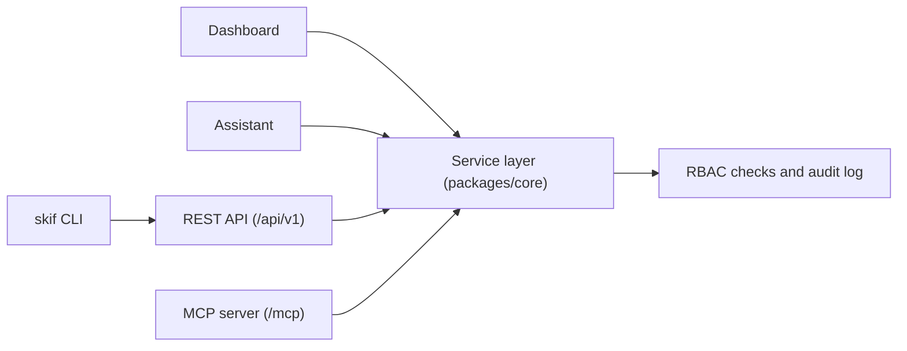
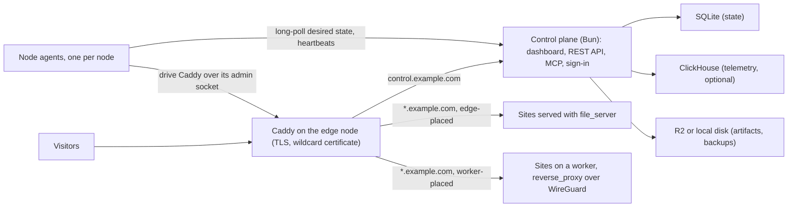

Skiff is a self-hosted deploy platform for one server and, optionally, a few more nodes. You
point it at a folder of files, a Workers-style function, a process or a container, and it puts the
result on your own domain with a preview URL for every deployment. You can promote a deployment to
production, or roll back to the previous one, in a single step. Skiff also runs the supporting
services an app needs: Postgres and other databases, S3-compatible object storage, message
brokers and email.

You drive Skiff from a dashboard, from the `skif` command-line tool, from the REST API, or from an
AI agent over MCP. All of these call the same service layer, so each one can do exactly the same
things.

## Who it is for

Skiff is for a developer or a small team who wants their own cloud on a VPS, with no per-seat
pricing and no lock-in. There is no Kubernetes and no external database to run. The control plane
is Bun, the state is SQLite, and Caddy handles TLS. If the control plane goes down, sites that are
already deployed keep serving.

It is also built for agents. An assistant such as Claude Code can deploy a site, create a share link
that expires, or check a deployment's status, using a token that only has the permissions you
granted it.

## What you can run

| Kind | What it is | Typical use |
|---|---|---|
| Static sites | A folder of built files, served by Caddy | Documentation, landing pages, single-page apps |
| Functions | Workers-style functions, with routes, cron and queue triggers | APIs and background handlers without a server to manage |
| Process apps | A long-running process under a sandboxed systemd unit | A Node or Bun server-side-rendered app |
| Containers | A container image run under Podman | A service that needs its own runtime |
| Databases | Managed database containers with credentials, backups and a studio | Postgres for an app, plus MySQL, MariaDB, MongoDB, Redis, Valkey and ClickHouse |
| Object storage | S3-compatible buckets with scoped access keys | Uploads, assets and backups |
| Brokers | NATS with JetStream, with attachments that inject connection details | Queues and events between services |
| Email | Outbound sending from your own domain, with DKIM | Transactional mail from your apps |

Each kind is described in its own section of these docs. The
[concepts](/getting-started/concepts) page explains the shared vocabulary (projects, deployments,
releases, environments and placement) so you can read the rest without guessing what each term
means.

## Five surfaces, one service layer

Skiff has five ways in. They all go through the same code in the control plane, with the same
permission checks and the same audit log, so none of them can do something another cannot.

The diagram shows the five surfaces and the service layer they share. The CLI talks to the REST API,
so it reaches the service layer through the same route.

| Surface | Use it for |
|---|---|
| Dashboard | Browsing the fleet, projects, deployments, traffic, logs and the audit log, and making changes by hand |
| Assistant | An optional chat panel inside the dashboard. An owner turns it on in **Settings → Assistant** by pointing Skiff at an OpenAI-compatible model endpoint |
| REST API | Scripts and integrations, under `/api/v1` on the control plane. See [REST API](/clients/rest-api) |
| MCP server | AI agents, at `/mcp` on the control plane, with OAuth 2.1 sign-in and a consent screen. See [MCP](/clients/mcp) |
| `skif` CLI | Deploys, status, rollbacks and logs from a terminal or CI. `skiff` is an alias. See [CLI](/clients/cli) |

A token has the permissions of its scopes and of your current role, whichever is smaller. If you
demote someone, every token they issued narrows straight away. Destructive actions, such as deleting
a project, need a human to confirm them.

## How it fits together

A Skiff installation has one control plane and one or more nodes. The control plane holds the
desired state: which releases should exist, which routes Caddy should serve and which workloads
should run. Each node runs a small agent that pulls that state, makes the node match it, and reports
back with heartbeats. Caddy terminates TLS on the edge node, using a wildcard certificate.

The diagram shows how the pieces connect. Visitors reach Caddy on the edge node, which routes the
platform domain to the control plane and the content domain to your sites.

Skiff uses two domains. The **platform domain** (for example `control.example.com`) serves the
dashboard, the API, MCP and sign-in. The **content domain** (for example `example.com`) serves your
deployed sites. Keeping them on separate registrable domains means deployed code never shares
cookies with the dashboard. Skiff also supports running both on one domain, but then it shows a
warning and applies extra hardening. The [installation](/self-hosting/installation) page covers how
to set up both domains.

Build artifacts are stored in Cloudflare R2 or on local disk. Serving never depends on R2 being
reachable, because each node keeps the release it is running. ClickHouse is off by default. You
install it only if you want traffic, database and storage metrics and dashboards.

## What is stable and what is early

Skiff is newly open source and is in early development. Expect rough edges, and expect breaking
changes before 1.0. The table shows how far each area has got.

| Area | Status |
|---|---|
| Static sites: previews, promote, rollback, access modes, share links | The most mature part. The v1 static platform is feature-complete apart from a few release items |
| Accounts, organisations, roles, API keys and two-factor sign-in | Built and in use |
| Functions, databases, object storage and brokers | Built, but still being verified end to end on Linux nodes |
| Email | Outbound sending is built. Inbound routing is not available yet |
| Process apps and containers | Preview. Built and tested, but not yet verified across every setup |
| Git builds, custom domains and named environments | Preview. The backend is in place. Installer and release wiring are still in progress |

> [!NOTE]
> Not available yet: inbound email routing and automatic failover between nodes. Multi-node
> clustering is planned, but a single control plane with one or more nodes is what runs today.

## Where to next

- [Quickstart](/getting-started/quickstart): deploy your first site.
- [Concepts](/getting-started/concepts): the terms used across the dashboard, CLI and API.
- [Static sites](/deploying/static-sites): deploy a folder, then promote or roll back.
- [Functions](/compute/functions): deploy a Workers-style function.
- [Databases](/data/databases): create a database and attach it to a project.
- [CLI](/clients/cli): every `skif` command and how to use it in CI.
- [MCP](/clients/mcp): connect an AI agent to your Skiff server.
- [Installation](/self-hosting/installation): install Skiff on a Debian or Ubuntu server.
