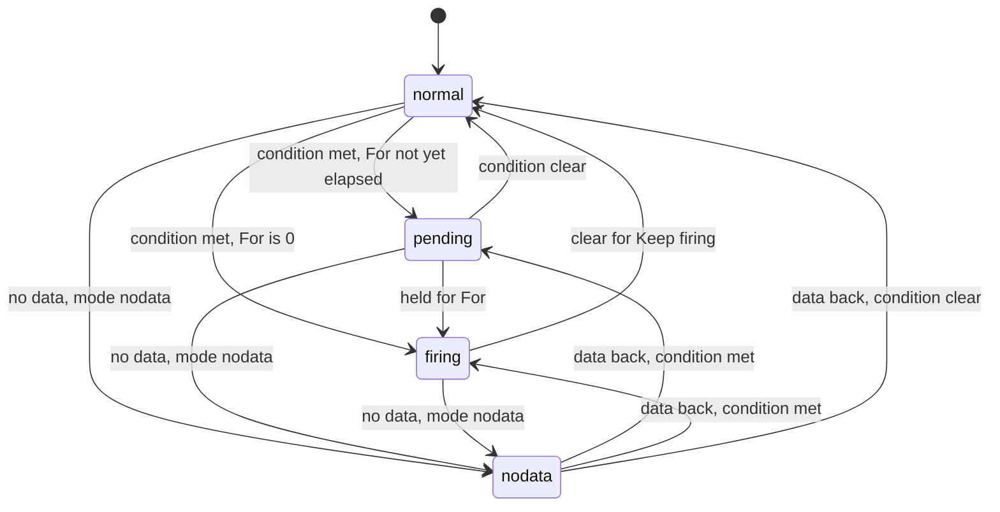
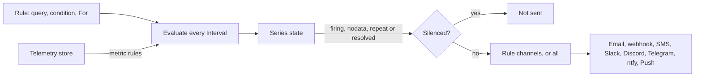

Skiff raises alerts when something needs attention: a node stops reporting, a disk fills, a certificate is about to expire, a backup fails, a deployment starts returning errors, or a metric you care about crosses a threshold. The **Alerts** page in the dashboard shows what is firing now, the rules that produce alerts, the silences that mute them, and a history of everything that has happened. This page covers each tab, the built-in system alerts, how to write a rule, and how notifications reach you.

Metric rules are evaluated against the telemetry store, so they need the telemetry service (see [metrics](/observe/metrics)). The built-in system alerts do not.

## The tabs

| Tab | What it holds | Who can open it |
|---|---|---|
| **Active** | Series that are pending, firing or have no data, with acknowledge and silence actions. | Everyone with metrics access (every role) |
| **Rules** | Metric alert rules for the organisation, with health and state counts. | Everyone can view. Owners and admins create and edit. |
| **Silences** | Active and scheduled silences. | Everyone can view. Owners, admins and deployers create or end them. |
| **History** | Timeline of state changes, notifications, acknowledgements and silences. | Everyone with metrics access |
| **System alerts** | The built-in alerts: on or off, channels and thresholds per kind. | Platform admins. Only the platform owner edits. |
| **Channels** | Which notification channels are configured, and test sends. | Platform admins. Only the platform owner sends tests. |

The last two tabs sit under a **Platform** heading in the sidebar. Viewers see the first four tabs only, and can view rules but not change them.

> [!NOTE]
> System alerts are platform-wide, so only platform admins see them, including in the History tab.

## System alerts

System alerts need no setup. The maintenance loop, which runs every minute, raises them from node heartbeats, stats reported by the agents and the platform's own state. These are the built-in kinds:

| Alert | Fires when | Severity |
|---|---|---|
| Node offline | A node stops sending heartbeats, or reports that its proxy (Caddy) is down, for longer than the threshold. Default 2 minutes. | Critical |
| Node disk full | A node's root disk is above the threshold. Default 85%. | Warning |
| TLS certificate expiring | A certificate Caddy serves is inside the warning window (default 14 days), or the critical window (default 3 days). Caddy normally renews about 30 days ahead, so an alert usually means renewal is failing. | Warning, then critical |
| 5xx spike after promote | In the 30 minutes after a promote, at least 5% of production requests return 5xx (from at least 20 requests), and the rate is at least double the rate before the promote. Fires once per deployment. | Critical |
| Backup or restore drill failed | The platform database backup or the monthly restore drill records a failure. | Critical |
| Database storage | A managed database passes its storage threshold. Default 85%. | Warning, critical at 95% |
| Database connections | Open connections pass their threshold, as a share of `max_connections`. Default 90%. | Warning |
| Connection pool saturation | A database's connection pool is nearly full, so clients wait. Default 90%. | Warning, critical at 95% |
| Storage usage | A storage instance passes its storage budget threshold, or an app volume passes it as a share of its quota. Default 85%. | Warning, critical at 95% |
| Queue broker store | A queue broker's message store passes its threshold. A full store refuses new messages. Default 85%. | Warning, critical at 95% |
| Org quota | An organisation reaches 80% or 95% of a quota, once per threshold per day. See [quotas and limits](/self-hosting/quotas-and-limits). | Warning |
| Alert rules cannot evaluate | The telemetry store has been unavailable for 10 minutes, so metric rules cannot fire. | Critical |
| Failover | Raised by the failover controller, not the maintenance loop: it moved a replica copy, could not (no node can take it, or the move expired or failed), withdrew or re-added an ingress node, found a database primary lost (you promote by hand), or lost its lease to another control plane. See [automatic failover](/self-hosting/clustering#automatic-failover). | Info when it acted, warning when blocked, critical for a lost primary or lease |

Each kind repeats while its condition holds. The repeat interval is set by **Repeat every**, default 30 minutes (5 to 1440). Every threshold is a platform policy with a fixed range:

| Setting | Default | Allowed |
|---|---|---|
| Node offline after | 2 minutes | 1 to 60 |
| Disk above | 85% | 50 to 99 |
| Certificate warning within | 14 days | 2 to 60 |
| Certificate critical within | 3 days | 1 to 30, and below the warning value |
| Database storage, connections, pool, object storage and broker store above | 85%, 90%, 90%, 85%, 85% | 50 to 99 (connections and pool up to 100) |

Platform owners change these on **Alerts → System alerts**, and each kind can be switched off or sent to chosen channels. A switched-off kind sends nothing and is not recorded in history. A change takes effect within about a minute.

> [!NOTE]
> The failure alerts raised by systemd units (see [systemd failure alerts](#systemd-failure-alerts) below) always go to every channel, even if the backup kind is routed elsewhere. They have to work while the control plane is down.

## Metric alert rules

A rule runs one query over a trailing window, on its own interval, and compares one number per series with a threshold. A series is one combination of `groupBy` values. A rule with no group-by has a single series.

To create a rule, open **Alerts → Rules** and choose **New rule**, or start from a template. You can also choose **Create alert…** from the menu of any panel on a dashboard, which copies that panel's query into a new rule. See [dashboards and logs](/observe/dashboards-and-logs) for building panels.

| Field | Default | Meaning |
|---|---|---|
| Query | | A builder query with one metric. SQL is available to platform admins only. |
| Condition | | An operator (`gt`, `gte`, `lt`, `lte`, `eq`, `neq`) and a threshold, in the metric's raw unit. Percent units are fractions, so 5% is `0.05`. |
| Window | 300 s | The query reads the last 60 to 86,400 seconds. |
| Interval | 60 s | How often the rule runs, from 60 to 3,600 seconds. |
| For | 120 s | The condition must hold this long before the series fires. `0` fires at once. |
| Keep firing | 0 s | A firing series resolves only after the condition has been clear this long. |
| No data | `ok` | What a missing series means (see below). |
| Repeat | 240 min | Notify again while a series keeps firing. `0` notifies once. |
| Notify on resolve | on | Send a resolved message when a notified series recovers. |
| Severity | warning | `info`, `warning` or `critical`. Sets the priority and colour in notifications. |
| Channels | all | Which channels get this rule's alerts. Empty means every channel. |
| Emails | none | Extra recipients for this rule, up to 10. |
| Runbook | none | Text or a link included in every notification. |

Rules see only their organisation's projects, databases and storage, exactly as a dashboard panel does. SQL rules read every organisation's telemetry, so only platform admins can write them.

### Templates

These presets cover the common outage cases. Once created, each one is an ordinary rule you can edit.

| Template | Watches | Fires when |
|---|---|---|
| Site down | Error rate by host, 3 minutes | Above 50% for 2 minutes. Critical. |
| High error rate | Error rate by host, 5 minutes | Above 5% for 5 minutes. |
| Slow responses | p95 latency by host, 5 minutes | Above 2 s for 5 minutes. |
| Traffic stopped | Requests by project, 10 minutes | Below 1 request. No data counts as alerting. Critical. |
| Database down | Database up by database, 2 minutes | Below 1 for 2 minutes. No data counts as alerting. Critical. |
| Pooler down | Pooler up by database, 2 minutes | Below 1 for 2 minutes. Critical. |
| Database connections | Connection utilisation, 5 minutes | Above 90% for 5 minutes. |
| Database deadlocks | Deadlocks, 5 minutes | Above 0. Repeats hourly. |
| Storage down | Storage up by instance, 2 minutes | Below 1 for 2 minutes. No data counts as alerting. Critical. |
| Broker down | Broker up by broker, 2 minutes | Below 1 for 2 minutes. No data counts as alerting. Critical. |
| Broker store full | Store utilisation by broker, 5 minutes | Above 85% for 5 minutes. |
| Queue backlog not draining | Oldest message age by broker, 10 minutes | Above 15 minutes. |

Traffic rules only see requests that reach the edge. A site that is unreachable from outside, or whose requests never arrive, may not show up as errors. For an outside view, use Traffic stopped with **No data** set to alerting.

### States and no data

Each series moves through `normal`, `pending` (the condition holds, but not yet for the **For** time), `firing`, and `nodata`. Acknowledging and silencing do not change this state; they only affect notifications.



When the query stops returning a series, **No data** decides what it means:

| No data | Missing data is treated as | Use for |
|---|---|---|
| `ok` | The condition clearing | Error and latency rules, where a quiet site is fine |
| `alerting` | The condition holding | Outage rules, where a database or host that stops reporting is down |
| `nodata` | Its own "No data" state, notified separately | An exporter you expect to report |
| `keep` | Ignored, so the last state holds | Flaky sources |

A series whose project, database or storage instance has been deleted is dropped rather than reported as down.

### Notifications

A rule's evaluation feeds its series into one notification path, shown below. Silences are checked before anything is sent.



- A series notifies when it enters firing or no data, again every **Repeat** interval while it stays there, and once more on recovery if **Notify on resolve** is on.
- Resolved messages carry severity `info`, and chat channels show them in green.
- If a rule's query fails, for example because of bad SQL, the rule shows an error in the Rules tab. After 10 minutes of failures its channels get one "Alert rule failing" message.
- If the telemetry store is unavailable, rules are skipped and keep their states. The platform's own channels get one critical message after 10 minutes, and another when the store is back.

## Acknowledging and silencing

On the **Active** tab:

- **Acknowledge** a firing or no-data series to stop its repeat notifications until it resolves. The series stays firing, and the Active tab shows who acknowledged it.
- **Silence** mutes notifications for a period. A silence covers one rule or every rule in the organisation, and can be narrowed with label matchers such as `host = shop.example.com`. Matchers must all match a series' labels. States still change during a silence, so a series can be firing while its notifications are muted.

Silences last at most 90 days. For longer periods, pause the rule instead. Owners, admins and deployers can acknowledge and silence. Viewers can see both, but cannot change them.

## History

The **History** tab lists events newest first, with filters for a rule and for event kind. Each notification event records the outcome for each channel, so a failing channel shows its error next to the successful ones. Events are kept for 90 days.

## Notification channels

Alerts are sent to any of these channels. Channel settings are set up in **Settings → Notifications**, and the **Channels** tab shows which are configured and lets platform owners send a test to one channel or to all of them.

| Channel | Delivers to | Set up with |
|---|---|---|
| Email | The alert address, through the platform's SMTP settings | `SKIFF_ALERT_EMAIL` and the `SKIFF_SMTP_*` settings |
| Webhook | Any HTTPS URL that accepts a JSON POST | `SKIFF_ALERT_WEBHOOK` and optional `SKIFF_ALERT_WEBHOOK_SECRET` |
| SMS | Phone numbers, through Twilio | `SKIFF_ALERT_SMS` and `SKIFF_TWILIO_*` |
| Slack | A Slack incoming webhook (or a Slack-compatible one) | `SKIFF_ALERT_SLACK_WEBHOOK` |
| Discord | A Discord channel webhook | `SKIFF_ALERT_DISCORD_WEBHOOK` |
| Telegram | A bot message to a chat | `SKIFF_ALERT_TELEGRAM_BOT_TOKEN` and `SKIFF_ALERT_TELEGRAM_CHAT_ID` |
| ntfy | A topic on ntfy.sh or your own server | `SKIFF_ALERT_NTFY_URL` and optional `SKIFF_ALERT_NTFY_TOKEN` |
| Push | Browsers that have installed the dashboard as an app | Settings → Notifications → Push |

The `SKIFF_*` values are stored in the host's environment file, `/etc/skiff/skiff.env`, which the systemd alert service also reads.

### Webhook payload

A webhook receives a JSON POST like this:

```json
{
  "title": "Skiff: Site down",
  "message": "shop.example.com: 62.5% of 48 requests returned 5xx in the last 3 minutes.",
  "severity": "critical",
  "key": "alert_rule:9f3c2a1b",
  "status": "firing",
  "url": "https://control.example.com/alerts/rules/9f3c2a1b",
  "labels": { "host": "shop.example.com" }
}
```

- `title` is `Skiff: ` followed by the alert title.
- `message` is the detail text.
- `severity` is `info`, `warning` or `critical`. Resolved messages are `info`.
- `key` identifies the alert. Metric rules use `alert_rule:<id>`, so a receiver can deduplicate on it. System alerts use the kind and target, for example `disk:<node-id>`.
- `status` is `firing` or `resolved`.
- `url` links to the alert in the dashboard. It is `null` for the host's systemd failure alerts, which have no page.
- `labels` are the series labels, for example the host or database. It is `{}` when there are none.

The first four fields were the original payload, so receivers written for them keep working.

A failure returns an error to the channel's history, and other channels still get the alert.

### Verify the webhook signature

Set a signing secret under **Settings → Notifications → Webhook** (it is stored as `SKIFF_ALERT_WEBHOOK_SECRET`) and every webhook request carries a signature header:

```http
X-Skiff-Signature: t=1794045600,v1=5257a869e7ecebeda32affa62cdca3fa51cad7e77a0e56ff536d0ce8e108d8bd
```

`t` is the Unix time the request was signed, and `v1` is the hex HMAC-SHA256 of `<t>.<raw body>` with the secret. To verify, recompute the HMAC over the exact bytes you received, compare it in constant time, and reject a `t` more than five minutes old so a captured request can't be replayed:

```ts
import { createHmac, timingSafeEqual } from 'node:crypto';

export function verifySkiff(secret: string, rawBody: string, header: string | null): boolean {
	const parts = Object.fromEntries((header ?? '').split(',').map((part) => part.split('=', 2)));
	const t = Number(parts.t);
	if (!Number.isInteger(t) || Math.abs(Date.now() / 1000 - t) > 300 || !parts.v1) return false;
	const expected = createHmac('sha256', secret).update(`${t}.${rawBody}`).digest('hex');
	return expected.length === parts.v1.length && timingSafeEqual(Buffer.from(expected), Buffer.from(parts.v1));
}
```

Without a secret, requests are not signed: treat the URL itself as a secret and keep it out of logs you do not control. [Log drains](/observe/dashboards-and-logs#log-drains) sign their webhook requests the same way.

If the URL is a Discord or Slack webhook, Skiff detects it from the host and sends that service's own message format instead.

### Web Push

Web Push delivers alerts as browser notifications to devices where the dashboard is installed or enabled. Only the platform owner can subscribe a device, from **Settings → Notifications → Push**. Alerts then go to the subscribed devices of every platform owner. Push needs a VAPID key pair on the host. The installer creates it, and **Set up push** creates it on hosts that predate that.

## Systemd failure alerts

Host-level jobs can alert even when the control plane is down. When one of these units fails, systemd runs `skiff-alert@<unit>.service`, which runs `skiff-alert` with the failed unit's name:

- `skiff-litestream.service` (platform database backups)
- `skiff-restore-drill.service` (the monthly restore drill; the alert includes the reason from the drill's status file)
- The ClickHouse telemetry service, when its alert template is installed

The alert is sent to every configured channel, using the same `SKIFF_ALERT_*` and `SKIFF_*` settings as the control plane. It also writes a line to the journal. If no channel is configured, the journal line is the only record. To read the failed unit's logs, run:

```sh
journalctl -u skiff-restore-drill.service -n 100
```

## Managing alerts over the API

Everything on this page is available through the REST API under `/api/v1/alerts`. The main endpoints are:

| Method and path | Purpose |
|---|---|
| `GET /api/v1/alerts` | Overview: active series, counts and what you can change |
| `GET`, `POST /api/v1/alerts/rules` | List or create rules |
| `GET`, `PUT`, `DELETE /api/v1/alerts/rules/{id}` | Read, update or delete a rule. `PUT` must include the rule's current `version`. |
| `POST /api/v1/alerts/rules/{id}/ack` | Acknowledge or clear acknowledgement for a series |
| `GET`, `POST /api/v1/alerts/silences` | List or create silences |
| `DELETE /api/v1/alerts/silences/{id}` | End a silence early |
| `GET /api/v1/alerts/history` | Event history |
| `GET`, `PUT /api/v1/alerts/system` | Read or change system alert routing and thresholds (platform owner for `PUT`) |
| `POST /api/v1/alerts/channels/test` | Send a test through one channel, or all (platform owner) |

See the [REST API](/clients/rest-api) page for authentication and the [MCP](/clients/mcp) page for the matching tools.
