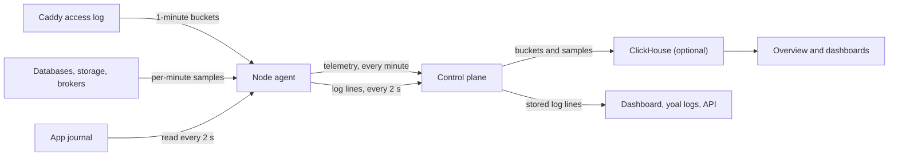

Yoal keeps four kinds of operational history: request traffic and errors, dashboards built over that telemetry, project and service logs, and an audit log of changes made in your organisation. This page covers what each one records, how long it is kept and where to find it. Traffic and dashboards need the optional telemetry store. Logs and the audit log work without it.

## Overview

The **Overview** page is the first thing you see after signing in. It has four parts:

- **Needs attention** lists current problems, most severe first: an offline node, a node whose disk is 90% full, a database or storage instance at 85% of its budget, a failed database or backup, a latest deployment or build that failed in the last 24 hours, a domain that could not be verified, and quota warnings. Each item links to where it is fixed. When nothing is wrong, a single "All clear" line appears instead.
- **Fleet summary** counts nodes, projects, active deployments and storage.
- **Traffic** shows requests, responses by status class, bandwidth and latency across every project you can see. You can choose the last 1 hour, 24 hours, 7 days or 30 days.
- **Recent activity**, **Nodes**, **Projects** and **Data services** show the latest deployments and builds and the state of each part of the fleet.

Traffic needs the `metrics:read` permission. Without it, the traffic panel stays empty and the rest of the page still loads.

## Traffic and errors

Each node's edge agent reads Caddy's access log and aggregates it into one bucket per host per minute. A bucket holds the request count, responses by status class (2xx, 3xx, 4xx and 5xx), bytes served, sampled p50 and p95 latency, and the ten most requested paths and referrers. Raw requests never leave the node. Once a minute, the agent sends completed buckets to the control plane, which attributes each one to a project by its host name.

Managed databases, object storage and queue brokers report a per-minute sample of their own health and counters in the same way. The stats tabs on those services, the Overview and dashboards all read from the same store.

The diagram shows how traffic, service samples and logs travel from a node to the control plane, and on to the views that read them.



The control plane keeps two resolutions:

| Resolution | Kept for | Used by |
| --- | --- | --- |
| 1 minute | 48 hours | Ranges that start within the last 48 hours |
| 1 hour | 90 days | Longer ranges, and any range too wide for minute data |

A periodic maintenance job runs every 60 seconds. It rolls minute data up into hourly rows, prunes data past either retention and, when object storage is configured, archives each completed day of minute data as Parquet files there.

### ClickHouse is optional

The telemetry store is a small ClickHouse server on the control-plane host. It is off by default because it is the heaviest part of a host: about 240 MB to download, capped at 1 GB of memory, and typically 300 to 800 MB in use. Without it, Yoal runs as normal, with these differences:

- Traffic charts, the database and storage stats tabs and dashboards show that telemetry is not installed. The Overview traffic panel shows the reason instead of data.
- Agents keep working. While the control plane is unreachable, an agent holds up to 5,000 one-minute buckets in memory and then drops the oldest.
- Deploys, logs, the audit log and every other page are unaffected.

Installing or removing ClickHouse is done by a platform owner in **Settings → Telemetry**. The page shows whether the store is installed, whether it is answering and what it holds. You can choose:

- **Install ClickHouse**, which downloads and starts it, then restarts the dashboard for a few seconds.
- **Remove**, which stops and uninstalls ClickHouse but keeps its data, so a reinstall picks up where it left off.
- **Remove and delete data**, which also deletes every stored traffic, database and storage sample. Archives already in object storage are kept.

On the server, `sudo yoal-platform-config telemetry on` and `sudo yoal-platform-config telemetry off` do the same, with `--purge` to delete the data. The installer asks the same question, or you can pass `--clickhouse` or `--no-clickhouse`. See [installation](/self-hosting/installation).

## Dashboards

**Dashboards** holds the organisation's saved dashboards, four starter templates and a blank dashboard. Every built-in role has `metrics:read`, so every member can see and run every saved dashboard in the organisation. Only the author, an owner or admin, or a platform admin can edit or delete one.

The starter templates are **Traffic overview** (with a host variable), **Managed databases**, **Object storage** and **Queue brokers**. A new dashboard starts with a default time range of the last 6 hours. Saving also stores the current time range and variable values as the defaults.

Dashboards are versioned. If someone saves a dashboard while you are editing it, Yoal shows a conflict and lets you reload their version or overwrite it. To back up a dashboard, use **Export JSON** on the dashboard; **Import** on the list page takes a JSON export back in.

### The query model

Each panel runs one query and draws it with one visualisation: time series, bar, stat, gauge, bar gauge, table, pie, or text (Markdown). The **query builder** is the default and works for anyone with `metrics:read`. It has five parts:

- **Dataset**: `traffic` (per project), `traffic_paths` and `traffic_referrers` (the top paths and referrers per project), `databases`, `storage` and `brokers`.
- **Measures** with an aggregation: `sum`, `avg`, `min`, `max`, `last`, `value`, `count` (counts buckets) or `rate` (per second). Derived measures such as **Server error rate**, **Success rate** and p95 latency are built in.
- **Group by** up to four dimensions, such as `host`, `project_id` or `database_id`. Ids show with their names.
- **Filters** up to 20, with the operators `eq`, `neq`, `in`, `nin`, `contains`, `gt`, `gte`, `lt` and `lte`.
- **Interval** `auto`, or a fixed width from 1 minute to 1 day. Turn off time series to get one row per group for the whole range. You can also set an order and a limit of up to 10,000 rows.

Builder queries are always limited to the projects, databases, storage instances and brokers the caller can see. Results are capped at 20,000 rows. A query range can be up to 400 days.

### SQL queries (platform admins)

A platform admin can write ClickHouse SQL for a panel or a variable instead. SQL runs as a read-only ClickHouse user with resource limits. It can read every organisation's rows, which is why only platform admins can add or edit it. Other users see an error on those panels.

SQL can use these macros, which are expanded before the query runs:

- `$__timeFilter(column)`, `$__fromTime` and `$__toTime` for the panel's time range.
- `$__interval_s` and `$__timeInterval(column)` for the bucket width.
- `$name` or `${name}` for a dashboard variable. A multi-value variable becomes a list for `IN`.

**Dashboards → Explore** runs ad-hoc queries, keeps a history of the ones you ran and adds a result to a dashboard as a panel.

### Variables, time and refresh

Time ranges use relative expressions such as `now-6h`, `now-7d` or `now/d`, or absolute UTC timestamps. Auto-refresh can be set to 10 seconds, 30 seconds, 1 minute, 5 minutes, 15 minutes or 1 hour.

Variables take their values from a query's first column, from a comma-separated list you type, or from a text box. They can allow several values, and can include an **All** option.

## Logs

Yoal collects logs from three places:

- **Builds**: git builds stream their output while they run.
- **Workloads**: the agent reads each app's journal every few seconds, so runtime output appears within seconds.
- **Managed services**: databases, object storage and brokers each have their own log view.

Lines are stored with a source, a stream (stdout or stderr), a level (debug, info, warn or error) and a deployment or build id. Yoal removes terminal colour codes and detects the level from common formats such as JSON, syslog and plain text. A line that has no recognisable level is `info`, or `warn` when it came from stderr during a build.

### Viewing and tailing in the dashboard

Open **Projects → my-site → Logs**. Choose the source, a deployment's runtime output or a build, then narrow the view with a text filter (a case-insensitive match) or a minimum level. Choosing `warn` includes errors.

The view tails new lines live over a server-sent event stream. If the connection drops, it resumes from the last line it received, so you do not miss or repeat lines. **Pause** stops the view from moving while lines keep arriving, and **Download** and **Copy** act on the lines currently visible. Static sites have no runtime process, so only their build logs appear.

### yoal logs

`yoal logs` prints the newest lines for a project and exits. It does not follow the output, so use the dashboard for a live tail.

```sh
yoal logs my-site
yoal logs my-site --lines 500
yoal logs my-site --json
```

| Flag | Meaning |
| --- | --- |
| `-n, --lines <n>` | How many lines to show, from 1 to 10,000. Default `200`. |
| `--json` | Print the raw API response instead of formatted lines. |
| `-h, --help` | Show usage. |

The REST API `GET /api/v1/projects/{slug}/logs` takes the same filters as the dashboard (`source`, `level`, `q`, `buildId`, `deploymentId`, `limit`) and an `after` cursor. Pass the `cursor` from one response as `after` on the next to read forward without duplicates. The MCP tool `get_logs` works the same way. See [the CLI](/clients/cli), [the REST API](/clients/rest-api) and [MCP](/clients/mcp).

### Retention

Logs are kept for the number of days set in **Settings → Policies → Log retention**. The default is 7 days and the range is 1 to 90. Each log store also holds at most 500,000 lines; past that, the oldest lines are removed first. Expired lines are removed by the same periodic job that handles telemetry.

Log drains (below) keep their own copy elsewhere if you need logs for longer.

## Log drains

A log drain forwards your logs to a service you run or pay for: any HTTPS endpoint that accepts a POST, or an OpenTelemetry (OTLP) receiver such as Grafana Cloud, Datadog, Honeycomb, New Relic, Axiom or your own OpenTelemetry Collector. Yoal sends each line it stores, a few seconds after it arrives, starting from when you create the drain. Earlier lines are not sent.

Set one up under **Settings → Log drains**, with `yoal log-drain create`, through `POST /api/v1/log-drains` or with the MCP tool `create_log_drain`. Organisation owners and admins manage drains; anyone with `logs:read` can see them. An organisation can have up to 10.

| Setting | Meaning |
| --- | --- |
| Receiver | **Webhook** posts batches of JSON lines. **OTLP** posts OTLP/HTTP logs with JSON encoding; a bare origin gets `/v1/logs` added. |
| URL | Must be `https://`. Put credentials in a header, not in the URL. Query-string values are shown as `***` afterwards. |
| Project | One project, or the whole organisation. Only organisation-wide drains carry managed-service logs. |
| Sources | Any of `build`, `runtime`, `system` and `services` (databases, object storage, brokers). None means all. |
| Minimum level | Only lines at this level and above, for example `warn` for warnings and errors. |
| Headers | Sent with every request, for example `Authorization: Bearer …`. Values are stored encrypted and never shown again. |
| Body | Webhook only: NDJSON, one line object per line (the default), or a JSON array. |

### Webhook body and signature

Each request carries up to 500 lines from each log store (project logs, database and storage logs, broker logs), about 1 MB in total. An NDJSON body has one object per line:

```json
{"id":"log:48213","time":"2026-11-07T10:00:00.000Z","level":"error","message":"payment failed","source":"runtime","stream":"stderr","org":"org_…","project":"shop","projectId":"prj_…","deploymentId":"dep_…","buildId":null,"node":"node_…","service":null}
```

Managed-service lines have `project` set to `null` and `service` set to `{ "kind": "database", "id": "…", "name": "main" }`. Each request also has an `X-Yoal-Drain` header with the drain id and an `X-Yoal-Batch` header that stays the same when a batch is retried.

Every webhook drain gets its own signing secret, shown once when you create it. Requests carry `X-Yoal-Signature: t=<unix seconds>,v1=<hex HMAC-SHA256>` over `<t>.<raw body>`, the same scheme as the [alert webhook](/observe/alerts#verify-the-webhook-signature), which shows how to verify it. **Rotate signing secret** (or `yoal log-drain update <id> --rotate-secret`) issues a new one; the old one stops working at once.

OTLP drains are not signed: authenticate them with the header your receiver asks for. Each line becomes a log record with `service.name` set to the project slug or service name, and `log.record.uid` set to the line `id`.

### Delivery and failures

Delivery is at least once. A batch that fails (a timeout, a connection error or a 5xx answer) is retried with the same lines after 5 seconds, then 10, 20 and so on up to 5 minutes between tries. After 8 failed tries, roughly ten minutes, the batch is dropped and counted, and the drain moves on to newer lines. A `400`, `413`, `415` or `422` answer, or a redirect, drops the batch at once, because retrying it would fail the same way. Every line has a stable `id`, so a receiver can drop the duplicates a retry may cause.

The drain list shows each drain's status (**Delivering**, **Failing**, **Waiting for logs** or **Paused**), how many lines it has sent and dropped, and the last error. **Test** sends one line straight away and shows what the receiver answered, without touching the counters. Pausing a drain stops it; resuming it starts again from new lines, so nothing logged while it was paused is sent.

```sh
yoal log-drain create archive --url https://logs.example.com/yoal -H "Authorization: Bearer …"
yoal log-drain create grafana --otlp --url https://otlp-gateway.example.com/otlp -H "Authorization: Basic …"
yoal log-drain test ldr_…
yoal log-drain list
```

Drains only reach public addresses: a URL that resolves to a private, loopback or link-local address is refused. To send to a collector on your own network, a platform admin can tick **Allow private addresses** when creating the drain in the dashboard, which also permits plain `http://`.

## Audit log

**Audit** is the organisation's record of changes. Each entry shows when it happened, who or what did it, the action, the resource and its id, the result, and the arguments. Open an entry to see its arguments as JSON.

### What is recorded

Every change made through the dashboard, REST API, CLI, MCP and the dashboard assistant is written to the audit log. Examples include `deployment.promote`, `project.delete`, `dashboard.update` and `database.credentials.reveal`. Revealing a credential is recorded as well, so reads of sensitive values leave a trace.

Calls to MCP tools are recorded in full, including read-only calls and calls refused for missing scope. The action is `mcp.<tool>`, so a call to the MCP tool `delete_dashboard` appears as `mcp.delete_dashboard` alongside the `dashboard.delete` entry the service writes. Actions taken by the dashboard assistant are recorded as `assistant.<tool>`. A chat message itself is recorded as `assistant.chat`, with its length and the page it was sent from, not its text.

Each entry records the actor, which is a user, an API key, an MCP client or the system. It also records the client that made the call and a hash of the client IP where one is available.

Arguments are stored with secrets removed. Any key whose name contains `secret`, `password`, `token`, `key` or `authorization` is stored as `[redacted]`, and strings longer than 2,000 characters are cut short. Viewing logs and running dashboard queries are not audited.

### Filtering

The audit page lists the newest entries first. Use the **Action** field for an exact action name such as `deployment.promote`, the **Resource** field for a resource type such as `project`, **From** and **To** for a range of whole days in UTC, and **Show** to pick 25, 50, 100 or 200 entries a page (the default is 50). **Older** moves to the next page and **Newest** goes back to the start. Paging stays stable while new entries arrive.

The REST API takes the same filters. `from` and `to` accept a date (`2026-11-07`), an ISO timestamp or epoch milliseconds, and a date as `to` covers that whole day. The response has `entries` and `nextCursor`; pass `nextCursor` as `cursor` to get the next, older page. It is `null` on the last page.

```sh
curl -H "Authorization: Bearer yoal_…" \
  "https://control.example.com/api/v1/audit?from=2026-11-01&to=2026-11-07&resource=project&limit=100"
```

The MCP tool `get_audit_log` takes the same `from`, `to` and `cursor` arguments, and `yoal audit` prints a page with the command for the next one (`--all` follows every page):

```sh
yoal audit --from 2026-11-01 --to 2026-11-07
yoal audit --resource log_drain --all --json
```

A page holds at most 200 entries. Reading the audit log needs `project:read`, which every built-in role has.

### Retention

Yoal does not delete audit entries automatically, and there is no setting that shortens how long they are kept.

## Where these settings live

| Setting | Where | Who can change it |
| --- | --- | --- |
| Install or remove ClickHouse | **Settings → Telemetry** | Platform owners |
| Log retention, 1 to 90 days | **Settings → Policies** | Platform owners |
| Dashboard access | `metrics:read` on the role | Organisation owners and admins |
| Log drains | **Settings → Log drains** | Organisation owners and admins; private-network drains need a platform admin |

For alerts on the same data, see [alerts](/observe/alerts). For metrics, see [metrics](/observe/metrics).
