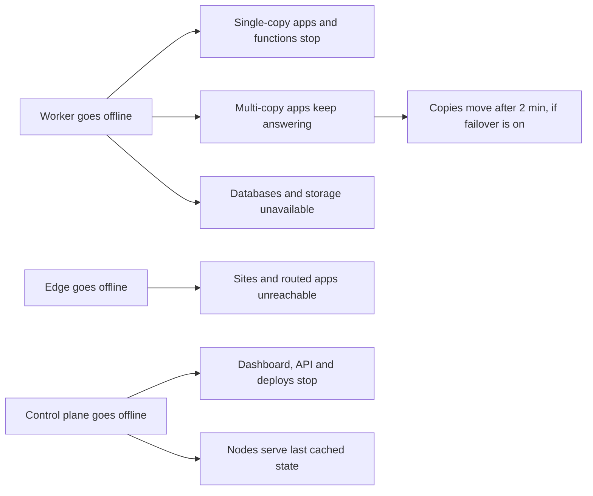
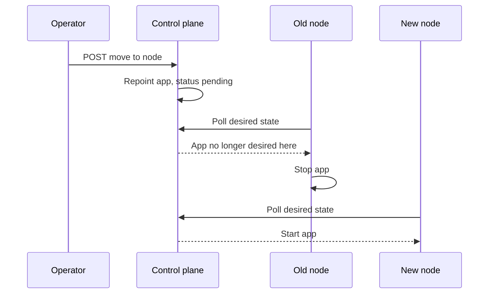
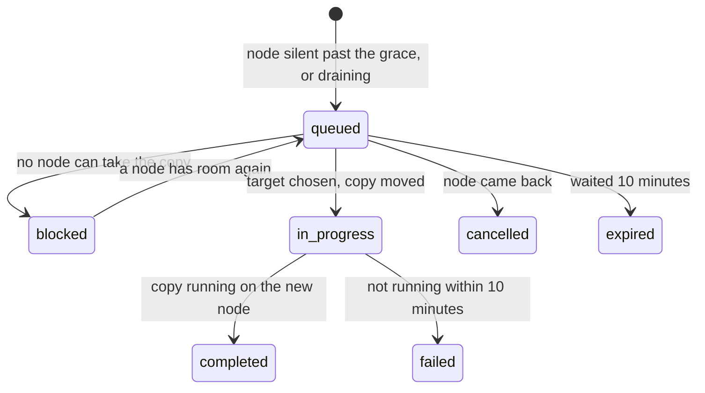

Yoal can run on several nodes, but its high availability is limited today. Most apps, databases and storage instances have one copy on one node, and recovery after a failure is mostly manual. This page covers what happens when a node, the edge or the control plane fails, how to use the pieces that exist, and what is planned but not built. To add machines, see [nodes and fleet](/self-hosting/nodes-and-fleet).

> [!IMPORTANT]
> Automatic failover is off by default, and when you turn it on it only moves copies of multi-copy apps. A database replica is promoted only when you ask (or, with an extra opt-in, by the controller), and nothing moves a single-copy app or changes DNS for you: Yoal alerts and tells you what to do. Keep current backups and plan for manual recovery.

## What runs where today

- One **edge** node takes ingress for the platform and content domains and serves every static site. The first node you join becomes the edge.
- Each app, function, database and storage instance runs on one node. An app can run several copies on different nodes, but only when the `MULTI_NODE_REPLICAS` feature flag is on (see [multi-node replicas](#multi-node-replicas)).
- The control plane is a single instance. Each node caches the last desired state it received on disk, so existing sites and apps keep running if the control plane stops.

## When something fails

The diagram summarises what keeps serving when each part fails. The sections below give the detail.



### A worker node goes offline

An agent that stops sending heartbeats is marked **offline** after 30 seconds. An alert follows after the delay set in **Alerts → System alerts**.

- **Single-copy apps and functions** on that node stop answering. They are not moved automatically. Bring the node back, or move the app (see [moving services](#move-services)).
- **Multi-copy apps** keep answering from their other copies. The edge stops sending requests to a copy that fails. If [automatic failover](#automatic-failover) is on, the copies on that node are started on healthy nodes once it has been silent for 2 minutes. If it is off, they stay where they are until the node returns or you drain it.
- **Managed databases and storage instances** on that node are unavailable until it returns. For a PostgreSQL database with a [read replica](/data/databases#read-replicas) on another node, Yoal raises a critical **Failover** alert after 2 minutes and shows which replica a promotion would use on **Settings → High availability**. You then [promote it](/data/databases#promote-a-replica) with `yoal db replica promote`; because the old node cannot confirm it stopped, the promotion needs `--accept-data-loss`. Without a replica, if the node is gone for good, you can move a database from its latest backup, but writes made since that backup are lost.

### The edge node goes offline

Every site and every app routed through the edge is unreachable, because no other node takes over its traffic. Either bring the edge back, or make another node the edge and point DNS at it:

1. In **Nodes**, open the menu for an online node and choose **Make this the edge**.
2. Type the node's name to confirm. The previous edge becomes a worker and keeps the apps and databases on it.
3. Yoal changes only the roles. If the new edge is a different machine, point the platform and content domains at it, and give its agent the TLS settings an edge needs. See [installation](/self-hosting/installation).

If `YOAL_EDGE_NODE_ID` is set in the control plane's environment, the edge is pinned and the dashboard refuses the change. Change the variable and restart the control plane instead.

### The control plane goes offline

The dashboard, REST API, CLI and MCP stop, and so do deploys and configuration changes. Nodes keep serving the last desired state from their disk cache, so sites and apps stay up while it is down. There is no standby control plane. To recover, restore the control plane from a platform backup, as described in [platform backups](/self-hosting/platform-backups).

### Disk failure

Yoal does not mirror a node's disks. A failed drive loses that node's data unless you have backups. For redundancy on one node, set up an mdadm array or a ZFS mirror in the OS and add it as a disk. See [disks](/self-hosting/nodes-and-fleet#disks) and [backups and point-in-time recovery](/data/backups-and-pitr).

## Set up what exists

### Zones

A zone is a failure domain: nodes in one zone share power, network and provider. Set a zone on each node so that replicas can be spread across zones. In **Nodes**, open **Actions for** the node, choose **Edit node** and set **Zone**. A node that never has a zone is in `default`.

The **Topology** page shows each node's roles and its blast radius: what would be affected if that node were lost, computed from current placement.

### Multi-node replicas

Replicas are copies of one app running on different nodes. The feature is on by default. To turn it off, set `YOAL_FEATURE_MULTI_NODE_REPLICAS=0` in the control plane's environment, see [configuration](/self-hosting/configuration), and restart it. While `SERVICE_ENDPOINTS` is on, process apps are not spread across nodes.

With the flag on:

- An app with more than one replica that serves HTTP is placed with one copy per node. An app pinned to a specific node, or attached to a database or storage instance on another node, stays on one node.
- A deploy is refused if there are not enough online nodes with free memory. The error names the reason for each node.
- The number of copies is capped by `replicas.max` in [Settings → Clustering](#settings--clustering), which defaults to 20.
- By default no two copies share a node. Set `replicas.spread` to `zone` to prevent two copies sharing a zone.
- Requests are balanced across copies by fewest connections. If the app declares a health path, the edge checks it every 5 seconds (`replicas.healthIntervalSeconds`) and skips any copy that fails the check. A copy that fails a request is skipped for 30 seconds.

With the flag off, copies still run, but all on one node.

### Drain a node

In **Nodes**, choose **Drain node** to stop new placements on a node. Existing single-copy apps and databases keep running there. With the flag on, replica copies on a draining node are moved to other nodes, whether or not automatic failover is on, under the same rate limits (see [automatic failover](#automatic-failover)). Choose **Resume placements** to undo the drain. Copies that already moved stay on their new nodes.

### Move services

You can move an app, a database or a storage instance to another node. The data handling differs for each.

**Apps** move by repointing them at the new node. The old node stops the app and the new node starts it on its next reconcile. A move is refused for a static site, an app attached to a database or storage instance on another node, an app with app volumes, and an app with a persistent data directory. Use the **Move** action on the app's page, or:

```sh
curl -X POST https://control.example.com/api/v1/projects/my-site/move \
  -H "Authorization: Bearer yoal_…" \
  -H "Content-Type: application/json" \
  -d '{"node": "<node-id>"}'
```

An app move repoints the app at the new node. The old node stops it, and the new node starts it on its next reconcile:



**Databases** move in stages: attached apps stop, a final backup is taken, the backup is restored on the target, and the old copy is purged. The `from` field chooses the data source:

- `dump` (default) takes a final backup of a running database.
- `latest-backup` restores the newest good backup. Use it when the database is down or its node is offline. Writes since that backup are lost.
- `empty` starts the database fresh and discards its data. Engines without backups can only use this.

```sh
curl -X POST https://control.example.com/api/v1/databases/my-db/move \
  -H "Authorization: Bearer yoal_…" \
  -H "Content-Type: application/json" \
  -d '{"node": "<node-id>", "from": "dump"}'
```

The response's `move.operationId` identifies the run driving the move. Follow it with `GET /api/v1/operations/<operationId>?wait=25&steps=1`, or ask your agent to call `get_task`. Until the final backup has been taken, you can cancel the move with `POST /api/v1/operations/<operationId>/cancel` (or `cancel_task`). The apps start again on the old node and nothing moves. Once the backup is being restored on the target, the move can no longer be cancelled. It finishes, or it rolls back to the old node if the restore fails.

**Storage instances** must be moved with `from` set to `empty`. Objects are not copied. The instance starts empty on the target, and the old copy is deleted. Buckets, access keys and attachments are kept.

> [!WARNING]
> Moving a storage instance deletes its objects. Copy them out first.

Moves are available from the dashboard and over REST. Storage instances can also be moved with `yoal storage move <name> --node <node-id>`; apps and databases have no CLI command for it yet.

### Automatic failover

The failover controller runs inside the control plane and checks the fleet every 5 seconds. Turn it on in [Settings → Clustering](#settings--clustering) by setting `"failover": { "enabled": true }`. It needs `YOAL_FEATURE_MULTI_NODE_REPLICAS=1`, because only copies of multi-copy apps can move.

When a node has sent no heartbeat for `replicas.failoverGraceSeconds` (120 seconds by default), the controller moves each copy on it to another node that passes the normal placement checks, with the same spread rules as a deploy:

- Copies of HTTP apps move first, then workers, lowest copy number first.
- At most `failover.maxPerMinute` moves a minute across the fleet (6 by default), 2 a minute onto any one node, and one copy of an app at a time.
- A node that lost copies, or was withdrawn from ingress, in the last 30 minutes is never chosen as a target, so a flapping node does not pull work back and forth.
- A move that cannot start within 10 minutes is dropped with an alert, and is not tried again from the same node for 30 minutes. If the node comes back first, the waiting move is cancelled.
- A move is complete when the new node reports the copy running. If it does not within 10 minutes, the move is marked failed and alerts.
- Nothing moves back when the node returns. The copy stays on its new node.

A node whose agent still heartbeats but reports Caddy down does not count as lost.



Only one control plane acts at a time. The controller holds a lease (`controlPlane.leaseTtlSeconds`, 30 seconds by default) and renews it on every check, and every change it makes re-checks the lease first. During an update, the new control plane takes over once the old one stops renewing; a control plane started with `YOAL_STANDBY=1` never acts.

For **databases** with replicas, the controller decides. When the primary's node has been silent for `failover.graceSeconds` (120 seconds), it picks the replica a promotion would use (the most caught-up one within `database.maxLagBytes` and `database.maxLagSeconds`, never a pending one or one on a silent node), records it, and raises a critical alert asking you to promote by hand.

With `YOAL_FEATURE_DB_AUTO_PROMOTE=1` as well, the controller promotes that replica itself, in the same steps as a [manual promotion](/data/databases#promote-a-replica): the old primary leaves its node's configuration (it stops when the node next checks in), the replica is promoted and the database moves to its node. Leave it off on a two-node fleet, and anywhere a node can be cut off from the control plane while its apps keep running: Yoal cannot stop a primary on a node it cannot reach, so apps on that node could keep writing to the old primary.

For **ingress**, with the `dns-failover` or `cloudflare-lb` driver, the controller keeps the set of ingress nodes that should be in DNS. A node is withdrawn after twice the withdraw hold-down in **Settings → High availability** (at least 2 minutes) without heartbeats, and added back after the re-add hold-down, at most once every 10 minutes. A node withdrawn twice in 30 minutes stays out for 30 minutes. Yoal does not change DNS records itself: each withdrawal or re-add is a **Failover** alert and a history entry telling you which record to change.

Every move writes one `ha.failover` entry to the audit log, with the source and target node, and raises a **Failover** system alert (see [alerts](/observe/alerts)). The state and the last 50 actions are on **Settings → High availability**, and from the CLI, REST and MCP:

```sh
yoal ha status
yoal ha status --events 25 --json
curl https://control.example.com/api/v1/ha/status -H "Authorization: Bearer yoal_…"
```

The MCP tool is `get_ha_status`. All three need a platform admin. None of them can change placement or trigger a failover.

### Database and storage replicas

A PostgreSQL database can have streaming [read replicas](/data/databases#read-replicas), and a storage instance can have replication targets. Use the **Replicas** section on the database or storage page, `yoal db replica add`, or the REST endpoints `POST /api/v1/databases/{name}/replicas` and `POST /api/v1/storage/{name}/replicas`.

A storage replication target is a real copy: the source's node copies every bucket to the target, then copies changes every `storage.syncIntervalMinutes` (15 by default). See [object storage replication](/data/object-storage#replication). Nothing promotes a target; if the source's node is lost, attach your apps to the target. A Postgres replica copies the primary with `pg_basebackup`, then streams over the overlay through the primary node's mTLS listener; its lag is sampled every 30 seconds. A replica on another node needs both nodes on the managed overlay, and both agents must be recent enough to advertise replica support. The limits are `database.maxReplicas` and `storage.maxTargets`, both 2 by default.

> [!NOTE]
> Not available yet: synchronous Postgres replicas, replicas of a database with point-in-time recovery, cascading replicas, rewinding the old primary after a promotion (its copy is deleted instead), and replicas for other engines.

## Settings → Clustering

**Settings → Clustering** is a JSON editor for cluster tunables. It is available to platform owners only. The JSON is validated against the schema, and unknown keys are rejected. Changes apply to the next join, placement, failover check or maintenance sweep.

These are the keys that code reads today:

| Key | Default | Effect |
|---|---|---|
| `overlay.cidr` | `10.88.0.0/22` | Address range for the managed WireGuard network between nodes |
| `overlay.mtu` | `1420` | MTU of the WireGuard interface |
| `overlay.listenPort` | `51820` | UDP port WireGuard listens on |
| `endpoints.portMin`, `endpoints.portMax` | `21000`, `21999` | Local port range for cross-node service endpoints; `portMin` must be below `portMax` |
| `replicas.max` | `20` | Most copies one app may run |
| `replicas.spread` | `node` | `node` or `zone` |
| `replicas.healthIntervalSeconds` | `5` | Seconds between the edge's health checks of each copy, when the app declares a health path |
| `replicas.failoverGraceSeconds` | `120` | Seconds without a heartbeat before automatic failover moves a node's copies |
| `failover.enabled` | `false` | Turn automatic failover on (see [automatic failover](#automatic-failover)); a drain moves copies either way |
| `failover.graceSeconds` | `120` | Seconds without a heartbeat before a node counts as lost for databases and ingress |
| `failover.maxPerMinute` | `6` | Most automatic moves a minute across the fleet |
| `controlPlane.leaseTtlSeconds` | `30` | How long the failover lease lasts without renewal: the longest a stopped control plane holds up the next one |
| `controlPlane.renewSeconds` | `5` | How often the controller checks the fleet and renews its lease (at most a third of the TTL) |
| `database.maxLagBytes`, `database.maxLagSeconds` | `67108864`, `60` | A replica further behind than either is never picked for promotion |
| `database.maxReplicas` | `2` | Replicas allowed per database (at most 8) |
| `storage.maxTargets` | `2` | Replication targets allowed per storage instance |
| `storage.syncIntervalMinutes` | `15` | Minutes between bucket replication passes |

> [!NOTE]
> The schema also accepts `overlay.maxHubs`, `endpoints.requireMtls`, `endpoints.forwarder`, `database.defaultMode` and `shares.mountRoot`. No code reads them yet, so changing them has no effect.

## Settings → High availability

**Settings → High availability** is available to platform owners only. It refreshes every 10 seconds and shows:

- the failover controller: whether automatic failover is on, who holds the lease and at which epoch, when it last ran, and its limits
- every node, how long since its last heartbeat, how many replica copies it holds, and when they would move
- databases with replicas, whether the primary is lost, and the replica a promotion would use
- the ingress driver and the withdraw and re-add hold-downs, which are set on this page, and every node with the ingress role, whether it is ready and whether it is in the DNS record set
- the failover history: every move, ingress withdrawal or re-add, database decision and lease change, newest first

**Settings → Clustering** shows a short summary of the same state above the JSON editor.

The page is for status. Only the `direct` driver, which is today's single edge, changes traffic. The other drivers (`dns-failover`, `cloudflare-lb` and `cloudflare-tunnel`) can be selected, but they do not change DNS or probe nodes; with `dns-failover` and `cloudflare-lb`, the controller tells you which record to change.

## Planned, not built

> [!NOTE]
> Not available yet. Do not plan around these:
>
> - A standby control plane, and automatic control-plane promotion.
> - Self-fencing of a database primary that is cut off from the control plane, which automatic promotion needs to be safe.
> - DNS-based or Cloudflare ingress failover with health probing.
> - A second ingress node that takes over traffic when the edge fails.
> - Rolling deploys, and a drain that moves every app off a node.
> - Mirrored node disks.
> - Bucket replication to another node.
> - One share used by apps on several nodes at once. Each node mounts a share as its own disk. See [network shares](/self-hosting/nodes-and-fleet#network-shares).
> - Replicas for engines other than Postgres.
