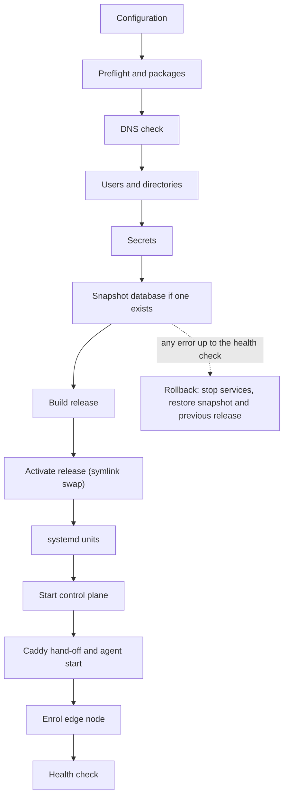

This page covers installing Skiff on a single Linux server: the requirements, the DNS records and Cloudflare token needed for HTTPS, every installer flag, what the installer does and where it puts things, and how to re-run or remove it. When the installer finishes, you create the owner account in the setup wizard, then continue with [configuration](/self-hosting/configuration).

## Requirements

### Server

- **Operating system:** Debian or Ubuntu, with systemd and `apt-get`. The installer checks the distribution but not the version; the documented releases are Debian 13 and Ubuntu 24.04 or later. Other distributions stop at preflight unless you set `SKIFF_FORCE_OS=1` to bypass the check.
- **Architecture:** x86_64 or arm64.
- **Access:** root, or `sudo`.
- **Ports:** 80 and 443 must be free. Caddy serves all web traffic on them.
- **Disk:** at least 2 GB free on `/`. The installer checks this and refuses to continue below it.
- **CPU and memory:** the installer does not check either. The size Skiff is designed around is a 2 vCPU, 4 GB RAM, 40 GB disk VPS, which runs the platform and several small apps. The control plane is capped at 1 GB of memory, so leave headroom for your apps. Optional ClickHouse needs a further 300 to 800 MB of RAM and about 750 MB of disk.

### Installed for you

The installer adds these packages unless you pass `--skip-deps`:

- **Caddy**, from the official Caddy apt repository, plus the `caddy-dns/cloudflare` module that wildcard HTTPS needs. If the module is added, the Caddy package is held so `apt upgrade` keeps the custom build. If the module download fails, the install continues over HTTP, and HTTPS needs the module later.
- **Podman** (agent installs only): `podman`, `uidmap`, `passt`, `netavark` and `aardvark-dns`. Podman runs managed databases and object storage. If it is missing, the installer warns and those services cannot start.

With `--skip-deps`, Caddy must already be on the `PATH`, or preflight fails.

### Network access

The installer needs outbound HTTPS to:

- `github.com`, for the Skiff source archive and the Bun release.
- `registry.npmjs.org`, for the pinned workerd runtime that runs functions.
- `dl.cloudsmith.io`, for the Caddy apt repository.
- `caddyserver.com`, for the Caddy build that includes the Cloudflare DNS module.
- Your apt mirror.

### Optional components

- **ClickHouse** stores traffic and dashboard telemetry. It is off by default. See `--clickhouse` below.
- **Cloudflare R2** (`--object-store r2`) stores release artifacts in R2 and, with Litestream, backs up the SQLite database there. The installer does not install the Litestream binary. Until you install it, the database is not backed up. See [platform backups](/self-hosting/platform-backups).
- **SMTP** sends magic links and invitations. Without it, magic links are written to the control-plane log.
- **GitHub OAuth app** adds GitHub sign-in.

## Plan your DNS

Domains are optional, but they give you real URLs and HTTPS. There are two names:

- The **platform domain** serves the dashboard, REST API and MCP endpoint, for example `control.example.com`.
- The **content domain** serves deployed sites at `<name>.<content domain>`, for example `my-site.example.com`.

Create A records (AAAA also works) pointing at the server's public IPv4 address for the platform domain, the content domain's apex and a wildcard for the content domain:

| Name | Type | Value |
|---|---|---|
| `control.example.com` | A | this server's IPv4 |
| `example.com` | A | this server's IPv4 |
| `*.example.com` | A | this server's IPv4 |

The installer resolves all three names through public resolvers before it installs anything. A name that resolves to a different address is a warning, not an error, so records behind a proxy such as Cloudflare's still pass.

### Two domains

Use two separate domains where you can, so the dashboard and sites never share a zone. For example, `control.example.net` for the dashboard and `example.com` for sites.

### One shared domain

You can put the dashboard under the content domain, for example `control.example.com` for the dashboard and `example.com` for sites. The installer accepts this and warns that both names share a registrable domain. One wildcard record covers the sites, and the dashboard keeps its own record. A site with the same name as the dashboard would share its hostname.

### No domains

Leave both domain settings blank. The dashboard is served at `http://<server-ip>` and sites at `*.<server-ip with dashes>.sslip.io`, over plain HTTP. The public `sslip.io` DNS service resolves those names to your server, so you create no records. Add domains and HTTPS later in **Settings → Domains**. Use `--public-address` if the detected address is wrong, for example behind NAT.

### HTTPS and the Cloudflare token

HTTPS needs two things:

1. **Real domains** for both the dashboard and sites. IP addresses and `sslip.io` names cannot get certificates.
2. **An ACME email** (`--acme-email`), the account email for Let's Encrypt.

Without both, the installer serves plain HTTP and says so.

Sites use a wildcard certificate for `*.<content domain>`. Let's Encrypt issues wildcards only through the DNS-01 challenge, so the content domain's DNS must be hosted on Cloudflare. Create an API token with this single permission:

- **Zone → DNS → Edit**, limited to the zone of your content domain.

Give the token to Skiff in one of two ways:

- **Before installing:** save it to a file, by default `/etc/caddy/cloudflare.token`, or set another path with `--cloudflare-token-file`. The installer never prompts for the token. It uses the file only when HTTPS is on. Keep the file private, for example mode `0640`.
- **After installing:** paste it into **Settings → Domains**, where you can also switch HTTPS on.

Without a token, the wildcard certificate for sites cannot be issued.

## Run the installer

The one-line bootstrap downloads Bun and the Skiff source, then runs the installer:

```sh
curl -fsSL https://raw.githubusercontent.com/KieranHolroyd/skiff/main/install.sh | sudo sh
```

Run it on the server itself, with a terminal attached. It asks for the dashboard domain, the content domain, the ACME email (only when both domains are real), an owner email (optional) and whether to install ClickHouse, which defaults to no. Its DNS check offers **re-check**, **continue anyway** or **quit**, so you can wait for records to propagate without restarting. When it finishes, it offers to export a recovery kit (see [the host layout](#host-layout)).

To run without prompts, pass the values as flags. Flags go after `sh -s --`:

```sh
curl -fsSL https://raw.githubusercontent.com/KieranHolroyd/skiff/main/install.sh | sudo env SKIFF_YES=1 sh -s -- \
  --platform-host control.example.com \
  --content-domain example.com \
  --acme-email ops@example.com \
  --admin-email owner@example.com
```

Without domains:

```sh
curl -fsSL https://raw.githubusercontent.com/KieranHolroyd/skiff/main/install.sh | sudo env SKIFF_YES=1 sh
```

With `--yes`, ClickHouse is not installed, and a missing DNS record produces a warning and the install continues. HTTPS will not issue certificates until the names resolve.

To install a specific release, set `SKIFF_REF`. The bootstrap downloads `main` by default.

```sh
curl -fsSL https://raw.githubusercontent.com/KieranHolroyd/skiff/main/install.sh | sudo env SKIFF_REF=v1.2.3 SKIFF_YES=1 sh -s -- --platform-host control.example.com --content-domain example.com --acme-email ops@example.com
```

### Installer flags

These flags are passed to the installer. Each one is also available as an environment variable in the last column where one exists. A flag wins over its environment variable. Re-running the installer keeps existing values from `/etc/skiff/skiff.env` unless you pass a new one.

| Flag | What it does | Environment |
|---|---|---|
| `--yes` | Non-interactive. Required values must come from flags or the environment. | `SKIFF_YES=1` |
| `--dry-run` | Print the plan and change nothing on the host. The bootstrap still downloads Bun and the source first. | none |
| `--upgrade` | Reuse `/etc/skiff` and data, build a new release and activate it. Skips the prompts and the DNS check. | none |
| `--uninstall` | Stop and remove the Skiff units and commands. Keeps data and configuration. | none |
| `--purge` | With `--uninstall`, also delete `/opt/skiff`, `/var/lib/skiff` and `/etc/skiff`. | none |
| `--platform-host <host>` | Domain or IPv4 address for the dashboard, API and MCP. Blank serves `http://<server-ip>`. | `SKIFF_PLATFORM_HOST` |
| `--content-domain <domain>` | Domain that sites are served under. Blank uses `<ip>.sslip.io`. | `SKIFF_CONTENT_DOMAIN` |
| `--acme-email <email>` | Let's Encrypt account email. Turns on HTTPS when both domains are real. | `SKIFF_ACME_EMAIL` |
| `--public-address <ipv4>` | This server's IPv4 address for installs without a dashboard domain. Default: detected. | `SKIFF_PUBLIC_HOST` |
| `--skip-deps` | Don't install Caddy or Podman. Caddy must already be installed. | `SKIFF_SKIP_DEPS=1` |
| `--admin-email <email>` | Pre-fills the owner's email in the setup wizard. It does not create an account. | `SKIFF_ADMIN_EMAIL` |
| `--cloudflare-token-file <path>` | Cloudflare token file for DNS-01, used only if the file exists and HTTPS is on. Default `/etc/caddy/cloudflare.token`. | `SKIFF_CLOUDFLARE_TOKEN_FILE` |
| `--skip-dns-check` | Don't check that the domains resolve before installing. | none |
| `--github-client-id <id>` | GitHub OAuth app client ID. Needs `--github-client-secret` too. | `GITHUB_CLIENT_ID` |
| `--github-client-secret <secret>` | GitHub OAuth app client secret. | `GITHUB_CLIENT_SECRET` |
| `--smtp-host <host>` | SMTP server for outgoing mail. Setting it turns on SMTP. | `SKIFF_SMTP_HOST` |
| `--smtp-port <port>` | SMTP port. Default `587`. | `SKIFF_SMTP_PORT` |
| `--smtp-user <user>` | SMTP username. | `SKIFF_SMTP_USER` |
| `--smtp-password <password>` | SMTP password. | `SKIFF_SMTP_PASSWORD` |
| `--smtp-from <address>` | From address. Default `Skiff <noreply@content domain>`. | `SKIFF_SMTP_FROM` |
| `--object-store local\|r2` | Where release artifacts are stored. Default `local`. | `SKIFF_OBJECT_STORE` |
| `--r2-account-id <id>` | R2 account ID. Required with `--object-store r2`. | `R2_ACCOUNT_ID` |
| `--r2-bucket <bucket>` | R2 bucket. Required with `--object-store r2`. | `R2_BUCKET` |
| `--r2-access-key-id <id>` | R2 access key ID. Required with `--object-store r2`. | `R2_ACCESS_KEY_ID` |
| `--r2-secret-access-key <secret>` | R2 secret access key. Required with `--object-store r2`. | `R2_SECRET_ACCESS_KEY` |
| `--no-agent` | Install the control plane only. No edge agent, Podman, workerd or node enrolment, so this host does not route sites. | none |
| `--clickhouse` | Install the optional ClickHouse telemetry store. About 240 MB to download and 300 to 800 MB of RAM. | `SKIFF_INSTALL_CLICKHOUSE=1` |
| `--no-clickhouse` | Skip ClickHouse without asking. An installed copy is left in place. | none |
| `--no-node` | Skip the pinned Node.js LTS that Node.js process apps run on. About 190 MB on disk. | `SKIFF_NO_NODE=1` |
| `--with-php` | Install the pinned FrankenPHP runtime for PHP apps. About 175 MB. | `SKIFF_INSTALL_PHP=1` |
| `--no-python` | Don't warm the Pyodide cache used by Python functions. About 36 MB. | `SKIFF_NO_PYTHON=1` |
| `--version <label>` | Release label. Default: the `VERSION` file in the source. | `SKIFF_VERSION` |
| `--help`, `-h` | Print the usage text and exit. | none |

The bootstrap script (`install.sh`) reads these environment variables itself:

| Variable | Default | Purpose |
|---|---|---|
| `SKIFF_REF` | `main` | Git ref, tag or branch to install. |
| `SKIFF_REPO` | `KieranHolroyd/skiff` | GitHub repository to download. |
| `SKIFF_GITHUB_TOKEN` | none | Token for a private repository. |
| `SKIFF_BUN_VERSION` | `1.4.0` | Bun version the installer uses. |
| `SKIFF_SOURCE_DIR` | none | Use an existing checkout instead of downloading. It must contain `scripts/install/main.ts`. |

## What the installer does

The installer is safe to re-run. It builds a new release in a separate directory and switches to it only when it is ready. The steps run in this order:

1. **Configuration.** Interactive runs ask for the domains, the ACME email, the owner email and ClickHouse. Blank domains are filled in from the server's address.
2. **Preflight.** It checks the OS, architecture, systemd and root access. It installs Caddy and Podman, then installs the optional runtimes (workerd and the Python cache, and FrankenPHP with `--with-php`). It checks that `systemctl`, `journalctl` and `caddy` exist, that Caddy has the Cloudflare module when HTTPS is on, that R2 settings are complete, that the domains are valid and different, and that at least 2 GB is free.
3. **DNS check.** On a fresh install only, it checks the platform name, the content apex and a random name under the wildcard.
4. **Users and directories.** It creates the `skiff` system user, which is also in the `caddy` group, and the directories listed under [host layout](#host-layout).
5. **Secrets.** It creates the master key and the session, cookie and object-store secrets. Existing values are kept on re-runs. The master key is sealed with `systemd-creds`, bound to the server's TPM2 chip and host key, or to the host key alone when there is no TPM2. On a server that already has a plain `master.key`, it seals that same key and deletes the plain file once the control plane has started with the sealed one. If the install fails, the plain file is put back.
6. **Snapshot.** If a database already exists, it writes a pre-upgrade snapshot to `/var/lib/skiff/backups`. The three most recent are kept.
7. **Build.** It copies the source into a new release directory, runs `bun install --frozen-lockfile`, and builds the control plane, agent, helper and CLI.
8. **Activate.** It points `/opt/skiff/current` at the new release with an atomic symlink swap. The previous release is kept as `/opt/skiff/previous`.
9. **Commands and units.** It installs `skif`, `skiff` and the operator commands, then writes the systemd units.
10. **ClickHouse.** If you chose it, the store starts before the control plane. A failure is a warning.
11. **Services.** It starts the privileged helper and the control plane, and waits for the control plane's socket and readiness check. It then points Caddy's bootstrap config at the control plane and starts the agent, which takes over Caddy's configuration through the admin API.
12. **Backups.** With `--object-store r2`, it installs the Litestream config, restore drill and alert units.
13. **Enrolment.** It creates the edge node, writes `/etc/skiff/agent.env` and restarts the agent.
14. **Health check.** It waits up to two minutes for `/api/setup/status` on the platform origin.
15. **Setup link.** While no owner exists, it prints the one-time setup link.

If a step fails, the installer stops the agent and control plane, restores the pre-upgrade database snapshot and points `current` back at the previous release, when there was one. A first install has no previous release, so fix the reported error and run the installer again.

The diagram shows the main steps in order and where the rollback branch starts. It leaves out the optional ClickHouse, backup and setup-link steps.



## Host layout

| Path | Contents |
|---|---|
| `/opt/skiff/releases/<version>-<timestamp>/` | One directory per build: `repo/` (source), `runtime/` (Bun links), `agent/skiff-agent`, `helper/skiff-helper`, `cli/skif.js`, and `meta.json`. |
| `/opt/skiff/current`, `/opt/skiff/previous` | Symlinks to the active and last-known-good releases. |
| `/opt/skiff/runtime` | The Bun binary the installer uses. |
| `/etc/skiff/skiff.env` | Settings and secrets read by the services. `root:skiff`, mode `0640`. |
| `/etc/skiff/master.key.cred` | Encryption key for stored secrets, sealed with `systemd-creds`. Readable by root only, and it only opens on this server, so a copy of the file is not a backup. The [recovery kit](/self-hosting/platform-backups#recovery-kit) is. |
| `/etc/skiff/master.key` | The same key as a plain file, readable by root only. Used only when systemd is older than 250 and `systemd-creds` is missing. |
| `/etc/skiff/setup-token` | Token for the setup link. It stops working once an owner exists. |
| `/etc/skiff/agent.env` | Edge node settings, written during enrolment. |
| `/etc/skiff/litestream.yml` | Backup configuration, with R2 only. |
| `/var/lib/skiff/data/skiff.db` | The SQLite database. Local objects are in `data/objects`. |
| `/var/lib/skiff/backups` | Pre-upgrade snapshots. |
| `/var/lib/skiff/clickhouse` | Telemetry data, with ClickHouse only. Not backed up. |
| `/etc/caddy/Caddyfile` | Caddy configuration. The installer writes a bootstrap version and the agent replaces it. Your original is kept as `Caddyfile.dist`. |
| `/var/lib/caddy` | Caddy's data, certificates and admin socket. |
| `/var/log/caddy/skiff-access.log` | Caddy's JSON access log, read by the agent. |
| `/run/skiff` | Runtime sockets, including `control.sock`. Recreated at boot. |
| `/usr/lib/skiff/workerd/<version>` | The workerd binary and the Pyodide cache. |
| `/usr/local/bin/skif`, `/usr/local/bin/skiff` | The CLI, which runs the copy bundled with the active release. |
| `/usr/local/sbin/skiff-*` | Operator commands, including `skiff-update-self`, `skiff-restore`, `skiff-alert`, `skiff-recovery-kit`, `skiff-rotate-master-key` and `skiff-uninstall`. |
| `/etc/systemd/system/skiff-*.service` | The Skiff units. |

Keep an offline copy of the recovery kit. Export one at any time with:

```sh
sudo skiff-recovery-kit export --include-env
```

## Create the owner account

A fresh install has no users. The setup wizard is the only way to create the first owner, and it runs once.

1. Open the setup link the installer printed, `https://<platform domain>/setup?token=…`. If you lost it, run `sudo cat /etc/skiff/setup-token`, or `journalctl -u skiff-control-plane | grep setup`.
2. **Check** lists the install's state: HTTPS, passkey support, email, storage and enrolled nodes. Warnings don't block setup.
3. **Account** takes your name, email, a password of at least 12 characters and the organisation name. It creates the owner and signs you in.
4. **Secure** adds a second factor. Owners need a passkey or an authenticator app. An authenticator is used when passkeys won't work, for example on plain HTTP or an IP address.
5. **Finish** lets you add a backup factor, then links to email, backups, members and API keys.

Open the wizard on the platform domain. Sign-in cookies and passkeys are bound to that origin, so `/setup` opened on the server's IP shows a link to the right address. Once an owner exists, `/setup` redirects to sign-in. See [sign-in and two-factor authentication](/accounts/sign-in-and-2fa).

## Optional runtimes

Some features need extra runtimes. The installer adds them when you ask, and you can re-run it later.

### Functions

On a host with the edge agent (the default), the installer downloads the pinned workerd binary from npm into `/usr/lib/skiff/workerd/<version>`. If the download fails, the installer warns and functions stay unavailable on this node. Re-running the installer retries it.

### Python functions

After workerd is installed, the installer warms a Pyodide cache beside it, which adds about 36 MB. Pass `--no-python` to skip it. If warming fails, Python functions stay unavailable on the node until you warm the cache. To do that on its own, run this from the release's source copy:

```sh
sudo /opt/skiff/runtime/bin/bun /opt/skiff/current/repo/scripts/install/pyodide.ts
```

### PHP apps

PHP apps run on a pinned FrankenPHP binary, which is large, so it is opt-in. Pass `--with-php` (or set `SKIFF_INSTALL_PHP=1`) to install it to `/usr/lib/skiff/frankenphp` with a link at `/usr/local/bin/frankenphp`. Without it, PHP apps cannot start on this node.

## Re-run and upgrade

Running the installer again on an existing host is safe. It keeps your settings and secrets, takes a snapshot of the database, builds a new release and switches to it.

`--upgrade` does the same without prompts or the DNS check. It also keeps an installed ClickHouse current, and adds one only if you pass `--clickhouse`. Because the bootstrap downloads `main` unless told otherwise, pin the release with `SKIFF_REF` when you upgrade:

```sh
curl -fsSL https://raw.githubusercontent.com/KieranHolroyd/skiff/main/install.sh | sudo env SKIFF_REF=v1.2.3 SKIFF_YES=1 sh -s -- --upgrade
```

For routine updates, see [upgrades](/self-hosting/upgrades).

## Uninstall

`skiff-uninstall` removes Skiff from the host. Run it as root:

```sh
sudo skiff-uninstall
```

By default it stops and removes every Skiff service and unit, including the helper, mail, ClickHouse, standby and update units, then removes `/opt/skiff` and the Skiff commands. It keeps `/var/lib/skiff`, `/srv/skiff`, `/etc/skiff` (with the master key) and `/etc/caddy/skiff.Caddyfile`, so a reinstall can reuse the database and master key. The ClickHouse binary in `/opt/skiff/clickhouse` also stays, next to its data.

To delete everything on the host:

```sh
sudo skiff-uninstall --purge --yes
```

> [!WARNING]
> `--purge` deletes the local database, the master key and the configuration. Export a recovery kit first, or the R2 backups can no longer be decrypted. The script also removes the `skiff`, `skiff-build`, `skiff-clickhouse` and `caddy` system users.

Neither mode touches Cloudflare R2. Releases, Litestream snapshots and telemetry Parquet files stay in the bucket until you delete them yourself.

The script does not remove the Caddy or Podman packages, and it does not stop the `caddy` service, so Caddy keeps serving its last configuration. Stop it with `sudo systemctl disable --now caddy` if you no longer need it. Containers that your apps run are not removed, so delete the apps first.

The installer has its own `--uninstall` mode, which does the same job with fewer steps. It keeps the data by default, and `--purge` deletes without asking for confirmation. It does not remove the system users or the Caddy configuration, so prefer `skiff-uninstall`.
