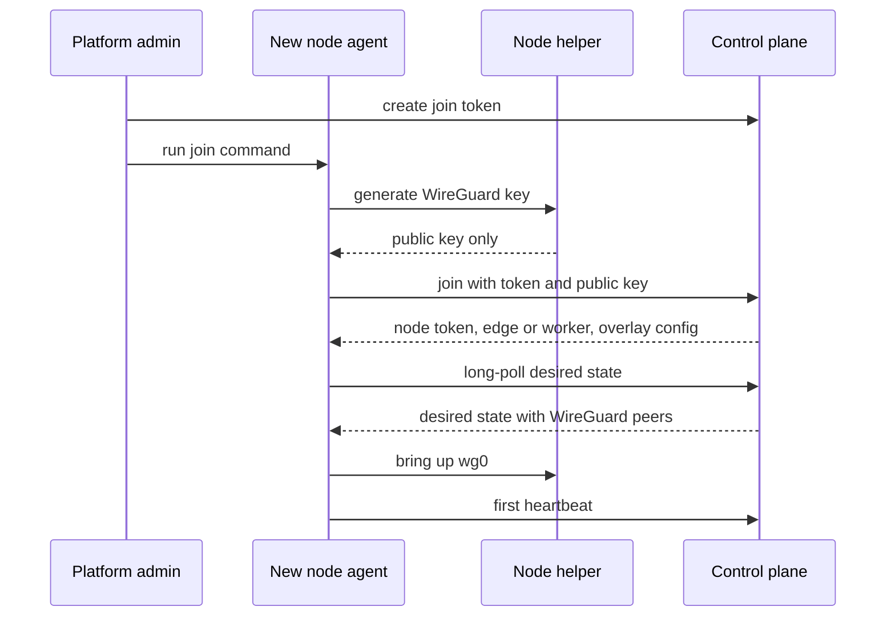
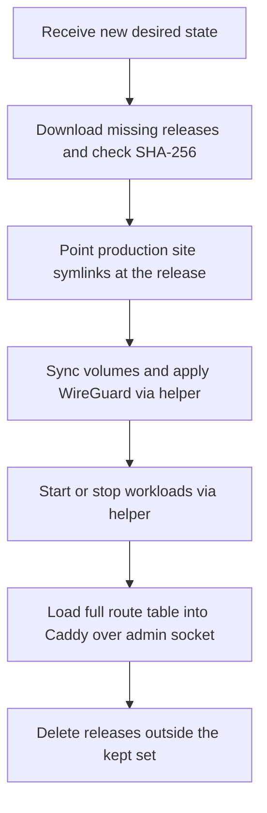

A Skiff install is one or more **nodes**: machines running `skiff-agent` and `skiff-helper`. The first node is the **edge**. It terminates public traffic for every site. Any later node is a **worker**, which runs apps, functions, databases and other workloads that you place on it. This page covers adding nodes, how they stay in step with the control plane, where workloads run, and how to drain or remove a machine. For a single machine, you can skip most of it.

## Node roles

Every node has a mode (`edge` or `worker`) and a set of roles that say what it may run. The mode is decided at join time: the first node to join becomes the edge, and every later node is a worker. You can change the edge later (see [Moving the edge](#moving-the-edge)).

| Role | Meaning |
| --- | --- |
| `ingress` | Public traffic ingress. Only the edge has it by default. |
| `control` | Edge-only by default. Removing it from the edge is refused. |
| `compute` | Runs app, function and broker workloads. Every node has it by default. |
| `data` | Runs managed databases and storage instances. Every node has it by default. |
| `build` | Claims git builds. Off by default; see [Builders](#builders). |

Roles are set per node on the **Nodes** page (**Edit node**). You cannot remove a role that is still in use: removing `compute` is refused while the node runs app workloads, and removing `data` is refused while it holds databases or storage instances.

## Adding a node

Adding a node takes three steps: generate a join token, run one command on the new machine, and wait for the node to appear.

1. Install the signed Skiff release bundle (`skiff-agent` and `skiff-helper`) on the new machine. See [installation](/self-hosting/installation).
2. In the dashboard, go to **Nodes → Add node**. Choose a network (below) and select **Generate join command**.
3. Run the command on the new machine as root. The node appears on the **Nodes** page after its first heartbeat, usually within seconds.

A join token is single-use and expires one hour after you create it. Only a platform admin can create one, from their dashboard session.

On a Skiff network, the join exchanges the token for a node identity and an overlay address before the agent starts converging:



### Skiff network (recommended)

The default. The node generates its WireGuard key locally and joins the managed overlay, so you do not plan addresses. The command the dashboard shows is:

```sh
curl -fsSL https://control.example.com/install/node.sh | sudo sh -s -- --token <token> --name <name>
```

The script checks that it runs as root and that `skiff-agent` is installed, starts `skiff-helper`, exchanges the token for the node's identity, writes `/etc/skiff/agent.env` (mode `0600`, keeping a timestamped backup of any earlier file), and enables `skiff-agent`. A rerun repairs the environment file rather than destroying it. The script needs systemd.

### Existing private network

Use this when the edge already reaches the machine over an address you manage, such as Tailscale, a VPC or a LAN. Skiff does not manage the tunnel. The dashboard shows:

```sh
sudo skiff-agent join https://control.example.com --token <token> --name <name> --public-address <tunnel-ip>:<port>
```

Redirect the output to `/etc/skiff/agent.env` as the install script does. For a NAT'd homelab machine, the dashboard's WireGuard worker guide (**Nodes → Add node → Existing private network**) walks through the tunnel and gives you the right `--public-address`.

### skiff-agent join

`skiff-agent join <controlUrl>` exchanges a join token for a node identity. It writes `node.json` into the data directory (mode `0600`) and prints the agent's environment file to stdout.

| Flag | Required | Meaning |
| --- | --- | --- |
| `--token <joinToken>` | Yes | The single-use token from the dashboard. At least 20 characters. |
| `--name <name>` | Yes | The node's name, up to 120 characters. |
| `--data-dir <dir>` | No | Where `node.json` is written. Defaults to `$SKIFF_DATA_DIR`, or `/var/lib/skiff-agent`. |
| `--network-mode skiff\|external` | No | `skiff` joins the managed overlay. The default for the command line is `external`. |
| `--wireguard-public-key <key>` | No | A WireGuard public key for a `skiff` join. If omitted, the helper generates the key. |
| `--public-address <host:port>` | No | The address the edge proxies to. For a `skiff` join it defaults to the node's overlay address on port 8080. |

The control plane decides the mode, not the command.

## Private networking

Managed nodes are connected by WireGuard. The control plane gives each one a `/32` address from the overlay range, `10.88.0.0/22` by default (the first `/24` is reserved). You can change the range with `PATCH /api/v1/cluster/config` before you join nodes.

- **Keys stay on the node.** The helper generates the private key, stores it under `/etc/skiff/wireguard/`, and sends only the public key to the control plane.
- **The edge is the hub.** Worker traffic from the edge runs over WireGuard to each worker's overlay address. The interface is `wg0`, listening on UDP `51820`, with an MTU of `1420`.
- **NAT'd workers need no inbound port.** A worker without a reachable endpoint dials out and sends a keepalive every 25 seconds.
- **Same-zone workers can peer directly** when both have a LAN endpoint, so traffic between them does not pass through the edge.
- **The firewall is narrow.** The helper opens UDP `51820`. Where `ufw` or `firewalld` is active, it adds its rules to that firewall. Otherwise it writes its own `inet skiff` nftables table, which admits only TCP `8080` (the app proxy), `15432`–`16431` (database listeners for cross-node attachments and read replicas) and `19000`–`19999` (private storage listeners) on `wg0`, and drops everything else arriving there. Those listeners accept only nodes whose certificate they were told to trust. It never edits the host's own filter rules.

## How the agent works

`skiff-agent` runs as a systemd service on every node. It keeps the node in step with the control plane using three loops.

- **Desired state.** The agent asks `GET /api/agent/desired-state` with its node token. The control plane holds the request open and answers as soon as the state changes, or returns `304` after the wait if nothing changed. The state lists everything the node must run: the releases it must hold, its routes, its workloads and its certificates.
- **Heartbeats.** Every 10 seconds the agent posts its status to `/api/agent/heartbeat`. The heartbeat carries Caddy health, the capabilities it supports, resource statistics, its release inventory and the state of its workloads. Hardware facts are reported at start-up and about hourly. A node that misses heartbeats for 30 seconds is shown as offline, and it raises an alert after the delay set under **Settings → Policies**.
- **Reconciliation.** The agent makes the machine match the desired state. It downloads missing releases, checks each against its SHA-256, and extracts it into an immutable directory. It then points the site's symlink at the release (promotion is a symlink swap), and calls the workload helper to start or stop workloads.

Reconciliation runs in this order each time the desired state changes. The heartbeat runs on its own 10-second timer alongside it.



Local state lives in the agent's data directory, `/var/lib/skiff-agent` by default:

- `desired-state.json` and `desired-state.etag` hold the last state the agent received. If the control plane is unreachable, the node keeps serving from this copy.
- `releases/<sha256>/` holds extracted releases. After each reconcile the agent keeps every release in the desired state plus the two most recent others, and deletes the rest.

Caddy is configured through its admin API on a unix socket, `/var/lib/caddy/admin.sock` by default. The agent checks Caddy with `GET /config/` and loads the full route table with `POST /load`. Caddy's admin API is never open on TCP. The agent serves `/healthz` and `/metrics` on its own unix socket, `/run/skiff-agent/agent.sock`.

## Edge and worker sites

Where a site runs depends on its runtime and placement:

- **Static sites run on the edge.** The edge serves their files from its release cache. If the edge is draining or offline, new static deployments are refused.
- **Apps and functions run where they are placed.** A project's placement is `edge` (the default), `auto`, or a specific node's id. When the workload is on a worker, the edge proxies each request to that worker's Caddy over WireGuard.

If a worker cannot be reached, or answers `502`, `503` or `504`, visitors get a branded `503 Service Unavailable` page with `Retry-After: 30` in place of the worker's own error.

## Capacity and workload budgets

Each node has a memory budget for its workloads, applied to the systemd slice `skiff-workloads.slice`:

| Setting | Default | Range | Where |
| --- | --- | --- | --- |
| Workload slice memory | 1024 MB | 32 to 65,536 MB | **Edit node** |
| Slice CPU weight | 200 | 1 to 10,000 | **Edit node** |
| CPU budget | none | millicores | **Edit node** |

The budget cannot be lowered below the memory that workloads on the node already reserve. The **Nodes** page shows reserved and free memory for each node.

Placement admits a workload only where there is room for its memory, its disk and its CPU budget:

- **`auto`** picks the online worker with the most free memory, and falls back to the edge only when no worker has room.
- **A specific node** is refused if the node is offline, or if it has no room. The error names the shortfall rather than saying "no capacity".
- **`edge`** places the workload on the edge, with the same checks.

A placement can also carry hard constraints such as a zone, roles or labels. Nodes can be labelled on the **Nodes** page, and the agent reports hardware labels such as `skiff.io/arch`, `skiff.io/gpu` and `skiff.io/memory-gb`. Labels beginning with `skiff.io/` are reserved for those derived facts.

## Node tasks

Some operations must run on the node that holds the service. A broker or function host listens only on its node's loopback interface, so the control plane cannot reach it directly. Node tasks handle this. The control plane queues a typed task against the node. That node's agent leases it, runs one fixed operation and posts the result back.

The tasks are the queue and function tools:

| Task | What it does | Where you use it |
| --- | --- | --- |
| Create a queue stream | Creates a function queue's stream now | `skif broker queue-create` |
| Send a test message | Publishes up to 100 copies of a message | `skif broker send` |
| Peek | Reads up to 50 messages without consuming them | `skif broker peek` |
| Redrive | Moves messages from a dead-letter queue to another queue, up to 1,000 at once | `skif broker redrive` |
| Purge, delete, delete one message | Removes a stream's messages, the stream, or one message | `skif broker queue-purge`, `queue-rm`, `message-rm` |
| Invoke | Sends one test request to a function | `skif function invoke` |
| Run a cron | Runs a function's `scheduled()` handler once, for one of its crons | `skif function cron` |

Each task needs a permission. Peeking, sending and redriving need `broker:update`. Purging, deleting and deleting a message need `broker:delete`. Invoking a function or running a cron needs `deployment:create`.

The flow has a few limits you may notice:

- A node runs tasks only when it hosts a broker or a function host. Other nodes never poll for them.
- The node must be online and must run an agent that advertises the `node-tasks` capability. Otherwise the request fails with a message that names the node and asks you to update it.
- The REST call waits up to 20 seconds for a result by default (up to 25 with `?wait=`). If the task is still running, it answers `202` with a `location` to poll at `GET /api/v1/node-tasks/:id`.
- A task that no node leases within 60 seconds fails. A lease lasts 90 seconds, after which an unfinished task counts as lost.
- A broker must be `running` to take queue tasks. Finished tasks are kept for an hour, because a peek result can contain message bodies. An organisation can have at most 50 pending tasks.

Message bodies are cut to 16 KiB in a peek. A test request to a function can carry up to 1 MiB of body, and the response is cut at 256 KiB.

## Draining and removing nodes

Every action on a node is in the **Actions** menu on the **Nodes** page. Each one needs a platform admin.

- **Drain node** stops new placements on the node, but existing sites and workloads keep serving. Draining is an operator decision: the agent's heartbeats do not clear it. **Resume placements** undoes it.
- **Edit node** changes the name, the address the edge proxies to, the zone, roles, labels, slice budget and storage paths.
- **Make this the edge** moves ingress to another online node. The new edge takes over every static site and the old edge becomes a worker that keeps what it hosts. Skiff does not move your DNS records or TLS for you, so point DNS at the new address yourself. Skiff refuses the change when `SKIFF_EDGE_NODE_ID` pins the edge in the control plane's environment.
- **Rotate token** issues a new node token and shows it once. Put it in `SKIFF_NODE_TOKEN` in `/etc/skiff/agent.env` and restart `skiff-agent`. The old token stops working at once.
- **Remove node** forgets a worker. Its token stops working, its volume registrations go, and any builds it had claimed return to the queue. Deployment and audit history keep the node's id. Removal is refused while the node still hosts projects, workloads, databases, storage instances, app volumes or a database move, and the error lists them. Removal never moves or deletes data. Move or delete those first. The edge cannot be removed. Removing a node changes nothing on the machine itself, so uninstall the agent there.

## Builders

Any node can be a Builder, which gives it the `build` role. Its `skiff-builder.service` claims one git build at a time and sits idle when the role is off. The build scratch directory is set separately from the data directory, and the two must not contain one another. Builds run in a sandboxed transient unit.

## Topology

**Topology** shows the fleet as a platform-level view. It is for platform admins only, because it names every node, zone and workload.

- **Zones** group nodes that share power, uplink and provider fate. Set a node's zone under **Edit node**. Nodes default to the `default` zone.
- **Nodes** lists each node's status, mode, roles, labels, hardware, volumes, and its addresses on the public and overlay networks.
- **Blast radius** counts what an outage of that node would take down: apps, databases, storage instances and volumes. The counts come from current placement, so they change when workloads move.

Topology is read-only. To change roles, zones or labels, use **Edit node** on the **Nodes** page.

## Single-node installs

A single machine needs none of this. The installer enrols it as the edge, with the `ingress`, `control`, `compute` and `data` roles and no overlay. Every site and workload runs on it, and `auto` placement falls back to the edge. Add a worker only when you need more capacity or separate failure domains. See [installation](/self-hosting/installation) for the first node, [upgrades](/self-hosting/upgrades) for updating agents, and [troubleshooting](/self-hosting/troubleshooting) when a node stays offline.
