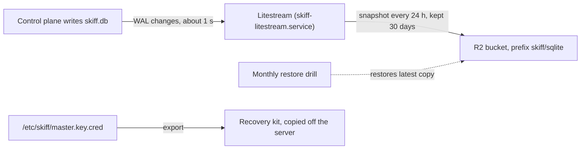
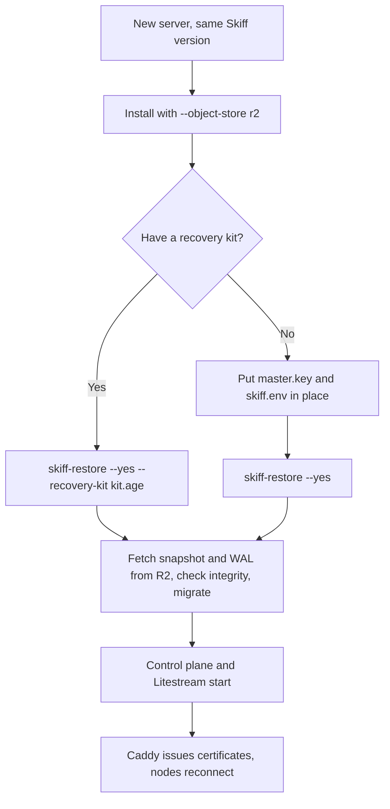

This page covers the control plane itself: its database, the master key that encrypts your secrets, and the configuration needed to bring them back on a new server. Databases that your projects create are backed up separately, as described in [backups and point-in-time recovery](/data/backups-and-pitr).

Platform recovery has three parts. Litestream copies every change to the platform database to a Cloudflare R2 bucket. A restore drill checks each month that the copy really restores. A recovery kit holds the master key, which no database backup contains.

## What needs protecting

| Item | Where it lives | How it is protected |
|---|---|---|
| Platform database: users, sessions, projects, deployments, audit log | `/var/lib/skiff/data/skiff.db` | Litestream to R2 |
| Master key, which encrypts every stored secret | `/etc/skiff/master.key.cred`, sealed with `systemd-creds` so it only opens on this server (`/etc/skiff/master.key` on systems without it) | Recovery kit |
| Environment file: `BETTER_AUTH_SECRET`, R2 keys and other settings | `/etc/skiff/skiff.env` | Recovery kit, with `--include-env` |
| Release artifacts | `releases/` in the R2 bucket, or `/var/lib/skiff/data/objects` with local storage | R2 holds them when you use R2 storage. Litestream does not copy the local directory, so copy it yourself |

Telemetry in ClickHouse is not backed up. Older telemetry is archived to R2 as Parquet files, and that archive is kept. Snapshots that Skiff takes into `/var/lib/skiff/backups` before each install, update and restore protect against a bad update. They do not protect against losing the server.

> [!WARNING]
> Without the master key, the restored database cannot decrypt your secrets. Keep a recovery kit somewhere other than the server.

## Continuous replication to R2

Replication runs as the `skiff-litestream.service` unit. It reads `/etc/skiff/litestream.yml`, which the installer writes from `scripts/litestream.yml`:

```yaml
dbs:
  - path: ${SKIFF_DATA_DIR}/skiff.db
    replicas:
      - type: s3
        bucket: ${R2_BUCKET}
        path: skiff/sqlite
        endpoint: ${R2_ENDPOINT}
        region: auto
        access-key-id: ${R2_ACCESS_KEY_ID}
        secret-access-key: ${R2_SECRET_ACCESS_KEY}
        sync-interval: 1s
        snapshot-interval: 24h
        retention: 720h
```

Litestream reads the values from `/etc/skiff/skiff.env`, so the file holds no credentials. Changes reach R2 about one second after they are written. A full snapshot is taken every 24 hours, and replicas are kept for 30 days.

The diagram shows what each copy protects and where it goes. The master key is not in the database, so it has its own copy in the recovery kit.



### Turning replication on

Create an R2 API token with Object Read & Write on one bucket in the Cloudflare dashboard. Then choose one of two routes.

During a new install, pass the R2 options to the installer:

```sh
# Add these to your installer command
--object-store r2 \
--r2-account-id <account-id> \
--r2-bucket skiff-backups \
--r2-access-key-id <access-key-id> \
--r2-secret-access-key <secret-access-key>
```

On a running server, open **Settings → Backups** and choose **Set up R2 backups**. Skiff tests the credentials before it saves them. It installs the pinned Litestream release if Litestream is missing, enables the replication and drill units, and turns backups on.

If the installer cannot find a `litestream` binary, it writes the configuration but leaves the units disabled. Install Litestream, then run:

```sh
sudo systemctl enable --now skiff-litestream.service skiff-restore-drill.timer
```

To check replication, look at **Latest backup** on **Settings → Backups**, or read the log:

```sh
sudo journalctl -u skiff-litestream -n 50 --no-pager
```

> [!NOTE]
> A running Litestream process is not proof of a backup. The restore drill is the only check that the copy restores.

## Restoring the control plane

Use `skiff-restore` when the database is damaged, a bad migration has been applied, or you are rebuilding on a server that still has its files. The script stops the control plane and Litestream while agents and Caddy keep serving the last desired state. It then:

1. Copies the current database to `/var/lib/skiff/backups/pre-restore-<UTC>.db`.
2. Downloads the latest snapshot and WAL frames from R2.
3. Runs an integrity check and swaps the restored database in.
4. Applies the migrations and starts the control plane.

If the control plane does not become healthy, the script puts the pre-restore copy back and exits with an error.

```sh
sudo skiff-restore                              # asks you to type "restore"
sudo skiff-restore --yes                        # no prompt
sudo skiff-restore --yes --from offsite         # a named replica from litestream.yml
sudo skiff-restore --yes --no-start             # restore, but leave the control plane stopped
sudo skiff-restore --yes --recovery-kit kit.age # install the master key from a kit first
```

| Option | Effect |
|---|---|
| `--yes`, `-y` | Skip the confirmation. `SKIFF_RESTORE_YES=1` does the same. |
| `--from <replica>` | Use a named replica from `litestream.yml`. By default, the only replica is used. |
| `--recovery-kit <file>` | Decrypt the kit first and install its master key, and `skiff.env` if the kit has one. Enter the passphrase at the prompt, or set `SKIFF_RECOVERY_PASSPHRASE_FILE`. |
| `--no-start` | Restore the database and leave the services stopped. |

Afterwards, check the services:

```sh
systemctl status skiff-control-plane skiff-litestream --no-pager
journalctl -u skiff-control-plane -n 100 --no-pager
```

A restore never deletes anything in R2. The pre-restore copy stays in `/var/lib/skiff/backups` and is listed under **Local snapshots** on **Settings → Backups**.

## Recovery kit

`skiff-recovery-kit` writes the master key, and optionally `/etc/skiff/skiff.env`, into one file encrypted with a passphrase. The file is a standard age file, so `age -d` can open it on any machine.

```sh
sudo skiff-recovery-kit export --include-env
sudo skiff-recovery-kit verify <file>
sudo skiff-recovery-kit import <file> [--restore-env] [--force]
```

- `export` writes `/root/skiff-recovery-kit-<host>-<date>.age` with mode 0600 when run as root. Use `--out <file>` to choose another path.
- You are asked for a passphrase of at least 12 characters. If you leave it empty, Skiff generates one and prints it once. For scripts, use `--passphrase-file <file>` or `SKIFF_RECOVERY_PASSPHRASE_FILE`.
- `verify` decrypts the kit in memory and checks it, without changing anything on the server.
- `import` refuses to replace a different master key unless you pass `--force`. Any file it replaces is kept as `<path>.pre-recovery-<UTC>`.
- On a server with a sealed key, `export` and `verify` unseal it, so run them as root on that server. `import` seals the kit's key again for this server. A sealed key that no longer opens, for example after the server was rebuilt or its TPM was cleared, counts as a different key, so `import --force` replaces it.

The sealed key file cannot be opened on any other machine, so copying `/etc/skiff` is not a backup of the master key. The recovery kit is the only copy that survives losing the server.

The installer offers an export at the end of an interactive first install. Otherwise run the export yourself.

Copy the kit off the server, then remove the copy on the server with `shred -u`. Keep the passphrase somewhere other than the kit file. Export a new kit after any change to the master key or to `skiff.env`.

## Monthly restore drill

Backups that have never been restored are not proven. The drill restores the latest backup into a scratch directory and compares it with the live database. It runs from `skiff-restore-drill.timer` at 04:17 on the first day of each month, with up to 30 minutes of random delay. If the server was off at that time, the drill runs at the next boot. The timer is installed only once R2 is configured.

The drill:

1. Stops the control plane and Litestream for a few seconds, so the copy is consistent. Sites keep serving.
2. Restores the latest snapshot and WAL frames into `/var/lib/skiff/drill/run-<UTC>-<pid>/restored.db`.
3. Runs an integrity check on the restored copy.
4. Compares the table list, the row count of each table, and a SHA-256 over every row, ordered by primary key, for the live and restored databases. Any difference fails the drill.
5. Starts the services again and confirms the control plane answers.

The drill never modifies the live database.

Results appear on **Settings → Backups**: the last drill passed or failed, when it ran, and when the next one is due. A failed drill also shows the reason. The same result is written to `/var/lib/skiff/drill/status.json`. The drill keeps the three most recent successful run directories, and keeps failed ones so you can inspect them. A failed drill also raises a system alert; see [alerts](/observe/alerts).

To run the drill now, choose **Run restore drill** on **Settings → Backups**, or run this on the server:

```sh
sudo skiff-restore-drill
```

If the drill fails, do not assume the backup is good. Read `status.json` and the run directory, then check that R2 is reachable, that the credentials are valid, and the Litestream log. If the live database is corrupt but R2 is sound, run `sudo skiff-restore --yes`.

## Rotating secrets

**R2 keys.** Create a new token in Cloudflare with the same permissions. Then open **Settings → Backups → Edit R2 settings** and enter the new details. Skiff tests the new credentials before saving them, and the dashboard restarts. Revoke the old token in Cloudflare afterwards. You cannot move backups to another bucket while release artifacts are stored in the current one.

**Session secret.** `BETTER_AUTH_SECRET` signs sessions, so changing it signs every user out. Edit the value in `/etc/skiff/skiff.env`, then restart the control plane:

```sh
sudo systemctl restart skiff-control-plane
```

Export a new recovery kit afterwards.

**Master key.** Rotate it with `skiff-rotate-master-key`. Never replace the key file by hand, because secrets encrypted with the old key would become unreadable. Check first that the current key opens everything, without changing anything:

```sh
sudo skiff-rotate-master-key --dry-run
sudo skiff-rotate-master-key
```

The command snapshots the database to `/var/lib/skiff/backups/pre-key-rotation-<UTC>.db`, stops the control plane for a few seconds and re-encrypts each organisation's data key with a new master key in one transaction. Sites keep serving. It then restarts the control plane and checks everything opens with the new key before it destroys the old one. If that check fails, it puts the old key back. If it is interrupted, run it again: it finishes or discards the half-done rotation. It refuses to run while an update is in progress. `--yes` skips the confirmation prompt.

Afterwards:

- Export a new recovery kit. The previous kit no longer matches the server.
- Keep the previous kit until Litestream snapshots, the pre-rotation snapshot and the pre-update snapshots from before the rotation have expired, because they still need the old key.
- Storage instances with bucket event rules restart once to pick up a new notification token, and open container consoles have to reconnect.

## Rebuilding on a new server

Use this runbook when the server is gone and you need a replacement. Until high availability is available, a lost server means the control plane and public ingress are down. See [clustering](/self-hosting/clustering) for what is planned.

The flowchart shows the path from a new server to a running control plane. Each numbered step below follows it.



1. Gather the recovery kit and its passphrase, plus the R2 token. The kit is the copy you exported earlier, and the token is in your Cloudflare account.
2. Point your domains at a new server, or change the DNS records. Keep the DNS TTL low, so the change takes minutes.
3. Install the same Skiff version as the lost server, with `--object-store r2` and the R2 options. Decline the recovery kit export at the end of the install. See [installation](/self-hosting/installation).
4. If the installer did not enable replication, install Litestream and enable the units as described in [replication](#continuous-replication-to-r2).
5. Copy the recovery kit to the new server, then restore:

   ```sh
   sudo skiff-restore --yes --recovery-kit /root/skiff-recovery-kit-<host>-<date>.age
   ```

   The script installs the master key, and `skiff.env` if the kit includes it, before it restores the database. Without a kit, stop `skiff-control-plane`, remove the new server's `/etc/skiff/master.key.cred`, put the old `master.key` (mode 0400, owned by root) and `skiff.env` in place yourself, then run `sudo skiff-restore --yes`. Run the installer again afterwards to seal the key.

6. Run the checks from [restoring the control plane](#restoring-the-control-plane), then run `sudo skiff-restore-drill`.
7. Caddy issues certificates again on first start, using the Cloudflare token in `/etc/caddy/cloudflare.token`. Make sure that file is present.
8. Check that your nodes reconnect to the new control plane. See [nodes and fleet](/self-hosting/nodes-and-fleet).

A restore does not reinstall Caddy or the agent, does not restore the Caddy certificates or the ClickHouse telemetry, and does not change R2. If something goes wrong, [troubleshooting](/self-hosting/troubleshooting) covers the common failures.
