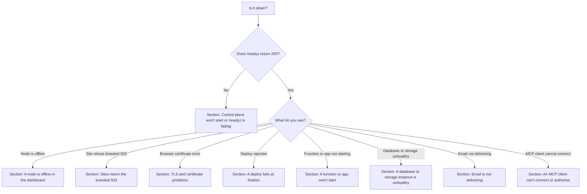
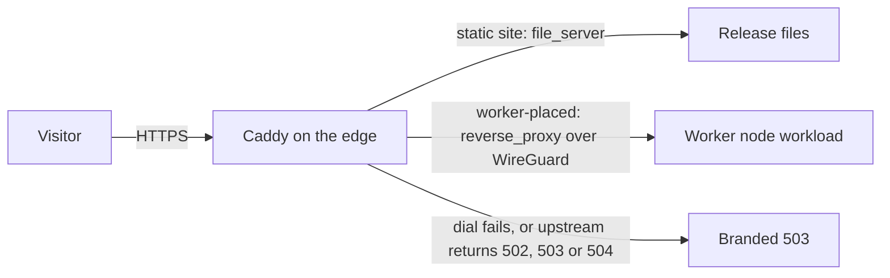

This page is a runbook for operators of a self-hosted Yoal. Find the symptom you see, check the
listed things in order, then apply the fix. Most commands run on the server or the node over SSH,
as root or with `sudo`. Platform services are systemd units named `yoal-*`, so `journalctl -u <unit>`
is where their logs are. Commands that run from your laptop use the `yoal` CLI, signed in with
`yoal login`.

Before you start, look at the overall state with `yoal status`. It shows platform health, the
online and offline node count, and a row per node.

If you are not sure which symptom applies, follow this triage flow. Each end names the section below
that covers it.



## Control plane won't start or /readyz is failing

The control plane is the `yoal-control-plane` unit. It reads `/etc/yoal/yoal.env` and receives
the master key through a systemd credential.

```sh
systemctl status yoal-control-plane --no-pager
journalctl -u yoal-control-plane -n 100 --no-pager
```

The usual causes are startup errors that name a variable:

- **`Missing required environment variable`**: `YOAL_PLATFORM_ORIGIN`, `YOAL_CONTENT_DOMAIN`,
  `YOAL_DATA_DIR` or `BETTER_AUTH_SECRET` is not set in `/etc/yoal/yoal.env`. In production
  there are no defaults for these.
- **`YOAL_MASTER_KEY must be 32 bytes (base64)`**: `/etc/yoal/master.key` is missing or was
  replaced with a value that does not decode to 32 bytes. Restore the original key. A different key
  cannot read existing secrets.
- **`YOAL_DEV_PASSWORD_LOGIN must not be enabled in production`**: remove that variable from the
  env file.

Once the process is up, the public readiness document tells you what is still wrong. It is served on
the control plane's Unix socket:

```sh
curl -fsS --unix-socket /run/yoal/control.sock http://localhost/readyz | jq
```

A **200** response means the platform can serve. A **503** means the database or schema is not
usable, a data directory is missing, or migrations shipped with the running release are pending.
The updater uses this same response to decide whether to roll back. A `degraded` status (an
unreachable backup target or low disk) does not stop serving, but upgrades are refused until it is
fixed.

If `schema.pending` is not empty, the release expects migrations that this database does not have.
Check the journal for migration errors, and do not run an older release against a newer schema. For a failed upgrade, follow [Upgrades](/self-hosting/upgrades) and
[Platform backups](/self-hosting/platform-backups) instead of editing the database by hand.

Sites and nodes keep running while the control plane is down. The Caddy unit is the only ingress,
so if the dashboard is unreachable, check `systemctl status caddy` as well.

## A node is offline in the dashboard

An agent counts as offline after 30 seconds without a heartbeat. The dashboard and `yoal status`
then show it as offline, and the node alert fires after the delay set in Alerts → System alerts. A node
in **draining** is deliberately not taking new work, so it is not a fault.

On the node, check the agent first:

```sh
systemctl status yoal-agent --no-pager
journalctl -u yoal-agent -n 200 --no-pager
```

- **The unit does not start at all.** The agent unit only starts once `/etc/yoal/agent.env` exists,
  which `yoal-agent join` writes. If that file is missing, the node was never joined, or the join
  token expired (they last one hour). Create a new token in the dashboard and join again.
- **It starts but cannot reach the control plane.** A worker keeps the URL it joined with in
  `YOAL_CONTROL_URL` in `/etc/yoal/agent.env`. After you move the dashboard to a new address, update
  that value and run `sudo systemctl restart yoal-agent`. Check that the platform origin answers
  from the node.
- **The node is online but its proxy is down.** The dashboard reports `caddy_down` when a node is
  still heartbeating but its proxy is not serving. On the node, run `systemctl status caddy`
  and `journalctl -u caddy -n 200 --no-pager`.
- **Overlay networking is involved.** Nodes on the Yoal overlay need their WireGuard peers to be
  up. If the node cannot reach the control plane only over the overlay, check that route before
  anything else.

Once the agent logs a heartbeat, the node returns to online by itself. If you use
[Nodes and fleet](/self-hosting/nodes-and-fleet), the same page explains draining and removing a node.

## Sites return the branded 503

Every site request reaches Caddy on the edge first. Caddy serves a static site's files itself, or
proxies a worker-placed site to its node over WireGuard. The branded 503 appears where that path breaks:



The branded 503 page ("Temporarily unavailable") is served when a site cannot reach its upstream.
It reloads itself every 30 seconds, so you do not need to refresh it. It has three causes.

1. **The node that runs the site is offline.** Worker-placed sites answer 503 when their node cannot
   be dialled. Run `yoal status` and find the node for the project, then work through
   [A node is offline](#a-node-is-offline-in-the-dashboard).
2. **A function did not start in time.** A function that is idle-stopped starts when a request
   arrives. If its socket is not ready within 30 seconds, the request gets this page. Check the
   function with `yoal logs <project>` and see [A function or app won't start](#a-function-or-app-wont-start).
3. **The upstream returned 502, 503 or 504.** The site's own process answered with one of these
   codes, and Yoal replaces it with the branded page. Read the project's logs to find the error the
   app returned.

## TLS and certificate problems

Yoal uses Caddy for certificates. The wildcard certificate for the sites domain, `*.<domain>`, is
issued over DNS-01 through Cloudflare, so it needs the API token. Custom domains try DNS-01 first and
fall back to HTTP-01 and TLS-ALPN-01. Caddy logs every ACME attempt to its journal.

```sh
journalctl -u caddy -n 300 --no-pager | grep -i acme
caddy list-modules | grep -i cloudflare
ls -l /etc/yoal/cloudflare.token
```

- **No `dns.providers.cloudflare` module.** The installed Caddy lacks the Cloudflare DNS module. Run
  `sudo caddy add-package github.com/caddy-dns/cloudflare` and `sudo systemctl restart caddy`, or
  update to a signed release with `sudo yoal-update-self`, which installs a Caddy build that has
  it. Without the module, DNS-01 cannot run at all.
- **Authentication or permission errors from Cloudflare.** The token must have **Zone → Zone → Read**
  and **Zone → DNS → Edit** on the sites domain. The **Create one in Cloudflare** link in
  Settings → Domains opens the token form with both filled in. Save a new token in **Settings → Domains**, which writes
  `/etc/yoal/cloudflare.token`. Then run `sudo systemctl reload caddy`.
- **Wildcard DNS is wrong.** The wildcard certificate needs an A record for `*.<domain>` that points
  at the server. Use **Check DNS** in Settings → Domains, or run `dig +short whatever.example.com`
  from outside the server.
- **A custom domain has no certificate.** It must be verified first. If its record is behind the
  Cloudflare proxy, DNS-01 is the only challenge that works, so the token must be able to edit that
  zone. Visitors see Cloudflare 525 or 526 while no certificate exists yet.
- **A certificate is close to expiry.** The built-in alerts warn at 14 days and go critical at 3 days.
  Fix the token or DNS problem above, then reload Caddy. Renewal is automatic once the challenge works.

If a change to the dashboard or sites domain breaks HTTPS, put it back with the same apply-and-verify
flow the dashboard uses, on the server:

```sh
sudo yoal-platform-config domains --platform-host <server-ip>
```

See [Domains and environments](/deploying/domains-and-environments) for the settings themselves.

## A deploy fails at finalize

`yoal deploy` uploads a zip, then finalizes it. The finalize step validates the bundle and reports
the first problem it finds. Read the message in full, since it names the file or limit involved.

- **`yoal.json`, `_redirects` or `_headers` is invalid.** The error lists each problem with its
  file. Fix the file and deploy again. The rules are in [Site config](/deploying/site-config).
- **Archive or file size limits.** A deploy over one of these limits is rejected at finalize:

  | Limit | Value |
  | --- | --- |
  | Archive, compressed and expanded | 500 MiB |
  | One file | 25 MiB |
  | Files in one deploy | 20,000 |
  | Inline deploy through MCP | 5 MiB |
  | Upload session lifetime | 1 hour |

  Remove large files you do not serve, such as source maps or raw media, rather than working around
  the limit.
- **`Upload expired before it was finalized`** or **`Upload is failed`**. A session that expires or
  fails cannot be reused. Run `yoal deploy` again so it creates a new upload.
- **`Storage quota exceeded` or an upload-size message.** The organisation is over a quota. See
  [Quotas and limits](/self-hosting/quotas-and-limits).
- **`Functions are not enabled on this platform (YOAL_FEATURE_FUNCTIONS)`.** Functions are on by
  default, so this means `YOAL_FEATURE_FUNCTIONS=0` is set in `/etc/yoal/yoal.env`. Remove it, or set
  it to `1`, then restart `yoal-control-plane`.
- **`Module "…" has SHA-256 …, but … declares …`.** The function bundle changed after it was built.
  Build it again and deploy the output. Do not edit the manifest by hand.
- **`The release was garbage-collected while deploying; please retry.`** A cleanup ran at the same
  moment. Deploy again.

## A function or app won't start

Start with the project's own output, then the node:

```sh
yoal logs <project>
yoal function invoke <project> /
```

`yoal function invoke` sends one test request, so you can tell an application error from a platform
error. Use the `yoal function invoke` form only for functions.

- **Cold start is slow.** A function stops after an idle stop, which defaults to 300 seconds, and
  starts again on the first request after that. To avoid the cold start for a function, raise
  `yoal.idleStopSeconds` in `wrangler.jsonc`, or set it to `0` to keep the function always on. A
  process app can scale to zero only with socket activation, a single replica and HTTP ingress.
  Containers are always on.
- **Agent logs say `helper unavailable on /run/yoal-helper/helper.sock`.** The privileged helper that
  creates units is down. Check it with `systemctl status yoal-helper` and
  `journalctl -u yoal-helper -n 200 --no-pager`. Then restart the agent with `sudo systemctl restart yoal-agent`.
- **Agent logs say `Workload slice unavailable`.** The node cannot create the `yoal-workloads.slice`
  that holds every app. No workload runs on that node until it can. Check
  `systemctl status yoal-workloads.slice`, then the agent journal.
- **A container app fails.** Each container runs as the unit `yoal-workload-<id>.service`. List them
  with `systemctl list-units 'yoal-workload-*'`, then read one with
  `journalctl -u yoal-workload-<id> -n 200 --no-pager`.

If the node looks healthy but the app still fails, run `yoal status` and check whether the node the
app is placed on is online.

## A database or storage instance is unhealthy

Every database and storage instance reports a status. A database is `pending`, `starting`, `running`,
`failed` or `stopped`. Start with the CLI, which reads the same status as the dashboard:

```sh
yoal db info <name>
yoal db logs <name> --follow
yoal db restart <name>
```

`yoal db restart <name>` restarts the database and its pooler. `yoal db restart --all` restarts every
database. Read the logs first, so you know what a restart will change.

For object storage, the instance is RustFS. Restarting keeps buckets and objects:

```sh
yoal storage info <name>
yoal storage restart <name>
```

If the instance is `failed` and the node it runs on is offline, placement is the problem. See
[A node is offline](#a-node-is-offline-in-the-dashboard). If the data itself is damaged, restore a
backup into a new database with `yoal db restore-backup <name> <backup-id> --as <new-name>`. Find the
backup ids with `yoal db backups <name>`. See [Backups and PITR](/data/backups-and-pitr) for how
backups work.

## Email is not delivering

Email runs on a single node you choose in Email → Mail server. Its agent starts the `yoal-mail` unit
through the helper, and the unit is normally stopped until then. Read the MTA's journal first:

```sh
journalctl -u yoal-mail -n 200 --no-pager
```

Most delivery failures come from one of three things outside Yoal.

- **Outbound port 25 is blocked.** Check it from the mail node with
  `timeout 8 bash -c '</dev/tcp/gmail-smtp-in.l.google.com/25' && echo ok`. On Scaleway, enable
  SMTP on the instance's security group.
- **The reverse DNS (PTR) record is wrong.** Receivers check that the node's IP reverse-resolves to the
  mail host. Set the PTR in the provider console to `mx1.<mail domain>`, then check it with
  `dig +short -x <ip>`. The answer must be `mx1.<mail domain>.`, with the trailing dot.
- **The DNS records are missing or stale.** Yoal publishes the `mx1.`, `mx.` and `smtp.` A records,
  the `_spf` record and the `bounces.` MX and SPF records through Cloudflare, or lists them for you to
  copy. Compare them in Email → Mail server with `dig +short <name>`. Email for a new organisation starts
  in a sandbox until you move it out in Email → Mail server.

The IP may also be on a blocklist. Check it on Spamhaus, and check your reputation in the provider
postmaster tools. For the full set of steps, see [Email](/data/email).

## An MCP client can't connect or authorise

The MCP endpoint is `https://<platform origin>/mcp`. It accepts only OAuth access tokens. An API key
(`yoal_…`) works with the REST API and the CLI, not with `/mcp`. The token's audience is the platform
origin plus `/mcp`, so a token issued before you changed the dashboard address is rejected.

Check the endpoint from outside:

```sh
curl -sI https://control.example.com/mcp
curl -s https://control.example.com/.well-known/oauth-protected-resource/mcp
```

An unauthenticated request should get a **401** with a `WWW-Authenticate` header, and the metadata
document should name the same origin. If either is wrong, the cause is usually one of these:

- **The platform origin changed.** Authorise the client again. Passkeys are also bound to the old
  address, so sign in at the new address first.
- **Dynamic client registration is off.** Clients that register themselves fail when
  `YOAL_MCP_ALLOW_DCR` is `0` in `/etc/yoal/yoal.env`. Set it to `1`, the default, then restart
  `yoal-control-plane`.
- **The user cannot sign in or consent.** The login page is `/login` and the consent page is
  `/consent`. Check the control plane journal for the request.

```sh
journalctl -u yoal-control-plane -n 200 --no-pager
```

See [MCP](/clients/mcp) for the tools and the connection steps.

## Where data and logs live

| Path | What it holds |
| --- | --- |
| `/etc/yoal/yoal.env` | Runtime settings and secrets for the control plane and agent. |
| `/etc/yoal/master.key` | The master key, delivered to the control plane as a systemd credential. Back it up. |
| `/etc/yoal/agent.env` | A node's join result and control URL. Written by `yoal-agent join`. |
| `/etc/yoal/cloudflare.token` | The DNS-01 token saved from Settings → Domains. |
| `/var/lib/yoal/data/yoal.db` | The platform SQLite database. |
| `/var/lib/yoal/backups` | Snapshots taken before upgrades and restores. |
| `/var/lib/yoal/drill` | Restore-drill scratch space and `status.json`. |
| `/var/lib/yoal/clickhouse` | Hot telemetry. Not backed up. |
| `/var/lib/yoal/mail` | The mail spool, which survives restarts. |
| `/var/lib/caddy` | Caddy's certificates and autosaved config (the home of the `caddy` service). |
| `/var/lib/yoal/agent` | The edge agent's state and the release cache that Caddy serves. |
| `/opt/yoal/current` | The active release. `/opt/yoal/previous` is the last good one. |
| `/var/lib/yoal-update/update.log` | The updater's log. Its status is in `status.json` beside it. |

Service logs go to the systemd journal, so read them with `journalctl -u <unit>`. Workload stdout and
stderr are kept in the dashboard's Logs tab for seven days, and `yoal logs <project>` reads the same
events. Raw Caddy access logs stay on the node that served them.

The units you are most likely to need are `yoal-control-plane`, `yoal-agent`, `caddy`,
`yoal-litestream`, `yoal-restore-drill`, `yoal-mail` and `yoal-studio`. `yoal-helper` runs on
each node, and `yoal-update-self` runs upgrades.

## Collecting diagnostics

When you need help, gather the same facts each time. Redact `/etc/yoal/yoal.env` and any token before
you share output.

```sh
systemctl status yoal-control-plane yoal-agent caddy yoal-litestream --no-pager
systemctl list-timers 'yoal-*' --no-pager
curl -fsS --unix-socket /run/yoal/control.sock http://localhost/readyz | jq
curl -fsS --unix-socket /run/yoal/agent.sock http://localhost/healthz
cat /var/lib/yoal/drill/status.json
df -h /var/lib/yoal /opt/yoal
du -sh /var/lib/yoal/agent /var/lib/yoal /var/log
yoal-update-self status --json
yoal status --json
```

The control plane serves `/readyz` only on its Unix socket, so do not open either service to the
internet while you debug.
If the restore drill is failing, `journalctl -u yoal-restore-drill -n 100 --no-pager` shows why.
The agent's `/healthz` answers on any node running the agent.

## Finding orphaned data with yoal prune

Over time, deleting projects, failed uploads and old deployments can leave data that nothing refers
to. `yoal prune` finds that data and removes it. It never removes anything a live project owns.

```sh
yoal prune
```

With no flags this is a dry run. It scans, prints a table with the items and bytes in each category,
and prints the command that applies exactly that plan. The categories are `project_rows`, `domains`,
`workload_reservations`, `share_redemptions`, `deployments`, `upload_sessions`, `config_snapshots`,
`releases` and, at platform scope, `objects`. Limit the scan with `--only`:

```sh
yoal prune --only releases,deployments
yoal prune --apply --plan <op_id>
```

Keep these rules in mind:

- A plan expires one hour after the scan. After that, scan again.
- `--apply` without `--plan` scans and then asks you to confirm. Off a terminal, add `--yes`.
- Org scope needs `project:delete`. Platform scope, which covers stored objects, needs a platform
  admin.
- A 24-hour grace window protects recent uploads and deploys that are still in progress.

## Following long-running operations

Prune runs and bulk project actions are operations. They run on the server, so closing your terminal
does not stop them.

```sh
yoal operations
yoal operations show <op_id>
yoal operations watch <op_id>
yoal operations cancel <op_id>
```

`watch` follows progress until the operation finishes. Ctrl-C detaches without cancelling, and it
prints the command to resume watching. `cancel` stops after the item in progress, and the remaining
items are marked cancelled. Items that already finished are not undone.

The exit codes from `watch`, and from a prune that you apply, are 0 for success, 3 for partial
success (some items failed) and 1 for failed, cancelled or expired. For a partial result, run
`yoal operations show <op_id>` to see which items failed.

## Checking a database with the fingerprint tool

The restore drill compares the live database with the copy restored from object storage. You can run
the same check by hand, from a checkout of the repository:

```sh
bun scripts/yoal-db-fingerprint.ts /path/to/copy-of-yoal.db
```

It prints JSON with the row count and a SHA-256 hash for each table, and one SHA-256 for the whole
database. Run it on two copies and compare the output with `cmp`. Identical output means the data is
identical. Run it on a copy, not the live file, because opening a database in WAL mode can create or
recover its sidecar files. Copy the `-wal` file with the database if one exists.
