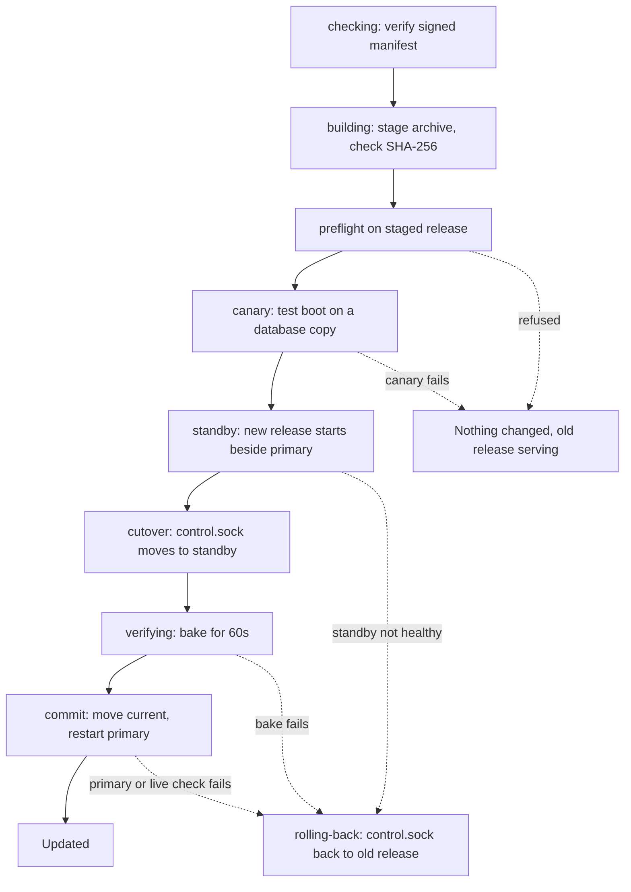

This page covers keeping a self-hosted Skiff current: how versions are numbered, the two ways to update the platform, how worker nodes and managed databases are handled, and how to go back when an update goes wrong. For a first install, see [installation](/self-hosting/installation).

## Versions

Skiff's version is the single line in the repository's `VERSION` file, written as [semantic versioning](https://semver.org) (for example `1.4.0`). Each published release is tagged `v` followed by that number.

To see the version that is running:

- In the dashboard, open **Settings → Updates**. It shows the running version and the newest one available.
- On the server, run `sudo skiff-update-self check`. It prints the running and latest versions and changes nothing.
- Read the `version` field from the readiness document on the server:

```sh
curl -fsS --unix-socket /run/skiff/control.sock http://localhost/readyz | jq -r .version
```

> [!NOTE]
> `skif --version` prints the version of the CLI on your own machine, not the platform. The CLI is released separately.

## How releases are published

When a commit lands on `main` with a `VERSION` that has no release yet, CI runs the tests and builds the control plane, agent, helper, CLI and Caddy for each architecture. It then signs a manifest and publishes everything as a GitHub release named after the version.

The manifest lists the size and SHA-256 of each artifact and is signed with Ed25519 (`manifest.json` and `manifest.json.sig`). The updater accepts a release only when the signature matches a trusted key: the release key built into the updater, or any `*.pub` key in `/etc/skiff/updater/keys/`. It also checks that the manifest's version and repository match what it asked for, and that each downloaded archive matches its signed size and checksum. Anything else is refused before it is installed.

Nothing updates on its own. The dashboard shows a newer version to platform admins, but an update runs only when someone starts it.

## Update from Settings → Updates

Only platform owners and admins can use this page.

1. Click **Check for updates**.
2. Choose how the release is obtained:

| Option | What it does |
|---|---|
| **Automatic** | Installs the newest signed release if one is published, otherwise builds the configured ref from source. |
| **Signed release** | Installs the CI-built release only. Nothing is compiled on the server. |
| **Build from source** | Compiles the configured ref on the server. Slower, and no prebuilt binary runs. |

3. Click **Update to v…** (or **Check and install** when no newer version is known), then confirm.

The page shows each step and a live log while the update runs. The control plane cannot restart itself, so it hands the request to the root-owned `skiff-update-self` on the host, which checks GitHub again before it does anything.

If the page says updates are not enabled on the host, run `sudo skiff-update-self check` once on the server. To change the default method that the dashboard selects, set `SKIFF_UPDATE_METHOD` to `auto`, `download` or `build` in `/etc/skiff/skiff.env`.

## What an update does

The running release keeps serving until the new one has passed its checks. In order:

1. **Stage.** The signed release is downloaded, or the ref is built, next to the running release. At least 2 GiB must be free under `/opt/skiff`.
2. **Preflight.** The updater checks the staged release before anything changes. It refuses when the backup target is unreachable, when free disk space is less than twice the size of the control database, when a data directory is missing or not writable, or when a migration is destructive and not approved. It also refuses a downgrade and any PostgreSQL major-version change.
3. **Snapshot.** The control database, configuration and master key are sealed into `/var/lib/skiff/backups/upgrade-<time>-v<version>/`.
4. **Test boot.** The new release boots against a copy of the database and runs its own canary check.
5. **Standby.** The new release starts beside the running one on its own socket. It must answer `/api/setup/status`, `/login` and `/readyz` within 90 seconds.
6. **Switch.** The control socket is repointed at the new release. Requests already in progress finish where they are.
7. **Bake.** The new release serves real traffic for 60 seconds by default. The updater checks every second that it is still running and answering. If the public URL answered before the update, it must still answer at the end of the bake.
8. **Commit.** The new release becomes the current one, the primary service restarts on it, and the standby stops.

A release that brings database migrations cannot run beside the old one, so its switch is fenced. The old release stops, the snapshot is taken, and the new release migrates the database before it starts. The dashboard and API are unavailable for that window. Sites keep serving, because Caddy is not restarted.

Signed releases also carry Skiff's Caddy build, with the Cloudflare DNS module. When it differs from the installed one, the updater checks that the new binary runs, copies it over the file the `caddy` service runs (normally `/usr/bin/caddy`), keeps the old one as `<path>.skiff-previous` and restarts Caddy once at commit. Open connections to sites drop for that moment. If Caddy does not come back, the old binary is put back and the update is reverted. A release built from source has no Caddy binary. The updater then puts back the binary it last replaced, if there is one, and otherwise leaves Caddy alone.

The diagram shows the same stages in order, with the points where the updater reverts:



### Automatic rollback

- If the **test boot fails**, nothing has changed. The release is recorded as failed and is skipped until you run the update again with `--force`.
- If the **standby, switch or bake fails**, the control socket points back at the old release and it serves again. For a release with migrations, the pre-update control database snapshot is also restored.

Managed databases, object storage, volumes and `skiff.env` are never restored automatically.

## Update from the command line

```sh
sudo skiff-update-self                     # install the newest release, if it is newer
sudo skiff-update-self plan                # run the preflight only
sudo skiff-update-self --source download   # signed releases only; never builds on the host
sudo skiff-update-self --source build --ref main   # build a branch or tag from source
```

The options you are most likely to need:

| Option | Effect |
|---|---|
| `--source auto`, `download` or `build` | The release source. `auto` is the default. `build` compiles `--ref`, which defaults to `main`. |
| `--ref <ref>` | Build this branch, tag or commit. Implies `--source build`. |
| `--dry-run` | Print the plan and change nothing. |
| `--bake <seconds>` | How long the new release must serve traffic before it is committed. Default `60`. |
| `--allow-destructive` | Approve a migration that drops a table or column, or changes a column type, after you have reviewed it. |
| `--force` | Install a release that is not newer, or retry one that failed. |
| `--no-canary` | Skip the test boot. Use only when you have a reason to. |
| `--no-agent` | Leave `skiff-agent` on its old binary. By default it restarts on the new release. |
| `--no-zero-downtime` | Stop the old release before starting the new one, instead of the standby switch. |

`sudo skiff-update-self status` shows the current and previous releases, the last switch, any failed releases and the retained snapshots.

Exit codes: `0` means updated, already up to date or nothing to do. `1` means nothing changed, or the update was rolled back and the old release is serving. `2` means a rollback could not bring the old release back. Act immediately in that case, starting with `journalctl -u skiff-control-plane -n 200`.

## Upgrade with the installer

Re-running the installer with `--upgrade` reuses `/etc/skiff` and the data directory, then builds and activates a new release from source. It downloads the newest release on the host's channel (the latest stable tag, or `main` on canary). Pin a release with `SKIFF_REF`:

```sh
curl -fsSL https://raw.githubusercontent.com/KieranHolroyd/skiff/main/install.sh | sudo env SKIFF_REF=v1.4.0 SKIFF_YES=1 sh -s -- --upgrade --yes
```

The installer takes the same kind of pre-upgrade snapshot. If a step fails, it restores that snapshot and points `current` back at the previous release. It does not check release signatures: it downloads the source for `SKIFF_REF` and builds it on the host. Use `skiff-update-self` for routine updates, which verifies signed releases and rolls back automatically. The installer is the right tool when you want to change install settings or repair a host. See [re-run and upgrade](/self-hosting/installation#re-run-and-upgrade) for the details.

## Worker nodes

Worker nodes run `skiff-agent` and `skiff-helper` from a signed node bundle. Update a node from **Nodes**: open its menu and choose **Update node**, or **Retry update** after a failure. Only platform admins can do this.

- The node downloads the signed bundle, checks its signature and checksum itself, replaces both binaries and restarts them. Sites and workloads keep running. The node shows as offline for a few seconds.
- A node installs only the control plane's own version. It never downgrades.
- After an update, each node checks for the storage tools (`fio`, `nfs-common`, `cifs-utils`) and installs any that are missing, once per version, in the background. This applies to the control-plane host too. Set `SKIFF_HELPER_STORAGE_TOOLS=0` in `/etc/skiff/helper.env` to manage them yourself.
- The menu item is missing when the agent is too old to update itself. Those agents need a one-time manual update first. This page does not cover that; see [nodes and fleet](/self-hosting/nodes-and-fleet).

The control-plane host is not updated from **Nodes**. Its own binaries belong to the release managed by `skiff-update-self`, so use that command for it.

## Managed databases

Updating Skiff does not change the version of any managed database, and databases are not restarted by a platform update.

PostgreSQL major versions are never switched automatically. Plan one with the CLI first:

```sh
skif db upgrade main --to 17 --plan
```

The plan lists blockers, warnings and the manual steps. Add `--apply` to queue a pinned backup and receive the runbook. Skiff does not switch the data directory itself. A platform update's preflight also refuses any requested PostgreSQL major change, so plan it this way instead. See [databases](/data/databases#changing-the-version-and-moving-nodes) for the other engines and for moving a database to another node.

## Maintenance

Skiff has no maintenance mode and no scheduled update window. Updates run when you start them.

**Settings → Maintenance** runs prune. It scans for data that nothing references any more, such as leftovers of deleted projects, orphaned domains and unused releases. You review the plan, and nothing is removed until you confirm. Platform admins can also run a platform-wide prune. The page keeps the history of prune runs and other mass operations for 90 days.

Background housekeeping runs every minute without you. It purges trash past its retention window, expires uploads, prunes logs, and raises alerts for nodes that stop reporting.

## Roll back

Automatic rollback covers an update that fails. To go back by hand, check the state, preview the rollback and then run it:

```sh
sudo skiff-update-self status
sudo skiff-update-self rollback --dry-run
sudo skiff-update-self rollback
```

The previous release is kept until a later update succeeds. Running `rollback` again returns to the release you left.

If the previous release knows every migration in the database, the rollback runs against the existing data. If the database has migrations that the previous release does not know, the rollback stops and asks you to choose:

- `--keep-db` runs the older code against the newer schema. Use it only when you have checked that the older release works with that schema.
- `--restore-db` restores the database snapshot taken when the current release was activated. A copy of the current database is kept.

> [!WARNING]
> `--restore-db` discards every write made to the control database since the last switch. Neither option touches managed databases, object storage or volumes.

Use the command rather than repointing `/opt/skiff/current` by hand. The rollback also restores the release's systemd units and restarts the services. To rebuild the control plane from a sealed snapshot, follow [restoring the control plane](/self-hosting/platform-backups#restoring-the-control-plane). If the service will not start after a rollback, see [troubleshooting](/self-hosting/troubleshooting).
